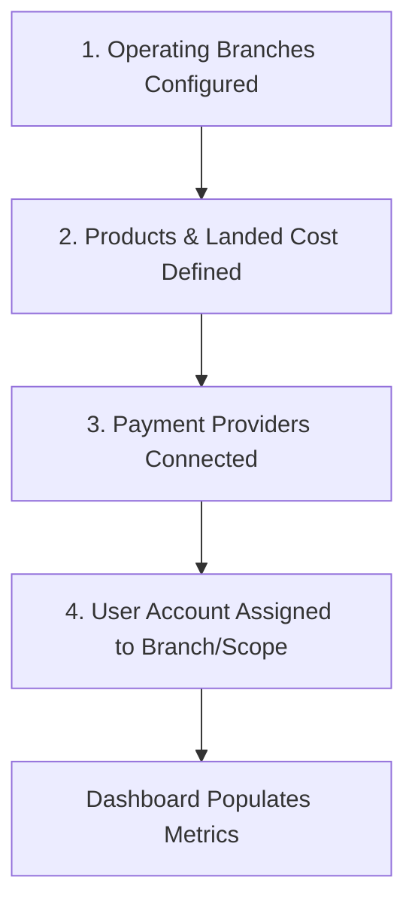

# Guide 01: Business Overview & Dashboard (`/admin`)

The **Business Overview** dashboard is the operational and financial cockpit of QSell. It aggregates company-wide commercial performance in real time across all sales channels, retail branches, warehouse locations, and payment gateways.

---

## 1. Executive Overview & Commercial Value Proposition

### Operational Problems Solved
- **Blind Operations**: Traditional businesses wait until the end of the day or month for accountants to balance physical receipt books and compile spreadsheets, leaving management blind to intraday inventory shortages or slumping sales.
- **Disconnected Branch Visibility**: Multi-location retail and wholesale operations struggle to compare branch performance fairly, resulting in slow-moving stock trapped in one branch while another suffers stockouts.
- **Unreconciled Cash Leakage**: Sales numbers often disguise collection failures. A company may show KES 1,000,000 in sales on paper, but only KES 400,000 in actual bank deposits, with the balance lost to uncollected credit or delayed mobile-money settlements.
- **Invisible Margins**: Heavy discounting by sales staff often inflates top-line revenue while wiping out bottom-line profit.

### Target Client Profiles
- **Multi-Branch Retail Chains**: Supermarkets, electronics stores, and clothing boutiques needing centralized branch rankings and till balances.
- **High-Velocity Wholesalers & FMCG Distributors**: Businesses needing real-time dispatch velocities, receivables ageing, and payment method breakdowns.
- **Executive Directors & C-Suite**: CEOs and CFOs requiring instant access to true gross margin, tax collected, and critical items requiring attention.

### Commercial Sales Pitch & Talk Track
> *"With QSell, you never have to ask your store managers for an end-of-day sales report. The moment an order is punched into a till in Kisumu or checked out on your Nairobi website, your executive dashboard updates instantly. You see not just your total revenue, but the exact cash and M-Pesa collected, your true realized profit margin after product costs, and which specific branch or product is driving your growth today."*

### Measurable ROI & Safeguards
- **100% Intraday Telemetry**: Zero reporting delay between order placement and executive awareness.
- **Direct Collection Audit**: Instantly compares Total Sales vs. Money Collected, exposing payment collection deficits before they turn into bad debts.
- **Realized Margin Tracking**: Monitors gross margin percentage in real time, alerting management when discounts erode product profitability.

---

## 2. Prerequisites & Configuration Sequence

Before the Business Overview dashboard can display complete figures, the following foundational setup must be completed:

1. **Operating Branches**: At least one branch must be active under `Settings > Branches`.
2. **Product Cost Prices**: Products must have their unit purchase cost entered under `Catalog > Products` for the Gross Profit KPI to calculate.
3. **Payment Gateways**: At least one payment provider (M-Pesa, Cash Till, Bank, or Card) must be configured under `Settings > Payments`.
4. **Staff Scope & Permissions**:
   - The user must possess the `dashboard:read` permission.
   - The user must be assigned to either a specific branch (to see localized data) or granted company-wide access (to see consolidated data and the branch filter).

---

## 3. Module Architecture & Telemetry Data Flow

The dashboard dynamically queries multiple operational domains in parallel and calculates real-time comparisons:

```mermaid
graph LR
    subgraph Transactions["Operational Ingestion"]
        ORD[Sales Orders Placed]
        PAY[Payment Gateways Confirmed]
        DEL[Delivery Statuses]
        STK[Inventory Thresholds]
    end

    subgraph Aggregator["Reporting Engine"]
        PERIOD[Date Period & Comparison Calculator]
        SCOPE[Branch Security & Currency Filter]
        FLOW[Order Flow Classifier]
    end

    subgraph DashboardView["Executive Presentation"]
        CARDS[KPI Cards & Sparklines]
        CHART[Trend Charts vs Previous Period]
        BRANCH[Branch Ranking Table]
        ATTN[Actionable Attention Queue]
    end

    Transactions --> Aggregator
    Aggregator --> DashboardView
```

- **Scope Boundary**: If a staff member is assigned to the "Mombasa Branch", the system automatically restricts all queries to orders, payments, and stock originating from that branch.
- **Currency Isolation**: All values are reported in the company's Base Currency (e.g., KES). Transactions placed in secondary foreign currencies (USD, EUR) are flagged in an informational footnote with order counts.

---

## 4. Interface-by-Interface Walkthrough

The Dashboard consists of five integrated functional sections:

### Section A: Top Filter & Date Range Bar
- **Preset Period Selector**: Quick-jump dropdown for rapid temporal slicing.
- **Comparison Mode Selector**: Configures the comparative baseline against which percentage growth/decline is measured.
- **Branch Scope Selector**: Dropdown to switch between company-wide consolidation or a specific branch.
- **Last Updated & Refresh Indicator**: Displays the exact timestamp the data was pulled and the active timezone (e.g., Africa/Nairobi).

### Section B: Executive Headline & Attention Banner
- **Headline Summary**: Natural-language sentences summarizing current performance (e.g., *"Sales are up 14% compared to the previous 30 days, driven by Central Store."*).
- **Attention Queue (`AttentionList`)**: Visual callout cards for items requiring immediate human intervention:
  - *Unpaid Orders Pending Delivery*
  - *Failed or Timed-Out Gateway Payments*
  - *Low Stock / Depleted SKUs*
  - *Late Delivery SLA Breaches*

### Section C: Sales Performance & Order Flow (`Card: Sales`)
- **Key Metric Tiles**:
  - `Sales`: Total gross revenue from valid orders placed in the selected period.
  - `Orders`: Total number of qualifying orders.
  - `Average Order Value (AOV)`: Gross Sales divided by Order Count.
  - `Tax Included in Sales`: Total VAT and consumption taxes included in the reported sales total.
- **Revenue Trend Chart**: Daily or hourly sales graph plotting the current period's velocity against the comparative prior period.
- **Order Flow Breakdown**: Visual status bar and breakdown table showing where placed orders ended up:
  - *Counted in Sales*: Completed, In-Transit, Awaiting Fulfillment, Credit Sales.
  - *Excluded from Sales*: Abandoned Checkouts, Cancelled by Customer, Payment Failed, Refunded.
- **Sales by Branch Table**: Multi-column comparison listing Branch Name, Revenue, Revenue Share %, Total Orders, and Growth % vs. Prior Period.
- **Best Sellers Ranking**: Top products by revenue, showing units sold and gross income.

### Section D: Money Collected & Liquidity (`Card: Money Collected`)
- **Collected Revenue**: Total cleared funds received through payment gateways and cash registers.
- **Collection Rate %**: `(Money Collected ÷ Gross Sales) × 100`. 
  - *Note*: Can exceed 100% when credit customers settle invoices from previous months.
- **In-Flight & Failed Payment Audit**: Flags customer transactions currently processing vs. abandoned.
- **Payment Method Distribution**: Metered progress bars showing the percentage and shilling value collected via M-Pesa Paybill, Cash Till, Bank Transfer, and Credit Cards.
- **Non-Cash Tenders Notice**: Footnote disclosing value paid via Loyalty Points redemptions and Gift Cards.

### Section E: Gross Profit & Margin Control (`Card: Gross Profit`)
- **Gross Profit (KES)**: Realized profit calculated as `Selling Price - Unit Cost Price`.
- **Gross Margin %**: `(Gross Profit ÷ Gross Sales) × 100`.
- **Uncosted Items Notice**: Warns if products without an entered cost were sold, preventing distorted margin figures.

---

## 5. Granular Field-by-Field Reference

| Control / Metric | Type | Purpose | Validation & Rules |
|---|---|---|---|
| **Period Preset** | Dropdown | Sets the time window for all metrics. | Options: `Today`, `Yesterday`, `Last 7 Days`, `Last 30 Days`, `This Month`, `Last Month`, `Custom`. |
| **Compare Mode** | Dropdown | Determines the comparison baseline. | Options: `Previous Period` (same duration immediately preceding), `Previous Year` (same dates last year). |
| **Branch Scope** | Dropdown | Filters metrics to a specific operational unit. | Disabled if the logged-in user lacks multi-branch view rights. Shows "All Branches" or specific branch names. |
| **From Date** | Date Input | Custom period start date. | Format `YYYY-MM-DD`. Must be earlier than or equal to `To Date`. |
| **To Date** | Date Input | Custom period end date. | Format `YYYY-MM-DD`. Cannot be a future date beyond current server time. |
| **Sales KPI** | Currency | Gross monetary value of valid orders. | Formatted in base currency (KES) with thousands separators. Excludes cancelled and refunded orders. |
| **Collection Rate** | Percentage | Ratio of cash received to sales booked. | Displayed to 1 decimal place. Highlights liquidity health. |
| **Gross Margin** | Percentage | Operating profitability ratio. | Color-coded: Green for healthy margins, Amber for marginal, Red for negative gross profit. |

---

## 6. Step-by-Step User Actions (Down to the Last Click)

### Action 1: Analyzing Today's Intraday Performance
1. Navigate to `/admin` in the sidebar.
2. Locate the **Period** dropdown in the top filter bar.
3. Click the dropdown and select **Today**.
4. The screen refreshes without full page reload.
5. Review the **Sales** tile to see today's revenue generated since 00:00.
6. Check the **Money Collected** tile to verify that cash/M-Pesa deposits match order revenue.
7. Click any item in the **Attention Queue** (e.g., *"3 orders pending dispatch"*) to jump directly to the pre-filtered order processing screen.

### Action 2: Comparing Branch Sales for Monthly Review
1. In the top filter bar, set **Period** to **This Month**.
2. Set **Compare** to **Previous Period** (or **Previous Year** for seasonal analysis).
3. Scroll down to the **Sales by branch** table.
4. Review the **Share %** column to identify your highest-volume branch.
5. Review the **vs Previous Period** column:
   - Positive numbers indicate revenue growth.
   - Negative numbers indicate underperformance requiring operational review.
6. Click the **Branch** dropdown in the top filter bar and select the specific underperforming branch to isolate its top sellers and order bottlenecks.

### Action 3: Reviewing Payment Method Health & Failed Transactions
1. Locate the **Money collected** card.
2. Inspect the **In-Flight & Failed Payments** status banner.
3. If failed payment attempts are flagged, note the count.
4. Review the breakdown list of payment methods:
   - Identify whether M-Pesa Paybill or In-Store Cash represents the primary liquidity source.
   - Note any funds flagged under *"unconfigured methods"* (payments received on legacy tills no longer assigned to branches).

---

## 7. Conditions, Business Rules & Edge Cases

### Order Qualification Rules (What Counts as a Sale?)
- **Counted in Sales**:
  - Orders marked as `Completed`, `Delivered`, `Dispatched`, `Processing`, or `Confirmed`.
  - Credit sales with approved payment terms (invoiced to customer account).
- **Excluded from Sales**:
  - Abandoned online shopping carts where the customer exited before checkout.
  - Payment attempts that returned `Failed`, `Cancelled`, or `Expired` from Safaricom or card processors.
  - Orders formally cancelled or refunded.

### Multi-Branch Permission Boundary
- If a user has `branches:read` and `dashboard:read` across the company, they see consolidated numbers and can toggle between branches.
- If a user is restricted to a single branch (e.g. "Westlands Branch"), the branch dropdown is locked, and the `byBranch` comparison table is hidden to prevent competitive data leakage among branch staff.

### Zero-Activity State Handling
- If a newly launched shop or branch has zero orders in the selected period, the dashboard displays:
  - A clean empty state: *"No orders were placed in this period."*
  - A dynamic jump button: *"Show the 30 days up to [Last Order Date]"* allowing managers to quickly review the last active sales period without guessing dates.

---

## 8. Implementor Checklist & Go-Live Verification

| Step | Verification Task | Expected Result | Pass/Fail |
|---|---|---|---|
| 1 | Create a test branch and assign products to it. | Branch appears in the dashboard branch filter dropdown. | [ ] |
| 2 | Place a test order for KES 5,000 using M-Pesa. | Sales KPI increases by KES 5,000; Orders KPI increments by 1. | [ ] |
| 3 | Confirm M-Pesa payment reception. | Money Collected tile updates by KES 5,000; Collection Rate reflects 100%. | [ ] |
| 4 | Log in as a Branch-Restricted Cashier. | Dashboard only shows data for the cashier's assigned branch. | [ ] |
| 5 | Verify Gross Margin calculation. | Product cost is subtracted from KES 5,000; accurate gross margin % is displayed. | [ ] |
