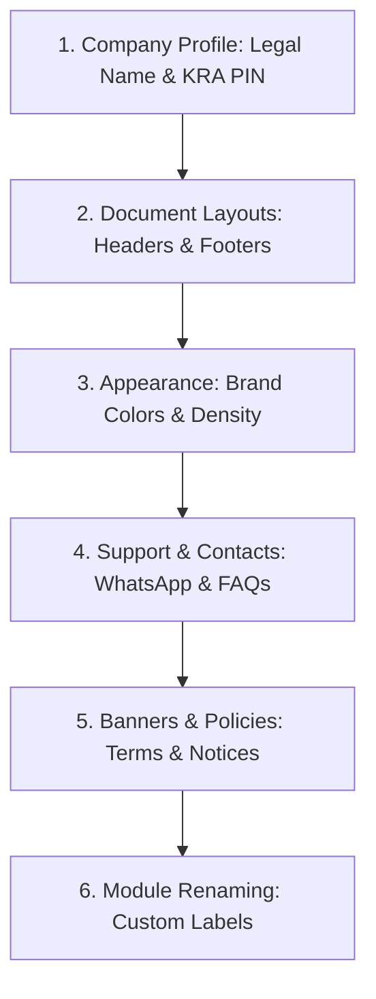
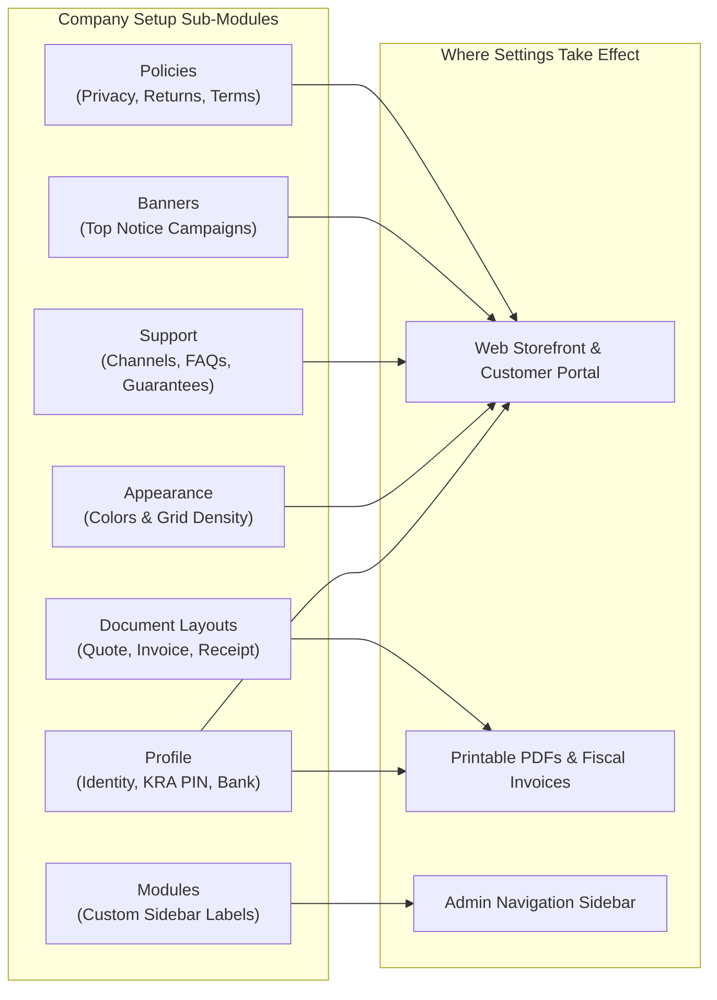

# Guide 02: Company Setup & Storefront Identity (`/admin/company`)

The **Company Setup** module establishes the legal, fiscal, operational, and visual identity of the business. It governs how the company presents itself to customers on the web storefront and how legal identity, tax information, and banking instructions appear on formal commercial documents (quotes, invoices, and receipts).

---

## 1. Executive Overview & Commercial Value Proposition

### Operational Problems Solved
- **Inconsistent Branding Across Channels**: Businesses frequently struggle with fragmented brand images—a web shop that looks different from printed counter receipts, and quotes that lack professional banking instructions.
- **KRA Tax Invoicing Compliance Risks**: Failing to display an exact legal name, physical address, and KRA PIN on invoices invalidates customer input tax deductions and incurs penalties from the Kenya Revenue Authority.
- **Costly Custom Development for Simple Storefront Changes**: Minor changes like changing a brand accent color, updating a customer service WhatsApp number, or posting a temporary delivery banner usually require hiring external web developers.

### Target Client Profiles
- **Branded Consumer Retailers & E-Commerce Merchants**: Businesses requiring an online storefront that mirrors their physical store branding and corporate identity.
- **B2B Suppliers & Corporate Wholesalers**: Organizations issuing proforma quotations and credit invoices requiring legal terms, VAT registration numbers, and wire transfer bank details.

### Commercial Sales Pitch & Talk Track
> *"With QSell, you can launch a fully branded, legally compliant online store and ERP in minutes. You don't need a web developer to change your brand colors, update your customer service hotline, or customize your invoice footer notes. Enter your details once in the Company Setup module, and every quote, invoice, receipt, and web page instantly updates with your brand, your KRA PIN, and your direct bank details."*

### Measurable ROI & Safeguards
- **Zero Developer Fees for Brand & Storefront Management**: 100% no-code configuration of colors, grid density, banners, FAQs, and policies.
- **100% Tax Document Legality**: Guarantees that every printed and emailed invoice satisfies Section 23 of the Kenyan Tax Procedures Act.

---

## 2. Prerequisites & Configuration Sequence

Company Setup is the **Stage 1 Foundation** of the entire QSell platform. It should be configured before adding products, creating users, or transacting.



- **Required Staff Permission**: Users must possess the `company:read` permission to view and `company:write` (or administrative role) to save changes.

---

## 3. Module & Sub-Module Architecture

Company settings are organized into seven distinct sub-modules under `/admin/company`:



---

## 4. Interface-by-Interface Walkthrough

### Sub-Module 1: Profile (`/admin/company/profile`)
Configures the core identity of the business. Divided into five sections:
1. **Brand & Logo**: Live visual brand card preview and high-resolution logo upload.
2. **Identity & Tax**: Legal entity name, public trading name, KRA PIN, VAT number, and business registration certificate number.
3. **Address & Location**: Physical street address, city, county/state, postal code, country, and landmark location label.
4. **Contact**: Primary corporate email, mobile phone (M-Pesa enabled), landline telephone, and official website URL.
5. **Banking**: Primary bank name, branch name, account name, and bank account number for wire transfers.

### Sub-Module 2: Document Layouts (`/admin/company/documents`)
Controls the appearance and custom text printed on customer-facing paper and PDF documents:
- **Quotes**: Header text, footer notes (e.g. *"Valid for 30 days. Prices inclusive of 16% VAT"*), and alignment.
- **Invoices & Proforma Invoices**: Payment instructions, bank details placement, tax breakdown notes, and late interest warnings.
- **Receipts**: Counter receipt footers (e.g. *"Goods once sold cannot be returned without receipt"*), cashier signature line, and QR code placement.

### Sub-Module 3: Appearance (`/admin/company/appearance`)
Governs the visual design of the customer storefront:
- **Primary Color**: Interactive color picker setting buttons, links, and checkout action buttons.
- **Accent Color**: Color picker setting invoice brand marks, highlights, and promotional tags.
- **Product Listing Density**: Configures desktop product catalog grid columns (3, 4, or 5 products per row) with live responsive previews.

### Sub-Module 4: Modules (`/admin/company/modules`)
Allows businesses to rename standard admin navigation modules to match company terminology (e.g. renaming *"Sales Quotes"* to *"Estimates"*, or *"Vendor Management"* to *"Purchasing"*).

### Sub-Module 5: Support (`/admin/company/support`)
Configures the storefront customer helpdesk:
- **Contact Channels**: Interactive list of support options (WhatsApp Chat, Telephone, Email, Physical Office) with operational hours.
- **Customer Guarantees**: Trust badges shown across the web shop (e.g. *"Same-Day Nairobi Delivery"*, *"30-Day Money Back Guarantee"*, *"Official Authorized Distributor"*).
- **Frequently Asked Questions (FAQs)**: Accordion FAQ builder with drag-and-drop reordering, generating structured FAQ rich data for Google search.

### Sub-Module 6: Banners (`/admin/company/banners`)
Manages site-wide announcement banners displayed across the top of the storefront (e.g., *"Holiday Sale: 15% off all solar panels until Friday!"*). Supports start/end scheduling and call-to-action buttons.

**Look and attention options (per banner, up to five banners):**
- **Colours**: by default a banner has the shop's usual look. Tick *Use my own colours* to choose a background (five ready-made colours or any colour of your choice) and a text colour. A readability check shows the contrast; if the chosen text cannot be read on the background, the shop automatically uses white or dark text instead, so a banner can never show unreadable words. *Pick the text colour for me* returns to automatic.
- **Picture** (optional): upload a PNG, JPEG, WebP, GIF or AVIF picture; it appears beside the headline and can be removed.
- **Movement**: *Still* (default), *Scrolling marquee* (words move across; visitors can pause it, it pauses under the pointer, and it does not move for people whose device asks for less motion) or *Pulsing glow*. A marquee has a *Scrolling speed* of Slow, Normal or Fast.
- **Size**: *Normal*, or *Large* (bigger type and more room) for a sale or a closing date.
- A live preview under each banner shows how it will look in the shop.

### Sub-Module 7: Policies (`/admin/company/policies`)
Dedicated rich-text editors for mandatory legal and operational pages:
- **Privacy Policy**: Data protection compliance.
- **Delivery Policy**: Delivery zones, turnaround times, and customer obligations.
- **Return & Refund Policy**: Return windows, condition requirements, and refund methods.

---

## 5. Granular Field-by-Field Reference

### Company Profile Fields (`/admin/company/profile`)

| Field Label | Purpose | Type & Format | Required? | Validation Rules & Hints |
|---|---|---|---|---|
| **Logo** | Brand mark on shop & invoices. | Image Upload | Optional | Accepts PNG, JPEG, WebP, SVG up to 2MB. Square or landscape. |
| **Storefront Tagline** | Subtitle below brand name. | Text (Max 120 chars) | Optional | e.g., *"Solar PV & Electrical Supplies"*. |
| **Legal Name** | Official registered company name. | Text (Max 120 chars) | **Required** | Must match Certificate of Incorporation. |
| **Trading Name** | Public brand name seen by customers. | Text (Max 120 chars) | **Required** | Displayed in website header and titles. |
| **KRA PIN** | Corporate tax identification number. | Text (Monospace, 11 chars) | **Required** | Must match pattern: Letter (`A` or `P`), 9 digits, ending in a letter (e.g. `P051234567Z`). |
| **VAT Number** | Value Added Tax registration number. | Text (Max 40 chars) | Optional | Displayed on tax invoices when populated. |
| **Registration Number** | Company registrar certificate number. | Text (Max 40 chars) | Optional | Displayed in legal footer notes. |
| **Invoice Prefix** | Default sequence prefix for invoices. | Text (Max 10 chars, uppercase) | **Required** | Default `INV`. e.g. `INV-` yields `INV-0001`. |
| **Street Address** | Physical office or warehouse location. | Text (Max 160 chars) | **Required** | e.g. *"Enterprise Road, Industrial Area, Godown #4"*. |
| **City** | Operating city. | Text (Max 80 chars) | **Required** | e.g. *"Nairobi"*. |
| **County / State** | County or administrative state. | Text (Max 80 chars) | **Required** | e.g. *"Nairobi County"*. |
| **Postal Code** | Postal delivery code. | Text (Max 20 chars) | **Required** | e.g. *"00100"*. |
| **Country** | Operating country. | Text (Max 80 chars) | **Required** | e.g. *"Kenya"*. |
| **Location Label** | Landmark description for customers. | Text (Max 120 chars) | Optional | e.g. *"Opposite City Cabanas"*. |
| **Email** | Official corporate email. | Email format (Max 160 chars) | **Required** | Valid email address. |
| **Phone (Mobile)** | Primary telephone for customer calls. | Telephone (Max 25 chars) | **Required** | Safaricom/Airtel format e.g. `+254 712 345 678`. |
| **Tel (Landline)** | Fixed line phone. | Telephone (Max 25 chars) | Optional | e.g. `+254 20 123 4567`. |
| **Website** | Web address. | URL format (Max 200 chars) | Optional | Must include `https://`. |
| **Bank Name** | Commercial bank holding primary account. | Text (Max 120 chars) | Optional | e.g. *"KCB Bank Kenya"*. |
| **Branch** | Bank branch name. | Text (Max 120 chars) | Optional | e.g. *"Industrial Area Branch"*. |
| **Account Name** | Exact name on bank account. | Text (Max 120 chars) | Optional | Must match wire transfer instructions. |
| **Account Number** | Bank account digits. | Text (Max 40 chars) | Optional | Account number printed on invoices. |

---

## 6. Step-by-Step User Actions (Down to the Last Click)

### Action 1: Uploading and Saving the Company Logo & Profile
1. Navigate to `/admin/company/profile`.
2. In the **Brand & logo** section, click **Upload logo** (or drag and drop an image file into the drop zone).
3. The uploaded logo previews immediately inside the **Brand preview** card.
4. Fill in the **Legal name**, **Trading name**, and **KRA PIN** fields.
5. In the **Address & location** section, enter the physical street address, city, and county.
6. In the **Banking** section, enter the bank name and account number where customer wire transfers should be directed.
7. Click the **Save profile** button in the top right header.
8. The button displays *"Saving…"*, then returns to *"Save profile"*.
9. A green confirmation banner displays: *"Company profile saved."*

### Action 2: Customizing Document Header and Footer Notes
1. Navigate to `/admin/company/documents`.
2. Scroll to the **Invoices and proforma invoices** card.
3. In the **Header text** box, enter any special notice (e.g. *"Tax Invoice — Original"*).
4. In the **Footer text** box, enter direct payment instructions:
   ```text
   Please pay via M-Pesa Paybill: 123456, Account: [Invoice Number]
   Or Wire to KCB Bank, Account: 1122334455, Industrial Area Branch.
   Goods remain property of the company until paid in full.
   ```
5. Click **Save document layouts** in the top header.
6. A success message confirms: *"Document layouts saved."* Every future invoice generated will include this footer.

### Action 3: Setting Up a Customer Service WhatsApp Channel
1. Navigate to `/admin/company/support`.
2. Locate the **Contact channels** section and click **Add channel**.
3. In the **Channel kind** dropdown, select **WhatsApp**.
4. In the **Label** field, enter *"Customer Care Desk"*.
5. In the **Value** field, enter the international WhatsApp phone number (e.g., `+254712345678`).
6. In the **Hours** field, enter *"Mon - Sat: 8:00 AM - 6:00 PM"*.
7. Click the **Save support settings** button.
8. The WhatsApp floating chat widget on the web shop immediately activates with this number.

---

## 7. Conditions, Business Rules & Edge Cases

### KRA PIN Format Validation
- The system enforces strict regular expression validation on the `kraPin` field:
  - Must begin with letter `A` (individual/sole proprietor) or `P` (company/partnership).
  - Must contain exactly 9 numeric digits.
  - Must end with a single alphabetic letter.
- If an invalid PIN is entered (e.g. `12345678` or `P05123456`), the save action is rejected with the message: *"KRA PIN must be a letter (A or P), nine digits and a letter."*

### Document Sizing and Print Ratios
- Uploaded logos are automatically resized on invoices to maintain a maximum height of 60px and maximum width of 240px, preventing document pagination overflow.
- If no logo is uploaded, the document header gracefully falls back to displaying the `Trading Name` in bold 18pt typography.

---

## 8. Implementor Checklist & Go-Live Verification

| Step | Verification Task | Expected Result | Pass/Fail |
|---|---|---|---|
| 1 | Enter company profile and valid KRA PIN. | Green banner confirms profile saved without validation errors. | [ ] |
| 2 | Upload corporate logo (PNG format). | Logo renders cleanly in storefront header and document preview. | [ ] |
| 3 | Change Brand Primary Color to company brand color. | Storefront buttons and active admin highlights reflect new color. | [ ] |
| 4 | Print a sample Sales Quote PDF. | Header displays trading name, KRA PIN, address, and custom footer notes. | [ ] |
| 5 | Verify Storefront Footer Links. | Privacy, Delivery, and Return policies render cleanly when clicked. | [ ] |
