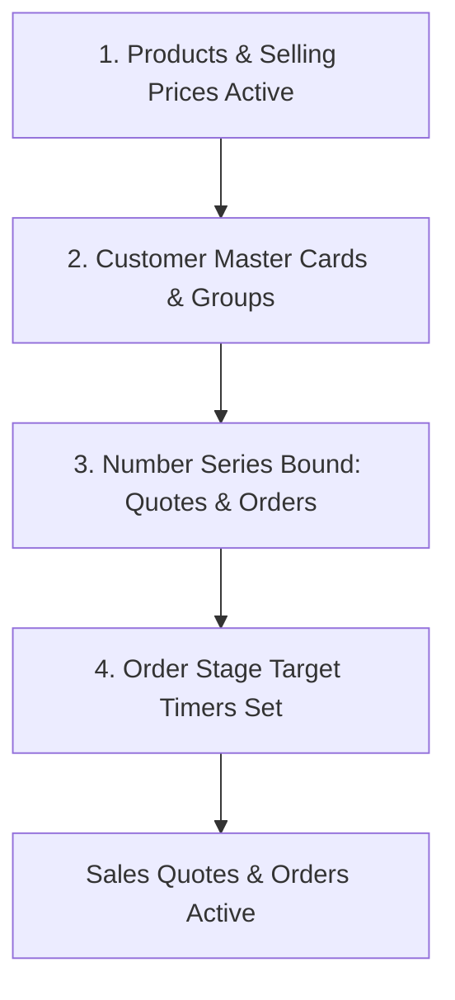
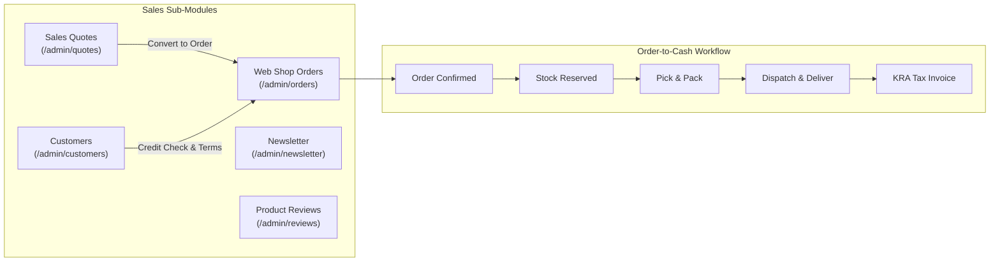

# Guide 03: Sales Quotes & Web Shop Orders (`/admin/sales`)

The **Sales & Fulfillment** module orchestrates the complete Order-to-Cash (O2C) lifecycle. It manages proforma sales quotations, omnichannel customer orders (online storefront, physical point-of-sale, and back-office credit sales), customer master cards, credit limit enforcement, newsletter subscribers, and product reviews.

---

## 1. Executive Overview & Commercial Value Proposition

### Operational Problems Solved
- **The Delivery & Fulfillment Blame Game**: When an order is delivered late or items go missing, sales reps blame the warehouse, warehouse staff blame the dispatcher, and dispatchers blame the courier. QSell eliminates this through an **immutable, server-timestamped order timeline** that tracks the exact second an order entered and exited every stage (Received $\rightarrow$ Confirmed $\rightarrow$ Reserved $\rightarrow$ Picked $\rightarrow$ Packed $\rightarrow$ Dispatched $\rightarrow$ Delivered).
- **Uncontrolled Credit Overextension**: Sales reps often accept orders from customers who have exceeded their credit limits or have 90-day overdue invoices. QSell enforces hard credit limit checks at order placement, automatically blocking unapproved credit orders.
- **Friction in B2B Quotation Negotiations**: B2B deals require multi-line formal proforma quotes with negotiated discounts and validity dates. In manual systems, quotes are made on spreadsheets and must be re-typed into the accounting system when won. QSell converts quotes to confirmed sales orders in a single click with zero data re-entry.

### Target Client Profiles
- **Wholesalers & B2B Trade Distributors**: Managing formal quotations, corporate customer accounts, credit terms (Net 30, Net 60), and multi-branch delivery schedules.
- **Omnichannel Retailers**: Processing walk-in counter sales alongside high-volume e-commerce orders.
- **Field Sales Teams**: Generating field quotes on tablets that link directly to warehouse inventory.

### Commercial Sales Pitch & Talk Track
> *"With QSell, your sales team moves deals from quotation to cash with zero friction and 100% accountability. Every quote you generate can be converted into a live sales order with a single click. Every single order is tracked with an unalterable server timestamp at every milestone—so you know exactly how long an order took to be picked in the warehouse, when it was handed to the rider, and the exact second the customer signed for it at the door."*

### Measurable ROI & Safeguards
- **Zero Double-Entry Overhead**: Quotes instantly convert to Orders, Orders to Packing Slips, and Orders to KRA-signed Invoices.
- **Elimination of Bad Debts**: Automatic credit-ceiling enforcement blocks orders when customers exceed agreed limits.
- **Order SLA Enforcement**: Real-time alerts when orders languish in picking or packing beyond target thresholds.

---

## 2. Prerequisites & Configuration Sequence

1. **Active Sellable Products**: Products must be assigned a business classification marked as *"Sold to Customers"* with active selling prices.
2. **Customer Master Cards**: Cash or credit customer accounts must exist under `/admin/customers/list`.
3. **Number Series**: Document number series for Sales Quotes (`QT-`) and Sales Orders (`ORD-`) must be active under `Settings > Number Series`.
4. **Order SLA Targets**: Stage timeout targets should be defined under `Settings > Order Targets` to trigger late-stage notifications.
5. **Staff Permissions**:
   - `quotes:read`, `quotes:manage`: Access and manage quotations.
   - `orders:read`, `orders:manage`: Process orders and print packing slips.
   - `customers:read`, `customers:manage`: Create and edit customer cards.

---

## 3. Module & Sub-Module Architecture

The Sales module coordinates five operational areas:

---

## 4. Interface-by-Interface Walkthrough

### Sub-Module 1: Sales Quotes (`/admin/quotes`)
- **Quotes List View (`QuotesTable`)**: Paged table showing Quote Number, Customer Name, Issue Date, Expiration Date, Total Amount, and Status (`Draft`, `Sent`, `Accepted`, `Converted`, `Expired`, `Rejected`). A **Staff** column names the person who created the quote and the person who emailed it to the customer ("Not emailed yet" until it is sent), so a manager can see who is responsible for each quote at a glance.
- **Quote Creation & Editor (`QuoteEditor`)**:
  - Customer selection with instant customer credit standing preview.
  - Line-item editor: SKU selection, unit of measure, quantity, base price, discount %, and tax rate.
  - Real-time calculation toolbar: Subtotal, total discount, VAT, and grand total.
  - Validity expiration date picker and customer memo notes.
- **Quote windows**: The quote editor and the quote detail window open extra wide so the lines, prices and margins sit side by side; on a phone they fill the screen.
- **Quote Detail Modal (`QuoteDetails`)**: Opens with *Created by* (name and time) and *Emailed to customer by* (name and time of the latest send), then shows the full proforma document view with actions to **Print PDF**, **Send via Email**, **Accept**, or **Convert to Order**.

### Sub-Module 2: Web Shop Orders (`/admin/orders`)
- **Orders List View**: Shows only orders placed through the web shop, including ones a shopper bought on account (their invoice is a credit sale, but the order still belongs here). Search by order number, customer, phone, email or tracking number; filter by Status (`Pending`, `Confirmed`, `Processing`, `Dispatched`, `Delivered`, `Cancelled`), Payment Status (`Unpaid`, `Paid`, `Partial`), and Branch.
- **Order Details Modal (`OrderDetailsModal`)**: Comprehensive multi-tab operational hub:
  1. **Order Summary Tab**: Order lines, quantities, unit prices, applied coupons, delivery fees, and grand total.
  2. **Stage Timeline Panel (`OrderTimelinePanel`)**: Visual vertical timeline showing every stage event with exact server timestamps, actors, and duration spent in each stage.
  3. **Deliveries Panel (`OrderDeliveriesPanel`)**: Shows partial and complete dispatches, courier tracking numbers, and delivery run links.
  4. **Stock Allocation Panel (`OrderStockPanel`)**: Shows warehouse reservations, batches allocated, and goods issue status.
  5. **Collection Panel (`OrderCollectionPanel`)**: Payment method, gateway reference, M-Pesa receipt code, and door cash collection status.
  6. **KRA Invoice Preview (`OrderInvoicePreview`)**: Electronic tax invoice details, KRA digital signature code, and QR verification code.

### Sub-Module 2A: Preparation sheet (`/admin/orders/preparation`)
For a business that makes what it sells to order (meals, catering, assembled sets), the sheet says **what has to be made for a day**. Permission: *orders read*. It is read from the exact choices saved with each order that holds a configurable package (guide 05, Packages), not from the order lines, which fold the parts of different servings together and no longer say which fish went with which ugali.
- **Day**: pick a date (it opens on today), press **Today**, press a day in the strip of the coming days that have orders (each shows its servings), or press **Orders with no date** for orders of packages that did not ask for one. The date is the one the order is for (the delivery time the shopper chose, or the date on the quote or order).
- **Totals**: servings in how many orders; servings of each package; and each chosen part with the **portions** wanted (servings times picks, so *Large fish 9*) and, when a part comes in more than one unit per portion, the **units** (*Ugali 12 (24 units)*), most wanted first.
- **Under the totals**, grouped by **delivery time** (earliest first, orders with no time last) and by package: every order's own choices as "9 × Large fish and Ugali", with the order number, the customer, and the payment state when it is not paid. Identical choices on different orders stay as separate lines, because each has its own order to prepare for.
- A **cancelled order is not on the sheet**; if its servings were counted before, the totals drop by them at once. One sheet shows up to 2,000 selections and says so when there are more.
- **Print** prints only the sheet (the menu and top bar are left out) so it can be pinned in the kitchen. The screen works on a phone.
- A **customer's note** on a serving ("no pepper", where the package takes notes) is printed under its selection in amber, so it cannot be missed.
- **Not built yet**: a per-package filter and a count of what is already made.

### Sub-Module 3: Customers (`/admin/customers`)
- **Customer Hub (`/admin/customers`)**: Customers is a parent module like Sales and Pricing. It reveals **List** (`/admin/customers/list`) and **Customer groups** (`/admin/pricing/groups`); the directory is only shown after **List** is chosen.
- **Customer Directory (`/admin/customers/list`)**: Searchable, paged table (cards on a phone) showing Account Code, Customer Name, Tax PIN, Account Type (`Cash` or `Credit`), Balance Owed, Credit Limit, KRA transmission, and Blocked status. Each row has separate **Open** and **Edit** actions. **Open** never opens the edit form.
- **Customer Centre (`/admin/customers/{id}`)**: What **Open** reaches. It shows customer information (contact, address, profile, tax PIN, terms, credit limit, notes), the balance and open-item count, and the statement with transactions, ageing, wallet, and PDF actions when the user has the matching finance permissions. A visible **Edit customer** action leads to the card editor.
- **Customer Card Editor (`/admin/customers/{id}/edit`)**: The dedicated edit screen reached from the row's **Edit** action or the centre. It uses the same card form as **New customer**: identity and tax PIN, account type, profile, credit limit and terms, KRA flag, and dimension bindings (`DimensionFields`). Saving returns to the customer centre.
- **Customer groups (`/admin/pricing/groups`)**: Wholesale, retail, VIP and other price groups; managed by the pricing permissions even though the entry sits under Customers.

### Sub-Module 4: Newsletter (`/admin/newsletter`)
- List of customer email subscribers captured via storefront footers and popups.
- Export to CSV action for email marketing campaigns (Mailchimp, Sendgrid).

### Sub-Module 5: Product Reviews (`/admin/reviews`)
- Customer review moderation queue showing Product Name, Customer Name, Star Rating (1-5), Review Headline, Review Body, and Submission Date.
- Action buttons: **Approve Review** (publishes to storefront) or **Reject / Archive** (removes from public display).

---

## 5. Granular Field-by-Field Reference

### Sales Quote Editor Fields (`/admin/quotes/new`)

| Field Label | Purpose | Type & Format | Required? | Validation Rules & Hints |
|---|---|---|---|---|
| **Customer** | Account receiving the quote. | Lookup Autocomplete | **Required** | Type 2+ characters to search customer cards. |
| **Quote Date** | Issue date. | Date (YYYY-MM-DD) | **Required** | Defaults to today's date. |
| **Hide the customer details (Bill To) on the quote document** | Customer name, email, phone and billing address are printed on the quote by default. Tick this to leave them off. | Checkbox | Optional | Off by default for every new quote, so the customer details appear. Quotes saved before this change keep what they had. A quote template has the same box and passes its choice on to quotes made from it. |
| **Valid Until** | Expiration date of quoted prices. | Date (YYYY-MM-DD) | **Required** | Must be $\ge$ Quote Date. Quotes cannot be converted after this date. |
| **Branch** | Fulfilling branch location. | Dropdown | **Required** | Determines inventory availability checks. |
| **Product Line: SKU** | Product item. | Lookup Autocomplete | **Required** | Must be an active, sellable product. |
| **Product Line: Qty** | Number of units quoted. | Decimal / Integer | **Required** | Must be $> 0$. Validated against unit of measure decimals. |
| **Product Line: Price** | Unit selling price. | Currency (KES) | **Required** | Defaults to price list. Cannot violate price floor. |
| **Product Line: Discount** | Line-item discount percentage. | Percentage (0-100%) | Optional | Capped by user's role override limit. |
| **Needed On** | The date the goods or the meal are needed. Packages with notice, closing-time, day-of-week or daily-limit rules are checked against it when the quote becomes an order. | Date (YYYY-MM-DD) | Optional (needed for such packages) | Without it, a quote of a package with date rules is refused at conversion with "choose the date you need it". |
| **Add a package** (button) | Sells a configurable package (such as an express lunch) on the quote, choosing its options with the same builder the shop uses. | Dialog: package picker, then the builder | Optional | Only active packages are offered. Every option can be chosen whatever stock says (a quote promises nothing from the shelves). The line's price is set by the package (base price plus what the choices add, or the choices added up) and cannot be typed; a discount percentage can still be given. |
| **Package line: Change choices** | Reopens the builder on the choices kept on the line. | Button on the line | n/a | A part the package no longer offers is named and left empty so a replacement can be chosen. |
| **Notes / Terms** | Commercial stipulations on quote. | Text (Max 500 chars) | Optional | Printed on proforma footer (e.g., *"Lead time 7 days"*). |

### Customer Card Fields (`/admin/customers/new`)

| Field Label | Purpose | Type & Format | Required? | Validation Rules & Hints |
|---|---|---|---|---|
| **Account Type** | Determines payment requirements. | Radio Selector | **Required** | `Cash` (must pay before dispatch) or `Credit` (invoiced). |
| **Customer Name** | Full legal or business name. | Text (Max 120 chars) | **Required** | Displayed on tax invoices. |
| **KRA PIN** | Customer's tax registration. | Text (11 chars) | Optional for Retail, **Required for B2B** | Must be a valid KRA PIN format for B2B eTIMS transmission. |
| **Phone Number** | Primary mobile contact. | Phone (Max 25 chars) | **Required** | Used for delivery SMS notifications and M-Pesa STK push. |
| **Email Address** | Invoicing email. | Email (Max 160 chars) | Optional | PDF invoices and proformas are dispatched here. |
| **Credit Limit** | Maximum outstanding balance allowed. | Currency (KES) | Required if Credit | e.g. `250000.00`. Orders blocked if balance + order $>$ limit. |
| **Payment Terms** | Grace period in days. | Integer (Days) | Required if Credit | e.g. `30` for Net 30 days. |
| **Price Group** | Custom pricing tier. | Dropdown | Optional | e.g. *Retail*, *Wholesale*, *Contractor*. |

---

## 6. Step-by-Step User Actions (Down to the Last Click)

### Action 1: Creating and Converting a Proforma Sales Quote to an Order
1. Navigate to `/admin/quotes` and click **New Quote** in the top right.
2. In the **Customer** lookup field, search for and select the client (e.g. *"Acme Construction Ltd"*).
3. Set the **Valid Until** date (e.g., 14 days from today).
4. Click **Add Line Item**.
5. In the product autocomplete, select the product (e.g., *"500W Solar Panel"*).
6. Enter the **Quantity** (e.g. `20`). The system automatically pulls the current customer group price.
7. Enter a negotiated discount (e.g. `5%`). The system recalculates the subtotal and VAT in real time.
8. Click **Save Quote**. The quote status becomes `Sent`.
9. When the client approves the proposal, open the quote details and click the **Convert to Order** button.
10. An `InlineConfirm` prompt appears: *"Convert Quote #QT-00142 into a confirmed Sales Order?"*
11. Click **Confirm Conversion**.
12. The quote status updates to `Converted`, and the system redirects to the newly created Sales Order with all lines, prices, and customer details intact.

### Action 2: Inspecting an Order's Timestamped Stage Timeline
1. Navigate to `/admin/orders`.
2. Locate the order using the search bar (by Order Number, Customer Name, or Phone).
3. Click the order row to open the **Order Details Modal**.
4. Click the **Timeline** tab.
5. The timeline renders chronologically:
   - `09:14:02` — *Order Placed* (Channel: Web Shop, Actor: Customer).
   - `09:14:05` — *Payment Confirmed* (M-Pesa STK Push: KES 14,500, Ref: `QA712XYZ`).
   - `09:15:20` — *Stock Reserved* (Warehouse: Central Depot, 2 items locked).
   - `09:40:12` — *Pick Started* (Actor: John Kamau - Storekeeper).
   - `09:52:00` — *Packed & Ready for Dispatch* (Packing Slip #PS-1082 printed).
   - `10:15:30` — *Dispatched* (Rider: Peter Ochieng, Run #RUN-04).
   - `10:48:15` — *Delivered* (Customer Signature & Verification PIN Confirmed).
6. Hover over any stage to view duration spent (e.g., *"Time in Packing: 11 minutes"*).

### Action 3: Reviewing and Moderating Customer Product Reviews
1. Navigate to `/admin/reviews`.
2. The table displays pending reviews submitted by shoppers on the storefront.
3. Review the star rating, title, and comments.
4. To approve: Click **Approve**. The review immediately becomes visible on the product page and updates the product's aggregate star rating.
5. To reject: Click **Reject**. An inline text prompt asks for an internal reason (e.g., *"Offensive language"* or *"Spam"*). Click **Confirm Rejection**.

---

## 7. Conditions, Business Rules & Edge Cases

### The Credit Limit Breach Rule
- When an order is placed on credit (either via counter order or quote conversion), the system checks:
  $$\text{Current Unpaid Balance} + \text{New Order Total} \le \text{Customer Credit Limit}$$
- If the calculation exceeds the limit:
  - If an **Approval Workflow** for credit override is configured, the order status halts in `Pending Credit Approval` and alerts the Credit Manager.
  - If no approval workflow exists, order creation is **blocked** with the error: *"Customer credit limit exceeded by KES [Amount]. Payment required before placement."*

### Quotes requested on the web shop
A package set to **Request a quote** (or **Either**) in **Pricing → Packages** lets a shopper ask for a quote from the product page. It arrives as a draft quote with **Requested on the web shop** in place of *Created by* (list and detail), the shopper's name, email and phone, the date they need it and their message in the internal notes. The price is worked out from the package, never typed by the shopper. Staff review, send and convert it like any other quote. The company's own email address is alerted when a request arrives (and the shopper gets a confirmation if they gave an email address), so keep that address set in Company Setup. See the packages section of guide 05 for the setting.

### Sales Orders (`/admin/sales-orders`)
Where staff **take an order for a customer**: by phone, at the counter for later, or for an account. Behind two permissions: *Sales orders: read* (the list) and *Sales orders: create* (taking one).
- **The list**: the sales orders staff took, newest first, 25 at a time with **Show more**; **Find a sales order** searches the order number or the customer's name. Each row shows the number, customer, date, total, status, payment status and **Waiting for approval** when it is held. **Open for fulfilment** opens that specific sales order in the fulfilment view; the Web Shop Orders list itself shows only web shop orders.
- **New sales order**: choose the **customer** (search by name, number, email or phone). The card under it shows where they stand: a credit account with its days, the **limit, what is owed and what is available**, **blocked** and **overdue** warnings; a cash customer says so. Add **products** (search; the list price shows) and **packages** (the same builder the shop uses, every option choosable; a package is sold in whole servings). Choose the **expected payment** (a label: M-Pesa, Pesapal, Jenga, KCB Buni; the money is received by receipt) and, if needed, the day it is **needed on**. Where the company's setting allows it, **Hold the stock until this order is paid** appears. **Place order**.
- **What happens when you place it**: the server prices the order for that customer (the browser never sends a price) and applies the company's **Selling Documents** settings for sales orders: the credit check and limit, what happens over it, the credit days on the invoice's due date, approval, discounts, when the stock leaves and whether the tax invoice is made with the order. A refusal is shown in words ("… would exceed the credit limit of …") and nothing is placed. When an approval is needed the order is placed **waiting for approval** and says so.
- **On account is not a choice here**: a customer's credit comes from their account (limit and days), whatever the expected payment. Selling to an account customer by "on account" belongs to the Credit Sales module.
- **Related documents**: an order's details (in Web Shop Orders) show **Related documents**: the quote it was made from, and the invoices raised for it, with numbers, totals and dates. A quote that has become an order shows **Became the order** with its number. Deliveries and credit notes have their own panels on the order.

### Shifts (`/admin/shifts`)
A **shift** is one person's time on one till. Cash sales (the Cash Sales module) can only be rung up inside an open shift. Behind four permissions: *Shifts: read* (see everyone's shifts and reports), *open* (open a shift and put cash in or take it out), *close* (close your own) and *supervise* (close another person's, and close a shift that is out by more than the company allows). Someone without *read* sees only their own shifts.
- **Open a shift**: choose a **till** (only tills with no shift open, in your branch if you have one) and **count the float in the drawer**: a box for each note and coin (1,000, 500, 200, 100, 50, 20, 10, 5, 1) with the total growing as you count, or tick *I only have a total*. **Open shift**. You can have one shift open at a time, and a till one shift at a time.
- **During the shift**: the **X report** shows the opening float, cash sales, cash put in, cash taken out and **what the till should hold**, any time, without closing anything. **Cash in or out** records cash **put in** (for example change from the bank) or **taken out** (for example buying supplies) with the **reason**; you cannot take out more than the till holds.
- **Close the shift**: count the cash in the drawer. The system works out the **difference** from what the till should hold. **Any difference needs a reason** in words. A difference **beyond the limit set in Registers** can only be closed by a **supervisor**, and a supervisor may close another person's shift. Closing gives the shift its **Z report number** from the gap-free series and keeps its figures, so the **Z report never changes**: a closed shift cannot be edited and cash cannot be added to it (the database refuses).
- **Shifts so far**: newest first, 25 at a time; each row shows the Z number (or *Open*), the till, who and when, and *Till right* or the difference. **Open** shows its report; **Print** prints it. A supervisor opening another person's open shift can close it from there.
- **Not yet in this release**: cash sales add to a shift's *Cash sales* line when the Cash Sales module is built (until then it is nothing), and the difference is **recorded on the shift** but not yet posted to the books through the finance cash count.

### Credit Sales (`/admin/credit-sales`)
Where staff **sell to a customer's account**: a sale charged to the customer's credit, invoiced at once. Behind two permissions: *Credit sales: read* (the list) and *Credit sales: create* (making one).
- **The list**: the credit sales, newest first, 25 at a time with **Show more**; **Find a credit sale** searches the order number or the customer. It lists the sales staff made on account; a shopper's web shop purchase on account stays in Web Shop Orders even though it is invoiced as a credit sale. Each row shows number, customer, date, total, status, payment status and **Waiting for approval** when held.
- **New credit sale**: only customers **with a credit account** are offered. The card shows their **limit, what is owed, what is available, their days**, and **blocked** and **overdue** warnings. Add **products** and **packages** (the shop's builder), the day it is needed and, where the company allows it, **Hold the stock until this sale is paid**. There is no payment to choose: it is on the customer's account terms. **Place credit sale**.
- **What happens**: the server prices it for that customer and applies the company's **Selling Documents** settings for *Credit sales*: the credit limit is checked (over it, the company's approval workflows decide, or it is refused in words), the invoice **falls due on the customer's days**, the **tax invoice is made with the sale** (and automatically once approved if an approval held it, unless *Invoice after approval* is off), and the stock leaves as that setting says (by default at delivery or collection). A customer without a credit account is refused ("is a cash customer and must pay at the invoice"): use a sales invoice or a sales order for them.
- **Credit hold with release**: a sale over the limit is held for approval by a workflow whose condition is the customer being over their credit limit (set up in Approvals); the approver releases it and the invoice follows. With no workflow to ask, it is refused and the message says so.

### Sales Invoices (`/admin/sales-invoices`)
Where staff **find, check and raise invoices**. Behind three permissions: *Sales invoices: read* (the list and an invoice's detail), *create* (raise an invoice) and *send* (send it again, print or download it).
- **The list**: every invoice document, from whatever kind of sale raised it — a sales order that has been invoiced, a credit sale, a web shop order, or a direct sales invoice — newest first, 25 at a time with **Show more**. **Find an invoice** searches the invoice number, the order number or the customer; the **Kind** choice narrows to *Tax invoices*, *Proforma* or *Delivery* invoices. Each row shows the number, kind, order, customer, date, total and three things: **how KRA signing stands** (*Signed with KRA*, *Being signed*, *Waiting to be signed*, *Not signed*, *Signing failed*, or *Not considered yet*), **what has been paid** (*Paid*, *Partly paid*, *Unpaid*, or *Credited* when credit notes cover all of it) and any **amount credited**. Payment follows the order's payment status, which receipts keep up to date.
- **Open** shows the invoice's detail: the kind and status chips, the order and customer, whether and when it was emailed, **what was invoiced** (lines and total), its **credit notes** (number, amount, KRA status, date), and the **signing log** (each time KRA signing looked at the invoice and what it decided, newest first). **Send again by email** (to the customer's email on the order; the invoice keeps its number) and **Download PDF** need the *send* permission.
- **Raise an invoice**: choose an **order to invoice** (search by order number or customer) and press **Raise invoice**. Only orders with no tax invoice yet are offered, and not those waiting for or refused by approval, cancelled or failed. The invoice is for the whole order. The invoicing rules hold: a tax invoice cannot be raised while the order waits for approval, the number is gap-free per branch, and KRA signing never holds the invoice up. An order that already has one is refused in words.
- **New sales invoice (a direct sale)**: for a sale invoiced at once, with no sales order in front of it. Needs the *Sales invoices: create* permission. The editor is the one for sales orders: choose the **customer** (the credit position shows, as the settings for sales invoices will look at it), add **products** and **packages**, the expected payment, the day needed, and **Hold the stock until this invoice is paid** where the company allows it, then **Issue invoice**. The server prices it and applies the company's **Selling Documents** settings for *Sales invoices*: **by default it checks the credit limit** (over it is refused in words), **falls due on the customer's payment terms**, **makes the tax invoice with it** and **issues the stock at once**; each of these is a setting (credit check, credit days, when stock is released, approval). The invoice is numbered from the fiscal tax-invoice series and signed under its own *Sales invoices* KRA signing switch (set it in the KRA settings like the others). In the list it shows as *(direct sale)*. If an approval is needed it is issued **waiting for approval**; its tax invoice (and its stock, where it leaves when issued) follow **automatically as soon as it is approved**, unless the company turned *Invoice after approval* off in Selling Documents, in which case staff use **Raise an invoice** once it is approved.
- **A signed invoice is never edited or deleted**: it is corrected by a credit note (from the order's details). Raising an invoice for part of an order, or one invoice per delivery, is a later module (partial billing).

### Who is written to, and which contacts a quote shows
The email staff send with **Send via Email** goes where **Settings, Email Routing** says for *Quote sent to the customer*: by default to the customer with replies to the company email, and it can be set to write to several people, copy the sender or others, blind-copy the manager and answer to a chosen address. The "Questions? Contact …" emails on the quote PDF, the public quote page and the email follow the company's setting for quotes made by staff, or for quotes asked for on the web shop. A single quote can override them: in the quote editor, **Business contacts shown on this quote**. A quote with no email for the customer can still be sent when Email Routing names other people to write to; if nobody can be found, the message says to add a customer email, and if the company switched quote emails off, it says so.

### Packages on a Quote
- A package line reads as its choices ("Express lunch: Large fish, Ugali and Sukuma") in the editor, the PDF and the email. The server works out the price, the tax (each chosen part at its own rate, like a kit) and the cost (what the chosen parts cost); the margin and the price floor use those figures.
- The quote keeps the choices by the slot's name and the part, not by internal ids. A package changed after the quote was made does not stop the quote being understood; if a chosen part is no longer offered, **converting the quote stops and names it** ("Large fish is no longer offered in Fish"), the quote can be reopened, the part replaced and saved again. Stock is not looked at when quoting; it is looked at, with the package's ordering rules (servings, notice, closing time, days, daily limit, who may order) and the date in **Needed On**, when the quote becomes an order. The quote's price stands even if the package's base price has moved.
- A **note** can be written on a package line of a quote when the package takes notes; it is kept with the line and goes on to the order and the preparation sheet.
- Two lines of one package with different choices stay two lines, also on the order; the exact selection of each is saved with the order for the preparation sheet.

### Stage Immutability & Reversals
- Once an order stage timestamp is recorded in the append-only event log, it can **never** be edited or deleted.
- If an order must be cancelled after dispatch:
  1. The order status moves to `Delivery Failed` or `Cancelled`.
  2. A return-to-stock movement is issued, recording the physical return of the goods to inventory.
  3. A credit note is generated referencing the original invoice.

---

## 8. Implementor Checklist & Go-Live Verification

| Step | Verification Task | Expected Result | Pass/Fail |
|---|---|---|---|
| 1 | Create a test Cash Customer and Credit Customer. | Both customers saved; credit limit reflected on Credit Customer. | [ ] |
| 2 | Issue a Sales Quote with a 10% line discount. | Proforma calculates discount and VAT accurately; status shows Draft/Sent. | [ ] |
| 3 | Convert Quote to Order. | Order created with identical lines; Quote status transitions to Converted. | [ ] |
| 4 | Attempt to place an order exceeding Credit Customer's limit. | System blocks or routes to Credit Approval queue as configured. | [ ] |
| 4b | Place two package orders for the same day, cancel one, open **Preparation sheet** for that day. | Totals and each order's choices show for the kept order only; Print leaves out the menu. | [ ] |
| 4a | If the company sells packages: quote one with **Add a package**, change its choices, convert the quote. | The line reads as its choices; the order's parts add up to the quote's total; a package with a daily limit refuses a second quote for the same date once full. | [ ] |
| 5 | Verify Order Timeline Events. | Placement, payment, and dispatch timestamps render accurately in order modal. | [ ] |
