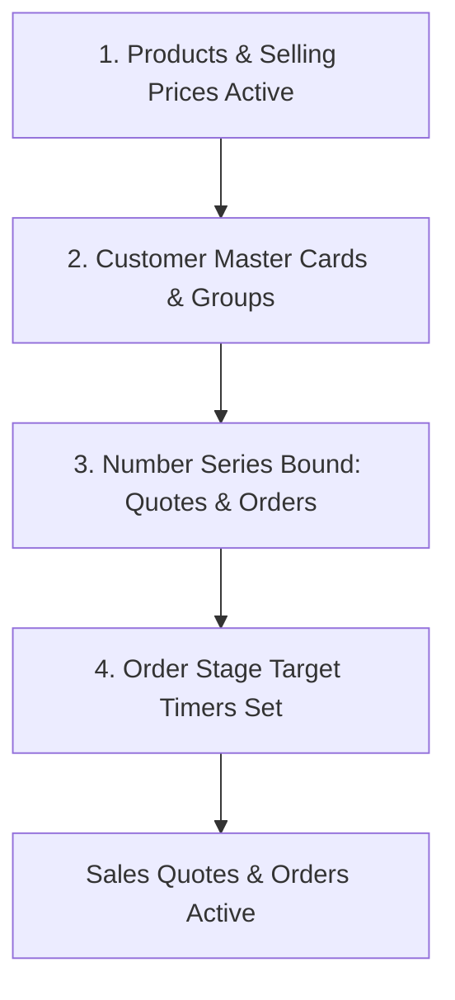
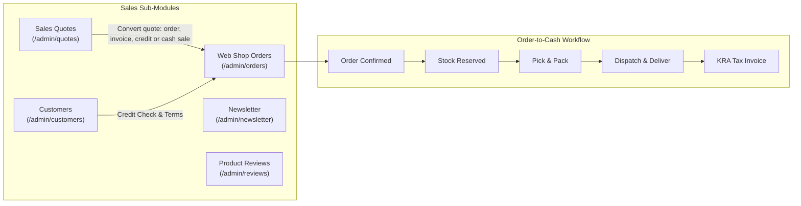

# Guide 03: Sales Quotes & Web Shop Orders (`/admin/sales`)

The **Sales & Fulfillment** module orchestrates the complete Order-to-Cash (O2C) lifecycle. It manages proforma sales quotations, omnichannel customer orders (online storefront, physical point-of-sale, and back-office credit sales), customer master cards, credit limit enforcement, newsletter subscribers, and product reviews.

---

## 1. Executive Overview & Commercial Value Proposition

### Operational Problems Solved

- **The Delivery & Fulfillment Blame Game**: When an order is delivered late or items go missing, sales reps blame the warehouse, warehouse staff blame the dispatcher, and dispatchers blame the courier. QSell eliminates this through an **immutable, server-timestamped order timeline** that tracks the exact second an order entered and exited every stage (Received $\rightarrow$ Confirmed $\rightarrow$ Reserved $\rightarrow$ Picked $\rightarrow$ Packed $\rightarrow$ Dispatched $\rightarrow$ Delivered).
- **Uncontrolled Credit Overextension**: Sales reps often accept orders from customers who have exceeded their credit limits or have 90-day overdue invoices. QSell enforces hard credit limit checks at order placement, automatically blocking unapproved credit orders.
- **Friction in B2B Quotation Negotiations**: B2B deals require multi-line formal proforma quotes with negotiated discounts and validity dates. In manual systems, quotes are made on spreadsheets and must be re-typed into the accounting system when won. QSell converts quotes to confirmed sales orders in a single click with zero data re-entry.

### Target Client Profiles

- **Wholesalers & B2B Trade Distributors**: Managing formal quotations, corporate customer accounts, credit terms (Net 30, Net 60), and multi-branch delivery schedules.
- **Omnichannel Retailers**: Processing walk-in counter sales alongside high-volume e-commerce orders.
- **Field Sales Teams**: Generating field quotes on tablets that link directly to warehouse inventory.

### Commercial Sales Pitch & Talk Track

> _"With QSell, your sales team moves deals from quotation to cash with zero friction and 100% accountability. Every quote you generate can be converted into a live sales order with a single click. Every single order is tracked with an unalterable server timestamp at every milestone—so you know exactly how long an order took to be picked in the warehouse, when it was handed to the rider, and the exact second the customer signed for it at the door."_

### Measurable ROI & Safeguards

- **Zero Double-Entry Overhead**: Quotes instantly convert to Orders, Orders to Packing Slips, and Orders to KRA-signed Invoices.
- **Elimination of Bad Debts**: Automatic credit-ceiling enforcement blocks orders when customers exceed agreed limits.
- **Order SLA Enforcement**: Real-time alerts when orders languish in picking or packing beyond target thresholds.

---

## 2. Prerequisites & Configuration Sequence

1. **Active Sellable Products**: Products must be assigned a business classification marked as _"Sold to Customers"_ with active selling prices.
2. **Customer Master Cards**: Cash or credit customer accounts must exist under `/admin/customers/list`.
3. **Number Series**: Document number series for Sales Quotes (`QT-`) and Sales Orders (`ORD-`) must be active under `Settings > Number Series`.
4. **Order SLA Targets**: Stage timeout targets should be defined under `Settings > Order Targets` to trigger late-stage notifications.
5. **Staff Permissions**:
   - `quotes:read`, `quotes:manage`: Access and manage quotations.
   - `orders:read`, `orders:manage`: Process orders and print packing slips.
   - `customers:read`, `customers:manage`: Create and edit customer cards.

---

## 3. Module & Sub-Module Architecture

The Sales module coordinates five operational areas:

---

## 4. Interface-by-Interface Walkthrough

### Sub-Module 1: Sales Quotes (`/admin/quotes`)

- **Quotes List View (`QuotesTable`)**: Paged table showing Quote Number, Customer Name, Issue Date, Expiration Date, Total Amount, and Status (`Draft`, `Sent`, `Accepted`, `Converted`, `Expired`, `Rejected`). A **Staff** column names the person who created the quote and the person who emailed it to the customer ("Not emailed yet" until it is sent), so a manager can see who is responsible for each quote at a glance.
- **Quote Creation & Editor (`QuoteEditor`)**:
  - Customer selection with instant customer credit standing preview.
  - Line-item editor: SKU selection, unit of measure, quantity, base price, discount %, and tax rate.
  - Real-time calculation toolbar: Subtotal, total discount, VAT, and grand total.
  - Validity expiration date picker and customer memo notes.
- **Quote windows**: The quote editor and the quote detail window open extra wide so the lines, prices and margins sit side by side; on a phone they fill the screen.
- **Quote Detail Modal (`QuoteDetails`)**: Opens with _Created by_ (name and time) and _Emailed to customer by_ (name and time of the latest send), then shows the full proforma document view with actions to **Print PDF**, **Send via Email**, **Accept**, or **Convert to Order**.

### Sub-Module 2: Web Shop Orders (`/admin/orders`)

- **Orders List View**: Shows only orders placed through the web shop, including ones a shopper bought on account (their invoice is a credit sale, but the order still belongs here). Search by order number, customer, phone, email or tracking number; filter by Status (`Pending`, `Confirmed`, `Processing`, `Dispatched`, `Delivered`, `Cancelled`), Payment Status (`Unpaid`, `Paid`, `Partial`), and Branch.
- **Opening an order (the same on Web Shop Orders, Sales Orders, Credit Sales and Sales Invoices, and from a customer statement or a receipt)**: every row has one button, **Open order**. The order opens over the screen it was opened from; **Close** (or Escape, or the browser's Back) returns to that same screen with its search and filters as they were. An order opened by its own address (a link pasted in an email or typed in) is a page of its own, titled with what it is (for example *Sales order ORD-2026-…*), with **Back to** the screen the order belongs to. An older link of the form `/admin/orders?order=…` goes to the same page.
- **What the order shows**: at the top, who it is for, when it was placed, **where it stands** (fulfilment status, payment status, and *Waiting for approval* when held) and the **total**. Under that a row of named parts, each one press away and staying in view while you scroll: **Customer**, **Items**, **Fulfilment**, **Payments**, **Invoices**, **History** (the parts themselves are headed *Customer and payment*, *What was bought*, and so on). Messages about what you just did (an invoice downloaded or emailed, a change refused) stay under that row so you see them wherever you are on the order.
  1. **Customer and payment**: the customer's phone, email and delivery address, and how it is paid (method, who paid from, reference).
  2. **What was bought**: every line with its unit price, quantity and line total (products can be opened for editing by those who may).
  3. **Fulfilment**: the status, courier and tracking code, internal notes and cancelling with the stock returned; below it the stock reserved or issued, the collection at the counter and the deliveries.
  4. **Payments**: receipts and tenders against the order, and the missing payment reference when there is one.
  5. **Invoices**: Tax invoice, Proforma and Delivery invoice (download or email, and a preview with the KRA signature and QR code), the documents made for the order, and its credit notes.
  6. **History**: the stage timeline with the exact server time of every stage, who did it and how long it stayed.
  After a change (a status, a payment, a credit note) the list behind the order reads its rows again, so it is never out of date when you close the order.

### Sub-Module 2A: Preparation sheet (`/admin/orders/preparation`)

For a business that makes what it sells to order (meals, catering, assembled sets), the sheet says **what has to be made for a day**. Permission: _orders read_. It is read from the exact choices saved with each order that holds a configurable package (guide 05, Packages), not from the order lines, which fold the parts of different servings together and no longer say which fish went with which ugali.

- **Print**: prints the sheet alone on A4 (the day, the totals and each order's choices), without the menu, the day pickers, the buttons or the browser's own address, date and page-number lines; choose *Save as PDF* in the print window to keep a copy. The same Print is used for the offline till slip (80 mm slip width) and the withholding tax certificate (headed with its number and issue date).
- **Day**: pick a date (it opens on today), press **Today**, press a day in the strip of the coming days that have orders (each shows its servings), or press **Orders with no date** for orders of packages that did not ask for one. The date is the one the order is for (the delivery time the shopper chose, or the date on the quote or order).
- **Totals**: servings in how many orders; servings of each package; and each chosen part with the **portions** wanted (servings times picks, so _Large fish 9_) and, when a part comes in more than one unit per portion, the **units** (_Ugali 12 (24 units)_), most wanted first.
- **Under the totals**, grouped by **delivery time** (earliest first, orders with no time last) and by package: every order's own choices as "9 × Large fish and Ugali", with the order number, the customer, and the payment state when it is not paid. Identical choices on different orders stay as separate lines, because each has its own order to prepare for.
- A **cancelled order is not on the sheet**; if its servings were counted before, the totals drop by them at once. One sheet shows up to 2,000 selections and says so when there are more.
- **Print** prints only the sheet (the menu and top bar are left out) so it can be pinned in the kitchen. The screen works on a phone.
- A **customer's note** on a serving ("no pepper", where the package takes notes) is printed under its selection in amber, so it cannot be missed.
- **Not built yet**: a per-package filter and a count of what is already made.

### Sub-Module 3: Customers (`/admin/customers`)

- **Customer Hub (`/admin/customers`)**: Customers is a parent module like Sales and Pricing. It reveals **List** (`/admin/customers/list`) and **Customer groups** (`/admin/pricing/groups`); the directory is only shown after **List** is chosen.
- **Customer Directory (`/admin/customers/list`)**: Searchable, paged table (cards on a phone) showing Account Code, Customer Name, Tax PIN, Account Type (`Cash` or `Credit`), Balance Owed, Credit Limit, KRA transmission, and Blocked status. Each table row has separate icon actions with hover labels: **Open customer**, **Record a receipt against this customer** (when the user can create receipts), **Edit customer** (when the user can edit customers) and **Delete customer**. Phone cards keep the same actions as labelled buttons. **Open** never opens the edit form, and **Record a receipt** opens the new receipt form with that customer already chosen.
- **Customer Centre (`/admin/customers/{id}`)**: What **Open** reaches. It shows customer information (contact, address, profile, tax PIN, terms, credit limit, notes), then a prominent **Balance** card with the net position (open invoices less unused credits), **Open items** (ledger rows still open) and **Status** (active, inactive and/or blocked). The credit limit is not repeated in these cards; it stays with the customer information and in the statement position cards. The **Customer statement** shows opening balance, period debits and credits, closing balance, ageing bands, wallet, and a dated running-balance transaction list. Its position cards show **Credit limit** and, when the company uses the running display, **Available credit**. Only documents that directly affect receivables are listed: invoices as debits, and receipts, credit notes, refunds and rebates as credits. An invoice row shows its **tax invoice number**, never the sales order number; a sales order appears only inside **Related documents** as the source order. Each **Debit** and **Credit** amount opens the transaction detail, which shows the posted amount and document amount, an **Items sold** table (item with SKU, quantity, unit price, discount saved and the rule or coupon that gave it, and line total), a **Documents applied to** table (document, type, amount applied, document amount and still open), and an **History** table (when, what happened, positive amount, and why or by whom). On phones each table row becomes a labelled card. **Related documents** links open the tax invoice PDF, the source sales order and any permitted receipt, credit note, refund or rebate document; the detail also carries clearly labelled **Download receipt/Print receipt** or **Download tax invoice/Print tax invoice** actions when the user has the matching finance permissions. Long histories have **Show more transactions**. **Download PDF** and **Download CSV** produce the statement for the transactions currently shown and the date range applied above the table, with the same customer, period totals and tax invoice numbers. The header offers **Back** to the previous screen, **Customer list** to the directory, **Edit customer** to the card editor and **Record a receipt** when permitted.
- **Customer Card Editor (`/admin/customers/{id}/edit`)**: The dedicated edit screen reached from the row's **Edit** action or the centre. It uses the same card form as **New customer**: identity and tax PIN, account type, profile, credit limit and terms, KRA flag, and dimension bindings (`DimensionFields`). Saving returns to the customer centre.
- **Customer groups (`/admin/pricing/groups`)**: Wholesale, retail, VIP and other price groups; managed by the pricing permissions even though the entry sits under Customers.

### Sub-Module 4: Newsletter (`/admin/newsletter`)

- List of customer email subscribers captured via storefront footers and popups.
- Export to CSV action for email marketing campaigns (Mailchimp, Sendgrid).

### Sub-Module 5: Product Reviews (`/admin/reviews`)

- Customer review moderation queue showing Product Name, Customer Name, Star Rating (1-5), Review Headline, Review Body, and Submission Date.
- Action buttons: **Approve Review** (publishes to storefront) or **Reject / Archive** (removes from public display).

---

## 5. Granular Field-by-Field Reference

### Sales Quote Editor Fields (`/admin/quotes/new`)

| Field Label                                                   | Purpose                                                                                                                                                                 | Type & Format                            | Required?                           | Validation Rules & Hints                                                                                                                                                                                                                                                                            |
| ------------------------------------------------------------- | ----------------------------------------------------------------------------------------------------------------------------------------------------------------------- | ---------------------------------------- | ----------------------------------- | --------------------------------------------------------------------------------------------------------------------------------------------------------------------------------------------------------------------------------------------------------------------------------------------------- |
| **Customer**                                                  | Account receiving the quote.                                                                                                                                            | Lookup Autocomplete                      | **Required**                        | Type 2+ characters to search customer cards.                                                                                                                                                                                                                                                        |
| **Quote Date**                                                | Issue date.                                                                                                                                                             | Date (YYYY-MM-DD)                        | **Required**                        | Defaults to today's date.                                                                                                                                                                                                                                                                           |
| **Hide the customer details (Bill To) on the quote document** | Customer name, email, phone and billing address are printed on the quote by default. Tick this to leave them off.                                                       | Checkbox                                 | Optional                            | Off by default for every new quote, so the customer details appear. Quotes saved before this change keep what they had. A quote template has the same box and passes its choice on to quotes made from it.                                                                                          |
| **Valid Until**                                               | Expiration date of quoted prices.                                                                                                                                       | Date (YYYY-MM-DD)                        | **Required**                        | Must be $\ge$ Quote Date. Quotes cannot be converted after this date.                                                                                                                                                                                                                               |
| **Branch**                                                    | Fulfilling branch location.                                                                                                                                             | Dropdown                                 | **Required**                        | Determines inventory availability checks.                                                                                                                                                                                                                                                           |
| **Product Line: SKU**                                         | Product item.                                                                                                                                                           | Lookup Autocomplete                      | **Required**                        | Must be an active, sellable product.                                                                                                                                                                                                                                                                |
| **Product Line: Qty**                                         | Number of units quoted.                                                                                                                                                 | Decimal / Integer                        | **Required**                        | Must be $> 0$. Validated against unit of measure decimals.                                                                                                                                                                                                                                          |
| **Product Line: Price**                                       | Unit selling price.                                                                                                                                                     | Currency (KES)                           | **Required**                        | Defaults to price list. Cannot violate price floor.                                                                                                                                                                                                                                                 |
| **Product Line: Discount**                                    | Line-item discount percentage.                                                                                                                                          | Percentage (0-100%)                      | Optional                            | Capped by user's role override limit.                                                                                                                                                                                                                                                               |
| **Needed On**                                                 | The date the goods or the meal are needed. Packages with notice, closing-time, day-of-week or daily-limit rules are checked against it when the quote becomes an order. | Date (YYYY-MM-DD)                        | Optional (needed for such packages) | Without it, a quote of a package with date rules is refused at conversion with "choose the date you need it".                                                                                                                                                                                       |
| **Add a package** (button)                                    | Sells a configurable package (such as an express lunch) on the quote, choosing its options with the same builder the shop uses.                                         | Dialog: package picker, then the builder | Optional                            | Only active packages are offered. Every option can be chosen whatever stock says (a quote promises nothing from the shelves). The line's price is set by the package (base price plus what the choices add, or the choices added up) and cannot be typed; a discount percentage can still be given. |
| **Package line: Change choices**                              | Reopens the builder on the choices kept on the line.                                                                                                                    | Button on the line                       | n/a                                 | A part the package no longer offers is named and left empty so a replacement can be chosen.                                                                                                                                                                                                         |
| **Notes / Terms**                                             | Commercial stipulations on quote.                                                                                                                                       | Text (Max 500 chars)                     | Optional                            | Printed on proforma footer (e.g., _"Lead time 7 days"_).                                                                                                                                                                                                                                            |

### Customer Card Fields (`/admin/customers/new`)

| Field Label       | Purpose                              | Type & Format         | Required?                                 | Validation Rules & Hints                                       |
| ----------------- | ------------------------------------ | --------------------- | ----------------------------------------- | -------------------------------------------------------------- |
| **Account Type**  | Determines payment requirements.     | Picker                | **Required**                              | `Cash` (must pay before dispatch) or `Credit` (invoiced). A customer made on the admin console starts as **Credit**, from the customer profile coded `CREDIT` (otherwise the first active credit profile), until you choose Cash or another profile; a credit customer needs a credit limit above zero. Customers who register on the web shop are **Cash** customers. |
| **Customer Name** | Full legal or business name.         | Text (Max 120 chars)  | **Required**                              | Displayed on tax invoices.                                     |
| **KRA PIN**       | Customer's tax registration.         | Text (11 chars)       | Optional for Retail, **Required for B2B** | Must be a valid KRA PIN format for B2B eTIMS transmission.     |
| **Phone Number**  | Primary mobile contact.              | Phone (Max 25 chars)  | **Required**                              | Used for delivery SMS notifications and M-Pesa STK push.       |
| **Email Address** | Invoicing email.                     | Email (Max 160 chars) | Optional                                  | PDF invoices and proformas are dispatched here.                |
| **Credit Limit**  | Maximum outstanding balance allowed. | Currency (KES)        | Required if Credit                        | e.g. `250000.00`. Orders blocked if balance + order $>$ limit. |
| **Payment Terms** | Grace period in days.                | Integer (Days)        | Required if Credit                        | e.g. `30` for Net 30 days.                                     |
| **Price Group**   | Custom pricing tier.                 | Dropdown              | Optional                                  | e.g. _Retail_, _Wholesale_, _Contractor_.                      |

---

## 6. Step-by-Step User Actions (Down to the Last Click)

### Action 1: Creating and Converting a Proforma Sales Quote to an Order

1. Navigate to `/admin/quotes` and click **New Quote** in the top right.
2. In the **Customer** lookup field, search for and select the client (e.g. _"Acme Construction Ltd"_).
3. Set the **Valid Until** date (e.g., 14 days from today).
4. Click **Add Line Item**.
5. In the product autocomplete, select the product (e.g., _"500W Solar Panel"_).
6. Enter the **Quantity** (e.g. `20`). The system automatically pulls the current customer group price.
7. Enter a negotiated discount (e.g. `5%`). The system recalculates the subtotal and VAT in real time.
8. Click **Save Quote**. The quote status becomes `Sent`.
9. When the client says yes, open the quote (or use the convert button on its row) and click **Convert quote…**. A quote that is *Sent* or *Accepted* can be converted; a *Sent* quote is accepted on the customer's behalf at the same moment (a customer who agrees by phone).
10. **What should this quote become?** Four choices appear as cards, each saying what it is for. Nothing is chosen for you:
    - **Sales order**: the customer has agreed; you prepare and deliver the goods and bill later.
    - **Sales invoice**: bill now, with the tax invoice, and deliver afterwards.
    - **Credit sale**: sell on the customer's account, to be paid within their credit terms.
    - **Cash sale**: the customer pays now at the counter, in your open shift.
11. A card that cannot be chosen stays on screen with the reason: *This customer has no credit account*, *Open a shift on a till first*, *It is over their limit by KES …* (when the company refuses over-limit sales), *The quote includes a delivery charge* (a cash sale has no delivery), *The customer is blocked*, *You do not have permission to create …*, or *The quote has expired / was rejected / already became …*.
12. Choosing a card shows **What will happen**, worked out from the company's own settings for that kind of document: whether the stock leaves now or is set aside, whether the tax invoice is made now or raised later, the days the customer has to pay, and whether it fits their credit limit. A caution in amber says what to look at first (an amount over the limit that will wait for approval, an overdue invoice).
13. Press the button, which is named for the choice (*Create the sales order*, *Issue the sales invoice*, *Sell on credit*). For a **cash sale** the button is *Continue to payment*, and the same payment screen as the till opens: choose cash, M-Pesa or card (one or several ways), enter what the customer hands over, and *Complete sale*.
14. The quote becomes `Converted` and a result screen shows the new document's number and its tax invoice (or the till receipt), the change to hand back for a cash sale, and a link to where it now lives. A document that waits for approval says so.

**When the customer answers by the link in the email**: the page they open (`/quote/…`) shows the quote with **Accept quote** and **Decline quote**. The customer sees **Quote accepted successfully**, with the quotation number, the total, the day, and a **Browse our catalogue** button to the shop. The same page says the same whenever the link is opened again; a declined quote says **Quote declined**, an old one says **This quote has expired**, and a withdrawn one says **This quote is no longer available**, each with who to contact. Only an address that is not a quote link at all shows a missing page.

**What happens when a customer accepts (Quotes screen, button *On acceptance*; needs the *Manage settings* permission)**. The company chooses one of four behaviours, and how the staff concerned are told:
- **Only tell my staff**: the quote is marked *Accepted* and nothing else is made. Nobody's stock, invoice or account is touched until a person opens the quote, presses **Convert quote…** and chooses a sales order, sales invoice, credit sale or cash sale.
- **Make a sales order** (the setting until someone chooses, as it always was), **Make a sales invoice** (with its tax invoice) or **Make a credit sale**: the quote becomes that document at once, at the quoted prices, behaving as the company's settings for that kind of document say. A cash sale is never made automatically, because it needs a person at a till to take the payment.
- **When it cannot be made** (a credit sale for a customer with no credit account, a missing delivery address, a product removed from the catalogue, no stock), the quote stays *Accepted*, the reason is written in its history as *order conversion failed*, and the staff are told that it needs them. The customer's acceptance is never lost and the customer is still thanked.
- **How staff are told**, by three independent switches, whichever behaviour is chosen: **Email** (to the people chosen in *Settings, Email routing* for *Quote accepted by the customer: alert to staff*; the staff member who made the quote until others are chosen; and always whoever sent the quote), **Text message** (to the same staff accounts that have a phone number, through the company's connected text message provider) and **Browser alert** (to the same staff who have turned alerts on for their browser). A way that cannot work yet says so beside its switch (no text provider connected, alerts not set up on the installation). One that is off, not set up or fails never stops the others, and none of them can undo the acceptance.
- What was sent, or why it was not, is written in the quote's history (*staff notified*) for each of the three ways. A quote marked accepted by a person follows the same behaviour but tells nobody, as they did it themselves. Declined quotes do not notify staff.

**Rules that always hold**: the quote's prices, taxes and discounts stand exactly as quoted, whatever the price list says today. The same quote converts only once; pressing the button again finds the same document and takes nothing twice. The person needs the right to approve quotes and the right to create the chosen kind of document. A *Sales invoice* always has its tax invoice made with it. A cash sale needs the person's own open shift, takes no delivery charge, and its receipt is the signed tax invoice on the receipt series. A converted quote shows *Became the sales invoice / credit sale / cash sale / sales order* with the document number.

### Action 2: Inspecting an Order's Timestamped Stage Timeline

1. Navigate to `/admin/orders`.
2. Locate the order using the search bar (by Order Number, Customer Name, or Phone).
3. Click **Open order** on that row.
4. Press **History** in the row of parts under the summary.
5. The timeline renders chronologically:
   - `09:14:02` — _Order Placed_ (Channel: Web Shop, Actor: Customer).
   - `09:14:05` — _Payment Confirmed_ (M-Pesa STK Push: KES 14,500, Ref: `QA712XYZ`).
   - `09:15:20` — _Stock Reserved_ (Warehouse: Central Depot, 2 items locked).
   - `09:40:12` — _Pick Started_ (Actor: John Kamau - Storekeeper).
   - `09:52:00` — _Packed & Ready for Dispatch_ (Packing Slip #PS-1082 printed).
   - `10:15:30` — _Dispatched_ (Rider: Peter Ochieng, Run #RUN-04).
   - `10:48:15` — _Delivered_ (Customer Signature & Verification PIN Confirmed).
6. Hover over any stage to view duration spent (e.g., _"Time in Packing: 11 minutes"_).

### Action 3: Reviewing and Moderating Customer Product Reviews

1. Navigate to `/admin/reviews`.
2. The table displays pending reviews submitted by shoppers on the storefront.
3. Review the star rating, title, and comments.
4. To approve: Click **Approve**. The review immediately becomes visible on the product page and updates the product's aggregate star rating.
5. To reject: Click **Reject**. An inline text prompt asks for an internal reason (e.g., _"Offensive language"_ or _"Spam"_). Click **Confirm Rejection**.

---

## 7. Conditions, Business Rules & Edge Cases

### The Credit Limit Breach Rule

- When an order is placed on credit, the system always checks:
  $$\text{Net Amount Owed} + \text{New Order Total} \le \text{Customer Credit Limit}$$
- **Net amount owed** means open invoices less credits not yet used. It is not the customer card's display balance. The company's **Customer credit** display only decides whether people see the limit alone (_Static_) or the limit less what is owed (_Running_); it never changes this check.
- If the calculation exceeds the limit:
  - When the company allows proceeding beyond available credit, an approval workflow decides if one is configured; with no workflow, the order is created.
  - Otherwise, when an **Approval Workflow** for a credit override is configured and the kind of sale asks for approval, the order waits with its stock reserved until an approver releases it.
  - Otherwise order creation is **blocked** with a message naming the credit limit; nothing is saved or charged.

### Quotes requested on the web shop

A package set to **Request a quote** (or **Either**) in **Pricing → Packages** lets a shopper ask for a quote from the product page. It arrives as a draft quote with **Requested on the web shop** in place of _Created by_ (list and detail), the shopper's name, email and phone, the date they need it and their message in the internal notes. The price is worked out from the package, never typed by the shopper. Staff review, send and convert it like any other quote. The company's own email address is alerted when a request arrives (and the shopper gets a confirmation if they gave an email address), so keep that address set in Company Setup. See the packages section of guide 05 for the setting.

### Sales Orders (`/admin/sales-orders`)

Where staff **take an order for a customer**: by phone, at the counter for later, or for an account. Behind two permissions: _Sales orders: read_ (the list) and _Sales orders: create_ (taking one).

- **The list**: the sales orders staff took, newest first, 25 at a time with **Show more**; **Find a sales order** searches the order number or the customer's name. Each row shows the number, customer, date, total, status, payment status and **Waiting for approval** when it is held. **Open order** opens that sales order over this list; closing it returns here.
- **New sales order**: choose the **customer** (search by name, number, email or phone). The card under it shows where they stand: a credit account with its days, the **credit limit**, **amount owed** and, when the running display is on, **available credit**, plus **blocked** and **overdue** warnings; a cash customer says so. With the static display, only the limit is shown. Add **products** (search; the list price shows) and **packages** (the same builder the shop uses, every option choosable; a package is sold in whole servings). Choose the **expected payment** (a label: M-Pesa, Pesapal, Jenga, KCB Buni; the money is received by receipt) and, if needed, the day it is **needed on**. Where the company's setting allows it, **Hold the stock until this order is paid** appears. **Place order**.
- **The lines (the same on Sales Orders, Credit Sales and Sales Invoices)**: the product search sits above the lines, and each line is laid out like an invoice with four named parts: **Item** (with its list price), **Quantity**, **Unit price** and **Line total**. On a phone every line is a card with the same four names. Under the lines the **total** is shown as **Before tax**, **Tax** and **Total**, worked out by the server for this customer as you type (until a customer is chosen, only the total at list prices is shown, and the screen says why). A quantity of nothing or a price of nothing is refused in words beside the box.
- **Change the price of an item** (permission *Sales orders / Credit sales / Sales invoices: change the price of an item*, given on purpose to the people who need it): the **Unit price** is a box. Type the new price and press Enter or leave the box; the line total follows. The line says **price changed**, and the round arrow brings the list price back. The server holds the new price to the price floors and to the person's own limit below list price, and refuses it in words otherwise. A person without the permission sees the price but cannot change it, and a price sent anyway is ignored.
- **Give a discount on an item** (two things must both be true: the company has allowed it for the branch under *Selling Documents > Discount typed by staff* for that document, and the person has the permission *offer a discount on an item* for that document): the **Discount** column has a button for a percentage or an amount off each unit. The charged price shows with the price it came from struck through. A person who may not see no discount control at all, and a discount sent anyway is refused in words. A discount is never offered on a package line, and it is held to the price floors and the person's override limit like a changed price. On a line with a discount the price box is read-only; remove the discount to type a price.
- **What happens when you place it**: the server prices the order for that customer (the browser never sends a price) and applies the company's **Selling Documents** settings for sales orders: the credit check and limit, what happens over it, the credit days on the invoice's due date, approval, discounts, when the stock leaves and whether the tax invoice is made with the order. The limit check always uses net amount owed, even when the screen shows only the limit. The company's **proceeding beyond available credit** setting can also let an over-limit order reach an approval workflow or be created when no workflow exists. A refusal is shown in words ("… would exceed the credit limit of …") and nothing is placed. When an approval is needed the order is placed **waiting for approval** and says so.
- **On account is not a choice here**: a customer's credit comes from their account (limit and days), whatever the expected payment. Selling to an account customer by "on account" belongs to the Credit Sales module.
- **Related documents**: an order's details (in Web Shop Orders) show **Related documents**: the quote it was made from, and the invoices raised for it, with numbers, totals and dates. A quote that has become an order shows **Became the order** with its number. Deliveries and credit notes have their own panels on the order.

### Selling with no connection (Cash Sales, when switched on in Settings, Offline selling)
Available **only when the company has switched it on**, for **cash sales** by a person with an **open shift opened while online**.
- **Getting ready**: while online with a shift open, the Cash Sales screen keeps the till ready on its own (it says *Ready to sell with no connection*, refreshed every few minutes): it keeps the **offline till page and its files** in the browser (a service worker), the **list prices** of what may be sold at the counter, the **ways of paying** for this branch, and the shift's **signing key**. A browser that cannot keep these (private windows, blocked storage) says so and cannot sell offline.
- **The offline till** (`/admin/cash-sales/offline`, linked from Cash Sales): shows **Connected** or **No connection: selling from what the till kept**, how many sales are waiting to be sent, and sells like the counter: add products (found on the till itself), quantities, cash with change, M-Pesa or card (with its reference), a mix of up to four. It **never prices by rule**: the customer is charged the kept list price; discounts, price lists, packages and named customers need the connection.
- **Complete sale** keeps the sale on the till, **signed** with the shift's key so a change afterwards is seen, and shows a **slip** with the till's own reference (`OFF-<till>-0007`) and "tax receipt to follow". The slip is **not** the tax receipt: keep it until the receipt is printed. If the shift's offline limit is used up the till refuses another offline sale and says why.
- **When the connection returns** the till sends its sales **one at a time, in the order they were rung up**, on its own, and shows each one's **real receipt number**. Sending a sale twice never makes two. The sale is accepted **at the price the customer was charged**; if it differs from today's price, or a product is no longer sold at the counter, the sale is accepted and **flagged** (*Needs a look*).
- **What cannot be made is kept, never lost**: a sale **past the limits, changed after it was signed, or into a shift that is already closed** is **refused** with the reason; a sale whose **stock is not there** (or whose way of paying is gone) is **parked** (*Not made yet*). Both are listed under **Offline sales to look at** on Cash Sales (for people who may read cash sales). A supervisor can **Look at** a flagged sale, **Try again** a parked one once the stock is put right, or **Give up** a parked or refused sale with a **reason** that is kept. **A shift cannot be closed while a sale of it is parked**, nor while sales are still waiting on the till (the Shifts screen says how many).
- **A lost device**: a sale that never left a device that is never reconnected is not in the books, so the till will count **over** at the close: a supervisor looks into it (the decision log shows every offline sale that did arrive).
- **Not in this release**: returns, opening or closing a shift, credit customers, price rules, and packages offline; a second till taking over another's waiting sales.

### Invoicing in parts (Sales invoices, when switched on in Settings, Partial billing)
Available **only when the company has switched it on** (its own permission and screen in Settings), for **sales orders that have no tax invoice yet, are approved and are not cancelled**, and whose delivery (if any) is billed with the goods.
- **Raise an invoice**: choose the order; the **Invoicing in parts** card shows each line with **ordered, invoiced and left**, and the part invoices already made (number, total, whether it finishes the order, signing status, **PDF**).
- **Invoice these quantities**: type how many of each line to invoice (decimals only where the product allows them; never more than is left). The card shows the invoice's total as the server works it out and refuses a quantity that is too big in words, before anything is raised. Each part is a **full tax invoice**: numbered in order for the order and from the **same gap-free tax invoice series** as every other invoice, **signed with KRA on its own**, at **the order's own prices**.
- **Invoice what is left**: takes every line's remainder and **finishes the order**: this invoice also carries the **delivery charge** and any rounding, so the invoices of an order **always add up to the order to the cent**. Once an order is finished it is no longer offered.
- **Never both**: an order with a whole-order tax invoice cannot take a part invoice, and an order with part invoices refuses the whole-order invoice ("invoiced in parts: invoice what is left"). **Two people pressing at once cannot invoice the same units twice.**
- **Corrections**: an invoice is never edited; **a credit note is raised against one part invoice** (the order's credit panel asks *Credit which invoice*) and can only credit that part's lines at its amounts, with returned goods, restock and refund following the usual credit note flow. A delivery charge carried by the finishing part is not credited line by line.
- **Part invoices in the list**: *Sales invoices* shows them as **Part invoice** (filter *Part invoices*) with their own signing and credited status. Emailing a part invoice again is not offered yet (download the PDF).

### Where a product or package is offered (Offered in, on the product)
Every product and package carries an **Offered in** list on its edit window (*Media* tab): **Sales quotes**, **Sales orders**, **Credit sales**, **Cash sales (the counter)** and **Sales invoices**, all ticked unless you change them. A product that is not ticked for a document is **not found** by that document's product search, **not shown** in the quote editor's catalogue, and **refused in words** ("X is not offered in cash sales. Change where it is offered on the product") if it is sent anyway, on every staff document and on quote lines and quote templates. An order made from a quote is not asked again, because the quote already checked it. A package is a product, so the same list controls where it can be sold. The **web shop keeps its own switch**, *Show in the web shop*. Use it for items you only sell to account customers (untick Cash sales), only at the counter (untick the others), or only by quote.

### Cash Sales (`/admin/cash-sales`)
The **counter**: a fast sale paid at once, rung up inside the person's **own open shift** (see Shifts). Behind two permissions: *Cash sales: create* (ring up a sale; you only ever sell into your own shift) and *Cash sales: read* (see every counter sale; without it you see only your own shift's).
- **Before selling**: you need an open shift on a till (the screen says so and links to Shifts). A shift whose close is **waiting for approval** takes no sales; withdraw the close to sell again. The bar at the top shows the till, how many sales so far and what the till should hold.
- **The till screen**: the counter is laid out like a point of sale. On the left, **one bar** that searches by name, SKU or stock code and takes a **scanned code** (press Enter and an exact code goes straight into the sale; **F2** jumps to the bar), **category buttons** under it, a **Your usual** row (what this person has sold most in the last 30 days) and **picture tiles** (a coloured tile with initials when a product has no picture) showing the price, a **Low** or **Out** mark for stock and a **count badge** of how many are already in the sale; out-of-stock tiles and products with no price cannot be tapped. Services are never "out". Only products offered in Cash Sales and sold on their own appear; a **package** tile opens its builder (the same as Sales Orders). **Tap a tile to add one, tap again for one more.** On the right is **the sale**: each line with its picture-less name, **minus and plus** buttons, a typed quantity, its price and a remove button, the **total** the server worked out and a large **Pay** button (**F4**). On a phone the sale is behind a bar at the bottom ("View sale · 3 items · KES …") that opens it as a sheet. **Customer** is optional (empty means the walk-in customer; choose one to have the sale in their name).
- **Change an item's price** (permission *Cash sales: change an item's price*, given on purpose to the people who need it, such as a senior cashier): on each line of the sale the price of one shows with a pencil. Press it, type the new price of one (tax included, as the shelf shows it) and press the tick; the line then says *price changed* and the total follows. The round arrow puts the list price back. A price can be raised freely. It cannot go below the item's **price floor** (a floor price on the price list, or a floor rule such as *never below cost*), and it cannot go further below the list price than **the person's own limit** (Price floors and override limits, set per role): the sale then says why and the price must be corrected, because a till cannot wait for a supervisor. No promotion is added on top of a price that was typed. The server checks the permission again on every sale, so a price sent by anyone without it is ignored and the list price is charged; the line's price explanation records *Price changed at the counter* with the old and new price. Someone without the permission sees the price but cannot press it.
- **Give a discount on an item** (two things must both be true: the company has allowed it for the branch, and the person has the permission *Cash sales: offer a discount on an item*, which is not given to anyone by default): the company chooses where, in **Settings → Selling Documents → Cash sales → Discount typed by staff** (*Not offered*, *At every branch*, or *Only at the branches chosen*, with the branches listed). Where both are true, each line shows a **Discount** button under its quantity. Press it, choose **%** (a percentage above 0 and under 100) or **KES** (an amount off each unit, tax included, as the shelf shows it), type the number and press the tick; the line then says *10% off* (or the amount) and the total follows. The cross removes it. A percentage or amount that is not a real discount is refused in words on the line. The discount comes off the price in force (the typed price, if the person also changed it, otherwise the list price) and is held to the same limits as a price change: **never below the item's price floor**, **never further below the list price than the person's own limit** (Price floors and override limits, set per role) and never as much as the price itself; the sale then says why and the discount must be reduced, because a till cannot wait for a supervisor. A person without the permission, or a branch the company has not chosen, never sees the button, and the server refuses a discount from anyone else, in words, rather than charging a price nobody expected. A branch left blank on the person's profile counts as the company's default branch. A discount is not offered on a package line, is not available on the offline till, and is never added on top of a promotion (a line with a discount is priced by the discount alone). The order's price explanation records *Discount of … given at the counter* with the old and new price, and the total of such discounts is kept with the order's discount summary. What the receipt says about it is the company's choice in **Settings → Sales → Cash Sales → Discounts on the receipt**: only the price charged (the default), one total discount near the end, or the discount under each item (see guide 13). The company's **Discounts** setting of *No discounts* switches this off as well. The same setting is meant to reach the other selling points (sales orders, invoices, credit sales) later; until then they offer *Not offered* only.
- **Hold and bring back**: **Hold** (**F8**) sets the sale aside while you serve someone else (a name like *Sale 1* is made for it; up to ten at a time); **On hold** (**F6**) lists them with the first items, **Bring back** (only when the sale in front of you is empty) or **Give up**. A held sale is only a list of items and counts: nothing is priced, stock is not touched and nothing is paid until it is brought back and completed, and it is priced afresh when it comes back. It stays with the person and the shift; anything still on hold when the shift closes is given up.
- **Total**: worked out by the **server** with the same pricing as every other sale (price list, discounts, tax) as lines change; the screen never prices anything itself. Until the server has answered, **Pay** stays off, so a payment is never started on an old total.
- **Payment screen** (**Pay**): the total in large figures and a line saying what is **still to pay**, **paid in full** or the **change to give**. The ways of paying set up for this branch (cash, M-Pesa or card) are **big buttons**. For **cash** there are **quick buttons**: the exact amount and the next amounts a customer is likely to hand over (to the next 50, 100, 500, 1,000 and so on); one tap records it. For **M-Pesa** or **card** one tap pays the **full amount still owed** with that method, and the **M-Pesa code** or **card slip number** is asked for where the method needs it (Complete stays off until it is filled). The **number pad** (or the keyboard) takes any other amount; **Add** records it. Pay in **one way or a mix** (up to four): for example 100 in cash and the rest by M-Pesa; remove a payment with its bin button. Only cash can be handed over in excess (change); M-Pesa and card pay exactly. A short payment says by how much and **Complete sale** stays off.
- **Complete sale**: in one step the sale is placed, **stock leaves** the branch, how it was paid is recorded and the sale is marked **paid**, the sale is queued to the books (**each way of paying lands in its own cash or bank account**), and the **receipt** is the signed tax invoice on the POS receipt series. The screen then shows the **change to give** in large figures, **Print receipt**, and **New sale**.
- **Safe to repeat**: each sale has a key made when the screen starts it, so pressing Complete twice, or again after a dropped connection, never counts a sale twice. If a sale was rung up but its payment could not be recorded, the screen says so and the button changes to **Finish payment**; the shift cannot be closed until it is finished.
- **Full-screen till or inside the admin page**: set in **Settings & Configuration → Sales → Cash Sales** (see 7c). Full-screen gives the whole screen to selling (the admin menu is out of the way) with a slim top bar: the till and shift, **Sales** (the shift's sales, returns and offline review), **Shift and reports** and **Exit**.
- **Sales so far**: the shift's (or, with *Cash sales: read*, all) counter sales, newest first, 25 at a time; **Receipt** shows or reprints one.
- **Return goods** (permission *Cash sales: return*, normally for a supervisor): the **Return** button on a paid sale opens the return: enter how many of each line come back (never more than is still returnable; a return can be partial and repeated), **Why** (a reason from the company's list) and what the customer said, and tick **The goods are fit to sell again** to put them back in stock (leave it off for damaged goods: the stock stays out and the loss is the business's). Choose **how the customer is paid back**: **cash** (handed over from your open shift; asks who takes it, the customer's name when empty) or **M-Pesa** to a number. **Return and refund** then, in order: issues a **credit note** that corrects the tax invoice (signed like any credit note, so the books and the customer account follow), counts the goods back into stock, asks for the **refund** through the normal refund flow (its approval workflow, limits and posting all apply), and, when the refund is approved at once and is cash, **hands the cash back from the open shift** (the shift's expected cash goes down by it, shown on the X and Z reports as *Cash handed back for returns*). A refund that needs approval is left waiting: the return shows under **Returns to finish**, and once approved, **Finish** hands the cash over (the person who approved cannot be the one who records the payout). Pressing the button twice, or again after a dropped connection, never credits, restocks or pays twice: a return that stopped part way is finished from where it was. The walk-in customer's refunds are not held by the per-customer limits or the same-amount check (they are many buyers), but the limits per cashier and per phone number still apply. A void is a return of everything on the sale.

### Shifts (`/admin/shifts`)

A **shift** is one person's time on one till. Cash sales (the Cash Sales module) can only be rung up inside an open shift. Behind four permissions: _Shifts: read_ (see everyone's shifts and reports), _open_ (open a shift and put cash in or take it out), _close_ (close your own) and _supervise_ (close another person's, and close a shift that is out by more than the company allows). Someone without _read_ sees only their own shifts.

- **Open a shift**: choose a **till** (only tills with no shift open, in your branch if you have one) and **count the float in the drawer**: a box for each note and coin (1,000, 500, 200, 100, 50, 20, 10, 5, 1) with the total growing as you count, or tick _I only have a total_. **Open shift**. You can have one shift open at a time, and a till one shift at a time.
- **During the shift**: the **X report** shows the opening float, cash sales, cash put in, cash taken out and **what the till should hold**, any time, without closing anything. **Cash in or out** records cash **put in** (for example change from the bank) or **taken out** (for example buying supplies) with the **reason**; you cannot take out more than the till holds. **Download PDF** saves the report (X while open, Z once closed) as a clean A4 document with the shop's name, the till, who opened and closed it and when, the cash worked out line by line, what was taken by M-Pesa and card, the drawer count, the cash put in and taken out, and lines for the cashier and supervisor to sign; **Print** prints that same document, never the screen around it. Only people who may see that shift's report can make the PDF.
- **Close the shift**: count the cash in the drawer. The system works out the **difference** from what the till should hold. **Any difference needs a reason** in words. A difference **beyond the limit set in Registers** is either closed by a **supervisor** on the spot or **sent to approval**, as the company chose in Registers; a supervisor may always close another person's shift on the spot. When it goes to approval the shift shows **Waiting for approval** with the count and reason, no cash can move on it, and the cashier can **Withdraw the request and recount**; once approved it closes with its Z number, and if it is rejected the shift is open again for a recount. Closing gives the shift its **Z report number** from the gap-free series and keeps its figures, so the **Z report never changes**: a closed shift cannot be edited and cash cannot be added to it (the database refuses).
- **Shifts so far**: newest first, 25 at a time; each row shows the Z number (or *Open*), the till, who and when, and *Till right* or the difference. **Open** shows its report; **Print** prints it. A supervisor opening another person's open shift can close it from there.
- **Cash sales** taken in the shift are its *Cash sales* line (net of change), and the X and Z reports show what counter sales took **by M-Pesa and card** as well, for reconciling against the provider and bank statements. The cash difference is **written to the books at the close** (see Settings, Registers: the till's cash account and the account for till differences); until those are chosen it waits, and the Z report says so.

### Credit Sales (`/admin/credit-sales`)

Where staff **sell to a customer's account**: a sale charged to the customer's credit, invoiced at once. Behind two permissions: _Credit sales: read_ (the list) and _Credit sales: create_ (making one).

- **The list**: the credit sales, newest first, 25 at a time with **Show more**; **Find a credit sale** searches the order number or the customer. It lists the sales staff made on account; a shopper's web shop purchase on account stays in Web Shop Orders even though it is invoiced as a credit sale. Each row shows number, customer, date, total, status, payment status and **Waiting for approval** when held.
- **New credit sale**: only customers **with a credit account** are offered. The card shows their **credit limit**, **amount owed** and, when the running display is on, **available credit**, their days, and **blocked** and **overdue** warnings. Add **products** and **packages** (the shop's builder), the day it is needed and, where the company allows it, **Hold the stock until this sale is paid**. There is no payment to choose: it is on the customer's account terms. **Place credit sale**.
- **What happens**: the server prices it for that customer and applies the company's **Selling Documents** settings for _Credit sales_: the credit limit is checked against the net amount owed (over it, the company's approval workflows or the over-credit setting decide, or it is refused in words), the invoice **falls due on the customer's days**, the **tax invoice is made with the sale** (and automatically once approved if an approval held it, unless _Invoice after approval_ is off), and the stock leaves as that setting says (by default at delivery or collection). A customer without a credit account is refused ("is a cash customer and must pay at the invoice"): use a sales invoice or a sales order for them.
- **Credit hold with release**: a sale over the limit is held for approval by a workflow whose condition is the customer being over their credit limit (set up in Approvals); the approver releases it and the invoice follows. With no workflow to ask, it is refused unless the company has switched on proceeding beyond available credit, in which case the order is created.

### Sales Invoices (`/admin/sales-invoices`)

Where staff **find, check and raise invoices**. Behind three permissions: _Sales invoices: read_ (the list and an invoice's detail), _create_ (raise an invoice) and _send_ (send it again, print or download it).

- **The list**: every invoice document, from whatever kind of sale raised it — a sales order that has been invoiced, a credit sale, a web shop order, or a direct sales invoice — newest first, 25 at a time with **Show more**. **Find an invoice** searches the invoice number, the order number or the customer; the **Kind** choice narrows to _Tax invoices_, _Proforma_ or _Delivery_ invoices. Each row shows the number, kind, order, customer, date, total and three things: **how KRA signing stands** (_Signed with KRA_, _Being signed_, _Waiting to be signed_, _Not signed_, _Signing failed_, or _Not considered yet_), **what has been paid** (_Paid_, _Partly paid_, _Unpaid_, or _Credited_ when credit notes cover all of it) and any **amount credited**. Payment follows the order's payment status, which receipts keep up to date.
- **Open invoice** opens the invoice as the document it is, in a large window over the list (closing it, with Close or Escape, returns to the list as it was). At the top: the customer, when it was issued and emailed, the link **Open order**, and the chips for kind, KRA signing, payment and *Order waiting for approval*. Under that four figures: **Invoice total**, **Credited**, **Paid** and **Balance due** (a proforma or delivery invoice shows no balance, and a part invoice shows its own total only). Then **What was invoiced** as a table with named columns: **Item** (with its code), **Quantity** (with its unit), **Unit price** (the price before a discount struck through when one was given), **Discount**, **Tax** and **Line total**; on a phone each line is a card with the same names. Under the table the sums: **Before tax**, **Delivery**, **Tax**, **Total**, the discount already taken off, **Credit notes**, **Paid** and **Balance due**. Then the **credit notes** against it (number, status, date, amount) and the **signing log**. **Download PDF** and **Send again by email** stay at the foot of the window wherever you scroll. An order the shop already records as paid shows as paid in full whatever the ledger shows.
- **Raise an invoice**: choose an **order to invoice** (search by order number or customer) and press **Raise invoice**. Only orders with no tax invoice yet are offered, and not those waiting for or refused by approval, cancelled or failed. The invoice is for the whole order. The invoicing rules hold: a tax invoice cannot be raised while the order waits for approval, the number is gap-free per branch, and KRA signing never holds the invoice up. An order that already has one is refused in words.
- **New sales invoice (a direct sale)**: for a sale invoiced at once, with no sales order in front of it. Needs the _Sales invoices: create_ permission. The editor is the one for sales orders: choose the **customer** (the credit position shows, as the settings for sales invoices will look at it), add **products** and **packages**, the expected payment, the day needed, and **Hold the stock until this invoice is paid** where the company allows it, then **Issue invoice**. The server prices it and applies the company's **Selling Documents** settings for _Sales invoices_: **by default it checks the credit limit** (over it is refused in words), **falls due on the customer's payment terms**, **makes the tax invoice with it** and **issues the stock at once**; each of these is a setting (credit check, credit days, when stock is released, approval). The invoice is numbered from the fiscal tax-invoice series and signed under its own _Sales invoices_ KRA signing switch (set it in the KRA settings like the others). In the list it shows as _(direct sale)_. If an approval is needed it is issued **waiting for approval**; its tax invoice (and its stock, where it leaves when issued) follow **automatically as soon as it is approved**, unless the company turned _Invoice after approval_ off in Selling Documents, in which case staff use **Raise an invoice** once it is approved.
- **A signed invoice is never edited or deleted**: it is corrected by a credit note (from the order's details). Raising an invoice for part of an order, or one invoice per delivery, is a later module (partial billing).

### Who is written to, and which contacts a quote shows

The email staff send with **Send via Email** goes where **Settings, Email Routing** says for _Quote sent to the customer_: by default to the customer with replies to the company email, and it can be set to write to several people, copy the sender or others, blind-copy the manager and answer to a chosen address. The "Questions? Contact …" emails on the quote PDF, the public quote page and the email follow the company's setting for quotes made by staff, or for quotes asked for on the web shop. A single quote can override them: in the quote editor, **Business contacts shown on this quote**. A quote with no email for the customer can still be sent when Email Routing names other people to write to; if nobody can be found, the message says to add a customer email, and if the company switched quote emails off, it says so.

### Packages on a Quote

- A package line reads as its choices ("Express lunch: Large fish, Ugali and Sukuma") in the editor, the PDF and the email. The server works out the price, the tax (each chosen part at its own rate, like a kit) and the cost (what the chosen parts cost); the margin and the price floor use those figures.
- The quote keeps the choices by the slot's name and the part, not by internal ids. A package changed after the quote was made does not stop the quote being understood; if a chosen part is no longer offered, **converting the quote stops and names it** ("Large fish is no longer offered in Fish"), the quote can be reopened, the part replaced and saved again. Stock is not looked at when quoting; it is looked at, with the package's ordering rules (servings, notice, closing time, days, daily limit, who may order) and the date in **Needed On**, when the quote becomes an order. The quote's price stands even if the package's base price has moved.
- A **note** can be written on a package line of a quote when the package takes notes; it is kept with the line and goes on to the order and the preparation sheet.
- Two lines of one package with different choices stay two lines, also on the order; the exact selection of each is saved with the order for the preparation sheet.

### Stage Immutability & Reversals

- Once an order stage timestamp is recorded in the append-only event log, it can **never** be edited or deleted.
- If an order must be cancelled after dispatch:
  1. The order status moves to `Delivery Failed` or `Cancelled`.
  2. A return-to-stock movement is issued, recording the physical return of the goods to inventory.
  3. A credit note is generated referencing the original invoice.

---

## 8. Implementor Checklist & Go-Live Verification

| Step | Verification Task                                                                                       | Expected Result                                                                                                                                                | Pass/Fail |
| ---- | ------------------------------------------------------------------------------------------------------- | -------------------------------------------------------------------------------------------------------------------------------------------------------------- | --------- |
| 1    | Create a test Cash Customer and Credit Customer.                                                        | Both customers saved; credit limit reflected on Credit Customer.                                                                                               | [ ]       |
| 2    | Issue a Sales Quote with a 10% line discount.                                                           | Proforma calculates discount and VAT accurately; status shows Draft/Sent.                                                                                      | [ ]       |
| 3    | Convert Quote to Order.                                                                                 | Order created with identical lines; Quote status transitions to Converted.                                                                                     | [ ]       |
| 4    | Attempt to place an order exceeding Credit Customer's limit.                                            | System blocks or routes to Credit Approval queue as configured.                                                                                                | [ ]       |
| 4b   | Place two package orders for the same day, cancel one, open **Preparation sheet** for that day.         | Totals and each order's choices show for the kept order only; Print leaves out the menu.                                                                       | [ ]       |
| 4a   | If the company sells packages: quote one with **Add a package**, change its choices, convert the quote. | The line reads as its choices; the order's parts add up to the quote's total; a package with a daily limit refuses a second quote for the same date once full. | [ ]       |
| 5    | Verify Order Timeline Events.                                                                           | Placement, payment, and dispatch timestamps render accurately in order modal.                                                                                  | [ ]       |
