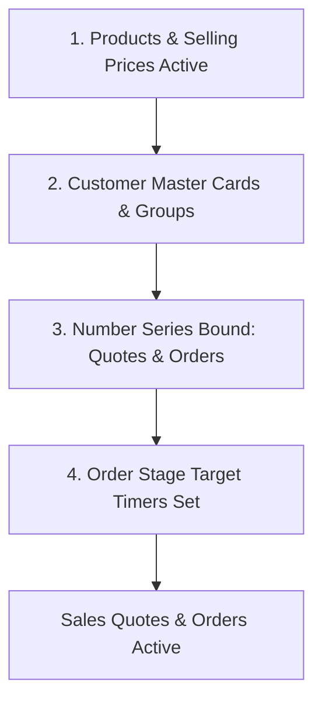
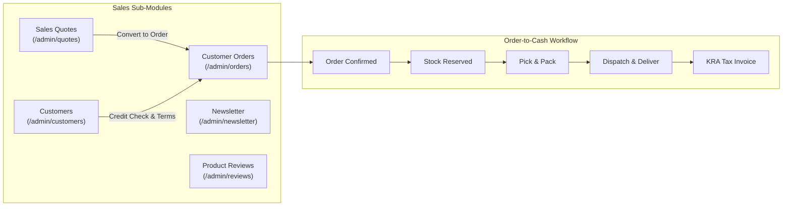

# Guide 03: Sales Quotes & Customer Orders (`/admin/sales`)

The **Sales & Fulfillment** module orchestrates the complete Order-to-Cash (O2C) lifecycle. It manages proforma sales quotations, omnichannel customer orders (online storefront, physical point-of-sale, and back-office credit sales), customer master cards, credit limit enforcement, newsletter subscribers, and product reviews.

---

## 1. Executive Overview & Commercial Value Proposition

### Operational Problems Solved
- **The Delivery & Fulfillment Blame Game**: When an order is delivered late or items go missing, sales reps blame the warehouse, warehouse staff blame the dispatcher, and dispatchers blame the courier. QSell eliminates this through an **immutable, server-timestamped order timeline** that tracks the exact second an order entered and exited every stage (Received $\rightarrow$ Confirmed $\rightarrow$ Reserved $\rightarrow$ Picked $\rightarrow$ Packed $\rightarrow$ Dispatched $\rightarrow$ Delivered).
- **Uncontrolled Credit Overextension**: Sales reps often accept orders from customers who have exceeded their credit limits or have 90-day overdue invoices. QSell enforces hard credit limit checks at order placement, automatically blocking unapproved credit orders.
- **Friction in B2B Quotation Negotiations**: B2B deals require multi-line formal proforma quotes with negotiated discounts and validity dates. In manual systems, quotes are made on spreadsheets and must be re-typed into the accounting system when won. QSell converts quotes to confirmed sales orders in a single click with zero data re-entry.

### Target Client Profiles
- **Wholesalers & B2B Trade Distributors**: Managing formal quotations, corporate customer accounts, credit terms (Net 30, Net 60), and multi-branch delivery schedules.
- **Omnichannel Retailers**: Processing walk-in counter sales alongside high-volume e-commerce orders.
- **Field Sales Teams**: Generating field quotes on tablets that link directly to warehouse inventory.

### Commercial Sales Pitch & Talk Track
> *"With QSell, your sales team moves deals from quotation to cash with zero friction and 100% accountability. Every quote you generate can be converted into a live sales order with a single click. Every single order is tracked with an unalterable server timestamp at every milestone—so you know exactly how long an order took to be picked in the warehouse, when it was handed to the rider, and the exact second the customer signed for it at the door."*

### Measurable ROI & Safeguards
- **Zero Double-Entry Overhead**: Quotes instantly convert to Orders, Orders to Packing Slips, and Orders to KRA-signed Invoices.
- **Elimination of Bad Debts**: Automatic credit-ceiling enforcement blocks orders when customers exceed agreed limits.
- **Order SLA Enforcement**: Real-time alerts when orders languish in picking or packing beyond target thresholds.

---

## 2. Prerequisites & Configuration Sequence

1. **Active Sellable Products**: Products must be assigned a business classification marked as *"Sold to Customers"* with active selling prices.
2. **Customer Master Cards**: Cash or credit customer accounts must exist under `/admin/customers`.
3. **Number Series**: Document number series for Sales Quotes (`QT-`) and Sales Orders (`ORD-`) must be active under `Settings > Number Series`.
4. **Order SLA Targets**: Stage timeout targets should be defined under `Settings > Order Targets` to trigger late-stage notifications.
5. **Staff Permissions**:
   - `quotes:read`, `quotes:manage`: Access and manage quotations.
   - `orders:read`, `orders:manage`: Process orders and print packing slips.
   - `customers:read`, `customers:manage`: Create and edit customer cards.

---

## 3. Module & Sub-Module Architecture

The Sales module coordinates five operational areas:

---

## 4. Interface-by-Interface Walkthrough

### Sub-Module 1: Sales Quotes (`/admin/quotes`)
- **Quotes List View (`QuotesTable`)**: Paged table showing Quote Number, Customer Name, Issue Date, Expiration Date, Total Amount, and Status (`Draft`, `Sent`, `Accepted`, `Converted`, `Expired`, `Rejected`).
- **Quote Creation & Editor (`QuoteEditor`)**:
  - Customer selection with instant customer credit standing preview.
  - Line-item editor: SKU selection, unit of measure, quantity, base price, discount %, and tax rate.
  - Real-time calculation toolbar: Subtotal, total discount, VAT, and grand total.
  - Validity expiration date picker and customer memo notes.
- **Quote Detail Modal (`QuoteDetails`)**: Full proforma document view with actions to **Print PDF**, **Send via Email**, **Accept**, or **Convert to Order**.

### Sub-Module 2: Customer Orders (`/admin/orders`)
- **Orders List View**: Filterable by Channel (`Web Shop`, `Counter POS`, `Sales Rep`, `B2B Account`), Status (`Pending`, `Confirmed`, `Processing`, `Dispatched`, `Delivered`, `Cancelled`), Payment Status (`Unpaid`, `Paid`, `Partial`), and Branch.
- **Order Details Modal (`OrderDetailsModal`)**: Comprehensive multi-tab operational hub:
  1. **Order Summary Tab**: Order lines, quantities, unit prices, applied coupons, delivery fees, and grand total.
  2. **Stage Timeline Panel (`OrderTimelinePanel`)**: Visual vertical timeline showing every stage event with exact server timestamps, actors, and duration spent in each stage.
  3. **Deliveries Panel (`OrderDeliveriesPanel`)**: Shows partial and complete dispatches, courier tracking numbers, and delivery run links.
  4. **Stock Allocation Panel (`OrderStockPanel`)**: Shows warehouse reservations, batches allocated, and goods issue status.
  5. **Collection Panel (`OrderCollectionPanel`)**: Payment method, gateway reference, M-Pesa receipt code, and door cash collection status.
  6. **KRA Invoice Preview (`OrderInvoicePreview`)**: Electronic tax invoice details, KRA digital signature code, and QR verification code.

### Sub-Module 3: Customers (`/admin/customers`)
- **Customer Directory**: Tabular list showing Account Code, Customer Name, Account Type (`Cash` or `Credit`), Phone, Email, City, Balance Owed, and Status (`Active`, `Suspended`).
- **Customer Card Details**:
  - **Identity & Legal**: Name, Trading Name, KRA PIN, Identity Document (National ID / Passport / Incorporation Cert).
  - **Credit Terms & Risk**: Credit limit (e.g. KES 500,000), payment grace period (e.g. 30 days), and price group assignment (e.g. *Wholesale Tier 1*).
  - **Billing & Shipping Addresses**: Multiple physical delivery locations with geo-coordinates.
  - **Dimension Bindings (`DimensionFields`)**: Cost center, sales territory, or industry vertical tags for financial reporting.

### Sub-Module 4: Newsletter (`/admin/newsletter`)
- List of customer email subscribers captured via storefront footers and popups.
- Export to CSV action for email marketing campaigns (Mailchimp, Sendgrid).

### Sub-Module 5: Product Reviews (`/admin/reviews`)
- Customer review moderation queue showing Product Name, Customer Name, Star Rating (1-5), Review Headline, Review Body, and Submission Date.
- Action buttons: **Approve Review** (publishes to storefront) or **Reject / Archive** (removes from public display).

---

## 5. Granular Field-by-Field Reference

### Sales Quote Editor Fields (`/admin/quotes/new`)

| Field Label | Purpose | Type & Format | Required? | Validation Rules & Hints |
|---|---|---|---|---|
| **Customer** | Account receiving the quote. | Lookup Autocomplete | **Required** | Type 2+ characters to search customer cards. |
| **Quote Date** | Issue date. | Date (YYYY-MM-DD) | **Required** | Defaults to today's date. |
| **Valid Until** | Expiration date of quoted prices. | Date (YYYY-MM-DD) | **Required** | Must be $\ge$ Quote Date. Quotes cannot be converted after this date. |
| **Branch** | Fulfilling branch location. | Dropdown | **Required** | Determines inventory availability checks. |
| **Product Line: SKU** | Product item. | Lookup Autocomplete | **Required** | Must be an active, sellable product. |
| **Product Line: Qty** | Number of units quoted. | Decimal / Integer | **Required** | Must be $> 0$. Validated against unit of measure decimals. |
| **Product Line: Price** | Unit selling price. | Currency (KES) | **Required** | Defaults to price list. Cannot violate price floor. |
| **Product Line: Discount** | Line-item discount percentage. | Percentage (0-100%) | Optional | Capped by user's role override limit. |
| **Notes / Terms** | Commercial stipulations on quote. | Text (Max 500 chars) | Optional | Printed on proforma footer (e.g., *"Lead time 7 days"*). |

### Customer Card Fields (`/admin/customers/new`)

| Field Label | Purpose | Type & Format | Required? | Validation Rules & Hints |
|---|---|---|---|---|
| **Account Type** | Determines payment requirements. | Radio Selector | **Required** | `Cash` (must pay before dispatch) or `Credit` (invoiced). |
| **Customer Name** | Full legal or business name. | Text (Max 120 chars) | **Required** | Displayed on tax invoices. |
| **KRA PIN** | Customer's tax registration. | Text (11 chars) | Optional for Retail, **Required for B2B** | Must be a valid KRA PIN format for B2B eTIMS transmission. |
| **Phone Number** | Primary mobile contact. | Phone (Max 25 chars) | **Required** | Used for delivery SMS notifications and M-Pesa STK push. |
| **Email Address** | Invoicing email. | Email (Max 160 chars) | Optional | PDF invoices and proformas are dispatched here. |
| **Credit Limit** | Maximum outstanding balance allowed. | Currency (KES) | Required if Credit | e.g. `250000.00`. Orders blocked if balance + order $>$ limit. |
| **Payment Terms** | Grace period in days. | Integer (Days) | Required if Credit | e.g. `30` for Net 30 days. |
| **Price Group** | Custom pricing tier. | Dropdown | Optional | e.g. *Retail*, *Wholesale*, *Contractor*. |

---

## 6. Step-by-Step User Actions (Down to the Last Click)

### Action 1: Creating and Converting a Proforma Sales Quote to an Order
1. Navigate to `/admin/quotes` and click **New Quote** in the top right.
2. In the **Customer** lookup field, search for and select the client (e.g. *"Acme Construction Ltd"*).
3. Set the **Valid Until** date (e.g., 14 days from today).
4. Click **Add Line Item**.
5. In the product autocomplete, select the product (e.g., *"500W Solar Panel"*).
6. Enter the **Quantity** (e.g. `20`). The system automatically pulls the current customer group price.
7. Enter a negotiated discount (e.g. `5%`). The system recalculates the subtotal and VAT in real time.
8. Click **Save Quote**. The quote status becomes `Sent`.
9. When the client approves the proposal, open the quote details and click the **Convert to Order** button.
10. An `InlineConfirm` prompt appears: *"Convert Quote #QT-00142 into a confirmed Sales Order?"*
11. Click **Confirm Conversion**.
12. The quote status updates to `Converted`, and the system redirects to the newly created Sales Order with all lines, prices, and customer details intact.

### Action 2: Inspecting an Order's Timestamped Stage Timeline
1. Navigate to `/admin/orders`.
2. Locate the order using the search bar (by Order Number, Customer Name, or Phone).
3. Click the order row to open the **Order Details Modal**.
4. Click the **Timeline** tab.
5. The timeline renders chronologically:
   - `09:14:02` — *Order Placed* (Channel: Web Shop, Actor: Customer).
   - `09:14:05` — *Payment Confirmed* (M-Pesa STK Push: KES 14,500, Ref: `QA712XYZ`).
   - `09:15:20` — *Stock Reserved* (Warehouse: Central Depot, 2 items locked).
   - `09:40:12` — *Pick Started* (Actor: John Kamau - Storekeeper).
   - `09:52:00` — *Packed & Ready for Dispatch* (Packing Slip #PS-1082 printed).
   - `10:15:30` — *Dispatched* (Rider: Peter Ochieng, Run #RUN-04).
   - `10:48:15` — *Delivered* (Customer Signature & Verification PIN Confirmed).
6. Hover over any stage to view duration spent (e.g., *"Time in Packing: 11 minutes"*).

### Action 3: Reviewing and Moderating Customer Product Reviews
1. Navigate to `/admin/reviews`.
2. The table displays pending reviews submitted by shoppers on the storefront.
3. Review the star rating, title, and comments.
4. To approve: Click **Approve**. The review immediately becomes visible on the product page and updates the product's aggregate star rating.
5. To reject: Click **Reject**. An inline text prompt asks for an internal reason (e.g., *"Offensive language"* or *"Spam"*). Click **Confirm Rejection**.

---

## 7. Conditions, Business Rules & Edge Cases

### The Credit Limit Breach Rule
- When an order is placed on credit (either via counter order or quote conversion), the system checks:
  $$\text{Current Unpaid Balance} + \text{New Order Total} \le \text{Customer Credit Limit}$$
- If the calculation exceeds the limit:
  - If an **Approval Workflow** for credit override is configured, the order status halts in `Pending Credit Approval` and alerts the Credit Manager.
  - If no approval workflow exists, order creation is **blocked** with the error: *"Customer credit limit exceeded by KES [Amount]. Payment required before placement."*

### Stage Immutability & Reversals
- Once an order stage timestamp is recorded in the append-only event log, it can **never** be edited or deleted.
- If an order must be cancelled after dispatch:
  1. The order status moves to `Delivery Failed` or `Cancelled`.
  2. A return-to-stock movement is issued, recording the physical return of the goods to inventory.
  3. A credit note is generated referencing the original invoice.

---

## 8. Implementor Checklist & Go-Live Verification

| Step | Verification Task | Expected Result | Pass/Fail |
|---|---|---|---|
| 1 | Create a test Cash Customer and Credit Customer. | Both customers saved; credit limit reflected on Credit Customer. | [ ] |
| 2 | Issue a Sales Quote with a 10% line discount. | Proforma calculates discount and VAT accurately; status shows Draft/Sent. | [ ] |
| 3 | Convert Quote to Order. | Order created with identical lines; Quote status transitions to Converted. | [ ] |
| 4 | Attempt to place an order exceeding Credit Customer's limit. | System blocks or routes to Credit Approval queue as configured. | [ ] |
| 5 | Verify Order Timeline Events. | Placement, payment, and dispatch timestamps render accurately in order modal. | [ ] |
