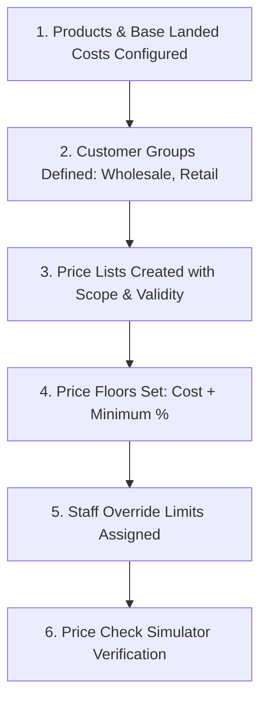
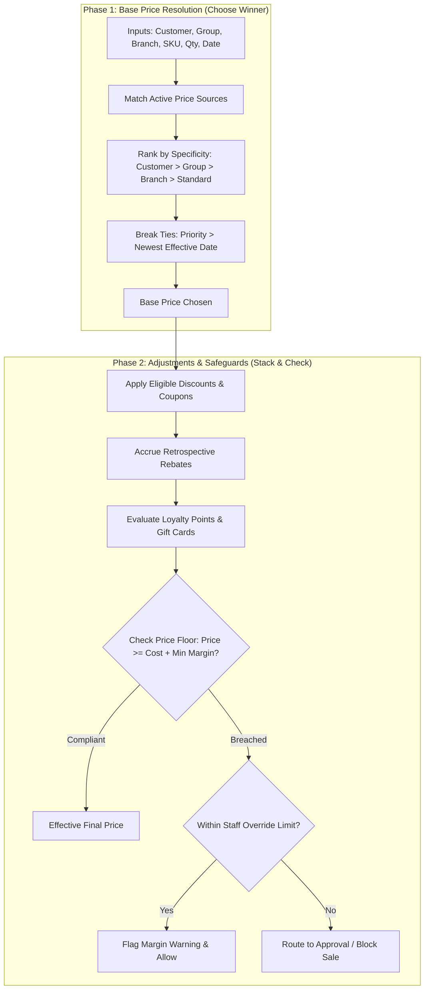

# Guide 04: Pricing Engine, Promotions & Margins (`/admin/pricing`)

The **Pricing Engine** is the commercial brain of QSell. It governs how base prices are determined across different customer tiers, retail channels, and branches, while enforcing strict margin protection rules, promotional coupons, retrospective rebates, loyalty points, and role-based discount caps.

---

## 1. Executive Overview & Commercial Value Proposition

### Operational Problems Solved
- **Erosion of Profitability Through Uncontrolled Discounting**: In competitive sales environments, sales reps frequently offer deep discounts to close deals, inadvertently selling products below cost or wiping out gross margin.
- **Accidental Discount Stacking**: Businesses often run promotional coupons (e.g. 10% off) that unintentionally stack on top of existing wholesale volume discounts and loyalty redemptions, leading to crippling margin loss.
- **Complexity in Multi-Tier B2B Pricing**: Managing different price sheets for retail customers, wholesale stockists, contractors, and export clients on paper or spreadsheets causes billing errors and client disputes.
- **No Explanation of How a Price Was Reached**: When a customer asks *"Why was I charged KES 1,850 instead of KES 1,700?"*, legacy ERPs cannot explain the calculation. QSell generates a deterministic **Price Trace** explaining every step in the waterfall.

### Target Client Profiles
- **Wholesalers & FMCG Distributors**: Utilizing customer tiers (Wholesale A/B/C), minimum order quantities (MOQs), and tiered volume breaks (e.g. 1-10 units @ KES 1,000; 11-50 units @ KES 920; 51+ units @ KES 850).
- **Multi-Branch Retailers**: Charging localized prices based on branch geography or transport costs (e.g. Nairobi vs. Lodwar).
- **High-Margin Hardware & Contractor Suppliers**: Requiring cost-plus minimum price floors to ensure every sale yields at least a 15% gross margin.

### Commercial Sales Pitch & Talk Track
> *"With QSell, you will never accidentally sell a product at a loss again. Our pricing engine lets you configure sophisticated wholesale price lists, volume breaks, and seasonal promotional codes, while locking your bottom line with automated Price Floors. If a salesperson attempts to discount an item below your required margin floor, the system blocks the transaction or automatically routes it to the Managing Director for approval. Best of all, our Price Check simulator allows you to test any pricing rule before it goes live."*

### Measurable ROI & Safeguards
- **100% Margin Floor Lock**: Hard stop prevents any quote or order from being sold below cost + minimum markup.
- **Deterministic Price Trace**: Complete auditability on every transaction line item.
- **Controlled Discretionary Limits**: Sales reps, supervisors, and managers each have defined discount authority ceilings.

---

## 2. Prerequisites & Configuration Sequence

1. **Product Master Data**: SKUs must exist with valid Base Selling Prices and Unit Cost Prices under `Catalog > Products`.
2. **Customer Groups**: Defined under `/admin/pricing/groups` (e.g. *Retail Cash*, *Trade Tier 1*, *Government Tender*).
3. **Price Lists**: Created with currency (KES), validity dates, and branch/customer scope.
4. **Price Floors**: Configured under `/admin/pricing/floors` to set non-negotiable minimum profit barriers.
5. **Override Limits**: Configured under `/admin/pricing/limits` to set role-based discount authority.
6. **Required Permissions**: `pricing:read` to view and `pricing:manage` to create or alter price rules.

---

## 3. Module & Sub-Module Architecture

The Pricing Engine operates as a deterministic 2-phase calculation waterfall:

---

## 4. Interface-by-Interface Walkthrough

### Sub-Module 1: Customer Groups (`/admin/pricing/groups`)
- Defines customer segmentation tiers (e.g., *Walk-in Retail*, *Wholesale Bronze*, *Wholesale Platinum*, *Staff*).
- Allows assigning customers in bulk or binding automatic qualifying criteria.

### Sub-Module 2: Price Lists (`/admin/pricing`)
- Table of active and scheduled price lists showing Code, Name, Currency, Priority, Effective Dates, and Scope.
- Line Editor: Set prices per SKU, Unit of Measure, and Quantity Breaks (e.g. Buy 10+, Buy 50+, Buy 100+).

### Sub-Module 3: Discounts & Coupons (`/admin/pricing/discounts`)
- Configures promotional campaigns:
  - **Type**: Percentage discount (e.g. 10% off), Fixed amount (e.g. KES 500 off), or Free Item.
  - **Trigger**: Coupon code entry, minimum cart value threshold (e.g. Spend KES 10,000+), or specific product bundles.
  - **Stacking Rules**: Whether this discount can combine with other active promotions.

### Sub-Module 4: Rebates (`/admin/pricing/rebates`)
- Long-term customer loyalty agreements:
  - Tracks cumulative purchase volume over a calendar quarter or year.
  - Accrues rebate percentages (e.g. *"Buy KES 2,000,000 of cement in Q1, receive 3% credit rebate"*).
  - Automatically generates Accounts Receivable Credit Memos upon milestone attainment.

### Sub-Module 5: Loyalty Points (`/admin/pricing/loyalty`)
- Point accrual engine: Set earn rate (e.g. 1 Point per KES 100 spent) and redemption rate (e.g. 1 Point = KES 1.00 store credit).
- Expiration rules and minimum points required to redeem.

### Sub-Module 6: Gift Cards (`/admin/pricing/gift-cards`)
- Prepaid voucher management: Generate digital gift card codes, assign balances, track partial redemptions, and monitor expiration dates.

### Sub-Module 7: Price Book (`/admin/pricing/book`)
- Printable and exportable matrix showing what every product sells for in any combination of Customer Group, Branch, and Quantity tier. Ideal for distributing physical price sheets to field sales agents.

### Sub-Module 8: Pricing Insights (`/admin/pricing/insights`)
- Executive analytics dashboard displaying:
  - Average realized gross margin across all orders.
  - Total revenue surrendered to promotional discounts and coupon codes.
  - Frequency of manual price overrides by sales representatives.

### Sub-Module 9: Price Floors (`/admin/pricing/floors`)
- The ultimate margin defense system:
  - Configures minimum selling prices based on:
    - `Cost + Percentage Markup` (e.g. Cost + 15%).
    - `Cost + Fixed Amount` (e.g. Cost + KES 200).
    - `Hard Absolute Price Floor` (e.g. Never sell below KES 1,500).
  - Scoped by specific Product, Product Group, or Category.

### Sub-Module 10: Override Limits (`/admin/pricing/limits`)
- Governs how far a staff member may manually lower a price or apply a discretionary discount:
  - *Junior Sales Rep*: Max 3% discount, cannot breach price floor.
  - *Senior Sales Account Manager*: Max 10% discount.
  - *Branch Manager*: Max 18% discount.
  - *Commercial Director*: Unlimited override authority.

### Sub-Module 11: Price Check / Simulator (`/admin/pricing/check`)
- The interactive sandbox where implementors and sales reps can test pricing scenarios:
  - Input: Select a Customer, Branch, Product SKU, Quantity, and Date.
  - Output: Instant live calculation with full waterfall trace displaying every considered price list, why one won, and which discounts applied.

### Sub-Module 12: Price Rules (`/admin/pricing/rules`)
- Master resolution settings configuring the relative weights and specificity rankings of competing price sources.

---

## 5. Granular Field-by-Field Reference

### Price List Line & Quantity Break Fields (`/admin/pricing/[id]`)

| Field Label | Purpose | Type & Format | Required? | Validation Rules & Hints |
|---|---|---|---|---|
| **Product / SKU** | Target item being priced. | Lookup Autocomplete | **Required** | Must be an active sellable product. |
| **Unit of Measure** | Selling package. | Dropdown | **Required** | e.g. *Piece*, *Box of 24*, *Kilogram*. |
| **Minimum Quantity** | Tier threshold (`From Qty`). | Integer / Decimal | **Required** | Tier 1 begins at `1`. Subsequent tiers must be higher. |
| **Tier Price** | Unit price for this quantity tier. | Currency (KES) | **Required** | Must be $> 0$. Format: 2 decimal places. |
| **Pricing Method** | How tier applies. | Radio Selector | **Required** | `All Units` (retroactive to unit 1) or `Incremental` (bracketed). |
| **Start Date** | Effective start date. | Date (YYYY-MM-DD) | Optional | If blank, active immediately upon publishing. |
| **End Date** | Expiration date. | Date (YYYY-MM-DD) | Optional | Must be $\ge$ Start Date. Automatically retires at 23:59:59. |

### Price Floor Fields (`/admin/pricing/floors/new`)

| Field Label | Purpose | Type & Format | Required? | Validation Rules & Hints |
|---|---|---|---|---|
| **Scope Type** | Level of floor application. | Dropdown | **Required** | `Company-Wide`, `Category`, `Product Group`, `Specific SKU`. |
| **Target Entity** | Selected category or product. | Lookup Autocomplete | Required if not Company-Wide | Selects the entity to protect. |
| **Floor Method** | How the minimum price is calculated. | Dropdown | **Required** | `Cost + Markup %`, `Cost + Fixed Amount`, `Fixed Minimum Price`. |
| **Floor Value** | The rate or amount. | Decimal / Currency | **Required** | e.g. `15.0` for 15% markup, or `250.00` for KES 250 margin. |
| **Enforcement** | Behavior upon violation. | Radio Selector | **Required** | `Hard Stop (Block Sale)` or `Require Manager Approval`. |

---

## 6. Step-by-Step User Actions (Down to the Last Click)

### Action 1: Setting Up a Tiered Wholesale Price List
1. Navigate to `/admin/pricing` and click **New Price List**.
2. Enter **List Name**: *"Wholesale Platinum Tier 1"*.
3. Set **Currency**: `KES`.
4. Set **Scope**: In the Customer Group dropdown, select *"Wholesale Platinum"*.
5. Set **Priority**: `10` (higher priority wins over generic lists).
6. Click **Save & Add Products**.
7. In the product lines table, click **Add Product**.
8. Select the SKU (e.g., *"Cement 50kg Bag"*).
9. In Tier 1: Set `From Qty: 1`, `Price: 750.00`.
10. Click **Add Tier**: Set `From Qty: 50`, `Price: 710.00`.
11. Click **Add Tier**: Set `From Qty: 200`, `Price: 680.00`.
12. Click **Save Price List**.
13. Status updates to `Active`. Any Wholesale Platinum customer ordering 50+ bags instantly receives KES 710.00.

### Action 2: Protecting Margins by Configuring a Price Floor
1. Navigate to `/admin/pricing/floors` and click **New Price Floor**.
2. Set **Scope Type** to **Category**.
3. Select **Category**: *"Power Tools & Machinery"*.
4. Set **Floor Method**: `Cost + Markup %`.
5. Enter **Floor Value**: `20.0` (meaning Cost + 20%).
6. Set **Enforcement**: `Hard Stop (Block Sale)`.
7. Click **Activate Price Floor**.
8. A green confirmation banner displays: *"Price floor activated. 48 products protected."* Any attempt to sell a power tool below cost + 20% is now impossible across all channels.

### Action 3: Simulating a Transaction in the Price Check Sandbox
1. Navigate to `/admin/pricing/check`.
2. In the **Customer** lookup, select *"QuickFix Contractors"*.
3. In the **Product** lookup, select *"Inverter 5kVA"*.
4. In the **Quantity** box, type `5`.
5. In the **Branch** dropdown, select *"Nairobi Westlands"*.
6. Click the **Simulate Price** button.
7. The **Waterfall Trace** displays:
   - *Standard Retail Price*: `KES 120,000.00`
   - *Customer Group Match (Trade)*: `KES 108,000.00` (Wins by Specificity)
   - *Quantity Break (5+ units)*: `KES 102,000.00`
   - *Active Coupon `SAVE5`*: `- KES 5,100.00` (Applied)
   - *Price Floor Check*: Landed Cost `KES 85,000.00` + 15% Floor (`KES 97,750.00`).
   - *Floor Result*: PASS (Net KES 96,900 is below floor? Triggers warning/approval).
8. The tool displays the exact formula and reason string that will be written to the order.

---

## 7. Conditions, Business Rules & Edge Cases

### Specificity Hierarchy (Who Wins When Prices Compete?)
When multiple active price sources match an order line, the winner is determined strictly by the **Specificity Hierarchy**:
1. **Contract Locked Price** (Explicit legal agreement with client).
2. **Customer-Specific Price** (Negotiated price sheet for this single account).
3. **Customer Group Price** (Tiered wholesale or trade group).
4. **Route / Van Price** (Mobile distribution route).
5. **Branch / Location Price** (Regional store price).
6. **Standard Product Price** (Base catalog price).

*Ties are broken by Price List Priority integer, then Newest Effective Date.*

### Preventing Coupon Cannibalization
- If a discount has the flag `allow_stacking = false`, applying it disables all other promotional discounts on that order line.
- The system automatically compares the single unstacked discount against the sum of competing stacked discounts and awards the customer the **better of the two deals** without double-dipping.

---

## 8. Implementor Checklist & Go-Live Verification

| Step | Verification Task | Expected Result | Pass/Fail |
|---|---|---|---|
| 1 | Create Customer Group *"Wholesale"* and assign a test customer. | Customer profile reflects the new group. | [ ] |
| 2 | Create a Price List for Wholesale with quantity break at 10 units. | Buying 9 units quotes Base Price; buying 10 units quotes Tier Price. | [ ] |
| 3 | Configure a 20% Cost-Plus Price Floor on a test product. | Selling below Cost + 20% is blocked with explicit floor warning. | [ ] |
| 4 | Test Staff Override Limit for a Junior Sales Rep. | Entering a manual discount above 5% is blocked. | [ ] |
| 5 | Run Price Check Simulator on 3 complex scenarios. | Trace displays correct winning source, applied discounts, and margin check. | [ ] |
