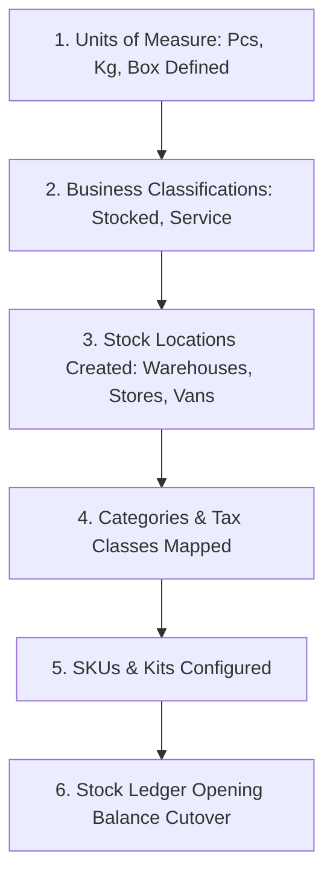
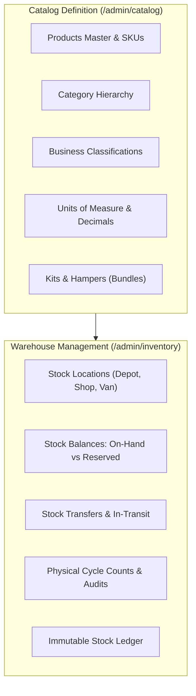

# Guide 05: Products Catalog & Inventory Control (`/admin/catalog`, `/admin/inventory`)

The **Products & Inventory Control** module governs the entire physical life of products—from SKU master definition and multi-level category classification to multi-location warehouse management, units of measure conversions, kits and hampers, two-step stock transfers, and continuous physical cycle counts.

---

## 1. Executive Overview & Commercial Value Proposition

### Operational Problems Solved
- **The "Single Stock Number" Blind Spot**: In basic systems, a product has one global stock number (e.g. *"50 units on hand"*). Management has no idea if those 50 units are in the Nairobi central depot, the Mombasa branch, or on a rider's delivery van, leading to false promises to customers.
- **Lost Goods in Transit**: Moving stock between warehouses or out on delivery vans is where theft and shrinkage occur. Traditional spreadsheets write off stock immediately upon dispatch, losing all accountability while goods are on the road. QSell introduces an **In-Transit Ledger** where goods remain on the company's books until formally acknowledged and received at the destination.
- **Stock Counts That Force Business Closures**: Businesses often shut down operations for an entire weekend to conduct physical inventory counts. In QSell, **Continuous Cycle Counting** allows warehouse staff to count shelves while retail cashiers and the web shop continue selling without discrepancy errors.
- **Unit of Measure Confusion**: Selling a product in pieces, 12-packs, and 24-box cartons typically causes inventory chaos. QSell enforces strict base-unit decimal conversions (e.g., kilograms, litres, pieces).

### Target Client Profiles
- **Multi-Branch Retailers & Wholesalers**: Operating central distribution hubs, regional branch stores, and mobile van-sales fleets.
- **Hardware, Agro-Dealers & Building Suppliers**: Selling goods by weight, length, volume, or pack sizes (cement, paint, fertilizer, cabling).
- **Gift, Hamper & Food Distributors**: Assembling multi-item gift hampers and combo kits priced as a single unit but fulfilled and taxed as individual components.

### Commercial Sales Pitch & Talk Track
> *"With QSell, you always know exactly what you have, exactly where it sits, and what it is worth. Your inventory isn't just a number on a spreadsheet—it is an immutable ledger. You can see real-time stock across every warehouse, branch shop, and delivery van. When you move stock between locations, it is tracked in transit. And best of all, you can perform physical stock audits on your shelves during business hours while your cashiers keep ringing up sales."*

### Measurable ROI & Safeguards
- **Zero Shrinkage in Transit**: Two-step transfers require sender dispatch and receiver sign-off with variance reporting.
- **Zero Interrupted Trading**: Continuous cycle counts eliminate the need for costly weekend store closures.
- **Kit Component Explosion**: Bundles automatically deduct stock and calculate KRA tax for individual underlying components.

---

## 2. Prerequisites & Configuration Sequence

1. **Units of Measure**: Defined under `/admin/settings/units` (Base units and conversion multipliers).
2. **Business Classifications**: Defined under `/admin/item-types` (Determining whether an item is physical stock, service, or consumable).
3. **Stock Locations**: Defined under `/admin/inventory/locations` (At least one default warehouse or shop).
4. **Categories**: Created under `/admin/categories` with mapped KRA tax classifications.
5. **Staff Permissions**:
   - `products:read`, `products:manage`: Create and manage catalog SKUs.
   - `stock:read`, `stock:manage`: View stock levels, issue transfers, and conduct counts.
   - `stock:cutover`: Execute initial opening balance migration.

---

## 3. Module & Sub-Module Architecture

The Products & Inventory module is divided into two operational domains:

---

## 4. Interface-by-Interface Walkthrough

### Sub-Module 1: Products Master (`/admin/products`)
- **Product Directory**: Server-paged table with instant filtering by Category, Stock Status (`In Stock`, `Low Stock`, `Out of Stock`), Classification, and Channel visibility.
- **Product Editor (`/admin/products/[id]`)**:
  - **Basic Info**: Title, SKU, Barcode (EAN-13/UPC), Brand, Category, Short Description, and HTML Rich-Text Body.
  - **Pricing & Tax**: Selling Price, Cost Price (for gross margin calculation), KRA Tax Classification (16% VAT, Zero-Rated, Exempt).
  - **Stock & Units**: Unit of Measure picker, Minimum Reorder Threshold, Safety Stock, and Track Inventory toggle.
  - **Web Shop Flags**: `Show on Web Shop` toggle, `Sold only inside packages` toggle, SEO title/description, and high-resolution gallery image uploader.

### Sub-Module 2: Trash (`/admin/trash/products`)
- Soft-delete recovery screen. Products removed from the catalog can be **Restored as Drafts** or permanently purged (only if no historic transaction or stock ledger records exist).

### Sub-Module 3: Business Classifications (`/admin/item-types`)
- Establishes product accounting behavior:
  - *Stocked Goods*: Physical inventory tracked in warehouses.
  - *Non-Stocked Services*: Labor, installation, delivery fees, consulting.
  - *Consumables / Packaging*: Boxes, tape, branded bags used at checkout.
  - Controls whether the item is *"Sold to Customers"* across quotes, orders, and storefront.

### Sub-Module 4: Units of Measure (`/admin/settings/units`)
- Global table of measurement units (e.g., `PCS`, `KG`, `LTR`, `BOX`, `MTR`).
- Enforces decimal precision (e.g. Kilograms allow 3 decimals `1.425 kg`, while Pieces allow 0 decimals `1 pc`).
- Defines conversion ratios (e.g., 1 Box = 24 Pieces).

### Sub-Module 5: Categories (`/admin/categories`)
- Multi-level tree view for organizing products into departments, categories, and subcategories. Drives storefront mega-menus and automated KRA tax inheritance.

### Sub-Module 6: Kits and Hampers (`/admin/pricing/kits`)
- Bundle creator: Defines combo packages (e.g., *"Solar Home Kit 1kVA"* or *"Executive Christmas Hamper"*).
- Line component mapping: Links 4 individual panels, 1 inverter, 2 batteries, and 1 mounting kit into a single sellable SKU.
- Component Tax Handling: Automatically apportions VAT across components with differing tax rates.

### Sub-Module 6A: Packages (`/admin/pricing/packages`)
A **package** is one product made of **choices**, for a business whose customers build what they buy: a lunch with a fish, a starch and vegetables to pick; a computer set with a choice of memory, storage and screen. A kit is always the same parts; a package lets the shopper decide some of them. Permission: *pricing read* to see, *pricing manage* to make, change or remove. Every change needs a reason from the pricing reasons list and is written to the decision log.

**What you set up, in order**
1. Make the **parts** as ordinary stock products. A part that nobody should buy alone (brown ugali, a side portion) is marked **Sold only inside packages** on its product; it keeps its stock, cost and tax but is not listed, found or sold by itself.
2. Make the **package product** (for example *Express lunch*) with its base price. It must be sold to customers; it cannot be a kit, a part of a kit, a part of another package or marked sold only inside packages.
3. On the Packages screen choose **New package**, pick that product and set:
   - **How the package is priced**: *one base price plus a difference for each option* (the usual), or *each option priced on its own and added up*.
   - **How the price is split over the parts** (for the tax and stock lines on the order): in proportion to the parts' prices (usual), their cost, or shares you set.
   - **An option that is out of stock**: hide it (usual), show it greyed out saying it is sold out, or show it greyed out and suggest another.
   - **In use**: when off, the product sells as an ordinary product.
4. Add **slots**, one for each decision (Fish, Starch, Vegetables, Extras). For each slot give the **fewest and most picks** (1 and 1 is a single choice; 0 as the fewest makes it optional; 1 and 2 lets the shopper pick one or two), whether **the same option can be chosen more than once** (extra portions), and whether it is **included, not a choice** (one option that is always part of it).
5. Add **options** to each slot: the product, the **quantity** of it in one pick, a **difference** to the base price (zero, higher or lower; in *base plus differences* mode) or a **fixed price** (in *summed* mode; empty means the product's own selling price), and whether it is **pre-selected**.
6. Choose a **reason** and **Save package**. The change applies to the next order; orders already made keep what was chosen.

**Rules the screen enforces (the server checks them again)**: the fewest servings is not more than the most, closing needs a time of day, a group audience needs at least one group; at least one slot (at most 20) with at least one option (at most 50); the fewest picks is not more than the most; the same product is not listed twice in a slot; a package cannot contain itself, a kit or another package; every product must exist and be sold to customers; in summed mode every option needs a price; with shares you set every option needs a share. The package list shows the **"from" price** (the cheapest valid choice), warns in red when that choice **sells below what its parts cost**, and flags options that can no longer be chosen because their product was switched off or deleted. **Pricing → Insights** raises the same two warnings.

**Protection**: a product that a package offers cannot be deleted (switch it off, or take it out of the package first). Removing a package does not touch orders or quotes already made.

**Slots filled from a category, a note on each serving, and order again**
- **Where a slot's options come from**: for each slot choose *a list I make, product by product* (the usual) or *every product of a category*. With a category, every product of it that can be sold (switched on, sold to customers, not checkout packaging, not a kit, not a package, not the package itself) is an option, up to 100 by name, so a vegetable added to the category later appears on the package by itself. Set once for the slot: the **category**, the **quantity of each pick** and the **difference** to the base price (or, in *summed* pricing, a **fixed price**; empty means each product's own selling price). A category slot cannot be an *included* slot, and shares you set (the split by shares) cannot be used with it: split by price or by cost. Saving is refused for a category that does not exist or has nothing that can be sold in a package. A category cannot be deleted while a package slot uses it.
- **Customers can write a note on each serving** (a setting on the package, off until turned on): a box under the builder, up to 200 characters, kept with the cart line and the order and shown on the preparation sheet ("Note: no pepper") and in the quote. The note is plain text, never markup. The same choices with another note are another line. A package that does not take notes refuses one.
- **Order again**: a signed-in shopper opening a package sees their own earlier selections of it (newest first, each once, up to three) with the servings, the note and today's price, and **Add again** puts one in the cart. Each earlier choice is found again by slot and part against today's package and stock. A part that is **sold out today is swapped for the nearest available option of the same slot** (the first available one), and the card says so ("Cabbage instead of Sukuma, which is sold out today"); a selection that cannot be made today at all is not offered. The server checks it again when it is added, like anything else. A signed-out visitor sees none.

**What the shopper sees (the web shop builder)**
- A package is an ordinary product page with a **step-by-step builder** in place of the quantity box: one group for each slot, the rule in words ("Choose 1", "Choose 1 to 2", "Choose up to 2 (optional)", "Included"), the pre-selected options already chosen, and on every option card what it adds ("+ KES 120", "Included", "− KES 20", or its own price in *summed* mode). A slot with one pick is a set of round buttons (choose another to replace); a slot with several picks is a set of tick boxes, with **+ / −** on an option when the same one may be chosen more than once.
- The **price is live**: it moves with every choice and shows the total for the servings chosen ("KES 660 each for 2"). **Servings** have their own + / − (1 to 1,000).
- **Add to cart** and **Buy now** are off until the choices are valid, and the reason is written next to them ("Choose an option for Vegetables."). One tap adds when the pre-selected options already make a valid choice.
- **Stock is read for all the servings, not one at a time.** What the shop shows follows the package's *option out of stock* setting: hidden (nothing to choose, no dead end), greyed out saying "Sold out today", or greyed out with a one-tap "Try ..." suggestion. If a slot that needs a choice has nothing left, the package shows "not available right now" instead of a form. Two lunches asking for the last portion of ugali are refused while the shopper builds, naming the part ("Ugali is sold out for 4 servings."). Parts that are services or not counted never run out.
- The **cart line** reads as a sentence: "Express lunch: Large fish, Ugali, Sukuma and Cabbage", with its price, a servings counter, **Edit** (reopens the builder with the choices kept and saves over the line) and **Remove**. The same choices are one line with more servings; different choices are different lines. The line is kept in the shopper's browser as choices only, never prices; on opening the cart, and after every change, the shop prices and checks it again and says plainly what is wrong (a part sold out, a choice removed from the package).
- **Product cards** and listings show **Choose options** instead of Add and Buy now, so a package is never put in the cart as it stands. The package page does not show the product's own price (the builder shows the live one).
- **Security**: the browser sends only product, option and slot ids and counts. Prices, quantities, tax and which options exist are all decided on the server; a choice from another package, a missing or duplicated option, too many or too few picks, a negative or fractional count, a package that is switched off or not sold on the web, or more than 20 package lines in one cart is refused with a plain message.

**Rules of ordering (set per package on the Packages screen; empty means no rule)**
- **Fewest and most servings per order** (a group lunch from 10 servings), counted over all lines of one package in the order.
- **Notice needed** (hours), **ordering closes** (a number of days before the date, at a time of day) and **days it can be served** (none ticked means every day), all counted in the company's time zone against the date the order is for.
- **Most servings promised for one day**. The count is of orders that still stand (a cancelled order gives its servings back). Two orders for the last servings arrive at the same moment: the database queues them and one is told "Only 2 servings left for that date" or "fully booked", with no stock held for it.
- **Who may order**: anyone, signed-in customers only, or only customers in the groups you choose. Group and corporate prices are not a setting here: they come from the price lists of those groups, which price the package product as they price any product. A different offer for a different audience is simply another package.
- **The date an order is for** is the delivery time the shopper chose. A package with notice, closing, day or daily-limit rules asks for it; with none, the shopper is told "choose the date you need it". Notice is counted to the start of the chosen day. A staff channel without a delivery passes the date itself.
- Every refusal says the rule in plain words and is kept on the checkout's record with its time and a reason ("Package ordering rule" or "Package choice problem").

**What happens when a package is ordered**
1. The shop re-reads the package, checks every choice, prices it again (the base price through the price lists for that customer, plus what the choices add; or the choices' own prices added up) and checks stock for all the servings together. Nothing the browser says about price is used.
2. Promotions and coupons apply to the package line like any line; then the price is shared over the chosen parts by the package's split method, each part taxed at its own product's rate, exactly like a kit. Parts of the same product that also appear elsewhere in the order fold into one line, so invoices, returns and credit notes work product by product. The order lines read "Large fish (Express lunch)".
3. The choice actually made must not sell for less than its parts cost; otherwise the order is refused ("would sell for less than its parts cost").
4. Stock is held for each part (never for the package product), in the same step as for any order. A cancelled order gives each part back; a return or credit note of one part credits that part's share.
5. The exact selection is saved with the order (the package and its version, servings, price after discounts, the date, and every pick with its slot and the part's name as it was). This record, not the folded lines, says what to prepare, and it survives a later change or removal of the package.
6. A package product added as a plain item (for example from an old saved cart) is refused.

**On the shop**: the package card and the package's structured data and share card show the **from** price (the cheapest valid choice). The checkout lists each package line with its price and the cart badge counts servings.

**Preparation sheet**: what to make for a day, from the choices saved with each order, with totals and print: Sub-Module 2A of guide 03 (`/admin/orders/preparation`).

**Quotes and staff orders**: a package can be sold on a quote with **Add a package** (guide 03) using the same builder, kept by slot name and part, converted to an order whose price stands, with a part the package no longer offers named and the conversion stopped. The documents that can sell a package are listed in one registry (web shop and staff orders, quotes); the point of sale, sales orders, sales invoices and credit sales are added to it when they are built, and a shared test runs the same package cases (same price, same tax, same parts, same refusals) against every registered document type.

**What is not built yet (later slices)**: the group link (P-7); **Request a quote** instead of Add to cart; a package offered only on some channels; staff taking a package order directly (there is no staff order screen other than quotes yet); point of sale, sales orders, invoices and credit sales (they register themselves when built). A signed-in shopper's package lines are kept in the browser, not on the account yet. Notice is counted to the start of the day, not to a delivery slot's start time. The package's price does not yet go through option-by-option price lists (an option is charged at its product's selling price or the fixed price given). The package is already defined once and will be sold the same way everywhere.

**Go-live check**: make a package of two slots, open its page in the shop and confirm each choice moves the price as you expect, add it to the cart and edit it there, set an option's stock to zero and confirm it is hidden (or greyed out, per the setting), confirm the "from" price is what you expect, make the cheapest choice cost more than its parts, and confirm the red warning disappears. Switch one option's product off and confirm it is flagged.

### Sub-Module 7: Stock Locations (`/admin/inventory/locations`)
- Defines physical locations:
  - **Warehouses**: Central distribution godowns.
  - **Retail Stores**: Front-office shops where point-of-sale orders draw inventory.
  - **Delivery Vans**: Mobile stock locations assigned to riders for run dispatch.
  - **Quarantine / Damaged**: Holding locations for defective customer returns.

### Sub-Module 8: Stock by Location (`/admin/inventory/by-location`)
- Real-time stock matrix displaying product rows across location columns, showing:
  - `On-Hand`: Total physical units on shelves.
  - `Reserved`: Units committed to active customer orders awaiting dispatch.
  - `Available`: Uncommitted stock available to promise (`On-Hand - Reserved`).

### Sub-Module 9: Stock Transfers (`/admin/inventory/transfers`)
- Two-step inter-location workflow:
  1. **Dispatch Transfer**: Source location picks and dispatches goods. Stock moves from source `On-Hand` to `In-Transit`.
  2. **Receive Transfer**: Destination location inspects physical delivery and accepts goods. Stock moves from `In-Transit` to destination `On-Hand`.
  3. **Discrepancy Reporting**: Records damaged or missing items during transit.

### Sub-Module 10: Stock Counts (`/admin/inventory/counts`)
- Cycle counting engine:
  - Create a count session for a specific warehouse, aisle, or category.
  - Staff scan barcodes and record physical counts on mobile or desktop.
  - System freezes an inventory snapshot at count initiation: **Cashiers keep selling!**
  - Reconciliation view highlights positive/negative variances with KES financial impact.
  - Manager approves count, posting adjustment entries to the stock ledger.

### Sub-Module 11: Stock Ledger & Cutover (`/admin/inventory/ledger`)
- The single source of truth: An immutable, append-only log of every physical movement (receipts, sales dispatches, transfers, adjustments, returns, write-offs).
- Includes the **Cutover Wizard** used during client onboarding to import verified opening inventory balances.

---

## 5. Granular Field-by-Field Reference

### Product SKU Master Fields (`/admin/products/new`)

| Field Label | Purpose | Type & Format | Required? | Validation Rules & Hints |
|---|---|---|---|---|
| **Product Title** | Name displayed on shop & quotes. | Text (Max 160 chars) | **Required** | Must be unique within company. |
| **SKU Code** | Unique internal stock identifier. | Text (Alphanumeric, Max 40) | **Required** | Uppercase recommended (e.g. `SLR-PAN-500W`). |
| **Barcode** | EAN/UPC barcode for POS scanners. | Text (Max 48 chars) | Optional | Must be unique across all active products. |
| **Category** | Organizational department. | Dropdown | **Required** | Determines tax rate and storefront navigation. |
| **Unit of Measure** | Selling unit. | Dropdown | **Required** | Select from active UOMs (e.g. *Piece*, *Box*). |
| **Selling Price** | Base retail price. | Currency (KES) | **Required** | Inclusive or exclusive of VAT per company setting. |
| **Cost Price** | Landed purchase cost. | Currency (KES) | **Required** | Used for margin floors and gross profit KPI. |
| **Tax Classification** | KRA eTIMS tax rate. | Dropdown | **Required** | General Rate (16%), Zero-Rated (0%), Exempt. |
| **Track Inventory** | Enables warehouse stock tracking. | Toggle (On/Off) | **Required** | Set to `Off` for services and digital goods. |
| **Low Stock Threshold** | Alert trigger limit. | Integer / Decimal | Optional | Generates dashboard attention warning when stock drops below. |
| **Space it takes per unit (litres)** | How much room one base unit takes in a vehicle (1,000 litres is a cubic metre). Delivery adds it up for a run and checks it against the vehicle's *Most space it holds*. | Number | Optional | More than nothing, at most 1,000,000. Empty means not known: the product counts as nothing on a run. Once set it can be changed but not emptied from this form (as with the shipping weight). Not part of the CSV import. |
| **Show on Web Shop** | Customer storefront visibility. | Toggle (On/Off) | **Required** | If `Off`, product only sellable via POS or B2B Quotes. |
| **Sold only inside packages** | For a part that a customisable package offers as a choice (for example brown ugali in an *Express lunch*) but that nobody should buy on its own. | Toggle (On/Off) | Optional, default `Off` | When `On` the product keeps its stock, cost, tax, suppliers and purchasing, but it is not listed in the shop, not found by search, has no page or sitemap entry, and cannot be ordered, quoted or invoiced by itself (staff and quotes included); a package sells it. `Show on Web Shop` is switched off for it and cannot be turned on. Needs a sellable item type and a selling price so a package can price it. Cannot be combined with checkout packaging. Turning it `Off` later does not put the product back in the shop: switch `Show on Web Shop` on again if you want that. |

### Stock Transfer Fields (`/admin/inventory/transfers/new`)

| Field Label | Purpose | Type & Format | Required? | Validation Rules & Hints |
|---|---|---|---|---|
| **Transfer Number** | Document sequence ID. | Text (Auto-generated) | System | e.g. `TRF-2026-0042`. |
| **Origin Location** | Source warehouse or shop. | Dropdown | **Required** | Must have sufficient available stock. |
| **Destination Location** | Receiving warehouse or van. | Dropdown | **Required** | Cannot equal Origin Location. |
| **Product Line: SKU** | Item being transferred. | Lookup Autocomplete | **Required** | Must exist at Origin Location. |
| **Product Line: Qty** | Number of units to move. | Decimal / Integer | **Required** | Cannot exceed Origin's available stock. |
| **Carrier / Driver** | Person or courier moving goods. | Text (Max 120 chars) | Optional | Staff driver or courier tracking code. |

---

## 6. Step-by-Step User Actions (Down to the Last Click)

### Action 1: Executing an Inter-Branch Stock Transfer
1. Navigate to `/admin/inventory/transfers` and click **New Transfer**.
2. Select **Origin Location**: *"Central Depot - Industrial Area"*.
3. Select **Destination Location**: *"Westlands Retail Store"*.
4. In the lines section, search for the product (e.g., *"100Ah Deep Cycle Battery"*).
5. Enter **Quantity**: `10`. The system verifies that 10 units are available at Central Depot.
6. Click **Dispatch Transfer**.
7. An `InlineConfirm` prompt appears: *"Dispatch 10 units into In-Transit status?"* Click **Confirm Dispatch**.
8. Print the **Transfer Delivery Note** for the driver.
9. When the truck arrives at Westlands, the storekeeper opens `/admin/inventory/transfers`, selects the transfer, and clicks **Receive Goods**.
10. If all 10 arrived safely, click **Accept All into Stock**.
11. If 1 battery was cracked during transport, enter `Received: 9`, `Damaged: 1`.
12. Click **Confirm Receipt**. The system places 9 batteries into Westlands stock and automatically routes the 1 damaged battery into the Quarantine location.

### Action 2: Conducting a Cycle Count While Trading Continues
1. Navigate to `/admin/inventory/counts` and click **Start New Count**.
2. Select **Location**: *"Mombasa Road Showroom"*.
3. Select **Scope**: *"Lighting & Fixtures"* category.
4. Click **Initialize Count Session**.
5. The system captures an immutable snapshot of current book stock. Staff take barcode scanners to the shelves and scan physical items.
6. Even if a customer buys a light bulb at the counter while the count is underway, the system's timestamped calculation accounts for the transaction without throwing off the audit.
7. Click **Review Variances**.
8. The screen displays discrepancies (e.g. Book Stock: 42, Physical Scanned: 40, Variance: -2 units, Financial Loss: KES 1,600).
9. Enter an explanation reason: *"Damaged showroom display units written off"*.
10. Click **Approve & Post Adjustments**.
11. Stock balances are instantly aligned with physical reality, and an inventory write-off entry is posted to the General Ledger.

---

## 7. Conditions, Business Rules & Edge Cases

### The Three Stock Numbers (`On-Hand`, `Reserved`, `Available`)
$$\text{Available Stock} = \text{On-Hand Stock} - \text{Active Unfulfilled Reservations}$$
- **On-Hand**: Physical boxes on the shelf.
- **Reserved**: Goods promised to orders currently being packed or awaiting dispatch.
- **Available**: What the storefront and sales reps can sell. An order for 10 units will be refused if only 8 units are *Available*, even if 15 units are physically *On-Hand*.

### Deactivating a Stock Location
- A location cannot be deleted or deactivated if:
  1. It holds physical `On-Hand` stock $> 0$.
  2. It has open in-flight stock transfers.
  3. It has active orders with unfulfilled reservations.
- The system blocks deactivation with the message: *"Cannot deactivate location: 14 units remain on hand. Transfer or write off stock first."*

---

## 8. Implementor Checklist & Go-Live Verification

| Step | Verification Task | Expected Result | Pass/Fail |
|---|---|---|---|
| 1 | Create Base Units of Measure (PCS with 0 decimals, KG with 3 decimals). | Decimal constraints enforced accurately during entry. | [ ] |
| 2 | Create Central Warehouse, Retail Shop, and Van locations. | Locations appear in Stock by Location matrix. | [ ] |
| 3 | Execute Opening Balance Cutover via Stock Ledger Wizard. | On-hand quantities reflect physical counts accurately. | [ ] |
| 4 | Perform a 2-step stock transfer from Warehouse to Retail Shop. | Stock moves to In-Transit upon dispatch, and to destination upon receipt. | [ ] |
| 5 | Build a Kit Product and place a test order. | Master kit is sold; individual component stock quantities are deducted. | [ ] |
