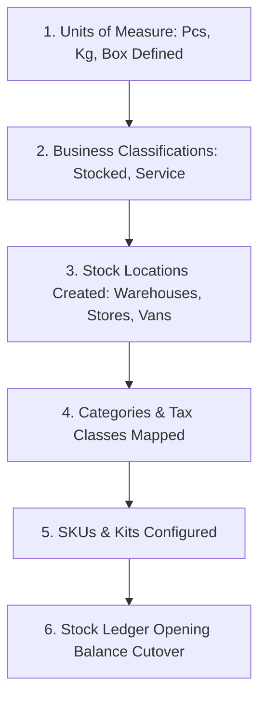
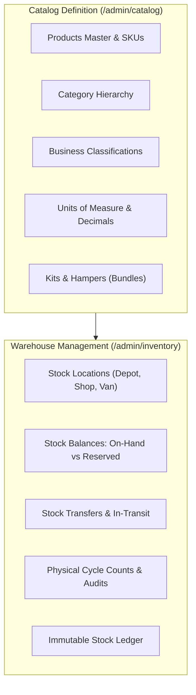

# Guide 05: Products Catalog & Inventory Control (`/admin/catalog`, `/admin/inventory`)

The **Products & Inventory Control** module governs the entire physical life of products—from SKU master definition and multi-level category classification to multi-location warehouse management, units of measure conversions, kits and hampers, two-step stock transfers, and continuous physical cycle counts.

---

## 1. Executive Overview & Commercial Value Proposition

### Operational Problems Solved
- **The "Single Stock Number" Blind Spot**: In basic systems, a product has one global stock number (e.g. *"50 units on hand"*). Management has no idea if those 50 units are in the Nairobi central depot, the Mombasa branch, or on a rider's delivery van, leading to false promises to customers.
- **Lost Goods in Transit**: Moving stock between warehouses or out on delivery vans is where theft and shrinkage occur. Traditional spreadsheets write off stock immediately upon dispatch, losing all accountability while goods are on the road. QSell introduces an **In-Transit Ledger** where goods remain on the company's books until formally acknowledged and received at the destination.
- **Stock Counts That Force Business Closures**: Businesses often shut down operations for an entire weekend to conduct physical inventory counts. In QSell, **Continuous Cycle Counting** allows warehouse staff to count shelves while retail cashiers and the web shop continue selling without discrepancy errors.
- **Unit of Measure Confusion**: Selling a product in pieces, 12-packs, and 24-box cartons typically causes inventory chaos. QSell enforces strict base-unit decimal conversions (e.g., kilograms, litres, pieces).

### Target Client Profiles
- **Multi-Branch Retailers & Wholesalers**: Operating central distribution hubs, regional branch stores, and mobile van-sales fleets.
- **Hardware, Agro-Dealers & Building Suppliers**: Selling goods by weight, length, volume, or pack sizes (cement, paint, fertilizer, cabling).
- **Gift, Hamper & Food Distributors**: Assembling multi-item gift hampers and combo kits priced as a single unit but fulfilled and taxed as individual components.

### Commercial Sales Pitch & Talk Track
> *"With QSell, you always know exactly what you have, exactly where it sits, and what it is worth. Your inventory isn't just a number on a spreadsheet—it is an immutable ledger. You can see real-time stock across every warehouse, branch shop, and delivery van. When you move stock between locations, it is tracked in transit. And best of all, you can perform physical stock audits on your shelves during business hours while your cashiers keep ringing up sales."*

### Measurable ROI & Safeguards
- **Zero Shrinkage in Transit**: Two-step transfers require sender dispatch and receiver sign-off with variance reporting.
- **Zero Interrupted Trading**: Continuous cycle counts eliminate the need for costly weekend store closures.
- **Kit Component Explosion**: Bundles automatically deduct stock and calculate KRA tax for individual underlying components.

---

## 2. Prerequisites & Configuration Sequence

1. **Units of Measure**: Defined under `/admin/settings/units` (Base units and conversion multipliers).
2. **Business Classifications**: Defined under `/admin/item-types` (Determining whether an item is physical stock, service, or consumable).
3. **Stock Locations**: Defined under `/admin/inventory/locations` (At least one default warehouse or shop).
4. **Categories**: Created under `/admin/categories` with mapped KRA tax classifications.
5. **Staff Permissions**:
   - `products:read`, `products:manage`: Create and manage catalog SKUs.
   - `stock:read`, `stock:manage`: View stock levels, issue transfers, and conduct counts.
   - `stock:cutover`: Execute initial opening balance migration.

---

## 3. Module & Sub-Module Architecture

The Products & Inventory module is divided into two operational domains:

---

## 4. Interface-by-Interface Walkthrough

### Sub-Module 1: Products Master (`/admin/products`)
- **Product Directory**: Server-paged table with instant filtering by Category, Stock Status (`In Stock`, `Low Stock`, `Out of Stock`), Classification, and Channel visibility.
- **Product Editor (`/admin/products/[id]`)**:
  - **Basic Info**: Title, SKU, Barcode (EAN-13/UPC), Brand, Category, Short Description, and HTML Rich-Text Body.
  - **Pricing & Tax**: Selling Price, Cost Price (for gross margin calculation), KRA Tax Classification (16% VAT, Zero-Rated, Exempt).
  - **Stock & Units**: Unit of Measure picker, Minimum Reorder Threshold, Safety Stock, and Track Inventory toggle.
  - **Web Shop Flags**: `Show on Web Shop` toggle, SEO title/description, and high-resolution gallery image uploader.

### Sub-Module 2: Trash (`/admin/trash/products`)
- Soft-delete recovery screen. Products removed from the catalog can be **Restored as Drafts** or permanently purged (only if no historic transaction or stock ledger records exist).

### Sub-Module 3: Business Classifications (`/admin/item-types`)
- Establishes product accounting behavior:
  - *Stocked Goods*: Physical inventory tracked in warehouses.
  - *Non-Stocked Services*: Labor, installation, delivery fees, consulting.
  - *Consumables / Packaging*: Boxes, tape, branded bags used at checkout.
  - Controls whether the item is *"Sold to Customers"* across quotes, orders, and storefront.

### Sub-Module 4: Units of Measure (`/admin/settings/units`)
- Global table of measurement units (e.g., `PCS`, `KG`, `LTR`, `BOX`, `MTR`).
- Enforces decimal precision (e.g. Kilograms allow 3 decimals `1.425 kg`, while Pieces allow 0 decimals `1 pc`).
- Defines conversion ratios (e.g., 1 Box = 24 Pieces).

### Sub-Module 5: Categories (`/admin/categories`)
- Multi-level tree view for organizing products into departments, categories, and subcategories. Drives storefront mega-menus and automated KRA tax inheritance.

### Sub-Module 6: Kits and Hampers (`/admin/pricing/kits`)
- Bundle creator: Defines combo packages (e.g., *"Solar Home Kit 1kVA"* or *"Executive Christmas Hamper"*).
- Line component mapping: Links 4 individual panels, 1 inverter, 2 batteries, and 1 mounting kit into a single sellable SKU.
- Component Tax Handling: Automatically apportions VAT across components with differing tax rates.

### Sub-Module 7: Stock Locations (`/admin/inventory/locations`)
- Defines physical locations:
  - **Warehouses**: Central distribution godowns.
  - **Retail Stores**: Front-office shops where point-of-sale orders draw inventory.
  - **Delivery Vans**: Mobile stock locations assigned to riders for run dispatch.
  - **Quarantine / Damaged**: Holding locations for defective customer returns.

### Sub-Module 8: Stock by Location (`/admin/inventory/by-location`)
- Real-time stock matrix displaying product rows across location columns, showing:
  - `On-Hand`: Total physical units on shelves.
  - `Reserved`: Units committed to active customer orders awaiting dispatch.
  - `Available`: Uncommitted stock available to promise (`On-Hand - Reserved`).

### Sub-Module 9: Stock Transfers (`/admin/inventory/transfers`)
- Two-step inter-location workflow:
  1. **Dispatch Transfer**: Source location picks and dispatches goods. Stock moves from source `On-Hand` to `In-Transit`.
  2. **Receive Transfer**: Destination location inspects physical delivery and accepts goods. Stock moves from `In-Transit` to destination `On-Hand`.
  3. **Discrepancy Reporting**: Records damaged or missing items during transit.

### Sub-Module 10: Stock Counts (`/admin/inventory/counts`)
- Cycle counting engine:
  - Create a count session for a specific warehouse, aisle, or category.
  - Staff scan barcodes and record physical counts on mobile or desktop.
  - System freezes an inventory snapshot at count initiation: **Cashiers keep selling!**
  - Reconciliation view highlights positive/negative variances with KES financial impact.
  - Manager approves count, posting adjustment entries to the stock ledger.

### Sub-Module 11: Stock Ledger & Cutover (`/admin/inventory/ledger`)
- The single source of truth: An immutable, append-only log of every physical movement (receipts, sales dispatches, transfers, adjustments, returns, write-offs).
- Includes the **Cutover Wizard** used during client onboarding to import verified opening inventory balances.

---

## 5. Granular Field-by-Field Reference

### Product SKU Master Fields (`/admin/products/new`)

| Field Label | Purpose | Type & Format | Required? | Validation Rules & Hints |
|---|---|---|---|---|
| **Product Title** | Name displayed on shop & quotes. | Text (Max 160 chars) | **Required** | Must be unique within company. |
| **SKU Code** | Unique internal stock identifier. | Text (Alphanumeric, Max 40) | **Required** | Uppercase recommended (e.g. `SLR-PAN-500W`). |
| **Barcode** | EAN/UPC barcode for POS scanners. | Text (Max 48 chars) | Optional | Must be unique across all active products. |
| **Category** | Organizational department. | Dropdown | **Required** | Determines tax rate and storefront navigation. |
| **Unit of Measure** | Selling unit. | Dropdown | **Required** | Select from active UOMs (e.g. *Piece*, *Box*). |
| **Selling Price** | Base retail price. | Currency (KES) | **Required** | Inclusive or exclusive of VAT per company setting. |
| **Cost Price** | Landed purchase cost. | Currency (KES) | **Required** | Used for margin floors and gross profit KPI. |
| **Tax Classification** | KRA eTIMS tax rate. | Dropdown | **Required** | General Rate (16%), Zero-Rated (0%), Exempt. |
| **Track Inventory** | Enables warehouse stock tracking. | Toggle (On/Off) | **Required** | Set to `Off` for services and digital goods. |
| **Low Stock Threshold** | Alert trigger limit. | Integer / Decimal | Optional | Generates dashboard attention warning when stock drops below. |
| **Show on Web Shop** | Customer storefront visibility. | Toggle (On/Off) | **Required** | If `Off`, product only sellable via POS or B2B Quotes. |

### Stock Transfer Fields (`/admin/inventory/transfers/new`)

| Field Label | Purpose | Type & Format | Required? | Validation Rules & Hints |
|---|---|---|---|---|
| **Transfer Number** | Document sequence ID. | Text (Auto-generated) | System | e.g. `TRF-2026-0042`. |
| **Origin Location** | Source warehouse or shop. | Dropdown | **Required** | Must have sufficient available stock. |
| **Destination Location** | Receiving warehouse or van. | Dropdown | **Required** | Cannot equal Origin Location. |
| **Product Line: SKU** | Item being transferred. | Lookup Autocomplete | **Required** | Must exist at Origin Location. |
| **Product Line: Qty** | Number of units to move. | Decimal / Integer | **Required** | Cannot exceed Origin's available stock. |
| **Carrier / Driver** | Person or courier moving goods. | Text (Max 120 chars) | Optional | Staff driver or courier tracking code. |

---

## 6. Step-by-Step User Actions (Down to the Last Click)

### Action 1: Executing an Inter-Branch Stock Transfer
1. Navigate to `/admin/inventory/transfers` and click **New Transfer**.
2. Select **Origin Location**: *"Central Depot - Industrial Area"*.
3. Select **Destination Location**: *"Westlands Retail Store"*.
4. In the lines section, search for the product (e.g., *"100Ah Deep Cycle Battery"*).
5. Enter **Quantity**: `10`. The system verifies that 10 units are available at Central Depot.
6. Click **Dispatch Transfer**.
7. An `InlineConfirm` prompt appears: *"Dispatch 10 units into In-Transit status?"* Click **Confirm Dispatch**.
8. Print the **Transfer Delivery Note** for the driver.
9. When the truck arrives at Westlands, the storekeeper opens `/admin/inventory/transfers`, selects the transfer, and clicks **Receive Goods**.
10. If all 10 arrived safely, click **Accept All into Stock**.
11. If 1 battery was cracked during transport, enter `Received: 9`, `Damaged: 1`.
12. Click **Confirm Receipt**. The system places 9 batteries into Westlands stock and automatically routes the 1 damaged battery into the Quarantine location.

### Action 2: Conducting a Cycle Count While Trading Continues
1. Navigate to `/admin/inventory/counts` and click **Start New Count**.
2. Select **Location**: *"Mombasa Road Showroom"*.
3. Select **Scope**: *"Lighting & Fixtures"* category.
4. Click **Initialize Count Session**.
5. The system captures an immutable snapshot of current book stock. Staff take barcode scanners to the shelves and scan physical items.
6. Even if a customer buys a light bulb at the counter while the count is underway, the system's timestamped calculation accounts for the transaction without throwing off the audit.
7. Click **Review Variances**.
8. The screen displays discrepancies (e.g. Book Stock: 42, Physical Scanned: 40, Variance: -2 units, Financial Loss: KES 1,600).
9. Enter an explanation reason: *"Damaged showroom display units written off"*.
10. Click **Approve & Post Adjustments**.
11. Stock balances are instantly aligned with physical reality, and an inventory write-off entry is posted to the General Ledger.

---

## 7. Conditions, Business Rules & Edge Cases

### The Three Stock Numbers (`On-Hand`, `Reserved`, `Available`)
$$\text{Available Stock} = \text{On-Hand Stock} - \text{Active Unfulfilled Reservations}$$
- **On-Hand**: Physical boxes on the shelf.
- **Reserved**: Goods promised to orders currently being packed or awaiting dispatch.
- **Available**: What the storefront and sales reps can sell. An order for 10 units will be refused if only 8 units are *Available*, even if 15 units are physically *On-Hand*.

### Deactivating a Stock Location
- A location cannot be deleted or deactivated if:
  1. It holds physical `On-Hand` stock $> 0$.
  2. It has open in-flight stock transfers.
  3. It has active orders with unfulfilled reservations.
- The system blocks deactivation with the message: *"Cannot deactivate location: 14 units remain on hand. Transfer or write off stock first."*

---

## 8. Implementor Checklist & Go-Live Verification

| Step | Verification Task | Expected Result | Pass/Fail |
|---|---|---|---|
| 1 | Create Base Units of Measure (PCS with 0 decimals, KG with 3 decimals). | Decimal constraints enforced accurately during entry. | [ ] |
| 2 | Create Central Warehouse, Retail Shop, and Van locations. | Locations appear in Stock by Location matrix. | [ ] |
| 3 | Execute Opening Balance Cutover via Stock Ledger Wizard. | On-hand quantities reflect physical counts accurately. | [ ] |
| 4 | Perform a 2-step stock transfer from Warehouse to Retail Shop. | Stock moves to In-Transit upon dispatch, and to destination upon receipt. | [ ] |
| 5 | Build a Kit Product and place a test order. | Master kit is sold; individual component stock quantities are deducted. | [ ] |
