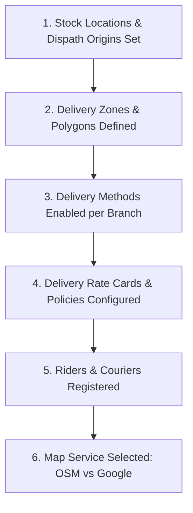
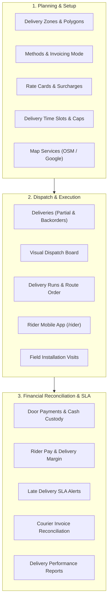

# Guide 06: Delivery Logistics & Field Dispatch (`/admin/delivery`)

The **Delivery & Field Logistics** module orchestrates the physical journey of goods from the dispatch warehouse to the customer's doorstep. It governs polygon delivery zoning, dynamic rate calculation (by zone, weight, or distance), visual dispatch boards, rider run sequencing, Cash-on-Delivery (COD) custody reconciliation, third-party courier APIs, and scheduled on-site installation visits.

---

## 1. Executive Overview & Commercial Value Proposition

### Operational Problems Solved
- **The "No Postcode" Reality in Africa**: Standard international e-commerce software assumes structured postal codes (ZIP codes). In Kenya, addresses are descriptive (e.g., *"Westlands, Muthithi Road, opposite Unga House, 3rd Floor"*). QSell allows customers to either select localized zones (County $\rightarrow$ Town $\rightarrow$ Estate) or drop a GPS pin on the map, finding the exact delivery zone and fee automatically.
- **Cash on Delivery (COD) Reconciliation Black Holes**: Riders collect cash and direct M-Pesa payments at customer doorsteps. In manual systems, days pass before riders hand in cash, leading to lost money, disputed balances, and theft. QSell treats **Rider Cash Custody as a living ledger**: every shilling collected is recorded against the rider's profile, and the cashier must formally accept the cash handover to clear the rider.
- **Unverified Third-Party Courier Billing**: Couriers (Fargo Courier, Wells Fargo, G4S, Speedaf) invoice merchants at the end of the month. Most businesses pay these invoices blindly. QSell's **Courier Invoice 3-Way Matcher** cross-checks every line on the courier's statement against actual parcels dispatched in the system, highlighting overcharges instantly.
- **Overpromising and Missed Delivery Windows**: Dispatchers accept more orders than their vehicle fleet can carry. QSell enforces **Delivery Slots with Capacity Limits**, closing order booking windows once a branch reaches its daily delivery capacity.

### Target Client Profiles
- **Omnichannel Retailers & E-Commerce Brands**: Operating in-house motorcycle fleets or hybrid fleets (own riders for local delivery, couriers for upcountry).
- **FMCG & Beverage Distributors**: Managing multi-drop truck and van delivery runs with cash settlement upon delivery.
- **Solar PV, Electronics & Equipment Suppliers**: Requiring technical crews to visit customer premises, complete installation checklists, and capture digital customer sign-offs.

### Commercial Sales Pitch & Talk Track
> *"With QSell, delivery is no longer an operational headache that eats away your profit. Whether you use your own motorcycle riders, third-party couriers, or have customers collect at your counter, QSell handles it seamlessly. Your customers can drop a pin on a map or pick their estate; your dispatch board clusters orders into optimized delivery runs; riders confirm deliveries using customer verification PINs; and any cash collected at the door is locked in a digital custody ledger until handed to your cashier."*

### Measurable ROI & Safeguards
- **100% Cash-on-Delivery Accountability**: Zero unrecorded door payments; riders cannot start new runs until previous cash floats are reconciled.
- **15–20% Reduction in Last-Mile Delivery Spend**: Automated distance/weight rate cards prevent undercharging customers for shipping.
- **Protection Against Courier Overbilling**: Automated reconciliation detects duplicate tracking numbers and incorrect weight charges on monthly courier invoices.

---

## 2. Prerequisites & Configuration Sequence

1. **Dispatch Origins**: Stock locations must have physical street addresses and GPS coordinates under `Inventory > Stock Locations`.
2. **Delivery Zones**: Defined under `/admin/delivery/zones` with mapped towns and estates.
3. **Delivery Methods**: Enabled under `/admin/delivery/methods` per branch (*Own Fleet*, *Courier*, *Click & Collect / Pickup*, *Scheduled Visit*).
4. **Delivery Charges**: Rate cards configured under `/admin/delivery/charges`.
5. **Riders & Couriers**: In-house riders created under `/admin/delivery/riders`; 3PL couriers registered under `/admin/delivery/couriers`.
6. **Required Permissions**: `deliveries:read`, `deliveries:dispatch`, `riders:manage`, `door_payments:manage`, `delivery_costs:manage`.

---

## 3. Module & Sub-Module Architecture

The Delivery module coordinates the entire fulfillment chain across 19 sub-modules:

---

## 4. Interface-by-Interface Walkthrough

### 1. Deliveries (`/admin/delivery/deliveries`)
- Master directory of fulfillment parcels. Filter by Status (`Draft`, `Released`, `Picking`, `Packed`, `Ready`, `On Run`, `Delivered`, `Failed`), Method, and Branch. Supports **Partial Dispatches** (sending in-stock items while back-ordering the rest).

### 2. Delivery Zones (`/admin/delivery/zones`)
- Geographic zone builder: Group counties, towns, and estates (e.g. *"Nairobi Central"*, *"Westlands & Parklands"*, *"Thika & Environs"*). Supports polygon geofencing on an interactive map.

### 3. Dispatch Board (`/admin/delivery/dispatch`)
- Visual operations kanban:
  - *Ready for Dispatch*: Orders packed and waiting for transport.
  - *Assigned to Run*: Grouped by rider or vehicle.
  - *Out for Delivery*: Live monitoring of parcels currently on the road.

### 4. Delivery Runs (`/admin/delivery/runs`)
- Multi-drop trip management: Sequenced list of stops for a rider. Calculates total run weight, departure time, estimated arrival at each stop, and starting cash float.

### 5. Riders (`/admin/delivery/riders`)
- Driver profiles: In-house staff drivers vs. freelance contract riders. Tracks vehicle type (Motorcycle, Van, Pickup), license number, mobile login PIN, and active status.

### 6. Door Payments (`/admin/delivery/door-payments`)
- Cash custody ledger: Shows cash and M-Pesa collected by each rider at customer doors.
- Reconciles rider cash against the counter till during evening debrief.

### 7. Delivery Costs (`/admin/delivery/costs`)
- Profitability tracking: Compares what the customer paid for delivery vs. what the company paid the rider (per-drop commission or fuel) or courier, reporting true **Delivery Gross Margin**.

### 8. Late Deliveries (`/admin/delivery/late`)
- Real-time SLA monitor: Highlights orders at risk of breaching promised customer delivery windows, enabling dispatchers to intervene before customer complaints arise.

### 9. Delivery Slots (`/admin/delivery/slots`)
- Booking window manager: Defines delivery windows (e.g. *Morning 9am-1pm*, *Afternoon 2pm-6pm*), daily parcel capacity limits, and order cut-off times.

### 10. Couriers (`/admin/delivery/couriers`)
- 3PL parcel partners (Fargo, G4S, Sendy, Speedaf). Stores API credentials securely sealed for automated waybill generation and tracking.

### 11. Visits (`/admin/delivery/visits`)
- Technical installation crew scheduling: Assigns technicians to site visits (e.g. solar PV installation, air-conditioner servicing). Provides digital checklists and captures customer signatures on site.

### 12. Delivery Report (`/admin/delivery/reports`)
- Executive analytics: Delivery success rates, failure reason distributions (e.g. customer unavailable, wrong address), and zone profitability.

### 13. Courier Invoices (`/admin/delivery/courier-invoices`)
- Monthly 3-way reconciliation: Upload courier billing statements (CSV) to automatically match waybills against system dispatch logs, highlighting discrepancies.

### 14. Delivery Performance (`/admin/delivery/performance`)
- Driver leaderboards: On-time delivery %, average stops per run, first-attempt success rate, and customer feedback ratings.

### 15. Delivery Charges (`/admin/delivery/charges`)
- Rate card matrix: Configure pricing rules:
  - *Flat Rate per Zone* (e.g. Nairobi CBD: KES 250).
  - *Weight-Tier Matrix* (e.g. 0-5 kg: KES 300, KES 50 per additional kg).
  - *Distance Formula* (e.g. Base KES 200 + KES 35/km from branch pin).
  - *Free Shipping Thresholds* (e.g. Free delivery for orders over KES 10,000).

### 16. Delivery Methods (`/admin/delivery/methods`)
- Per-branch toggle enabling or disabling specific fulfillment modes (Own Fleet, Courier, In-Store Collection, Installation Visit).

### 17. Delivery Invoicing (`/admin/delivery/invoicing`)
- KRA Tax compliance setting: Choose whether delivery charges appear on the **Same Tax Invoice** as products, or on a **Separate Delivery Invoice** signed independently for KRA eTIMS.

### 18. Stock Timing (`/admin/delivery/stock`)
- Configures the exact moment stock is deducted from the physical ledger:
  - *Option A*: When order is paid.
  - *Option B*: When packed into dispatch vehicle.
  - *Option C*: When customer confirms receipt at the door.

### 19. Map Service (`/admin/delivery/maps`)
- Provider configuration: Toggle between free **OpenStreetMap (Nominatim)** or **Google Maps Platform** for address autocomplete and distance calculations, comparing cost vs. accuracy tradeoffs.

---

## 5. Granular Field-by-Field Reference

### Delivery Zone Fields (`/admin/delivery/zones/new`)

| Field Label | Purpose | Type & Format | Required? | Validation Rules & Hints |
|---|---|---|---|---|
| **Zone Code** | Internal zone identifier. | Text (Max 20 chars, uppercase) | **Required** | Unique code e.g. `ZONE-NBI-WEST`. |
| **Zone Name** | Name shown to dispatchers. | Text (Max 80 chars) | **Required** | e.g. *"Westlands & Parklands"*. |
| **County** | Primary administrative county. | Dropdown | **Required** | e.g. *Nairobi*, *Mombasa*, *Kiambu*. |
| **Included Towns / Estates** | List of covered estates. | Multi-Select Tag Input | **Required** | e.g. *Westlands, Parklands, Highridge, Spring Valley*. |
| **Map Polygon Boundary** | GPS geofence coordinates. | Map Drawing Tool | Optional | Polygon coordinates defining exact boundary. |
| **Active Status** | Controls zone availability. | Toggle (On/Off) | **Required** | Inactive zones cannot be selected at checkout. |

### Delivery Rate Policy Fields (`/admin/delivery/charges/new`)

| Field Label | Purpose | Type & Format | Required? | Validation Rules & Hints |
|---|---|---|---|---|
| **Policy Name** | Reference name. | Text (Max 120 chars) | **Required** | e.g. *"Standard Nairobi Zone Rates 2026"*. |
| **Calculation Method** | How fees are calculated. | Dropdown | **Required** | `Zone Rate Card`, `Distance from Branch`, `Flat Weight`. |
| **Base Fee** | Minimum starting charge. | Currency (KES) | **Required** | e.g. `250.00`. |
| **Per-Kilometer Fee** | Variable distance charge. | Currency (KES) | Required if Distance | e.g. `35.00` per km beyond base radius. |
| **Per-Kilogram Extra** | Heavy parcel surcharge. | Currency (KES) | Optional | Charge per kg exceeding base weight limit. |
| **Free Delivery Threshold** | Order value qualifying for free shipping. | Currency (KES) | Optional | Orders $\ge$ this value receive 100% shipping discount. |

---

## 6. Step-by-Step User Actions (Down to the Last Click)

### Action 1: Planning and Dispatching a Multi-Drop Delivery Run
1. Navigate to `/admin/delivery/dispatch`.
2. The board lists orders in **Ready for Dispatch** status.
3. Click **Create Delivery Run**.
4. Select **Fulfilling Branch**: *"Nairobi Industrial Area"*.
5. Select **Assigned Rider**: *"David Mutua (Motorcycle #KMDF 123A)"*.
6. In the orders list, select the 4 customer orders destined for Westlands.
7. Click **Add to Run**.
8. In the **Stop Order** list, drag and drop the stops into optimal street delivery sequence.
9. Click **Finalize & Dispatch Run**.
10. The system prompts: *"Confirm dispatch of 4 parcels? Stock will move to David Mutua's mobile custody."*
11. Click **Confirm Dispatch**.
12. The run status updates to `Out for Delivery`, and the parcels appear immediately on David Mutua's mobile phone at `/rider`.

### Action 2: Customer Handover & Verification PIN Confirmation
1. The rider arrives at the customer's address and opens the `/rider` mobile web app.
2. Selects the active stop: *"Order #ORD-10492 - Jane Wanjiku"*.
3. The rider requests the **4-digit Delivery PIN** sent to the customer via SMS upon dispatch.
4. The rider types the PIN (e.g. `8492`) into the app.
5. If the order is Cash on Delivery, the rider selects **Payment Collected**:
   - Types cash amount received: `KES 3,500.00`.
6. Click **Confirm Delivery**.
7. The system validates the PIN instantly, marks the delivery as `Delivered`, updates the customer order status, and adds KES 3,500.00 to David Mutua's cash custody ledger.

### Action 3: Reconciling Evening Cash Handover from a Rider
1. At the end of the shift, the rider returns to the cashier desk.
2. The cashier navigates to `/admin/delivery/door-payments`.
3. In the rider list, select **David Mutua**.
4. The screen displays: *"Total Cash Custody: KES 14,200.00 (from 4 deliveries today)"*.
5. The rider hands the physical cash to the cashier.
6. The cashier counts KES 14,200.00, selects the destination till (*"Main Cash Till #1"*), and clicks **Accept Cash Handover**.
7. An `InlineConfirm` prompt appears: *"Accept KES 14,200.00 from David Mutua into Main Cash Till #1?"*
8. Click **Confirm Handover**.
9. The rider's custody balance drops to zero, and a cash receipt journal entry is posted to the till ledger.

---

## 7. Conditions, Business Rules & Edge Cases

### Handling a Failed Delivery Attempt
- If a rider arrives and the customer is unreachable:
  1. The rider clicks **Report Failed Attempt** in the mobile app.
  2. The system forces selection of a mandatory **Failure Reason Code**:
     - `Customer Phone Unreachable`
     - `Customer Not at Premises`
     - `Customer Refused / Cash Shortage`
     - `Inaccessible Road / Weather Block`
  3. The rider must enter a short memo note.
  4. The delivery transitions to `Attempt Failed`. Stock remains in the rider's custody until the run is closed, where it must be physically returned to the warehouse storekeeper.

### Invoicing Modes for Delivery Charges (KRA Compliance)
Under `/admin/delivery/invoicing`, the business configures one of two fiscal modes:
- **Combined Invoicing**: Delivery is printed as a service line item on the primary product tax invoice, taxed at the standard 16% VAT rate.
- **Separate Delivery Invoicing**: Products are billed on Invoice A, while the delivery fee is billed on a separate Delivery Invoice B. This is required when delivery is handled by an affiliated logistics entity with a separate KRA PIN.

---

## 8. Implementor Checklist & Go-Live Verification

| Step | Verification Task | Expected Result | Pass/Fail |
|---|---|---|---|
| 1 | Configure 3 Delivery Zones with towns and estates. | Zones appear in storefront checkout dropdown. | [ ] |
| 2 | Configure a Distance-based Rate Card (KES 200 base + KES 30/km). | Checkout pin-drop calculates exact distance and fee accurately. | [ ] |
| 3 | Create an In-House Rider profile with a mobile login PIN. | Rider can successfully log in at `/rider`. | [ ] |
| 4 | Plan a Delivery Run and dispatch 2 test orders. | Parcels appear on rider run sheet; stock moves to mobile custody. | [ ] |
| 5 | Execute Door Payment collection and Cashier Handover. | Rider custody ledger updates and clears to zero upon cashier sign-off. | [ ] |
