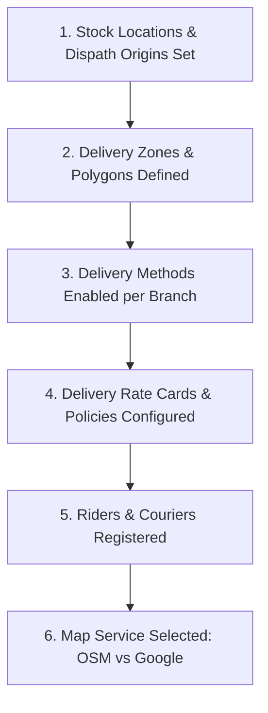
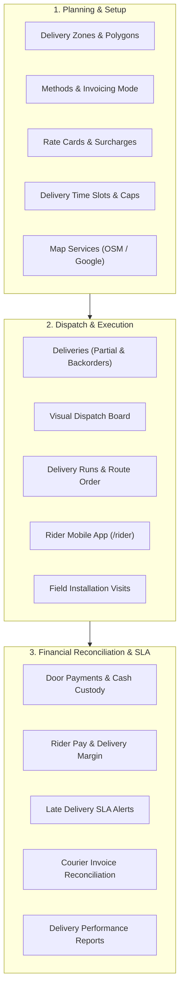

# Guide 06: Delivery Logistics & Field Dispatch (`/admin/delivery`)

The **Delivery & Field Logistics** module orchestrates the physical journey of goods from the dispatch warehouse to the customer's doorstep. It governs polygon delivery zoning, dynamic rate calculation (by zone, weight, or distance), visual dispatch boards, rider run sequencing, Cash-on-Delivery (COD) custody reconciliation, third-party courier APIs, and scheduled on-site installation visits.

---

## 1. Executive Overview & Commercial Value Proposition

### Operational Problems Solved
- **The "No Postcode" Reality in Africa**: Standard international e-commerce software assumes structured postal codes (ZIP codes). In Kenya, addresses are descriptive (e.g., *"Westlands, Muthithi Road, opposite Unga House, 3rd Floor"*). QSell allows customers to either select localized zones (County $\rightarrow$ Town $\rightarrow$ Estate) or drop a GPS pin on the map, finding the exact delivery zone and fee automatically.
- **Cash on Delivery (COD) Reconciliation Black Holes**: Riders collect cash and direct M-Pesa payments at customer doorsteps. In manual systems, days pass before riders hand in cash, leading to lost money, disputed balances, and theft. QSell treats **Rider Cash Custody as a living ledger**: every shilling collected is recorded against the rider's profile, and the cashier must formally accept the cash handover to clear the rider.
- **Unverified Third-Party Courier Billing**: Couriers invoice merchants at the end of the month, and most businesses pay these invoices blindly. In QSell, what each courier charged for each parcel is recorded against that parcel as it happens. When the courier's invoice arrives, the office types it in and **matches it to those recorded charges**; the screen says plainly whether the two **agree, or the invoice is higher or lower**, and by how much. Charges the courier has made that no invoice has yet covered are listed so nothing is forgotten, and a charge can sit on one invoice only, so the same parcel cannot be paid twice.
- **Overpromising and Missed Delivery Windows**: Dispatchers accept more orders than their vehicle fleet can carry. QSell enforces **Delivery Slots with Capacity Limits** (and a weight limit if wanted), closing a slot once it is full, and refusing times that are too soon for the goods to be ready. The shopper chooses a day and time at checkout; the promise is shown on the dispatch board and on the customer's tracking page.
- **Finding out a delivery is late only when the customer complains**: Every delivery promised a time window is watched. It is flagged *At risk* before the window ends and *Late* after it, and a delivery that stays late goes up to the supervisor. The dispatchers and supervisors can be **mailed automatically**, and every flagged delivery is acknowledged with a note saying what is being done about it.
- **Riders who share one login, or whose phones are not secure**: A rider with an account of their own signs in with their **phone number and a 6-digit PIN**, chosen by the rider and known only to them. Wrong guesses shut the rider out for a while, so a lost or borrowed phone is not a way in. A rider can see their own earnings and what they have been paid, which ends the daily argument about pay.
- **Not knowing whether delivery makes money**: The delivery report and the **performance** screen show what customers paid for delivery against what it cost (rider pay, courier charges, fuel, vehicle costs), and how often deliveries are on time, succeed at the first try, and how full each delivery time runs.

### Target Client Profiles
- **Omnichannel Retailers & E-Commerce Brands**: Operating in-house motorcycle fleets or hybrid fleets (own riders for local delivery, couriers for upcountry).
- **FMCG & Beverage Distributors**: Managing multi-drop truck and van delivery runs with cash settlement upon delivery.
- **Solar PV, Electronics & Equipment Suppliers**: Requiring technical crews to visit customer premises, complete installation checklists, and capture digital customer sign-offs.

### Commercial Sales Pitch & Talk Track
> *"With QSell, delivery is no longer an operational headache that eats away your profit. Whether you use your own motorcycle riders, third-party couriers, or have customers collect at your counter, QSell handles it seamlessly. Your customers can drop a pin on a map or pick their estate; your dispatch board clusters orders into optimized delivery runs; riders confirm deliveries using the customer's delivery code; and any cash collected at the door is locked in a digital custody ledger until handed to your cashier."*

### Measurable ROI & Safeguards
- **100% Cash-on-Delivery Accountability**: Zero unrecorded door payments; riders cannot start new runs until previous cash floats are reconciled.
- **15–20% Reduction in Last-Mile Delivery Spend**: Automated distance/weight rate cards prevent undercharging customers for shipping.
- **Protection Against Courier Overbilling**: Each courier invoice is checked against the charges recorded for that courier's parcels, and a charge cannot be counted on two invoices.
- **Fewer Late Deliveries Going Unnoticed**: Every delivery promised a window is raised at risk, late and still-late, once each, with a record of who acknowledged it and what they said.
- **Fewer Rider Pay Disputes**: Pay is recorded as each delivery is made, taken back only with a written reason, and paid out in one payout that is kept for good.

---

## 2. Prerequisites & Configuration Sequence

1. **Dispatch Origins**: Stock locations must have physical street addresses and GPS coordinates under `Inventory > Stock Locations`.
2. **Delivery Zones**: Defined under `/admin/delivery/zones` with mapped towns and estates.
3. **Delivery Methods**: Enabled under `/admin/delivery/methods` per branch (*Own Fleet*, *Courier*, *Click & Collect / Pickup*, *Scheduled Visit*).
4. **Delivery Charges**: Rate cards configured under `/admin/delivery/charges`.
5. **Riders & Couriers**: Choose which kinds of rider the company uses under `/admin/delivery/riders` (own staff, riders with an account of their own, or both); add riders there. A rider who will sign in with a phone number and PIN needs an account of their own and a **Kenyan mobile number** (for example 0712 345 678). Couriers are connected under `/admin/delivery/couriers`.
6. **Delivery Times (optional)**: Slots, days with no slots and lead times are set under `/admin/delivery/slots`; a branch needs at least one slot for shoppers to be offered a delivery time.
7. **Rider Pay (optional)**: Set what a rider earns for each delivery and for each day on a run under `/admin/delivery/costs`. To have rider pay appear in the accounts, choose the two accounts under **In the books**: the account rider pay is booked to, and the account that holds what is owed to riders (the books must be live; otherwise pay is still recorded and paid out, but nothing is posted).
8. **Mail for Lateness (optional)**: Type the mail addresses of the dispatchers and supervisors under `/admin/delivery/slots` (**When a delivery counts as late**).
9. **Required Permissions**: `deliveries:read`, `deliveries:dispatch` (dispatch board, late deliveries, delivery performance), `riders:manage` (riders and their PINs), `delivery_slots:manage` (slots, closed days, lead times and the lateness settings), `couriers:manage` (connecting couriers), `delivery_costs:manage` (costs, rider pay, courier invoices, the delivery report), `door_payments:manage`.

---

## 3. Module & Sub-Module Architecture

The Delivery module coordinates the entire fulfillment chain across 19 sub-modules:

---

## 4. Interface-by-Interface Walkthrough

### 1. Deliveries (`/admin/delivery/deliveries`)
- Master directory of fulfillment parcels. Filter by Status (`Draft`, `Released`, `Picking`, `Packed`, `Ready`, `On Run`, `Delivered`, `Failed`), Method, and Branch. Supports **Partial Dispatches** (sending in-stock items while back-ordering the rest).

### 2. Delivery Zones (`/admin/delivery/zones`)
- Geographic zone builder: Group counties, towns, and estates (e.g. *"Nairobi Central"*, *"Westlands & Parklands"*, *"Thika & Environs"*). Supports polygon geofencing on an interactive map.

### 3. Dispatch Board (`/admin/delivery/dispatch`)
- Visual operations kanban:
  - *Ready for Dispatch*: Orders packed and waiting for transport.
  - *Assigned to Run*: Grouped by rider or vehicle.
  - *Out for Delivery*: Live monitoring of parcels currently on the road.
  - *With couriers*: Parcels handed to a courier, with its tracking number and last news.
- A delivery promised a time shows a chip such as **Promised Fri 6 Nov, 09:00 to 12:00**, turning **At risk** and then **Late** using the company's own warning time (see *Late Deliveries*).
- A parcel whose booking with the courier's system failed (or whose cancellation failed) shows a **Courier not booked** chip.

### 4. Delivery Runs (`/admin/delivery/runs`)
- Multi-drop trip management: Sequenced list of stops for a rider. Calculates total run weight, departure time, estimated arrival at each stop, and starting cash float.

### 5. Riders (`/admin/delivery/riders`)
- **Who rides**: choose whether the company uses its own staff as riders, riders with an account of their own, or both. A kind cannot be switched off while people of that kind are still working.
- **Proof at the door**: what a rider must show to mark a delivery delivered (nothing, the customer's code, a photo, or either).
- **Add a member of staff as a rider** (the staff member keeps signing in with their own account) or **Make an account for a rider** (an account that opens the rider app and nothing else).
- **Each rider's card**: kind, email, phone, vehicle, branch, runs still to do, and status (*Riding*, *Paused*, *Left*); buttons to pause, resume, mark as left, and (for riders with their own account) give a new first password.
- **Sign in with a phone number and PIN** (riders with their own account only): the rider's PIN panel shows *No PIN*, *Waiting for the rider to choose their own*, *PIN set* or *Shut out for ...*, the number they sign in with, when they last signed in, and any wrong tries in a row. Buttons: **Give a PIN**, **Give a new PIN**, **Let them try again**, **Turn off the PIN**. See *Action 4*.

### 6. Door Payments (`/admin/delivery/door-payments`)
- Cash custody ledger: Shows cash and M-Pesa collected by each rider at customer doors.
- Reconciles rider cash against the counter till during evening debrief.

### 7. Delivery Costs (`/admin/delivery/costs`)
- **What riders are paid**: what a rider earns for each delivery made and for each day on a run on which something was delivered (once a day, however many runs). Either can be nothing. Pay already earned never changes when the rules change.
- **Fuel and vehicle costs**: type in fuel, a vehicle cost (repairs, service, parking, tolls) or another cost, with what it was for, and optionally the run it belongs to. See *Action 8*.
- **Costs**: every cost, newest first, filtered by kind and by days. Rider pay is recorded as deliveries are made; a courier's charge is typed on the delivery it belongs to. A mistake is never edited: it is **taken back with a written reason**, and the original stays on record.
- **In the books**: the two accounts rider pay is posted to. Pay is saved first and posted afterwards, so a mistake in the accounts never stops a rider's delivery; what is waiting is counted and can be posted at once.
- **Owed to riders / Paid to riders**: what each rider is owed (pay earned less anything taken back, not yet paid) and the payouts made, each with its number.

### 8. Late Deliveries (`/admin/delivery/late`)
- Every delivery promised a window that is **At risk** or **Late** now, the most overdue first, showing how late, the highest level reached (*At risk: the dispatcher is told*, *Late: the dispatcher is told*, *Still late: the supervisor is told*), when it was raised, and how many mails were sent about it (sent, waiting, could not be sent).
- Each has an **Acknowledge** box (**What is being done about it**) that records who answered, when and what they said. One acknowledgement covers every level raised for that window.

### 9. Delivery Slots (`/admin/delivery/slots`)
- **Slots**: the delivery times a branch offers (for example *Morning 09:00 to 12:00*), the days of the week they run, how many deliveries a day each can take, how many minutes before the start an order must be placed, and optionally the most weight it can carry in a day. A slot can be stopped (deliveries already promised it keep it).
- **Days with no slots**: close a day for all branches or one (public holidays, stock-taking), with the reason.
- **How long the goods need** (lead times): the least time from order to ready, for a delivery zone or for an item (for example fresh or made-to-order goods). A delivery cannot be promised a slot that starts before the longest lead time that applies.
- **When a delivery counts as late**: how many minutes before the end of the window a delivery is *At risk*, after how many minutes late it goes to the supervisor, and who is mailed at each level.
- At checkout the shopper sees the days and times that are open; one that fills before the order is made is never a reason to refuse the sale. See *Conditions and Rules*.

### 10. Couriers (`/admin/delivery/couriers`)
- The courier companies the business sends parcels with. A courier is either **by hand** (the office types its tracking number and news) or **connected to its own system** over the internet: the system then books each parcel, follows it, and cancels it with the courier by itself. A courier's own system is connected through settings (its web address, the header that carries your key, the paths used to book, ask about and cancel a parcel, and where its answers keep the tracking number and status); no programming is needed for couriers whose system speaks the common web format, and a specific courier's own connection can be added later.
- The key the courier gave you is **kept sealed and never shown again**. The **secret that signs the courier's news** (so that only the real courier can report to you) is shown **once**, together with the address the courier is to send its news to.
- A courier can be stopped and started, edited (two people editing at once are warned), and given a new secret.

### 11. Visits (`/admin/delivery/visits`)
- Technical installation crew scheduling: Assigns technicians to site visits (e.g. solar PV installation, air-conditioner servicing). Provides digital checklists and captures customer signatures on site.

### 12. Delivery Report (`/admin/delivery/reports`)
- Executive analytics: Delivery success rates, failure reason distributions (e.g. customer unavailable, wrong address), and zone profitability.

### 13. Courier Invoices (`/admin/delivery/courier-invoices`)
- **Charged to us, on no invoice yet**: by courier, how many charges and how much have not been put on any invoice.
- **Type in an invoice**: the courier, the invoice number, the day on the invoice, the invoice total and an optional note. The invoice is typed in; it is not read from an uploaded file.
- **Each invoice** shows its total, the charges matched to it and the difference, with a status: *Nothing matched yet*, *Agrees with our charges*, *We have fewer charges than the invoice*, or *We have more charges than the invoice*. **Match charges** lists that courier's charges that are on no invoice, to tick; matched charges can be taken off. A wrong invoice is **voided with a reason**.
- Matching changes no charge and posts nothing; paying the invoice is done in the usual way.

### 14. Delivery Performance (`/admin/delivery/performance`)
- For the days chosen (the last 30 by default, at most a year): **Overall** (deliveries made, % on time, % at the first try, average time from going out to delivered, how late the late ones were, release-to-delivered time), **By rider**, **By courier** (parcels sent and what became of them, including parcels that could not be booked), and **Delivery times** (places offered, booked, days full and share used for each slot; how many times shoppers chose at checkout and how many had gone by delivery).
- *On time* means delivered by the end of the window the customer was promised; deliveries promised no window are left out of that rate. *First try* means no failed attempt before. Rates are marked good (95% and over), to watch (80% and over) or poor.

### 15. Delivery Charges (`/admin/delivery/charges`)
- Rate card matrix: Configure pricing rules:
  - *Flat Rate per Zone* (e.g. Nairobi CBD: KES 250).
  - *Weight-Tier Matrix* (e.g. 0-5 kg: KES 300, KES 50 per additional kg).
  - *Distance Formula* (e.g. Base KES 200 + KES 35/km from branch pin).
  - *Free Shipping Thresholds* (e.g. Free delivery for orders over KES 10,000).

### 16. Delivery Methods (`/admin/delivery/methods`)
- Per-branch toggle enabling or disabling specific fulfillment modes (Own Fleet, Courier, In-Store Collection, Installation Visit).

### 17. Delivery Invoicing (`/admin/delivery/invoicing`)
- KRA Tax compliance setting: Choose whether delivery charges appear on the **Same Tax Invoice** as products, or on a **Separate Delivery Invoice** signed independently for KRA eTIMS.

### 18. Stock Timing (`/admin/delivery/stock`)
- Configures the exact moment stock is deducted from the physical ledger:
  - *Option A*: When order is paid.
  - *Option B*: When packed into dispatch vehicle.
  - *Option C*: When customer confirms receipt at the door.

### 19. Map Service (`/admin/delivery/maps`)
- Provider configuration: Toggle between free **OpenStreetMap (Nominatim)** or **Google Maps Platform** for address autocomplete and distance calculations, comparing cost vs. accuracy tradeoffs.

### 20. The Rider App (`/rider`)
- **Sign in** (`/rider/sign-in`): a rider with an account of their own enters their **Phone number** and **PIN**. A link underneath offers *Sign in with email and password instead* (used by staff who ride, and still available to any rider).
- **Choose your own PIN** (`/rider/pin`): shown the first time after the office gives a PIN, and later from *Change my PIN*. Until the rider has chosen their own PIN, every other page of the app brings them back here.
- **My runs** (`/rider`): runs still to do and the last few finished; a notice of the cash the rider holds from doors; a link to *My pay*; the runs kept on the phone open without signal.
- **A run and its stops**: each stop with the customer's name, address, phone, items and links to call, chat and navigate; buttons to mark delivered or failed; cash and M-Pesa collected at the door; finishing the run.
- **My pay** (`/rider/pay`): **Owed to me now** (earned and not yet paid), **Earned this month**, **What I earned** (the latest 30 entries, each marked *Paid* or *Not paid yet*; pay the office took back shows as *Taken back by the office*, without the office's reason) and **What was paid to me** (the latest 10 payouts with number, day, how it was paid and reference). A rider sees only their own.
- **Sign out** at the top, back to the rider sign-in.

### 21. What the Customer Sees
- **At checkout**: for a delivery, the days and times that are open (with places left), and the earliest time; the shopper's choice is kept with the order. If the chosen time has filled by the time the delivery is made, the sale and the delivery go ahead and the customer is sent a message saying the time could not be kept; the office sees what the customer chose and what became of it on the order.
- **On the tracking page**: the promised window until it is delivered, and, for a parcel with a courier that gave a page, a link *Follow it on their page*.

---

## 5. Granular Field-by-Field Reference

### Delivery Zone Fields (`/admin/delivery/zones/new`)

| Field Label | Purpose | Type & Format | Required? | Validation Rules & Hints |
|---|---|---|---|---|
| **Zone Code** | Internal zone identifier. | Text (Max 20 chars, uppercase) | **Required** | Unique code e.g. `ZONE-NBI-WEST`. |
| **Zone Name** | Name shown to dispatchers. | Text (Max 80 chars) | **Required** | e.g. *"Westlands & Parklands"*. |
| **County** | Primary administrative county. | Dropdown | **Required** | e.g. *Nairobi*, *Mombasa*, *Kiambu*. |
| **Included Towns / Estates** | List of covered estates. | Multi-Select Tag Input | **Required** | e.g. *Westlands, Parklands, Highridge, Spring Valley*. |
| **Map Polygon Boundary** | GPS geofence coordinates. | Map Drawing Tool | Optional | Polygon coordinates defining exact boundary. |
| **Active Status** | Controls zone availability. | Toggle (On/Off) | **Required** | Inactive zones cannot be selected at checkout. |

### Delivery Rate Policy Fields (`/admin/delivery/charges/new`)

| Field Label | Purpose | Type & Format | Required? | Validation Rules & Hints |
|---|---|---|---|---|
| **Policy Name** | Reference name. | Text (Max 120 chars) | **Required** | e.g. *"Standard Nairobi Zone Rates 2026"*. |
| **Calculation Method** | How fees are calculated. | Dropdown | **Required** | `Zone Rate Card`, `Distance from Branch`, `Flat Weight`. |
| **Base Fee** | Minimum starting charge. | Currency (KES) | **Required** | e.g. `250.00`. |
| **Per-Kilometer Fee** | Variable distance charge. | Currency (KES) | Required if Distance | e.g. `35.00` per km beyond base radius. |
| **Per-Kilogram Extra** | Heavy parcel surcharge. | Currency (KES) | Optional | Charge per kg exceeding base weight limit. |
| **Free Delivery Threshold** | Order value qualifying for free shipping. | Currency (KES) | Optional | Orders $\ge$ this value receive 100% shipping discount. |

### Rider Account Fields (`/admin/delivery/riders`, *Make an account for a rider*)

| Field Label | Purpose | Type & Format | Required? | Validation Rules & Hints |
|---|---|---|---|---|
| **Name** | The rider's name. | Text (Max 120) | **Required** | Shown on runs and pay. |
| **Email to sign in with** | The rider's account address. | Email | **Required** | Must not already belong to another account. |
| **Phone** | The number the rider signs in with when using a PIN, and the number customers can call. | Phone | **Required** | For a PIN: a Kenyan mobile number (07.. or 01.., with or without +254). |
| **First password** | The password the rider changes at their first email sign-in. | Text | **Required** | Must meet the password rules. |
| **Vehicle (optional)** | Motorcycle, van or plate number. | Text (Max 80) | Optional | Shown on the rider's card. |
| **Branch** | The branch the rider belongs to. | Lookup | Optional | Only active branches. |

### Rider PIN Fields

| Field Label | Purpose | Type & Format | Required? | Validation Rules & Hints |
|---|---|---|---|---|
| **Phone number** (rider sign-in) | Identifies the rider. | Kenyan mobile number | **Required** | Written any way (0712 345 678, +254712345678, 712345678). A number belongs to one rider at a time. |
| **PIN** (rider sign-in) | Proves it is the rider. | 6 digits | **Required** | Digits only. |
| **The PIN the office gave you / The PIN you have now** | The PIN the rider is replacing. | 6 digits | **Required** | A wrong one counts as a wrong try. |
| **Your new PIN** | The rider's own PIN. | 6 digits | **Required** | Not one digit repeated, not digits in a row (123456, 987654), not a common choice, not the end of the rider's own phone number, and not the same as the old PIN. |
| **Your new PIN again** | Confirms the new PIN. | 6 digits | **Required** | Must match. |

### Fuel and Vehicle Cost Fields (`/admin/delivery/costs`)

| Field Label | Purpose | Type & Format | Required? | Validation Rules & Hints |
|---|---|---|---|---|
| **What kind of cost** | Groups the cost in the report. | Choice: *Fuel*, *Vehicle cost (repairs, service, parking, tolls)*, *Other cost* | **Required** | Rider pay and courier charges are recorded by the system, not typed here. |
| **How much (KSh)** | The amount. | Currency | **Required** | More than nothing, to the cent, at most 10 million. |
| **Run it was for (optional)** | Ties the cost to a run (and so to its rider). | Lookup of the company's runs | Optional | |
| **What it was for** | The words kept with the cost. | Text (3 to 300 characters) | **Required** | For example the vehicle and the trip. |

### Rider Pay Fields (`/admin/delivery/costs`, *What riders are paid*)

| Field Label | Purpose | Type & Format | Required? | Validation Rules & Hints |
|---|---|---|---|---|
| **For each delivery (KSh)** | Earned by the rider for each delivery made. | Currency | **Required** | Nothing (0) is fine. A delivery that could not be made earns nothing. |
| **For each day on a run (KSh)** | Earned once a day for a day on a run on which something was delivered. | Currency | **Required** | Nothing (0) is fine. |

### Cost Take-Back and Payout Fields

| Field Label | Purpose | Type & Format | Required? | Validation Rules & Hints |
|---|---|---|---|---|
| **Why it is being taken back** | The reason kept with the reversing entry. | Text | **Required** | At least a few words; a cost can be taken back once. |
| **Account rider pay is booked to** | The cost account rider pay is posted to. | Lookup of accounts | **Required** to post | Must differ from the other account. |
| **Account that holds what is owed to riders** | The payable account. | Lookup of accounts | **Required** to post | |
| **Paid by** | How the rider is paid. | Payment method (cash, M-Pesa or bank) | **Required** | A method that does not pay in cash, M-Pesa or through the bank is refused. |
| **Reference (M-Pesa code, cheque or slip number)** | The proof of payment. | Text | Optional | Kept with the payout. |

### Slot, Closed Day and Lead Time Fields (`/admin/delivery/slots`)

| Field Label | Purpose | Type & Format | Required? | Validation Rules & Hints |
|---|---|---|---|---|
| **Branch** | Where the deliveries leave from. | Lookup | **Required** | |
| **Name** | The slot's name shown to shoppers. | Text | **Required** | Unique for the branch. |
| **Days** | The days of the week the slot runs. | Day buttons (Monday to Sunday) | **Required** | At least one. |
| **Starts (Nairobi)** / **Ends (Nairobi)** | The window promised to the customer. | Time (HH:MM) | **Required** | The end must be after the start. |
| **Deliveries a day** | How many deliveries the slot can take each day. | Whole number | **Required** | 1 to 10,000. |
| **Closes (minutes before)** | How long before the start orders stop being taken for it. | Whole number | **Required** | 0 to 10,080. |
| **Most it can carry in a day, in kg (empty for no limit)** | Weight limit for the day. | Number | Optional | More than nothing. |
| **Day** / **Branch (all if empty)** / **Why** (*Close a day*) | Closes a day to all branches or one. | Date, lookup, text | **Required** (day and why) | A day already closed is refused. |
| **Minutes the zone needs** / **Minutes the item needs** (*Lead times*) | The least time before goods are ready. | Whole number | **Required** | A zone or an item is chosen first. |

### Lateness Settings Fields (`/admin/delivery/slots`, *When a delivery counts as late*)

| Field Label | Purpose | Type & Format | Required? | Validation Rules & Hints |
|---|---|---|---|---|
| **At risk this many minutes before the window ends** | When a promised delivery is flagged *At risk* (also once the window has begun and it is not on its way). | Whole number | **Required** | 0 to 1,440; default 60. |
| **Tell the supervisor after this many minutes late** | When a late delivery goes up to the supervisor. | Whole number | **Required** | 1 to 1,440; default 60. |
| **Mail the dispatchers when a delivery is at risk or late** | Who is mailed for the first two levels. | Mail addresses separated by commas | Optional | At most ten; each must look like an address; shown back in lower case, once each. |
| **Mail the supervisors when it has been late too long** | Who is mailed for the third level. | Mail addresses separated by commas | Optional | As above. Empty means no mail; the Late deliveries screen shows everything either way. |
| **What is being done about it** (acknowledging) | The answer kept with the delivery. | Text (5 to 300 characters) | **Required** | |

### Courier Fields (`/admin/delivery/couriers`, *Add a courier*)

| Field Label | Purpose | Type & Format | Required? | Validation Rules & Hints |
|---|---|---|---|---|
| **Name** | The courier's name; also what is shown on deliveries and invoices. | Text | **Required** | Unique among the company's couriers. |
| **How it is connected** | By hand, or connected to the courier's own system. | Choice | **Required** | A courier by hand needs nothing more. |
| **The courier's web address** | Where the company's system talks to the courier's. | Web address | Required if connected | Must start with https and be a public address on the internet. |
| **Key the courier gave you** | Proves the company's requests to the courier. | Secret text | Required if connected | Kept sealed; never shown again. Left empty when editing, the old key is kept. |
| **Header that carries the key** | The name of the header the courier expects the key in. | Text | Optional | The courier's documents say which. |
| **Path to book a parcel** / **Path to ask about one** / **Path to cancel one** | The parts of the courier's address used for each job. | Text | Optional | Asking and cancelling need the courier's tracking number in the path. |
| **Where to find things in the courier's answers (JSON, optional)** | Where the courier's answers keep the tracking number, status, who signed and proof. | Text | Optional | Left empty, the common defaults are used. |

### Courier Invoice Fields (`/admin/delivery/courier-invoices`)

| Field Label | Purpose | Type & Format | Required? | Validation Rules & Hints |
|---|---|---|---|---|
| **Courier** | Whose invoice it is. | Choice of the couriers that have charged or are connected | **Required** | Only that courier's charges can be matched to it. |
| **Invoice number** | The number printed on the courier's invoice. | Text (Max 60) | **Required** | Unique for the courier (any case); a voided invoice frees its number. |
| **Day on the invoice** | The invoice date. | Date | **Required** | Not in the future. |
| **Invoice total (KSh)** | What the invoice adds up to. | Currency | **Required** | More than nothing. |
| **Note (optional)** | Anything worth keeping. | Text (Max 300) | Optional | |
| **Why it is being voided** | The reason kept with a voided invoice. | Text | **Required** to void | At least a few words. |

### Delivery Performance Fields (`/admin/delivery/performance`)

| Field Label | Purpose | Type & Format | Required? | Validation Rules & Hints |
|---|---|---|---|---|
| **From day** / **To day** | The days to look at. | Date | **Required** | The first cannot be after the last; at most a year. Default: the last 30 days. |

---

## 6. Step-by-Step User Actions (Down to the Last Click)

### Action 1: Planning and Dispatching a Multi-Drop Delivery Run
1. Navigate to `/admin/delivery/dispatch`.
2. The board lists orders in **Ready for Dispatch** status.
3. Click **Create Delivery Run**.
4. Select **Fulfilling Branch**: *"Nairobi Industrial Area"*.
5. Select **Assigned Rider**: *"David Mutua (Motorcycle #KMDF 123A)"*.
6. In the orders list, select the 4 customer orders destined for Westlands.
7. Click **Add to Run**.
8. In the **Stop Order** list, drag and drop the stops into optimal street delivery sequence.
9. Click **Finalize & Dispatch Run**.
10. The system prompts: *"Confirm dispatch of 4 parcels? Stock will move to David Mutua's mobile custody."*
11. Click **Confirm Dispatch**.
12. The run status updates to `Out for Delivery`, and the parcels appear immediately on David Mutua's mobile phone at `/rider`.

### Action 2: Customer Handover & Verification PIN Confirmation
1. The rider arrives at the customer's address and opens the `/rider` mobile web app.
2. Selects the active stop: *"Order #ORD-10492 - Jane Wanjiku"*.
3. The rider asks for the **6-digit delivery code** the customer was sent in the "on its way" message (by email) when the delivery left. The customer gives it only when the parcel arrives. (If the company's rule at the door is a photo, or nothing, the app asks for that instead; see *Proof at the door* on the Riders screen.)
4. The rider types the code (for example `048213`) into the app.
5. If the order is Cash on Delivery, the rider selects **Payment Collected**:
   - Types cash amount received: `KES 3,500.00`.
6. Click **Confirm Delivery**.
7. The system validates the code instantly, marks the delivery as `Delivered`, updates the customer order status, and adds KES 3,500.00 to David Mutua's cash custody ledger.

### Action 3: Reconciling Evening Cash Handover from a Rider
1. At the end of the shift, the rider returns to the cashier desk.
2. The cashier navigates to `/admin/delivery/door-payments`.
3. In the rider list, select **David Mutua**.
4. The screen displays: *"Total Cash Custody: KES 14,200.00 (from 4 deliveries today)"*.
5. The rider hands the physical cash to the cashier.
6. The cashier counts KES 14,200.00, selects the destination till (*"Main Cash Till #1"*), and clicks **Accept Cash Handover**.
7. An `InlineConfirm` prompt appears: *"Accept KES 14,200.00 from David Mutua into Main Cash Till #1?"*
8. Click **Confirm Handover**.
9. The rider's custody balance drops to zero, and a cash receipt journal entry is posted to the till ledger.

### Action 4: Giving a Rider a PIN, and the Rider's First Sign-In
1. Open `/admin/delivery/riders`. The rider must have an account of their own, a Kenyan mobile number and be riding or paused.
2. On the rider's card, in **Sign in with a phone number and PIN**, click **Give a PIN**.
3. A yellow box shows six digits, for example **482915**, with the number the rider signs in with. **This is the only time the PIN is shown**; the system does not keep it. Give it to the rider in person or by a call. Click **I have given it to them**.
4. The rider opens `/rider`; being signed out, they are taken to the sign-in. They enter their phone number and the PIN and click **Sign in**.
5. They are taken to **Choose your own PIN**. They enter the PIN the office gave, then a new PIN twice. Weak PINs are refused with the reason shown under the box. Click **Save my PIN**.
6. They arrive at **My runs**. The rider's card now shows **PIN set** and when they last signed in.
7. To give a new PIN (a forgotten PIN), click **Give a new PIN** and confirm. The old PIN stops working and any phone signed in with it is signed out within a minute; the rider repeats steps 4 to 6.
8. To stop the PIN, click **Turn off the PIN** and confirm. The rider can then sign in only with email and password.

### Action 5: When a Rider Is Shut Out
1. After five wrong tries in a row the rider sees *Too many wrong tries. Try again in 15 minutes*. Further wrong tries lengthen the wait (30 minutes, 1 hour, up to 4 hours). Even the right PIN does not work until the wait is over.
2. The rider's card shows **Shut out for ...**. Click **Let them try again** to clear it at once, or leave it to run out.
3. A wrong number and a wrong PIN get the same answer, so someone guessing cannot learn which numbers belong to riders.

### Action 6: Handling a Late Delivery
1. Open `/admin/delivery/late` (or watch the mail the dispatchers receive, if mail addresses are set).
2. Find the delivery: its card shows how late it is and the highest level reached.
3. Act on it (call the rider, tell the customer, move the delivery to another run).
4. In **What is being done about it** type what you did (a few words) and click **Acknowledge**. The answer, your name and the time are kept; the card then shows who acknowledged it.
5. The delivery leaves the screen once it is delivered, cancelled or returned.

### Action 7: Connecting a Courier and Sending a Parcel
1. Open `/admin/delivery/couriers` and fill **Add a courier**: the **Name**, **How it is connected**, and, for a connected courier, the web address, the key and the paths from the courier's documents. Click **Add the courier**.
2. For a connected courier, a box shows the **address the courier sends its news to** and the **secret that signs its news**. Copy both now and give them to the courier; the secret is not shown again. Click **I have copied it**.
3. On a ready delivery that goes by courier, choose the courier under **Courier from your list** (or type a name for a courier by hand and a tracking number) and dispatch it. Dispatch happens at once.
4. The system books the parcel with the courier within a minute. If the courier cannot be reached it tries again after 2, 4, 8, 16 and 32 minutes, then shows the failure on the delivery and the board; **Try the courier again** tries at once. A courier being down never holds up a dispatch.
5. The system asks the courier about the parcel while it is on the road (every 15 minutes at first, then less often); **Ask the courier now** does it at once. News the courier sends to the address is accepted only if correctly signed.
6. When the courier reports *delivered*, the delivery is completed with who signed and a link to the proof. A problem reported by the courier becomes a failed attempt. A cancelled delivery is cancelled with the courier by the system.
7. To stop using a courier, click **Stop using** and confirm; **Make a new secret** replaces the signing secret (the old one stops working).

### Action 8: Recording Fuel and Other Running Costs
1. Open `/admin/delivery/costs`. In **Fuel and vehicle costs** choose **What kind of cost**, type **How much (KSh)** and **What it was for**, and optionally pick the **Run it was for**.
2. Click **Save the cost**. A confirmation appears and the form empties; clicking twice saves it once.
3. The cost appears in the list and counts in the delivery report. It is not posted to the accounts here: record the receipt as an expense or a supplier invoice in the usual way, so it is not counted twice.
4. If it was typed wrongly, type **Why it is being taken back** on its row and confirm **Take it back**.

### Action 9: Typing In and Matching a Courier Invoice
1. Open `/admin/delivery/courier-invoices`. Under **Type in an invoice** choose the courier, type the number, the day and the total, and click **Record the invoice**.
2. The invoice appears as *Nothing matched yet*. Click **Match charges to ...**.
3. Tick the courier's charges that appear on the invoice and click the **Match** button (it shows how many and how much).
4. The invoice shows what was matched and the difference: *Agrees with our charges*, or fewer or more charges than the invoice. Decide what to do about a difference (ask the courier, or find the missing charge).
5. To correct a mistake, click **Take off** beside a charge and confirm, or void the whole invoice by typing **Why it is being voided** and confirming **Void it**.

### Action 10: Paying a Rider
1. Open `/admin/delivery/costs`, **Owed to riders**.
2. Find the rider and click **Pay**. Choose **Paid by** and, if you have one, type the **Reference**, then click the pay button (it shows the amount).
3. The payout is numbered, the rider's balance clears, and (when the books are live and the accounts are chosen) the accounts are posted. The rider sees it under *What was paid to me*.

---

## 7. Conditions, Business Rules & Edge Cases

### Handling a Failed Delivery Attempt
- If a rider arrives and the customer is unreachable:
  1. The rider clicks **Report Failed Attempt** in the mobile app.
  2. The system forces selection of a mandatory **Failure Reason Code**:
     - `Customer Phone Unreachable`
     - `Customer Not at Premises`
     - `Customer Refused / Cash Shortage`
     - `Inaccessible Road / Weather Block`
  3. The rider must enter a short memo note.
  4. The delivery transitions to `Attempt Failed`. Stock remains in the rider's custody until the run is closed, where it must be physically returned to the warehouse storekeeper.

### Invoicing Modes for Delivery Charges (KRA Compliance)
Under `/admin/delivery/invoicing`, the business configures one of two fiscal modes:
- **Combined Invoicing**: Delivery is printed as a service line item on the primary product tax invoice, taxed at the standard 16% VAT rate.
- **Separate Delivery Invoicing**: Products are billed on Invoice A, while the delivery fee is billed on a separate Delivery Invoice B. This is required when delivery is handled by an affiliated logistics entity with a separate KRA PIN.

### Rider PIN Sign-In: Rules
- **Only riders with an account of their own** sign in with a PIN. A member of staff who rides always signs in with their own account: a PIN must never open a back-office account.
- A PIN sign-in opens the rider app only, whatever the account holds.
- The system never keeps a PIN, only a scrambled form made with a secret of the server's own. The office sees a PIN once, when it is given.
- A rider who is paused, has left, whose account is switched off, or whose kind of rider has been switched off cannot sign in, even with the right PIN.
- Changing a rider's phone number turns their PIN off (a PIN belongs to the number it was given for); a rider who leaves loses it, freeing the number for someone else. A phone number belongs to one rider at a time.
- Sign-in attempts are also limited by device address and by phone number, so many guesses from many places run out as quickly as many from one. Someone repeatedly trying a rider's number can shut that rider out for a while; the office's **Let them try again** is the remedy.
- A phone signed in with an old PIN is signed out when the PIN is changed, replaced or turned off (within about a minute).

### Delivery Slots, Cut-Offs and Customer Choice
- A shopper is offered a day and time only if the slot runs that day, the day is not closed, places are left, the weight limit is not passed, the cut-off has not passed and the goods can be ready in time (the longest lead time that applies).
- The shopper's cut-off is judged at the moment they chose; a day that has already passed is refused.
- The delivery is booked the slot **when the delivery is made**. If the slot has filled since, **neither the sale nor the delivery is held up**: the customer's request is marked as not kept, and the customer is sent a message in the same step.
- A booked window is kept as promised, even if the slot is later changed or stopped.

### Lateness
- A delivery promised a window is *On track*, *At risk* (within the warning time of the end of the window, or the window has begun and it is not on its way), *Late* (past the end), *On time* or *Delivered late*. Cancelled and returned deliveries are not watched.
- *At risk*, *Late* and *Still late: the supervisor is told* are each raised once for a delivery and a window; a delivery given a new window is watched afresh. A background task checks every minute.
- Mail is queued in the same step that raises a level, one mail for each address; if the mail server is down the mail is tried again after 5, 10, 20 and 40 minutes and then left as *could not be sent*. A mail never carries an address, phone number or payment detail. Changing the list later does not change who was already told.

### Couriers
- Calls to a courier go only to secure (https) public addresses; the courier's own error text is never shown to staff, only a plain reason.
- A booking that fails because the courier refused the request fails at once; one that fails because the courier could not be reached is retried. The same piece of news from a courier (pushed or asked) counts once.
- Cancelling a delivery cancels its parcel with the courier; a parcel never booked is simply closed.

### Costs, Pay and Courier Invoices
- Costs are never edited or deleted; a mistake is taken back by an opposite entry with a reason, once. A cost taken back cannot be matched to a courier invoice.
- Rider pay for a delivery is counted once however many times the delivery is retried. Pay for a day is counted once for a rider and a day.
- What is owed to a rider is the pay earned less anything taken back, not yet paid out. If more was taken back than earned, nothing can be paid and the balance is set against their next pay.
- Fuel and vehicle costs reduce the delivery margin in the report but are not posted to the accounts.
- A courier charge is on at most one invoice; matching a set of charges is all or nothing; a voided invoice frees its charges and its number; an invoice's words cannot be changed once typed.

---

## 8. Implementor Checklist & Go-Live Verification

| Step | Verification Task | Expected Result | Pass/Fail |
|---|---|---|---|
| 1 | Configure 3 Delivery Zones with towns and estates. | Zones appear in storefront checkout dropdown. | [ ] |
| 2 | Configure a Distance-based Rate Card (KES 200 base + KES 30/km). | Checkout pin-drop calculates exact distance and fee accurately. | [ ] |
| 3 | Make an account for a rider with a Kenyan mobile number, then **Give a PIN**. | The PIN is shown once; the rider signs in at `/rider` with the number and PIN and is made to choose their own PIN before anything else. | [ ] |
| 4 | Plan a Delivery Run and dispatch 2 test orders. | Parcels appear on rider run sheet; stock moves to mobile custody. | [ ] |
| 5 | Execute Door Payment collection and Cashier Handover. | Rider custody ledger updates and clears to zero upon cashier sign-off. | [ ] |
| 6 | Try five wrong PINs for the test rider. | The rider is shut out (even for the right PIN) and the card shows *Shut out for ...*; **Let them try again** restores sign-in. | [ ] |
| 7 | Give the test rider a new PIN while a phone is signed in with the old one. | The old PIN fails and the old phone is signed out within a minute. | [ ] |
| 8 | Set rider pay (for example KES 50 for each delivery) and complete a test delivery. | The rider's *My pay* shows the entry as *Not paid yet*; after **Pay**, it shows *Paid* and the payout. | [ ] |
| 9 | Record a fuel cost against a run. | It appears in the cost list and in the delivery report's cost line, and is taken back with a reason on request. | [ ] |
| 10 | Add a slot with room for one delivery a day and book two orders. | The second shopper is not offered the slot; a shopper whose chosen slot filled still completes the order and is sent a message. | [ ] |
| 11 | Give a delivery a window that has already ended, with mail addresses set. | Within a minute the delivery appears on *Late deliveries*, the dispatchers are mailed, and acknowledging it records your note. | [ ] |
| 12 | Add a courier by hand and a connected courier (test key). | The connected courier's news secret is shown once; the board shows *Courier not booked* if the test address cannot be reached, and **Try the courier again** retries. | [ ] |
| 13 | Type a courier invoice and match two charges. | The invoice shows *Agrees with our charges* when the total equals the charges, or the difference when it does not; a charge cannot be matched twice. | [ ] |
| 14 | Open *Delivery performance* after a few test deliveries. | On-time, first-try, rider, courier and delivery-time figures appear, and show nothing (not zero percent) where no delivery was promised a window. | [ ] |

### Common Client Setup Pitfalls
- **A rider has a landline or foreign number**: a PIN cannot be given. Correct the phone number on the rider first; changing it turns an existing PIN off.
- **Two riders share one phone number**: the second cannot be given a PIN. Each rider needs their own number.
- **Slots exist but shoppers are never offered a time**: the branch has no slot on that day of the week, the day is closed, the cut-off has passed, or a lead time makes the goods too late.
- **Lateness mail never arrives**: no addresses were typed in the lateness settings, or the company's mail sending is not configured; the Late deliveries screen still shows everything.
- **Rider pay is recorded but not in the accounts**: the books are not live, or the two accounts under *In the books* were not chosen. What is waiting is counted on the screen.
- **A courier invoice does not agree**: a charge was never typed on the delivery, was taken back, or is already on another invoice. The difference shows how much is missing or extra.
