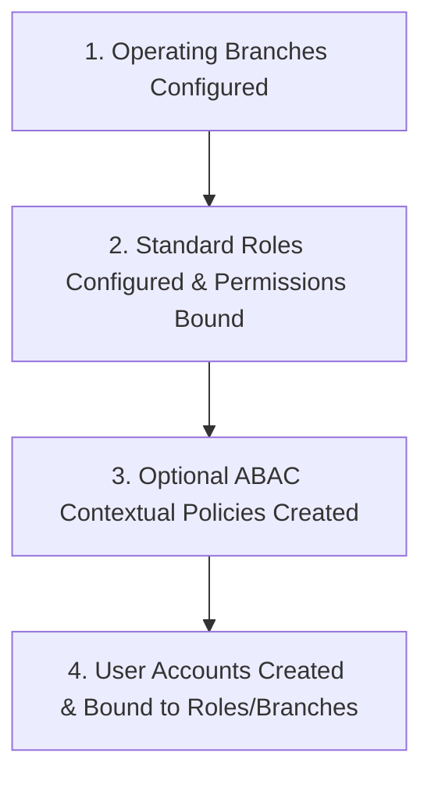
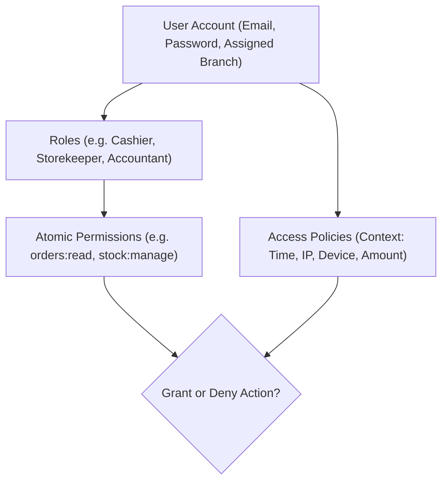

# Guide 07: Users, Roles & Access Governance (`/admin/users`)

The **Users & Access Governance** module provides enterprise-grade identity, authentication, Role-Based Access Control (RBAC), and Attribute-Based Access Control (ABAC). It ensures that every staff member has precisely the permissions required for their operational responsibilities while enforcing strict separation of duties across cash handling, inventory management, procurement, and financial reporting.

---

## 1. Executive Overview & Commercial Value Proposition

### Operational Problems Solved
- **The "Admin Password Shared by Everyone" Disaster**: In many businesses, staff share a single master administrator login. When money goes missing, orders are deleted, or prices are discounted, management cannot hold any individual accountable. QSell mandates individual staff accounts with immutable audit logging for every action.
- **Internal Fraud & Collusion**: If the person receiving goods in the warehouse can also create purchase orders and approve supplier invoices, fake deliveries and embezzlement inevitably follow. QSell enforces strict **Separation of Duties (SoD)** through granular atomic permissions.
- **Data Leakage Between Competing Branches**: In multi-branch retail, store managers often compete for performance bonuses. Giving all staff global access causes friction and leakage of customer contact lists. QSell's **Branch-Scoped Access** restricts staff visibility strictly to their assigned operating location.
- **After-Hours System Tampering**: Dishonest staff may log into the system late at night or from home to manipulate records. QSell's **Access Policies (ABAC)** allow management to enforce contextual constraints (e.g. *"Logins only permitted Monday-Saturday between 7:00 AM and 7:00 PM from authorized company network IPs"*).

### Target Client Profiles
- **Medium to Large Enterprises & Retail Chains**: Employing 10 to 500+ staff across sales, logistics, warehousing, accounting, and executive leadership.
- **Franchise & Multi-Branch Operators**: Requiring independent branch staff permissions with centralized corporate oversight.
- **Audit-Sensitive Corporations**: Requiring proof of strict internal controls for external financial auditors and board compliance.

### Commercial Sales Pitch & Talk Track
> *"With QSell, you have total control over who sees what and who can do what in your business. You can give a counter cashier the exact ability to ring up sales and print receipts, without letting them see your product cost prices or company profit. Your storekeepers can manage stock movements without touching invoices. And you can ensure that cashiers can only log into their till during business hours while physically at the store."*

### Measurable ROI & Safeguards
- **100% Personal Accountability**: Every single transaction, stage movement, and document edit is stamped with the authenticated user's ID.
- **Zero Margin Leakage to Frontline Staff**: `report_profit:read` permission separates top-line sales figures from sensitive product cost prices.
- **Contextual Perimeter Defense**: Time-of-day and IP-based access policies block unauthorized remote logins.

---

## 2. Prerequisites & Configuration Sequence

1. **Operating Branches**: Defined under `Settings > Branches` so users can be assigned to physical operating units.
2. **Roles Defined**: Built under `/admin/users/roles` with explicit permission bindings.
3. **Staff Account Creation**: Users invited or created under `/admin/users`.
4. **Required Permissions**: Only staff with `users:read` and `users:manage` can access this module.

---

## 3. Module & Sub-Module Architecture

Access control is built upon a 3-layer security model:

1. **Layer 1: Identity & Branch Scope**: The authenticated user identity bound to a primary operating branch (or *"All Branches"* for corporate directors).
2. **Layer 2: Role-Based Permissions (RBAC)**: Role templates grouping atomic permissions across 10 system categories.
3. **Layer 3: Contextual Policies (ABAC)**: Dynamic rules that evaluate environmental attributes (time of day, network IP, document amount) before permitting an action.

---

## 4. Interface-by-Interface Walkthrough

### Sub-Module 1: Users Directory (`/admin/users`)
- Master list of staff accounts showing Name, Email, Assigned Branch, Role(s), MFA Status, and Account State (`Active`, `Suspended`).
- Actions: **Invite User**, **Edit Account**, **Reset Password**, **Impersonate (Super Admin only)**, and **Deactivate User**.

### Sub-Module 2: Roles & Permissions (`/admin/users/roles`)
- Role catalog view showing pre-packaged and custom roles (e.g. *Super Administrator*, *Branch Manager*, *Senior Accountant*, *Sales Representative*, *Storekeeper*, *Counter Cashier*, *Dispatcher*).
- **Role Permission Matrix**: Interactive accordion grouped into the 10 core permission categories:
  1. *General* (Dashboard, Analytics export).
  2. *Orders & Sales* (Read, create, edit, cancel orders, quotes, customers).
  3. *Projects* (Job costing, milestone approval).
  4. *Vendor Management* (RFQs, POs, RGN receipts, supplier invoices).
  5. *Customers* (Credit limit overrides, pricing group assignments).
  6. *Products & Inventory* (Catalog edits, stock transfers, cycle counts, ledger cutover).
  7. *Finance & Payments* (General journals, bank accounts, receipts, fiscal period closing).
  8. *Reports & Insights* (Sales, collections, gross profit, receivables ageing).
  9. *Company & Settings* (Brand profile, document layouts, payment gateways, KRA eTIMS).
  10. *Users & Access* (User creation, role configuration, access policies).

### Sub-Module 3: Access Policies (`/admin/users/policies`)
- Contextual policy designer:
  - Create rules combining attributes: `If User Role = Cashier AND Current Time NOT BETWEEN 08:00 AND 18:00 THEN DENY LOGIN`.
  - IP Whitelisting: `If Action = Post General Journal AND User IP NOT IN [Head_Office_IPs] THEN REQUIRE MFA`.

---

## 5. Standard Role Templates (Implementor Reference)

| Role Template | Primary Target Persona | Key Granted Permissions | Key Restricted / Denied Permissions |
|---|---|---|---|
| **Counter Cashier** | Front-office retail staff. | `orders:create`, `orders:read`, `receipts:create`, `pos:cash_sale` | Denied: `report_profit:read`, `gl_journals:post`, `stock:manage`, `pricing:manage` |
| **Warehouse Storekeeper** | Godown and inventory staff. | `stock:read`, `stock:manage`, `inventory:counts`, `inventory:transfers`, `rgn:read`, `rgn:receive` | Denied: `orders:delete`, `gl_journals:post`, `company:write`, `supplier_invoices:read` |
| **Sales Representative** | Field and counter sales reps. | `quotes:manage`, `orders:create`, `customers:read`, `pricing:read` | Denied: `pricing:override_unlimited`, `gl_journals:post`, `report_profit:read` |
| **Logistics Dispatcher** | Fleet coordinator. | `deliveries:read`, `deliveries:dispatch`, `riders:manage`, `delivery_runs:manage` | Denied: `receipts:delete`, `finance:manage`, `gl_accounts:write` |
| **Senior Accountant** | Back-office finance team. | `finance:manage`, `gl_journals:post`, `bank_accounts:read`, `receipts:read`, `supplier_invoices:post` | Denied: `users:manage`, `system:configure`, `stock:physical_count` |
| **Branch Manager** | Operational head of a store. | Scoped to assigned branch: all sales, stock, delivery, and branch report permissions. | Denied: `reports:all_branches`, `company:profile_write`, `tax_compliance:manage` |
| **Super Administrator** | Company directors and IT head. | Full global access across all 10 categories, all branches, and all settings. | None. |

---

## 6. Step-by-Step User Actions (Down to the Last Click)

### Action 1: Onboarding a New Cashier Account
1. Navigate to `/admin/users` and click **New User**.
2. Enter **Full Name**: *"Faith Mwangi"*.
3. Enter **Corporate Email**: *"faith.mwangi@company.co.ke"*.
4. In the **Primary Branch** dropdown, select *"Nairobi Westlands Store"*.
5. In the **Role** selection list, check the box for **Counter Cashier**.
6. Check the box **Require Password Reset on First Login**.
7. Click **Create User**.
8. The system dispatches an activation email to Faith Mwangi containing a secure, single-use login link.

### Action 2: Creating a Custom Restricted Role for Sales Interns
1. Navigate to `/admin/users/roles` and click **New Role**.
2. Enter **Role Name**: *"Sales Intern"*.
3. Enter **Description**: *"Can create draft quotes and view customers; cannot view costs or confirm orders."*
4. In the permissions list:
   - Expand **Orders & Sales**: Check `quotes:read`, `quotes:create`, `customers:read`.
   - Leave `orders:confirm` and `orders:cancel` unchecked.
   - Expand **Reports & Insights**: Leave `report_profit:read` unchecked.
5. Click **Save Role**.
6. A success message confirms: *"Role 'Sales Intern' created with 3 active permissions."*

### Action 3: Enforcing Operating Hours via an Access Policy
1. Navigate to `/admin/users/policies` and click **New Access Policy**.
2. Enter **Policy Name**: *"Cashier Operating Window"*.
3. In the **Target Roles** picker, select **Counter Cashier**.
4. In the **Conditions** builder:
   - Select Attribute: `Current Time (Local)`.
   - Select Operator: `Outside Hours`.
   - Enter Time Range: `07:30` to `19:30`.
5. In the **Action** selector, choose `Deny Access with Notice`.
6. Enter Customer Message: *"System access is restricted outside operational retail hours. Please contact your Branch Manager."*
7. Click **Activate Policy**.
8. Any cashier attempting to log in at 10:00 PM is immediately blocked with the configured message.

---

## 7. Conditions, Business Rules & Edge Cases

### Preventing Accidental Lockout (Super Admin Safeguard)
- The system prevents deactivating or deleting the last active user holding the `Super Administrator` role.
- If an administrator attempts to remove the `users:manage` permission from their own account, the system rejects the operation: *"Cannot remove administrative access from your own active session."*

### Multi-Branch Visibility Isolation
- Users with the `reports:all_branches` permission can view company-wide consolidated analytics.
- Users lacking this permission have their queries automatically filtered at the database level by `branch_id = user.assigned_branch_id`.

---

## 8. Implementor Checklist & Go-Live Verification

| Step | Verification Task | Expected Result | Pass/Fail |
|---|---|---|---|
| 1 | Create user accounts for each staff member with correct branch bindings. | Users successfully receive activation emails. | [ ] |
| 2 | Assign "Counter Cashier" role to a test user. | User can create orders but cannot access General Ledger or Gross Profit. | [ ] |
| 3 | Log in as Branch Manager assigned to Branch B. | Dashboard and order lists strictly show Branch B data; Branch A is invisible. | [ ] |
| 4 | Test Time-of-Day Access Policy. | Login outside permitted hours is blocked with clean error banner. | [ ] |
| 5 | Verify Super Admin protection rule. | System refuses to delete or deactivate the primary Super Admin account. | [ ] |
