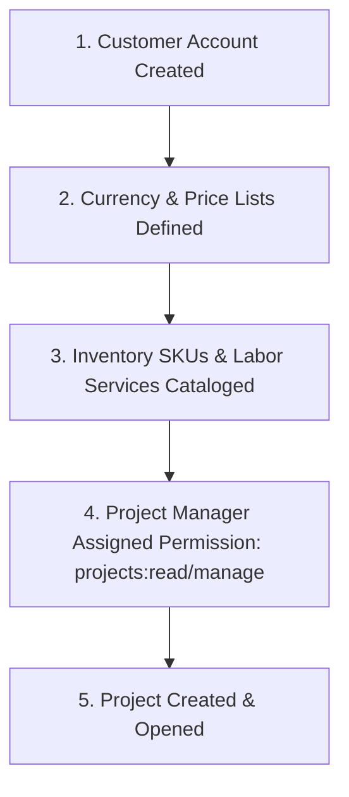
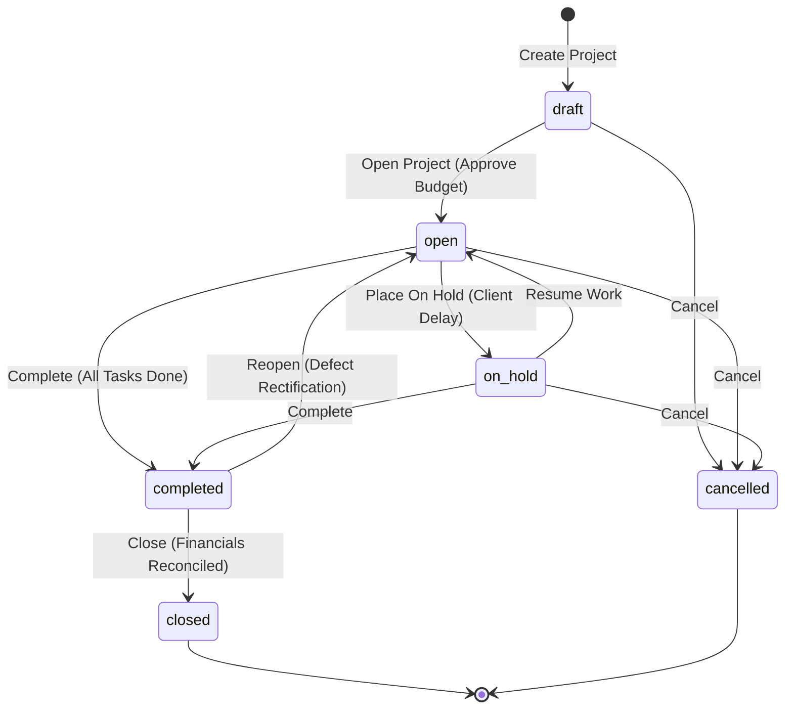

# Guide 08: Projects & Job Costing (`/admin/projects`)

The **Projects & Job Costing** module manages complex, milestone-based customer deliverables, technical installations, and internal business initiatives. It tracks tasks, billable materials, direct labor expenses, customer milestone billings, and actual gross profitability per job.

---

## 1. Executive Overview & Commercial Value Proposition

### Operational Problems Solved
- **The "Profitable on Paper, Loss in Reality" Trap**: Service contractors and equipment installers (e.g. Solar PV installers, HVAC technicians, machinery distributors) often win projects with a high contract value, only to discover at completion that unexpected labor hours, extra cabling, and sub-contractor fees wiped out all profit. QSell tracks **Budget vs. Actual Costs** in real time as materials are dispatched and hours are logged.
- **Delayed Milestone Billing**: In multi-stage projects (e.g. 30% Advance Deposit, 50% Delivery of Equipment, 20% Final Commissioning), businesses frequently forget to issue milestone invoices promptly, choking cash flow. QSell binds project tasks directly to Accounts Receivable billing schedules.
- **Premature Project Closure**: Jobs are often marked "finished" while open vendor invoices or unreturned equipment remain unaccounted for. QSell enforces a strict state machine (`draft` $\rightarrow$ `open` $\rightarrow$ `on_hold` $\rightarrow$ `completed` $\rightarrow$ `closed`), preventing a project from being formally closed until all costs and billings reconcile.

### Target Client Profiles
- **Solar PV & Renewable Energy Contractors**: Managing residential and commercial solar installations requiring site assessments, panel mounts, inverters, wiring, and commissioning.
- **Commercial Equipment & Fit-Out Contractors**: Installing industrial kitchen equipment, backup diesel generators, security CCTV systems, and retail shop fittings.
- **Internal Corporate Project Teams**: Managing internal capital expenditure projects (e.g. opening a new retail branch or refurbishing a warehouse).

### Commercial Sales Pitch & Talk Track
> *"With QSell, you can quote, execute, and bill complex installation jobs with total financial clarity. You can build a project budget with materials from your warehouse and estimated labor costs, track every milestone task, issue customer milestone invoices, and watch your true gross margin update with every screw and hour spent. You will never finish a project wondering where your profit went."*

### Measurable ROI & Safeguards
- **Real-Time Job Profitability**: Realized gross margin monitored continuously against initial quotation budgets.
- **Strict State-Machine Integrity**: Projects cannot be prematurely closed with unbilled milestones or open tasks.
- **Zero Double-Keying**: Direct quote-to-project-to-invoice workflows eliminate re-typing.

---

## 2. Prerequisites & Configuration Sequence

1. **Customer Master Card**: A customer must be selected under `/admin/customers` (unless the project is an internal company project).
2. **Catalog SKUs**: Physical items (e.g. solar panels, inverters) and labor services (e.g. technical installation per day) must exist in the catalog.
3. **Staff Permissions**: `projects:read` to view and `projects:manage` to create, edit, change status, and add tasks.

---

## 3. Module & Sub-Module Architecture

The Project Lifecycle is governed by a deterministic, non-reversible state machine:

---

## 4. Interface-by-Interface Walkthrough

### 1. Projects Directory (`/admin/projects`)
- Filterable list displaying Project Code, Title, Customer Name, Status (`Draft`, `Open`, `On Hold`, `Completed`, `Closed`, `Cancelled`), Budget Amount, Total Billed, and Target Completion Date.

### 2. Project Creation Form (`/admin/projects/new`)
- **Header**: Project Title, Project Code (auto-generated e.g. `PRJ-2026-0012`), and Description.
- **Customer Assignment**: Bind to a commercial client or mark as an Internal Company Project.
- **Dates & Currency**: Estimated Start Date, Target Completion Date, and Contract Currency (KES, USD).
- **Budget Formulation**: Target contract billing amount and estimated expense ceiling.

### 3. Project Detail Workspace (`/admin/projects/[id]`)
- **Executive KPI Tiles**:
  - `Contract Budget`: Total agreed revenue from customer.
  - `Invoiced to Date`: Amount billed via milestone invoices.
  - `Materials Cost`: Value of inventory items issued to the project.
  - `Realized Gross Margin`: Profit percentage earned on the project.
- **Action Toolbar**: Contextual state buttons based on current status (`Open Project`, `Put On Hold`, `Resume`, `Mark Completed`, `Close Project`).
- **Task & Milestone Manager**:
  - Interactive task checklist (e.g. *Site Assessment*, *Mounting Rails Installation*, *Inverter Wiring*, *Testing & Commissioning*).
  - Task state badges: `Open`, `Completed`, `Cancelled`.
- **Linked Documents Panel**: Direct links to generated Sales Quotes, Sales Orders, Material Requisitions, and Customer Invoices.

---

## 5. Granular Field-by-Field Reference

### Project Workspace Fields (`/admin/projects/new`)

| Field Label | Purpose | Type & Format | Required? | Validation Rules & Hints |
|---|---|---|---|---|
| **Project Title** | Descriptive job name. | Text (Max 160 chars) | **Required** | e.g. *"10kW Hybrid Solar Installation - Karen Residence"*. |
| **Project Code** | Unique identifier. | Text (Auto-generated) | System | e.g. `PRJ-2026-0004`. |
| **Customer** | Billable client. | Lookup Autocomplete | Optional | If blank, treated as an internal CapEx project. |
| **Currency** | Invoicing currency. | Dropdown | **Required** | Default `KES`. Locked once transactions exist. |
| **Contract Budget** | Total agreed deal value. | Currency (KES) | **Required** | Must be $> 0$ for customer projects. Format: 2 decimals. |
| **Start Date** | Project kick-off date. | Date (YYYY-MM-DD) | **Required** | Cannot be later than Target Completion Date. |
| **Target Completion** | Promised hand-over date. | Date (YYYY-MM-DD) | **Required** | Must be $\ge$ Start Date. Used for late milestone alerts. |
| **Description / Scope** | Detailed scope of work. | Rich Text (Max 2,000 chars) | Optional | Outlines deliverables and milestone criteria. |

---

## 6. Step-by-Step User Actions (Down to the Last Click)

### Action 1: Creating and Opening a Turnkey Project
1. Navigate to `/admin/projects` and click **New Project**.
2. Enter **Project Title**: *"Solar PV Installation - 5kVA System"*.
3. In the **Customer** lookup, select *"Dr. Evans Mutiso"*.
4. Enter **Contract Budget**: `KES 650,000.00`.
5. Set **Start Date**: Tomorrow's date; **Target Completion**: 10 days later.
6. Click **Save Draft**. Status becomes `Draft`.
7. In the Tasks section, click **Add Task**:
   - Task 1: *"Site Survey & Structural Roof Check"*.
   - Task 2: *"Solar Panels Mounting & Conduit Piping"*.
   - Task 3: *"Inverter & Lithium Battery Wiring"*.
   - Task 4: *"KPLC Net-Metering Commissioning & Client Sign-Off"*.
8. In the top action bar, click **Open Project**.
9. The status transitions to `Open`. Team members can now issue stock and record time against the project.

### Action 2: Completing Tasks and Milestone Invoicing
1. When technicians complete the roof mounting, open `/admin/projects/[id]`.
2. Locate Task 2: *"Solar Panels Mounting"*.
3. Click the checkmark icon to **Mark Completed**.
4. The task status updates to `Completed`.
5. Click **Generate Milestone Invoice** in the action bar.
6. The system opens the invoice builder pre-populated with the client's details, referencing Project #`PRJ-2026-0012`.
7. Enter Milestone 2 amount: `KES 325,000.00` (50% payment).
8. Post the invoice. The project workspace immediately reflects: *"Invoiced to Date: KES 325,000.00 (50%)"*.

### Action 3: Closing a Fully Reconciled Project
1. When all tasks are finished and the client signs the completion certificate:
2. In the top action bar, click **Mark Completed**.
3. Status moves to `Completed`.
4. Review the final financial summary card:
   - *Total Invoiced*: `KES 650,000.00`
   - *Actual Material Costs*: `KES 412,000.00`
   - *Direct Labor Expenses*: `KES 45,000.00`
   - *Net Gross Profit*: `KES 193,000.00 (29.7% Margin)`.
5. Click the **Close Project** button.
6. An `InlineConfirm` prompt appears: *"Formally close project PRJ-2026-0012? No further expenses or lines may be posted."*
7. Click **Confirm Closure**. The status transitions to `Closed`.

---

## 7. Conditions, Business Rules & Edge Cases

### State Machine Restrictions
- A project can only be **Closed** if its current status is `Completed`. An `Open` or `On Hold` project cannot jump directly to `Closed`.
- If defects or post-installation warranty claims arise after completion, an authorized manager may click **Reopen Project**, moving the status from `Completed` back to `Open`.
- A project in `Closed` status is **immutable**: no new tasks, material requisitions, or invoices can be attached.

---

## 8. Implementor Checklist & Go-Live Verification

| Step | Verification Task | Expected Result | Pass/Fail |
|---|---|---|---|
| 1 | Create a project in Draft status. | Saved successfully; editable capabilities enabled. | [ ] |
| 2 | Add 3 milestone tasks. | Tasks render in sequence with status Open. | [ ] |
| 3 | Transition project from Draft to Open. | Status badge updates to green Open; tasks become actionable. | [ ] |
| 4 | Attempt to close an Open project directly. | Action blocked with message: *"Complete the project before closing it."* | [ ] |
| 5 | Complete all tasks and close the project. | Status transitions to Closed; edit controls lock. | [ ] |
