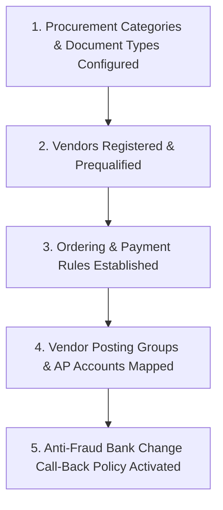
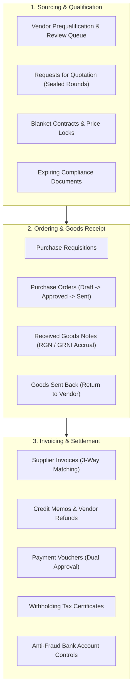

# Guide 09: Vendor Management, Procurement & Payables (`/admin/vendors`)

The **Vendor Management & Procurement** module orchestrates the complete Procure-to-Pay (P2P) lifecycle. It encompasses vendor prequalification, sealed competitive quotation rounds (RFQs), purchase orders, Goods Received Notes (RGN), automated 3-way invoice matching, landed cost capitalization, vendor payment vouchers, Accounts Payable ageing, anti-fraud bank account controls, and KRA Withholding Tax certificates.

---

## 1. Executive Overview & Commercial Value Proposition

### Operational Problems Solved
- **Procurement Fraud & Inflated Supplier Invoices**: In traditional businesses, suppliers submit invoices that charge higher prices than originally quoted, or bill for 100 units when only 80 arrived. Accounts departments often pay these blindly. QSell enforces strict **Automated 3-Way Matching**: a supplier invoice cannot be posted unless its line quantities and prices match the original Purchase Order (PO) and the physical Goods Received Note (RGN) within configured tolerance limits.
- **Vendor Bank Account Impersonation Fraud**: The single most common corporate cybercrime occurs when a fraudster hacks a supplier's email and requests that pending invoice payments be sent to a "new bank account". QSell eliminates this through **Mandatory Bank Change Quarantine**: changing a vendor's bank details triggers a phone call-back verification protocol, secondary managerial approval, and a 72-hour payment cool-off period.
- **Hidden Import & Freight Costs**: Importing goods involves sea freight, port clearance, customs import duty, and local transport. If these expenses are treated as general overhead rather than capitalized into the product's unit cost, the business underprices its goods and loses money. QSell's **Landed Cost Apportionment** wizard automatically divides freight and duty across product unit costs based on weight or value.
- **Statutory Withholding Tax (WHT) Penalties**: Kenyan tax law requires companies to withhold 2% VAT or 3%/5% Income Tax from vendor payments and remit it to KRA. QSell calculates withholding tax automatically on every payment voucher and generates monthly KRA Withholding Certificates in one click.

### Target Client Profiles
- **Importers & Large Distributors**: Managing container shipments, customs clearing agents, and multi-supplier product lines.
- **Manufacturing & Assembly Plants**: Procuring raw materials, packaging, and sub-components via competitive RFQs and blanket contracts.
- **Corporate Enterprises & Institutions**: Requiring formal procurement compliance (requisitions, multi-quote comparisons, separation of duties).

### Commercial Sales Pitch & Talk Track
> *"With QSell, you take total control of your company's spending. You eliminate procurement fraud before it happens. Your buyers can run sealed competitive quote rounds through our Vendor Self-Service Portal; your warehouse receives goods with digital Goods Received Notes; and your finance team never pays a single shilling until our system proves that the invoice matches the purchase order and the warehouse delivery note. Furthermore, our anti-fraud bank change security protects you against CEO and supplier wire fraud."*

### Measurable ROI & Safeguards
- **100% 3-Way Match Assurance**: Eliminates over-billing and paying for missing goods.
- **Automated Landed Costing**: True inventory valuation ensures selling prices maintain required profit margins.
- **Zero KRA Withholding Tax Fines**: Automated calculation and certificate generation ensure full compliance with the Tax Procedures Act.

---

## 2. Prerequisites & Configuration Sequence

1. **Procurement Categories**: Defined under `/admin/vendors/categories` (e.g. *Raw Materials*, *Office Supplies*, *Logistics*).
2. **Document Types**: Compliance mandates set under `/admin/vendors/document-types` (e.g. KRA Tax Compliance Certificate, Business Permit).
3. **Vendor Accounts**: Created or invited under `/admin/vendors`.
4. **Payment Rules & Tax Codes**: Withholding VAT and Income Tax percentages set under `/admin/vendors/payment-rules`.
5. **Vendor Posting Groups**: Linked to General Ledger Accounts Payable under `Finance > Posting Setup`.
6. **Required Permissions**: `vendors:read`, `purchase_orders:read/write`, `rgn:read/write`, `supplier_invoices:read/write`, `vendor_payments:read/write`.

---

## 3. Module & Sub-Module Architecture

The Procure-to-Pay (P2P) pipeline spans 25 operational sub-modules:

---

## 4. Interface-by-Interface Walkthrough

### 1. Vendors Directory (`/admin/vendors`)
- Master supplier cards: Company Name, KRA PIN, Primary Contact, Category, Prequalification Tier, Credit Terms (e.g. Net 30), and Balance Owed.

### 2. Requests for Quotation / RFQs (`/admin/vendors/rfqs`)
- Competitive bidding engine:
  - Create an RFQ for specific items or services.
  - Invite prequalified vendors to submit sealed bids through the Vendor Portal.
  - **Comparison Sheet**: Side-by-side bid matrix comparing unit prices, delivery lead times, and payment terms.
  - Award the winning vendor and auto-generate the Purchase Order in one click.

### 3. Purchase Orders (`/admin/vendors/orders`)
- Legally binding purchase commitments:
  - Header: Vendor, Delivery Warehouse, Target Delivery Date, Currency.
  - Lines: SKU, Quantity, Agreed Price, Tax Class.
  - Lifecycle: `Draft` $\rightarrow$ `Pending Approval` $\rightarrow$ `Released` $\rightarrow$ `Sent to Vendor` $\rightarrow$ `Confirmed` $\rightarrow$ `Partially Received` $\rightarrow$ `Fully Received` $\rightarrow$ `Closed`.

### 4. Received Goods / RGN (`/admin/vendors/receipts`)
- Goods Receipt Note (RGN):
  - When the delivery truck arrives, warehouse staff inspect physical boxes.
  - Record line-by-line acceptance (e.g. Ordered: 100, Received Good: 95, Damaged: 5).
  - Automatically posts the accounting accrual: `Dr Inventory / Cr Goods Received Not Invoiced (GRNI)`.

### 5. Supplier Invoices (`/admin/vendors/invoices`)
- The 3-Way Matcher:
  - Vendor submits their invoice via the Vendor Portal (or staff type it in).
  - System automatically links the invoice lines to the corresponding RGN and PO lines.
  - Flags price variances, quantity discrepancies, or duplicate invoice numbers.

### 6. Landed Costs (`/admin/vendors/landed-costs`)
- Import cost capitalization: Apportions shipping freight, marine insurance, and customs duty across received product lines by weight, volume, or value.

### 7. Payments to Vendors (`/admin/vendors/payments`)
- Payment voucher management:
  - Select approved due invoices.
  - Automatically deducts Withholding Tax (WHT).
  - Routes voucher for **Dual Managerial Approval** before initiating bank EFT transfer or M-Pesa B2B payout.

### 8. What We Owe / Payables Ageing (`/admin/vendors/payables`)
- Accounts Payable ageing report: Current, 1-30 days, 31-60 days, 61-90 days, 90+ days overdue, with printable vendor statements.

### 9. Vendor Scorecards (`/admin/vendors/scorecards`)
- Automated supplier rating based on: Delivery on-time %, quality acceptance rate (% goods rejected at RGN), and price stability.

### 10. Anti-Fraud Bank Changes (`/admin/vendors/bank-changes`)
- Controlled quarantine for vendor bank account edits:
  - Flags any request to update payment details.
  - Requires telephone call-back verification to the vendor's primary registered landline.
  - Requires 2nd senior manager sign-off.
  - Enforces a mandatory 72-hour payment cool-off quarantine before funds can be disbursed to the new account.

### 11. Petty Cash Floats (`/admin/vendors/petty-cash`)
- Office expense float management: Imprest float balance, petty cash expense vouchers with scanned receipts, float replenishment workflows, and GL account allocation.

---

## 5. Granular Field-by-Field Reference

### Purchase Order Form Fields (`/admin/vendors/orders/new`)

| Field Label | Purpose | Type & Format | Required? | Validation Rules & Hints |
|---|---|---|---|---|
| **Vendor** | Selected supplier. | Lookup Autocomplete | **Required** | Must be an active, approved vendor. |
| **PO Number** | Sequence code. | Text (Auto-generated) | System | e.g. `PO-2026-0038`. |
| **Delivery Location** | Destination warehouse. | Dropdown | **Required** | Warehouse receiving the physical shipment. |
| **Promised Date** | Expected arrival date. | Date (YYYY-MM-DD) | **Required** | Used for vendor scorecard on-time tracking. |
| **Payment Terms** | Credit agreement. | Dropdown | **Required** | e.g. *Advance Payment*, *Cash on Delivery*, *Net 30*. |
| **Product Line: SKU** | Item to purchase. | Lookup Autocomplete | **Required** | Must be an active product or raw material. |
| **Product Line: Qty** | Ordered quantity. | Decimal / Integer | **Required** | Must be $> 0$. |
| **Product Line: Unit Cost** | Purchase price per unit. | Currency (KES) | **Required** | Pre-populated from vendor contract or last price. |
| **Product Line: Tax** | VAT rate on purchase. | Dropdown | **Required** | 16% Input VAT, Zero-Rated, or Exempt. |

### Supplier Invoice Matching Fields (`/admin/vendors/invoices/[id]`)

| Field Label | Purpose | Type & Format | Required? | Validation Rules & Hints |
|---|---|---|---|---|
| **Vendor Invoice No** | Number on vendor's bill. | Text (Max 60 chars) | **Required** | Unique per vendor. Duplicates blocked at entry. |
| **Invoice Date** | Date on vendor's paper. | Date (YYYY-MM-DD) | **Required** | Cannot be later than current server date. |
| **Linked RGN** | Matching Goods Receipt Note. | Lookup Autocomplete | **Required** | Pulls received quantities into match grid. |
| **Price Tolerance** | Acceptable variance %. | Decimal | System | Defined in settings (default 0.5%). Breaches require manager approval. |
| **Withholding Tax Code** | Applicable tax deduction. | Dropdown | Optional | e.g. *WHT 2% (VAT)* or *WHT 5% (Management/Services)*. |

---

## 6. Step-by-Step User Actions (Down to the Last Click)

### Action 1: Receiving Goods and Generating a Goods Received Note (RGN)
1. Navigate to `/admin/vendors/receipts` and click **New Goods Receipt**.
2. Select the **Purchase Order** (e.g. `PO-2026-0038` from *"SolarTech Kenya Ltd"*).
3. The lines auto-populate with the ordered items: *"100 units of 500W Panels"*.
4. Enter the vendor's physical **Delivery Note Number** (e.g. `DN-88192`).
5. In the **Received Qty** column, type `100`.
6. If 2 panels are shattered upon inspection, enter `Accepted: 98`, `Rejected: 2`, and select Rejection Reason: *"Physical Transit Damage"*.
7. Click **Post Goods Receipt (RGN)**.
8. The system updates warehouse stock immediately by 98 units, posts the GRNI accrual in the general ledger, and generates formal PDF RGN documentation for the delivery driver.

### Action 2: 3-Way Matching and Booking a Supplier Invoice
1. Navigate to `/admin/vendors/invoices` and click **New Supplier Invoice**.
2. Select **Vendor**: *"SolarTech Kenya Ltd"*.
3. Type the **Vendor's Invoice Number**: `INV-99410`.
4. Link the invoice to **RGN #`RGN-2026-0024`**.
5. The system performs the 3-Way Match:
   - PO Price: `KES 12,000.00` per panel.
   - Invoice Price: `KES 12,000.00` per panel. $\rightarrow$ **MATCH**
   - RGN Accepted Qty: `98 units`.
   - Invoice Billed Qty: `98 units`. $\rightarrow$ **MATCH**
   - Tax Rate: `16% VAT`. $\rightarrow$ **MATCH**
6. Green badges confirm: *"3-Way Match Passed (0% variance)"*.
7. Click **Post Supplier Invoice**.
8. The document transitions to `Posted`, moves into Accounts Payable, clears the GRNI accrual, and books the liability to Vendor Payables.

### Action 3: Processing an Anti-Fraud Vendor Bank Account Change
1. Navigate to `/admin/vendors/bank-changes`.
2. A pending request appears: *"SolarTech Kenya Ltd submitted new bank details: Equity Bank, Acc #011223344"*.
3. The system locks all pending payment vouchers for SolarTech Kenya Ltd.
4. The Procurement Officer dials the vendor's registered landline telephone (taken from the original prequalification certificate, not from the email request).
5. After confirming the legitimacy of the change with the vendor's Managing Director, the officer enters the **Call-Back Verification Code** and notes.
6. The Finance Director opens the request and clicks **Approve Bank Change**.
7. The system initiates the **72-Hour Cool-Off Period**. A countdown timer displays on screen: *"Payments to this account unlock in 71h 59m"*, preventing immediate wire transfers.

---

## 7. Conditions, Business Rules & Edge Cases

### The Automated 3-Way Matching Tolerance Rule
- If the price billed on a supplier invoice exceeds the purchase order price:
  - If variance $\le \text{Configured Tolerance}$ (e.g. 0.5% or KES 50), the system permits booking with a price adjustment log.
  - If variance $> \text{Configured Tolerance}$, booking is **blocked** until the procurement manager issues an approved Purchase Order Amendment or the vendor submits a corrected invoice.

### Duplicate Invoice Protection
- The system enforces a strict composite database unique constraint: `(vendor_id, LOWER(TRIM(vendor_invoice_number)))`.
- If an accountant attempts to enter an invoice number that already exists for that vendor (even with extra spaces or different letter casing), the system blocks the entry with the message: *"Invoice [Number] has already been booked for this vendor on [Date]."*

---

## 8. Implementor Checklist & Go-Live Verification

| Step | Verification Task | Expected Result | Pass/Fail |
|---|---|---|---|
| 1 | Create a Vendor Master Card with KRA PIN and Credit Terms. | Vendor saved and visible in purchasing lookup lists. | [ ] |
| 2 | Issue a Purchase Order and receive goods via RGN. | Stock on hand increases; GRNI ledger accrual posted. | [ ] |
| 3 | Enter a Supplier Invoice with mismatched quantities. | System flags quantity discrepancy and blocks posting until reconciled. | [ ] |
| 4 | Test Anti-Fraud Bank Change Workflow. | Change triggers telephone call-back requirement and 72-hour cool-off. | [ ] |
| 5 | Post a Payment Voucher with Withholding Tax (WHT). | 2% VAT or 5% WHT deducted; KRA certificate generated. | [ ] |
