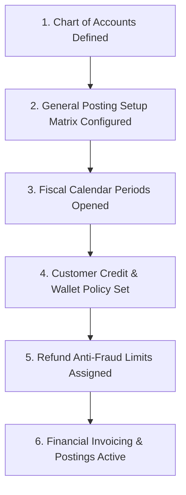
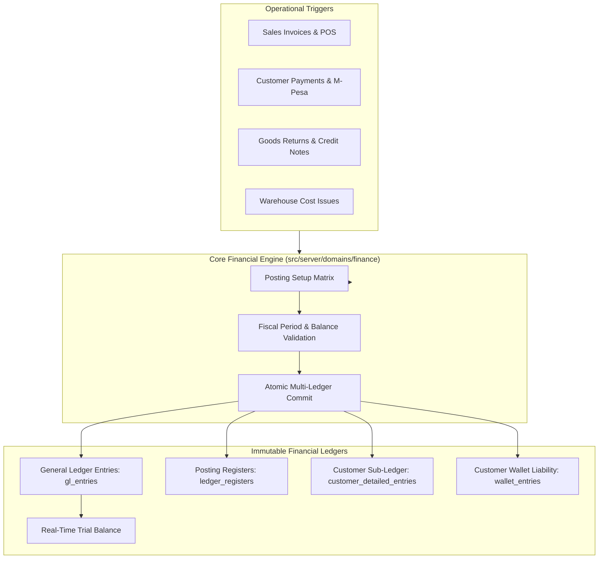

# Guide 10: Finance, General Ledger & Accounts Receivable (`/admin/finance`)

The **Core Finance & Accounts Receivable** module provides a complete, double-entry financial accounting system with the discipline of Microsoft Dynamics 365 Business Central. It encompasses the Chart of Accounts, General Journals, immutable G/L Entries and Registers, Real-Time Trial Balances, Fiscal Periods, the Posting Setup Matrix, Customer Receipts Allocation, Customer Wallets (Store Credit), Safeguarded Refunds, Foreign Exchange Revaluation, and Debtor Ageing.

---

## 1. Executive Overview & Commercial Value Proposition

### Operational Problems Solved
- **The Month-End "Disappearing Debtors" Hunt**: In traditional systems, sales invoices, cashier receipts, and warehouse dispatches are recorded in separate tables that frequently disagree with the general ledger. Accountants spend weeks chasing discrepancies between the Accounts Receivable sub-ledger and the G/L balance. QSell guarantees **Sub-Ledger and G/L Invariant Harmony**: every invoice, receipt, return, and wallet credit is posted together with its balancing G/L double entries in the exact same atomic transaction.
- **Accidental Back-Dated Posting Chaos**: A rogue or untrained user edits an invoice from three months ago, throwing off previously certified and tax-audited financial statements. In QSell, **Posted Means Immutable**. Past journal lines can never be edited or deleted. Errors must be corrected by formal reversals or credit memos with mandatory reason logging. Furthermore, closed fiscal periods are cryptographically locked.
- **Overpayment & Customer Credit Chaos**: When a customer pays KES 10,000 for an KES 8,000 order, most systems treat the extra KES 2,000 as a negative debt or loose money. QSell features a native **Customer Wallet Sub-Ledger**: unallocated overpayments or return credits are securely parked in the customer's digital store wallet as a clean liability, ready to automatically offset future purchases.
- **Refund Embezzlement & Fraud**: Internal staff frequently issue unauthorized cash refunds to personal phone numbers. QSell enforces a **Separation of Duties Refund Framework**: refunds require dual managerial approval, mandatory upload of supporting evidence, phone-number velocity limits, and daily payout caps.

### Target Client Profiles
- **Corporate CFOs, Financial Controllers & Chief Accountants**: Demanding IFRS-compliant double-entry accounting, audit-ready journal registers, and instant drill-down from financial statements to source transactions.
- **High-Volume Retail & Wholesale Distributors**: Managing thousands of customer invoices, partial payments, credit notes, and multi-currency transactions.
- **B2B Trade Merchants**: Managing credit customers with strict 30/60/90-day payment terms and debt collection schedules.

### Commercial Sales Pitch & Talk Track
> *"With QSell, you get the financial rigor and posting discipline of tier-one enterprise ERPs like Microsoft Dynamics Business Central, built specifically for modern African businesses. There are no batch delays and no month-end reconciliation surprises. The second a cashier rings up a sale or an M-Pesa payment confirms, your General Ledger, Accounts Receivable sub-ledger, and Trial Balance update simultaneously. Your books are permanently audit-ready, your customer store wallets are automated, and your refund payouts are locked with anti-fraud limits."*

### Measurable ROI & Safeguards
- **Zero Reconciliation Hunting**: General Ledger control accounts and Accounts Receivable balances match at all times.
- **100% Audit Integrity**: Append-only ledger registers record *Who, What, When, Why, and From Where* for every shilling.
- **Guaranteed Fraud Protection**: Segregation of duties prevents the person creating a credit memo or refund from approving or disbursing the payout.

---

## 2. Prerequisites & Configuration Sequence

1. **Chart of Accounts**: Defined under `/admin/finance/accounts` (Assets, Liabilities, Equity, Revenue, COGS, Expenses).
2. **Posting Setup Matrix**: Configured under `/admin/finance/posting-setup` (Mapping which G/L accounts receive sales revenue, inventory, tax, and receivables postings).
3. **Fiscal Calendar**: Periods opened under `/admin/finance/periods` (At least one active open accounting period).
4. **Customer Credit & Wallet Policy**: Defined under `/admin/finance/receivables/wallet-policy`.
5. **Refund Limits**: Defined under `/admin/finance/refunds/limits`.
6. **Required Permissions**: `gl_accounts:read`, `journals:read/post`, `ledger_registers:read`, `trial_balance:read`, `receipts:read/create`, `refunds:read/act`.

---

## 3. Module & Sub-Module Architecture

The Finance architecture coordinates the General Ledger and Accounts Receivable sub-ledgers:

---

## 4. Interface-by-Interface Walkthrough

### Part A: General Ledger (`/admin/finance`)

#### 1. Chart of Accounts (`/admin/finance/accounts`)
- Master list of accounts organized by category: *1000 Assets*, *2000 Liabilities*, *3000 Equity*, *4000 Revenue*, *5000 Cost of Goods Sold*, *6000 Operating Expenses*.
- Account configuration: Account Code, Account Name, Account Type (`Posting`, `Heading`, `Total`), Direct Posting Toggle, Blocked Status, and Balance Sheet / Income Statement mapping.

#### 2. General Journals (`/admin/finance/journals`)
- Manual journal preparation workspace:
  - Create balanced debit and credit entries with Document Number, Posting Date, G/L Account, Description, Amount, and Dimension Sets (Branch, Department).
  - **Posting Preview**: Runs the complete posting simulation in memory and renders every entry that would be created before writing to the database.

#### 3. G/L Entries (`/admin/finance/entries`)
- The immutable general ledger: Search and filter millions of ledger lines by Account, Date, Document No, or Register ID. Shows Debit, Credit, and Source Document link.

#### 4. Postings / Registers (`/admin/finance/registers`)
- The master audit log: Each row represents one atomic posting event, recording Register No, Starting/Ending Entry ID, Posting Date, User ID, Source Document, and Reason Code.
- **Reverse Transaction Action**: Reverses an entire register with an equal-and-opposite posting in one click with mandatory reason capture.

#### 5. Trial Balance (`/admin/finance/trial-balance`)
- Real-time trial balance report: Filter by Date Range, Dimension (Branch/Cost Center), or Account Group. Shows Opening Balance, Period Net Movement (Debits/Credits), and Closing Balance. Total Debits strictly equal Total Credits.

#### 6. Fiscal Periods (`/admin/finance/periods`)
- Fiscal calendar management: Configure 12 monthly periods per fiscal year. Set period status (`Open`, `Soft-Closed`, `Closed`, `Locked`). Prevents back-dated postings into audited periods.

#### 7. Posting Setup (`/admin/finance/posting-setup`)
- The business-to-accounting translation matrix: Maps product business classifications, customer groups, and payment methods to specific G/L accounts (e.g. *Retail Hardware Sales $\rightarrow$ Account 4100; Wholesale Cement Sales $\rightarrow$ Account 4200*).

---

### Part B: Accounts Receivable (`/admin/finance/receipts`, `/admin/finance/receivables`)

#### 8. Receipts (`/admin/finance/receipts`, `/new`)
- Customer payment recording:
  - Select Customer, Payment Method (Cash, Bank Transfer, Cheque, M-Pesa), Amount Paid, and Payment Reference.
  - **Invoice Allocation Grid**: Displays customer's open unpaid invoices. Allows auto-allocating payment to oldest invoices first, or manually selecting specific invoices to settle.

#### 9. Customer Wallets (`/admin/finance/receivables/wallets`)
- Customer store credit liability sub-ledger:
  - Displays customer wallet balances.
  - History of wallet funding (overpayments, returned goods, cash advances) and redemptions against orders.

#### 10. Credit Adjustments (`/admin/finance/receivables/credit-adjustments`)
- Manual adjustments to customer balances (bad debt write-offs, courtesy credits):
  - Requires mandatory 2nd-person managerial approval before affecting the general ledger.

#### 11. Customer Refunds & Limits (`/admin/finance/refunds`, `/limits`)
- Payout governance:
  - Multi-tier refund request workflow (Request $\rightarrow$ Verification & Evidence $\rightarrow$ Approval $\rightarrow$ Disbursement).
  - Anti-Fraud Limits: Sets maximum daily refund amount per customer phone number, per cashier, and per branch.

#### 12. Receivables Ageing (`/admin/finance/receivables/ageing`)
- Debtor analysis dashboard: Buckets outstanding customer debt into *Current*, *1-30 Days*, *31-60 Days*, *61-90 Days*, and *90+ Days*. Drill down to individual overdue invoices to trigger dunning notices or pause credit accounts.

#### 13. Foreign Exchange & Revaluation (`/admin/finance/exchange-rates`)
- Multi-currency rate table and month-end FX revaluation wizard: Automatically calculates and posts unrealized foreign exchange gains or losses on foreign currency receivables (USD, EUR, GBP) to the G/L.

---

## 5. Granular Field-by-Field Reference

### Chart of Accounts Fields (`/admin/finance/accounts/new`)

| Field Label | Purpose | Type & Format | Required? | Validation Rules & Hints |
|---|---|---|---|---|
| **Account Code** | Unique accounting number. | Text (Alphanumeric, Max 20) | **Required** | Must be unique (e.g. `1100`, `4100`). |
| **Account Name** | Description of the account. | Text (Max 120 chars) | **Required** | e.g. *"Accounts Receivable - Trade"*. |
| **Account Type** | Role in the financial chart. | Dropdown | **Required** | `Posting` (holds entries), `Heading`, `Total` (summary). |
| **Category** | Primary financial statement classification. | Dropdown | **Required** | `Asset`, `Liability`, `Equity`, `Revenue`, `COGS`, `Expense`. |
| **Direct Posting** | Allows manual journal entries. | Toggle (On/Off) | **Required** | Set to `Off` for control accounts (AR, AP, Stock) to prevent manual tampering. |
| **Blocked Status** | Prevents future postings. | Toggle (On/Off) | **Required** | Blocked accounts reject all new journal postings. |

### Customer Receipt Fields (`/admin/finance/receipts/new`)

| Field Label | Purpose | Type & Format | Required? | Validation Rules & Hints |
|---|---|---|---|---|
| **Customer** | Account making the payment. | Lookup Autocomplete | **Required** | Loads customer's open invoices and current wallet balance. |
| **Receipt Date** | Date funds cleared. | Date (YYYY-MM-DD) | **Required** | Must fall within an open fiscal period. |
| **Payment Method** | Ingress payment channel. | Dropdown | **Required** | e.g. *M-Pesa Paybill*, *KCB Bank Transfer*, *Cash Till*. |
| **Amount Received** | Monetary sum paid. | Currency (KES) | **Required** | Must be $> 0$. Format: 2 decimal places. |
| **Reference / Trx ID** | Bank or M-Pesa transaction code. | Text (Max 60 chars) | **Required** | e.g. `QA812739182` or Cheque number. |
| **Overpayment Handling**| What to do with excess cash. | Dropdown | **Required** | `Credit to Customer Wallet`, `Leave as Unapplied Receipt`. |

---

## 6. Step-by-Step User Actions (Down to the Last Click)

### Action 1: Recording and Allocating a Customer Payment
1. Navigate to `/admin/finance/receipts` and click **New Receipt**.
2. In the **Customer** lookup, select *"Nairobi Hardware Wholesalers"*.
3. Enter **Amount Received**: `KES 150,000.00`.
4. In the **Payment Method** dropdown, select *"Bank Transfer - KCB"*.
5. In the **Reference** box, enter the bank deposit slip number: `DEP-99412`.
6. The screen displays the customer's unpaid invoices:
   - Invoice #`INV-1002`: Balance KES 80,000.00.
   - Invoice #`INV-1008`: Balance KES 50,000.00.
   - Invoice #`INV-1014`: Balance KES 40,000.00.
7. Click **Auto-Allocate (Oldest First)**.
8. The system allocates KES 80,000 to INV-1002 (paid in full), KES 50,000 to INV-1008 (paid in full), and the remaining KES 20,000 to INV-1014 (partial payment, KES 20,000 remaining).
9. Click **Post Receipt**.
10. The receipt is posted. General ledger entries are generated instantly (`Dr KCB Bank / Cr Accounts Receivable`), and official payment receipts are generated.

### Action 2: Posting a General Journal with Posting Preview
1. Navigate to `/admin/finance/journals` and open the *"General Operations"* batch.
2. Click **Add Journal Line**:
   - Account: `6100 - Office Electricity & Water`.
   - Side: `Debit`, Amount: `KES 18,500.00`.
   - Description: *"March Power Bill - Head Office"*.
3. Click **Add Balancing Line**:
   - Account: `1120 - Petty Cash Float`.
   - Side: `Credit`, Amount: `KES 18,500.00`.
4. Click the **Posting Preview** button in the header.
5. The preview modal renders showing the exact G/L entries that will be written, proving debits equal credits.
6. Click **Confirm & Post Journal**.
7. The register number is generated (`REG-2026-0182`), entries are written to `gl_entries`, and the batch clears.

### Action 3: Reversing an Erroneous Financial Posting
1. Navigate to `/admin/finance/registers`.
2. Locate the register created in error (e.g. `REG-2026-0182`).
3. Click **View Register Details**.
4. In the top action bar, click **Reverse Register**.
5. The system displays a confirmation modal requiring a **Mandatory Reversal Reason**:
   - Type reason: *"Incorrect electricity bill amount entered; will re-enter with official KPLC receipt."*
6. Click **Confirm Reversal**.
7. The system creates a new balancing register (`REG-2026-0183`) containing exact equal-and-opposite debits and credits, permanently linking it to the original register in the audit trail.

---

## 7. Conditions, Business Rules & Edge Cases

### Direct Posting Lock on Control Accounts
- Control accounts (such as *Accounts Receivable 1200*, *Accounts Payable 2100*, and *Inventory at Cost 1300*) have `direct_posting = false`.
- If a user attempts to create a manual general journal line posting directly to Account 1200, the system blocks the action with the error: *"Direct posting is disabled for Account 1200 (Accounts Receivable). Post customer transactions through customer invoices, receipts, or credit memos to preserve sub-ledger integrity."*

### Fiscal Period Locking Rules
- If an accounting period is set to `Closed` or `Locked` (e.g. December 2025):
  - Any transaction dated within that period is **strictly rejected**.
  - Transactions must have their posting date moved into the earliest open fiscal period.

---

## 8. Implementor Checklist & Go-Live Verification

| Step | Verification Task | Expected Result | Pass/Fail |
|---|---|---|---|
| 1 | Import or configure standard Chart of Accounts. | Accounts appear in numerical order with categories assigned. | [ ] |
| 2 | Configure Posting Setup matrix for Sales, Inventory, and Tax. | Test invoice posts accurately without missing account errors. | [ ] |
| 3 | Execute Posting Preview on a manual General Journal. | Preview modal displays balanced debits and credits. | [ ] |
| 4 | Post a customer receipt and verify Trial Balance. | Accounts Receivable decreases; Bank Account balance increases; TB balances. | [ ] |
| 5 | Attempt to post a journal into a Closed Fiscal Period. | System rejects entry with explicit period closed warning. | [ ] |
