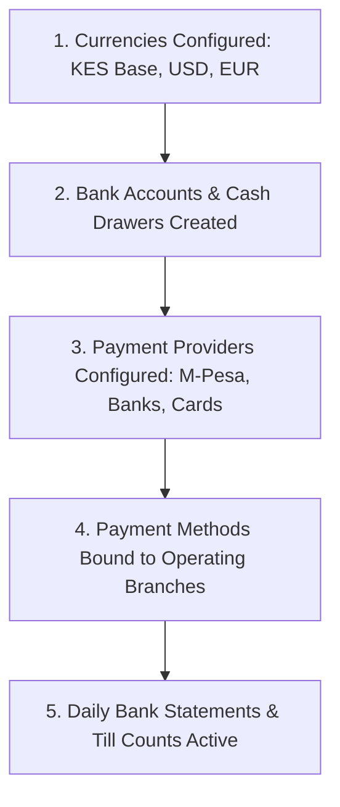
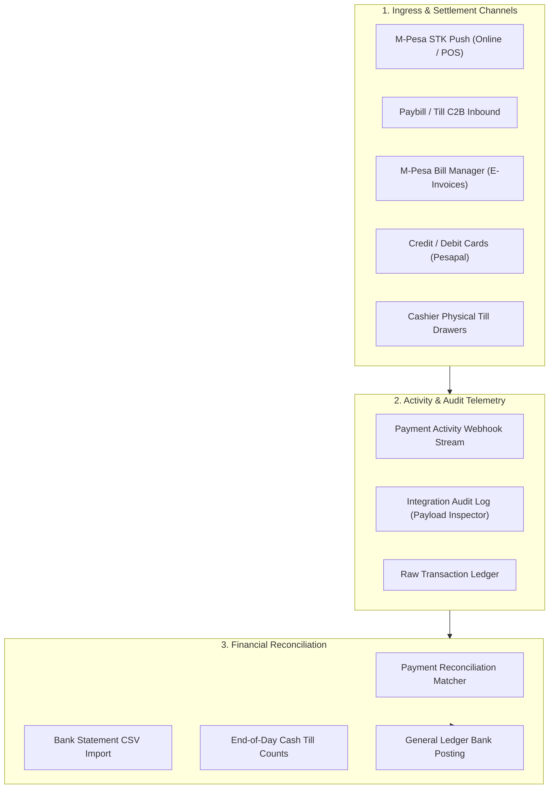

# Guide 11: Banking, Cash & Payment Gateways (`/admin/finance/bank-accounts`, `/admin/payments`, `/admin/currencies`)

The **Banking, Cash & Payment Gateways** module governs the physical and digital cash flow of the business. It encompasses commercial bank accounts, physical cashier cash drawers, Safaricom M-Pesa merchant integrations (STK Push, Paybill, Till, and Bill Manager), automated bank statement CSV reconciliations, multi-currency exchange rates, and raw integration audit logs.

---

## 1. Executive Overview & Commercial Value Proposition

### Operational Problems Solved
- **The "Missing M-Pesa Payment" Nightmare**: In typical businesses, customers send money to a Paybill number, but network drops or customer typos mean the order remains "Unpaid" on the screen while funds are deducted from the customer's phone. Staff argue with customers and manually check Safaricom statement portals. QSell provides **Real-Time Payment Activity Telemetry**: every inbound webhook, STK prompt, and transaction payload is captured live. If an orphan payment arrives, the **Reconciliation Workspace** matches it to the pending order with a single click.
- **Cash Till Shortages & Till Theft**: In busy retail stores, cashiers collect physical cash notes all day. Without strict controls, till shortages are discovered days later when it is impossible to identify which cashier was responsible. QSell mandates **End-of-Day Cash Drawer Counts**: cashiers count their physical notes (KES 1,000s, 500s, 200s, 100s, 50s, coins) against the system's expected book balance, and variances are automatically flagged and posted.
- **Manual Bank Statement Reconciliation**: Financial controllers spend days each month printing bank statements and ticking off line items against customer deposits. QSell features an **Automated Bank Statement CSV Reconciler**: upload a standard bank statement, and the system automatically matches deposits to open invoices and customer ledger entries based on reference numbers, dates, and amounts.
- **Exposing API Keys in Plaintext**: Many platforms store payment provider API keys and consumer secrets in unencrypted configuration files. QSell encrypts all API credentials at rest in the database with hardware-grade cryptographic sealing; keys are never exposed on screen or printed in server logs.

### Target Client Profiles
- **High-Velocity Omnichannel Retailers**: Processing hundreds of M-Pesa and card transactions hourly across in-store POS and web shop.
- **Multi-Branch Store Networks**: Operating independent bank accounts and cash drawers per branch location.
- **Cross-Border Regional Traders**: Invoicing and collecting in multiple currencies (KES, USD, EUR, UGX, TZS) with daily exchange rate revaluations.

### Commercial Sales Pitch & Talk Track
> *"With QSell, you will never lose track of a single payment. We integrate natively with Safaricom M-Pesa (both STK Push and Bill Manager), major Kenyan banks, and card processors. When a customer pays, your books update immediately. If a network blip occurs, our payment activity dashboard shows you the raw gateway response in real time. And at the end of every day, your cashiers conduct digital till counts that verify physical cash against book sales down to the last five-shilling coin."*

### Measurable ROI & Safeguards
- **100% Payment Ingress Visibility**: Zero lost mobile-money transactions; orphan payments matched in seconds.
- **Instant Till Shortage Detection**: Physical cash variances highlighted before cashiers leave the premises.
- **Zero API Credential Exposure**: Sealed cryptographic storage ensures bank and M-Pesa secrets cannot be stolen.

---

## 2. Prerequisites & Configuration Sequence

1. **Currencies Active**: Base currency (KES) and foreign currencies established under `/admin/currencies`.
2. **Bank Accounts Created**: Defined under `/admin/finance/bank-accounts` (Commercial banks and physical tills).
3. **Payment Providers Configured**: Credentials entered under `Settings > Payments`.
4. **Public Base URL Set**: Company or branch must have a valid public HTTPS URL configured so gateway webhooks can reach the server.
5. **Staff Permissions**: `bank_accounts:read/write`, `cash_counts:read/create`, `payment_activity:read`, `transactions:reconcile`.

---

## 3. Module & Sub-Module Architecture

The Banking and Payment ecosystem is structured into three operational layers:

---

## 4. Interface-by-Interface Walkthrough

### 1. Bank Accounts (`/admin/finance/bank-accounts`)
- Master directory of corporate liquid funds:
  - Commercial Bank Accounts (e.g. KCB, Equity Bank, Standard Chartered).
  - Mobile Money Settlement Accounts (Safaricom M-Pesa Paybill / Buy Goods Till).
  - Physical Cash Drawers (e.g. *Till #1 - Westlands*, *Till #2 - Mombasa*).
- Displays real-time Book Balance, Last Reconciled Date, Currency, and Status.

### 2. Bank Statements & Reconciliation (`/admin/finance/bank-statements`)
- Reconciles bank reality with general ledger books:
  - Upload official bank statement CSVs.
  - Interactive split screen: Statement Lines on the left; System Bank Ledger Entries on the right.
  - **Auto-Match Button**: Matches transactions by Reference ID, Date, and Shilling Amount.
  - Unmatched transactions can be posted directly as bank charges, interest income, or direct customer deposits.

### 3. Cash Counts (`/admin/finance/cash-counts`)
- End-of-shift retail till verification:
  - Select Branch and Cash Drawer.
  - Enter physical denomination counts (Quantity of KES 1,000, 500, 200, 100, 50, 40, 20, 10, 5, 1).
  - Displays Expected Balance vs. Counted Balance, calculating exact **Shortage or Overage**.
  - Posts variance adjustment entries with mandatory supervisor approval.

### 4. Currencies & FX (`/admin/currencies`)
- Multi-currency management: Base currency (KES) and foreign currencies (USD, EUR, GBP, UGX, TZS).
- Maintain daily spot exchange rates and view monthly FX revaluation logs.

### 5. Transactions Ledger (`/admin/transactions/ledger`)
- Low-level payment record: Shows every payment attempt, gateway transaction ID, channel, customer phone number, monetary value, and settlement status (`Pending`, `Paid`, `Failed`, `Reconciled`).

### 6. Payment Activity (`/admin/payments/activity`)
- Real-time developer & operations log: Displays live stream of incoming gateway webhook notifications from Safaricom Daraja, banks, and card processors.
- Essential for customer care desks investigating delayed or disputed payments.

### 7. M-Pesa Bill Manager Invoices (`/admin/payments/bills`)
- Push electronic bills directly to customer Safaricom M-Pesa apps:
  - Select customer invoice.
  - Send M-Pesa Bill Manager notification.
  - The customer receives an official Safaricom notification on their phone displaying invoice details and a single *"Pay Now"* prompt.
  - Receipting is 100% automated upon PIN entry.

### 8. Reconciliation (`/admin/reconciliation`)
- The orphan payment matching engine:
  - Lists payments received by M-Pesa or bank transfer that could not be automatically matched to an order (e.g. customer entered wrong account number).
  - Search pending customer orders and click **Manually Match & Settle** to instantly confirm the order.

### 9. Integration Audit Log (`/admin/integration-audit`)
- Deep forensic payload viewer: Inspect the complete HTTP headers, request payloads, and response bodies for every outbound API call and inbound webhook.

---

## 5. Granular Field-by-Field Reference

### Bank Account Master Fields (`/admin/finance/bank-accounts/new`)

| Field Label | Purpose | Type & Format | Required? | Validation Rules & Hints |
|---|---|---|---|---|
| **Account Code** | Internal accounting ID. | Text (Max 20 chars, uppercase) | **Required** | Unique e.g. `BANK-KCB-01`. |
| **Account Name** | Descriptive label. | Text (Max 120 chars) | **Required** | e.g. *"KCB Operating Account - Industrial Area"*. |
| **Account Type** | Nature of the account. | Dropdown | **Required** | `Commercial Bank`, `Cash Drawer (Till)`, `Mobile Money Settlement`. |
| **Bank Name** | Institution name. | Text (Max 120 chars) | Required for Bank | e.g. *"KCB Bank Kenya"*. |
| **Account Number** | Official account number. | Text (Max 40 chars) | Required for Bank | Account number at the bank. |
| **Currency** | Monetary denomination. | Dropdown | **Required** | e.g. `KES`, `USD`. Locked after transactions occur. |
| **Linked G/L Account** | General Ledger posting account. | Lookup Autocomplete | **Required** | Maps to Asset account in Chart of Accounts (e.g. `1110 Bank`). |

### Cash Drawer Count Fields (`/admin/finance/cash-counts/new`)

| Field Label | Purpose | Type & Format | Required? | Validation Rules & Hints |
|---|---|---|---|---|
| **Cash Drawer** | Target till being audited. | Dropdown | **Required** | Select from active tills at user's branch. |
| **Count Date & Time** | Timestamp of audit. | DateTime | System | Recorded at server time of count submission. |
| **Denominations** | Physical note and coin counts. | Integer per denomination | **Required** | Enter quantity of notes: KES 1000, 500, 200, 100, 50, coins. |
| **Supervisor Witness** | Witnessing staff member. | Lookup Autocomplete | **Required** | Staff member co-signing the physical count. |
| **Variance Explanation** | Reason for cash mismatch. | Text (Max 500 chars) | Required if Variance $\ne 0$ | Explains shortage or overage before posting. |

---

## 6. Step-by-Step User Actions (Down to the Last Click)

### Action 1: Reconciling an Orphan M-Pesa Payment to an Order
1. A customer calls claiming they paid via M-Pesa Paybill, but their web order still shows *"Pending Payment"*.
2. Navigate to `/admin/reconciliation`.
3. In the **Unmatched Payments** table, search by the customer's phone number or the M-Pesa transaction code (e.g. `QA9912048X`).
4. The payment is located: *"KES 4,500.00 received at 11:42 AM from 0712345678"*.
5. In the **Candidate Orders** pane on the right, the system automatically suggests Order #`ORD-10928` based on matching phone number and shilling amount.
6. Click **Link Payment to Order**.
7. An `InlineConfirm` prompt appears: *"Match transaction QA9912048X (KES 4,500.00) to Order ORD-10928?"*
8. Click **Confirm Match**.
9. The order status updates instantly to `Paid`, stock is reserved, a confirmation SMS is sent to the customer, and the payment is marked reconciled in the transaction ledger.

### Action 2: Executing an End-of-Day Cash Till Count
1. At store closing, the cashier navigates to `/admin/finance/cash-counts` and clicks **New Cash Count**.
2. Select **Cash Drawer**: *"Till #1 - Westlands"*.
3. The system shows that the cashier's till is locked for new sales during counting.
4. Count the physical banknotes and enter the counts:
   - `KES 1,000 notes`: `45` ($= \text{KES } 45,000$)
   - `KES 500 notes`: `12` ($= \text{KES } 6,000$)
   - `KES 200 notes`: `8` ($= \text{KES } 1,600$)
   - `KES 100 notes`: `15` ($= \text{KES } 1,500$)
   - `Coins`: `KES 240.00`
5. Total Counted calculates: `KES 54,340.00`.
6. System Book Balance shows: `KES 54,350.00` (Variance: `- KES 10.00` Shortage).
7. In the explanation box, enter: *"Small coin shortage due to change deficit"*.
8. Select the **Supervisor Witness** and click **Submit & Close Till**.
9. The count is saved, the till is closed, and an adjustment journal for KES 10.00 is posted to the Cash Shortage expense account.

---

## 7. Conditions, Business Rules & Edge Cases

### Payment Provider Webhook Signature Verification
- Inbound webhooks from payment gateways (Safaricom Daraja, Pesapal) are cryptographically validated against sealed company secrets.
- Any request lacking a valid HMAC signature or originating from an unauthorized IP address is rejected immediately with HTTP 401 and logged in the **Integration Audit Log** as a security incident.

### Reconciling Multi-Currency Bank Accounts
- A bank account denominated in USD can only be reconciled against statement CSVs in USD.
- When customer payments in USD are allocated to KES invoices, the system automatically uses the active spot exchange rate and writes any currency conversion discrepancy to the **Foreign Exchange Gain/Loss G/L Account**.

---

## 8. Implementor Checklist & Go-Live Verification

| Step | Verification Task | Expected Result | Pass/Fail |
|---|---|---|---|
| 1 | Create Bank Account and Cash Drawer master records. | Accounts render in Bank Accounts directory with correct GL bindings. | [ ] |
| 2 | Configure M-Pesa Daraja STK Push credentials. | Test KES 10.00 STK push successfully prompts test phone. | [ ] |
| 3 | Verify Payment Activity Webhook Stream. | Gateway callback response renders in real time with status "Confirmed". | [ ] |
| 4 | Upload a sample Bank Statement CSV. | Auto-Match button successfully pairs statement lines to system receipts. | [ ] |
| 5 | Perform an End-of-Day Till Count with a KES 50 variance. | Variance calculation accurate; adjustment journal posted upon supervisor sign-off. | [ ] |
