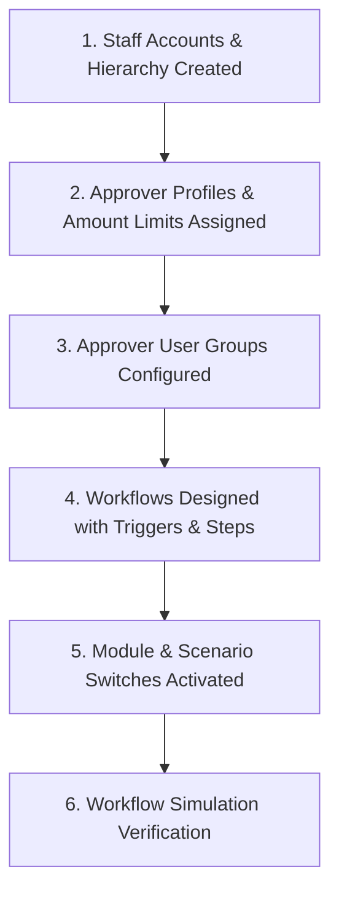
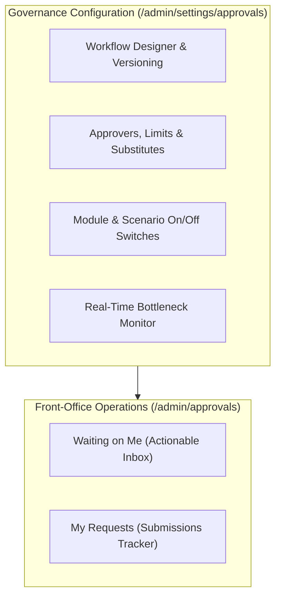

# Guide 12: Approvals & Internal Controls (`/admin/approvals`, `/admin/settings/approvals`)

The **Approvals & Governance** module delivers a zero-code, runtime corporate approval engine inspired by Microsoft Dynamics 365 Business Central. It allows administrators to define, version, simulate, and enforce approval hierarchies across purchase orders, price discounts, sales credit limits, inventory adjustments, and customer refunds—with tiered signing limits, automatic substitute rerouting, and real-time bottleneck monitoring.

---

## 1. Executive Overview & Commercial Value Proposition

### Operational Problems Solved
- **Rigid, Hard-Coded Approval Rules**: In most software, if a board of directors changes the purchase order signing limit from KES 100,000 to KES 250,000, software developers must be paid to rewrite and redeploy code. QSell's approval rules are **100% Runtime Configuration**: administrators change thresholds, add approvers, or toggle approval rules on or off in seconds with zero downtime.
- **Operational Gridlock When Managers Travel**: In traditional organizations, business grinds to a halt when the Managing Director goes on leave or travels abroad without connectivity; urgent purchase orders and customer deliveries sit unapproved. QSell features native **Substitute Approver Chains**: if a designated manager is on leave, requests automatically route to their certified substitute, or escalate to the next qualified manager after a configurable due-time threshold.
- **In-Flight Workflow Corruption**: In legacy systems, editing an approval rule while orders are currently pending either crashes the system or leaves documents in an orphaned "limbo" state. QSell uses **Immutable Versioned Workflows**: active in-flight documents complete under the exact workflow version they started with, while new requests seamlessly use the updated version.
- **Unexplained Approval Rejections**: Managers often reject employee requests without explanation, creating workplace frustration and delayed customer service. QSell enforces **Mandatory Reason Codes and Comments**: an approver cannot click "Reject" without selecting a standardized reason code and providing an explanatory note.

### Target Client Profiles
- **Corporate Enterprises & Institutions**: Requiring strict financial governance and tiered signing authorities (e.g. Supervisor up to KES 50k, Manager up to KES 250k, Director Unlimited).
- **Multi-Branch Retail Chains**: Requiring localized approval hierarchies (e.g. Mombasa store manager approves Mombasa write-offs, while Head Office approves capital expenditures).
- **Audit-Regulated Organizations**: Subject to internal and external financial control audits (ISO 9001, IFRS, Sarbanes-Oxley).

### Commercial Sales Pitch & Talk Track
> *"With QSell, you enforce total financial discipline without slowing down your business. You can set up multi-step approval workflows for large purchase orders, high discounts, or stock write-offs without writing a single line of code. If your Commercial Director is out of office, the system automatically routes the request to their appointed deputy. And our visual Approval Monitor gives you complete visibility over what is waiting on whom, highlighting bottlenecks before they delay a customer."*

### Measurable ROI & Safeguards
- **100% Zero-Code Workflow Maintenance**: Modify signing limits and approvers in seconds without IT developer costs.
- **Zero Document Deadlock**: Automated timeout escalations prevent documents from stalling during executive absence.
- **Complete Governance Audit Trail**: Every approval, rejection, delegation, and escalation is timestamped and permanently logged.

---

## 2. Prerequisites & Configuration Sequence

1. **Staff Directory**: Users must exist under `/admin/users`.
2. **Approver Profiles & Limits**: Configured under `/admin/settings/approvals/approvers` (Assigning signing limits and substitutes).
3. **Approver Groups**: Configured for multi-person approval committees (e.g. *Tender Committee*).
4. **Workflow Designer**: Built under `/admin/settings/approvals/workflows`.
5. **Switches**: Toggled active under `/admin/settings/approvals/switches`.
6. **Required Permissions**: `approvals:act` to approve/reject; `approvals:request` to submit; `approvals:manage` to design workflows.

---

## 3. Module & Sub-Module Architecture

The Approvals engine separates operational tasks from administrative configuration:

### The Four Approver Resolution Types
When a document enters a workflow step, the engine resolves who must act based on one of four rules:
1. **Specific Approver / Group**: Sent directly to a named individual or an ordered user committee (e.g. *"Finance Director"* or *"Tender Committee"*).
2. **Requester's Line Manager**: Sent to the direct supervisor of the person who initiated the document.
3. **Approver Chain by Limit**: Evaluates the requester's supervisor; if the document amount exceeds their signing limit, it automatically climbs to *their* supervisor, and so on until a qualified approver is reached.
4. **First Qualified Approver**: Skips intermediate managers and jumps directly to the first person up the chain whose signing limit covers the document amount.

---

## 4. Interface-by-Interface Walkthrough

### Part A: Front-Office Operations (`/admin/approvals`)

#### 1. Waiting on Me (`/admin/approvals/inbox`)
- The actionable executive queue: Displays all documents currently requiring the logged-in user's approval.
- Summary columns: Document Type (`Purchase Order`, `Sales Order`, `Credit Memo`, `Stock Write-Off`, `Customer Refund`), Document No, Requester Name, Total Amount, Due In / Overdue indicator.
- Action Buttons:
  - **Approve**: Instantly releases the document to the next step or final approved state.
  - **Reject**: Opens mandatory rejection modal requiring a reason code and explanatory note.
  - **Delegate**: Forwards the request to another qualified user or designated substitute.

#### 2. My Requests (`/admin/approvals/requests`)
- Personal submissions tracking: Shows documents submitted by the user that are currently in-flight.
- Shows current step, assigned approver, submission date, and time elapsed.
- Action: **Cancel Request** (withdraws the document back to `Draft` state before an approver acts).

---

### Part B: Governance Configuration (`/admin/settings/approvals`)

#### 3. Workflows (`/admin/settings/approvals/workflows`)
- Visual workflow designer:
  - **Trigger Catalogue**: Select event (e.g. *Purchase Order Released*, *Order Exceeds Credit Limit*, *Stock Count Variance > Threshold*).
  - **Condition Tree Builder**: Build logical rules using `AND` / `OR` blocks (e.g. `Order Amount > KES 100,000 AND Branch = Nairobi`).
  - **Step Sequence Builder**: Add ordered approval steps, assign resolution rules, set due hours, and configure overdue behaviors (*Remind*, *Escalate to Supervisor*, *Auto-Approve*, *Auto-Reject*).
  - **Dry-Run Simulator**: Select a real past document and simulate the workflow in sandbox mode to preview who would be assigned.

#### 4. Approvers & Limits (`/admin/settings/approvals/approvers`)
- Matrix of staff signing authorities:
  - Assign maximum approval limits per document kind (e.g. *John Kamau: PO Limit KES 200,000; Refund Limit KES 20,000*).
  - **Unlimited Checkbox**: For executive directors.
  - **Substitute Approver Picker**: Assign an alternate staff member and activate substitute mode when traveling.

#### 5. Switches (`/admin/settings/approvals/switches`)
- Three-tier on/off control switches:
  1. *Module Switches*: Turn approvals on/off globally for an entire module (e.g. disable all Purchase Order approvals).
  2. *Scenario Switches*: Toggle specific triggers (e.g. enable Order Credit Limit Approvals, but disable Margin Floor Approvals).
  3. *Branch Overrides*: Apply switches to specific branches.

#### 6. Monitor (`/admin/settings/approvals/monitor`)
- Executive bottleneck control room:
  - Lists all approval requests currently in-flight across the entire company.
  - Highlights requests that are overdue against target SLAs.
  - **Reassign Action**: Super Admins can reassign stuck requests to an alternate manager to prevent operational delays.

---

## 5. Granular Field-by-Field Reference

### Workflow Step Fields (`/admin/settings/approvals/workflows/[id]`)

| Field Label | Purpose | Type & Format | Required? | Validation Rules & Hints |
|---|---|---|---|---|
| **Step Sequence** | Execution order. | Integer | System | Re-orderable (1, 2, 3...). |
| **Approver Rule** | How approver is chosen. | Dropdown | **Required** | `Specific User`, `User Group`, `Line Manager`, `Chain by Limit`, `First Qualified`. |
| **Target User / Group**| Selected actor or committee. | Lookup Autocomplete | Required if Specific | Identifies user or group. |
| **Requirement Rule** | Quorum for group steps. | Dropdown | Required if Group | `Any One Member`, `All Members Must Approve`, `N of Group`. |
| **Due After (Hours)** | SLA target window. | Integer (Hours) | **Required** | Number of hours before marked overdue (e.g. `24`). |
| **Overdue Action** | What happens on SLA breach. | Dropdown | **Required** | `Remind Only`, `Escalate to Next in Chain`, `Auto-Approve`, `Auto-Reject`. |
| **Self-Approval** | Can requester approve own request? | Toggle (On/Off) | **Required** | Default `Off`. Enforces strict separation of duties. |

---

## 6. Step-by-Step User Actions (Down to the Last Click)

### Action 1: Reviewing and Approving a Purchase Order in the Inbox
1. The Finance Manager logs in and navigates to `/admin/approvals/inbox`.
2. A badge shows: *"Waiting on Me (1)"*.
3. Click the request: *"Purchase Order #PO-2026-0042 from Acme Supplies (KES 380,000.00)"*.
4. A slide-over drawer opens displaying the full purchase order document, vendor details, and the approval chain history.
5. Inspect the line items and budget availability.
6. Click the green **Approve** button in the header.
7. A confirmation banner displays: *"Purchase Order #PO-2026-0042 approved successfully."*
8. The document transitions to `Approved`, releases for procurement, and vanishes from the manager's pending inbox.

### Action 2: Rejecting a Discount Request with a Mandatory Reason
1. In the inbox, select a Sales Order discount request: *"Order #ORD-1092 - 18% Discretionary Discount"*.
2. The manager determines that 18% wipes out product margin.
3. Click the red **Reject** button.
4. The **Rejection Modal** appears (the action cannot proceed without it):
   - Select **Reason Code**: `Unacceptable Margin Loss`.
   - In the **Mandatory Comment** box, type: *"Maximum allowable discount on this inverter model is 8%. Please revise quote with customer."*
5. Click **Confirm Rejection**.
6. The request status updates to `Rejected`, the sales order reverts to `Draft` state, and an instant alert is sent to the sales representative with the manager's explanation.

### Action 3: Reassigning a Stuck Document via the Approval Monitor
1. A sales order for a priority customer is stuck because the designated Branch Manager is hospitalized.
2. The Operations Director navigates to `/admin/settings/approvals/monitor`.
3. Locate the stuck document, flagged in red: *"Overdue by 42 hours (Assigned to: Peter Mwangi)"*.
4. Click **Reassign Request**.
5. Select **New Approver**: *"Susan Kiprop (Regional General Manager)"*.
6. Enter Reassignment Reason: *"Emergency reassignment due to medical leave of primary approver"*.
7. Click **Confirm Reassignment**.
8. The request instantly transfers to Susan Kiprop's inbox, and the audit log records the emergency reassignment.

---

## 7. Conditions, Business Rules & Edge Cases

### The Self-Approval Block
- By default, `allow_self_approval = false`.
- If a Managing Director creates a Purchase Order, the system detects that `Requester ID == Approver ID` and automatically escalates the document to the Board Chairman or appointed second signatory.

### In-Flight Workflow Immutability
- When a workflow definition is edited and saved, the system creates a new version (e.g. Version 3).
- Any document that was submitted under Version 2 will continue executing through the Version 2 step sequence until completion. New submissions automatically use Version 3.

---

## 8. Implementor Checklist & Go-Live Verification

| Step | Verification Task | Expected Result | Pass/Fail |
|---|---|---|---|
| 1 | Assign approval limit of KES 100,000 to Supervisor and Unlimited to Director. | Limits accurately reflect on Approver Profiles screen. | [ ] |
| 2 | Build a Workflow for Purchase Orders exceeding KES 100,000. | Workflow compiles cleanly with active trigger and steps. | [ ] |
| 3 | Submit a test PO for KES 150,000 as a Buyer. | PO halts in Pending Approval and appears in Director's Inbox. | [ ] |
| 4 | Attempt to reject a request without entering a reason. | System blocks rejection until reason code and comment are provided. | [ ] |
| 5 | Verify Real-Time Approval Monitor. | In-flight request appears with accurate SLA timer countdown. | [ ] |
