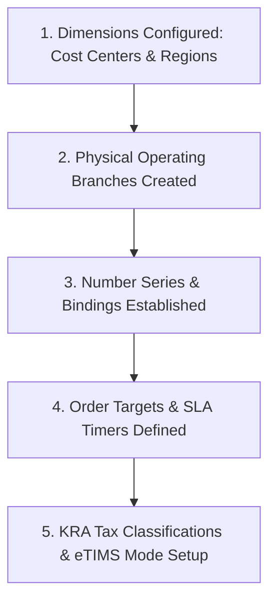
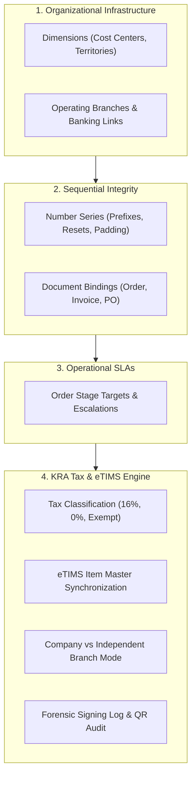

# Guide 13: Settings, Branches, Numbering & KRA eTIMS (`/admin/settings`)

The **Settings & Configuration** module forms the bedrock of the entire enterprise deployment. It governs organizational Dimensions, physical operating Branches, Payment Provider integrations, gapless Number Series engines, Document Number Bindings, Order Stage Target Timers (SLAs), and complete Kenya Revenue Authority (**KRA TIMS & eTIMS**) fiscal compliance.

---

## 1. Executive Overview & Commercial Value Proposition

### Operational Problems Solved
- **The KRA eTIMS Compliance Trap**: Under Kenyan tax law, every B2B and B2C commercial invoice must be validated, digitally signed, and transmitted to the KRA eTIMS system in real time, complete with cryptographic control codes and verification QR codes. Businesses using legacy POS software must buy expensive external hardware "Type C" fiscal boxes (KES 40,000 to KES 80,000 per till) that regularly jam, drop serial connections, and halt store sales. QSell features native **Direct Cloud eTIMS Digital Signing**: no external boxes required; invoices sign in milliseconds via direct API integration.
- **Audit Disasters from Gapped Invoice Numbering**: Tax auditors from the KRA routinely penalize businesses if invoice numbers contain missing gaps (e.g. `INV-0012` followed by `INV-0014` without an explanatory audit trail for `0013`). QSell enforces **Strict Gapless Number Series Engines**: document numbers are reserved transactionally; if a transaction aborts, the gap is tracked or the sequence is preserved cleanly.
- **Multi-Branch Tax Inconsistencies**: A company with branches in Nairobi, Mombasa, and Kisumu may have different physical fiscal devices or branch-specific KRA middleware. QSell supports **Independent Branch Tax Modes**: branches can either inherit the company-wide eTIMS configuration or operate under independent fiscal credentials.
- **Unnoticed Operational Sluggishness**: Orders sit for hours between "Order Placed" and "Picking Started" without anyone noticing. QSell's **Order Target Timers** alert management when any stage exceeds its SLA threshold.

### Target Client Profiles
- **Kenyan Retail & Wholesale Enterprises**: Subject to mandatory KRA eTIMS invoice transmission and VAT compliance.
- **Multi-Branch Retail Chains**: Requiring standardized document numbering (e.g. `INV-NBI-0001` vs `INV-MBA-0001`) and localized branch reporting.
- **SLA-Sensitive Delivery & E-Commerce Merchants**: Guaranteeing customers fast fulfillment and delivery windows.

### Commercial Sales Pitch & Talk Track
> *"With QSell, regulatory tax compliance and enterprise setup are solved out of the box. You do not need to buy expensive, unreliable fiscal gadget boxes for each of your cashiers. Our native KRA eTIMS integration signs and transmits your invoices in the cloud in real time, generating official QR codes on every printed receipt. Furthermore, our gapless number series protect you from tax audit penalties, and our multi-branch architecture lets you scale to 50 stores with complete central visibility."*

### Measurable ROI & Safeguards
- **100% KRA eTIMS Compliance**: Zero risk of non-compliance fines (saving up to KES 1,000,000 per violation).
- **Elimination of Fiscal Box Hardware Costs**: Saves KES 50,000+ per counter till by utilizing software-based cloud signing.
- **Zero Gapless Audit Errors**: Guaranteed sequential numbering satisfies statutory book requirements.

---

## 2. Prerequisites & Configuration Sequence

1. **Dimensions**: Established under `/admin/settings/dimensions` (Optional financial tags).
2. **Branches**: Created under `/admin/settings/branches`.
3. **Number Series**: Formats defined under `/admin/settings/number-series` and bound under `/admin/settings/number-series/bindings`.
4. **Order Targets**: SLA thresholds set under `/admin/settings/order-targets`.
5. **KRA eTIMS Mode**: Configured under `/admin/settings/tax-compliance/kra-tims-etims`.
6. **SMS Provider (optional)**: Connected under `/admin/settings/sms` with the keys the client's own SMS provider gave them (see section 4, item 8).
7. **Required Permissions**: `settings:read/manage`, `branches:read/manage`, `numbering:manage`, `taxes:manage`, `sms:manage` (SMS providers).

---

## 3. Module & Sub-Module Architecture

The Settings module is organized into six administrative domains:

---

## 4. Interface-by-Interface Walkthrough

### 1. Dimensions (`/admin/settings/dimensions`)
- Multi-dimensional reporting axes: Create custom tags (e.g. *Cost Center*, *Department*, *Project*, *Sales Territory*).
- Allows slicing Trial Balance, Sales Reports, and Expense Ledgers by dimension values without cluttering the Chart of Accounts.

### 2. Branches (`/admin/settings/branches`)
- Physical business units:
  - Branch Code (e.g. `BR-NBI-01`), Branch Name (e.g. *"Nairobi Central Depot"*).
  - Physical Street Address, City, County, GPS Coordinates.
  - **Map pin** (the button *Set the map pin for* the branch, needs the permission to manage branches): latitude, longitude and an optional name for the place, from *Use my current location*, typed numbers, or **Look up a place** (type at least three letters, for example *Westlands, Nairobi*, and press *Search* or Enter; the search runs only when you ask, because the free map services do not allow search as you type, and each person may search about 60 times in ten minutes) lists the places the map service knows with a point on the map; choosing one fills the latitude and longitude, which you check before saving. If nothing is found it says so and you can type the numbers. A branch with no pin is left out when the nearest branch is chosen for a delivery.
  - Linked Default Cash Drawer and linked Bank Account.
  - Public Base URL configuration for localized payment gateway webhooks.

### 3. Payments (`/admin/settings/payments`)
- Payment provider configuration:
  - Connect Safaricom M-Pesa Daraja APIs (Shortcode, Consumer Key, Consumer Secret, Passkey, B2C initiator credentials).
  - Connect Card Processors (Pesapal, Bank PGWs).
  - All secrets encrypted with AES-256 GCM sealed storage.

### 4. Number Series (`/admin/settings/number-series`)
- Document sequential engine:
  - Define formats (e.g. Prefix `INV-`, Starting No `00001`, Ending No `99999`, Increment `1`).
  - Configure Yearly Restarts (e.g. resetting sequence to `0001` on January 1st).
  - Enforce Gap-Less Rules for fiscal documents.

### 5. Document Numbering Bindings (`/admin/settings/number-series/bindings`)
- Connects document types to specific number series per branch:
  - *Branch Nairobi*: Invoices bind to series `INV-NBI-`, Quotes bind to `QT-NBI-`.
  - *Branch Mombasa*: Invoices bind to series `INV-MBA-`, Quotes bind to `QT-MBA-`.

### 6. Order Targets & SLA Timers (`/admin/settings/order-targets`)
- SLA management:
  - Define target duration per order stage (e.g. *Picking: Max 45 mins*, *Packing: Max 30 mins*, *Delivery: Max 180 mins*).
  - Configure notification triggers and escalation email alerts when orders languish in a stage.

### 7a. SMS Providers (`/admin/settings/sms`)
Every client sends text messages through their own SMS provider, so the provider is chosen and its keys are typed in here, per business, with nothing built in. The screen has three parts:
- **Add an SMS provider**: choose the **Provider** (*Africa's Talking*, *Twilio*, or *Write to the server log (for trying it out)*). The form then shows exactly the boxes that provider needs, with a hint under each. Give the connection a **Name** (only for you, to tell connections apart) and press **Add the connection**. The first connection added becomes the default at once.
- **Your connections**: one card for each, showing its name, whether it is the **Default: messages go through this**, **In use** or **Stopped**, the provider, and the result of the last test (*Not tested yet*, *Test message accepted by the provider on …*, or the plain reason it did not go).
- Each card has **Send a test message to** (a mobile number, then **Send the test**), **Change …** (opens the same form; the key box is empty and says *saved*, and leaving it empty keeps the key), **Make this the default**, and **Stop using …** (with a confirm step) or **Use it again**.

The keys are sealed when saved, are never shown again (not in the list, not when the connection is opened to change it) and are used only at the moment a message is sent. Which fields are secret is part of each provider's definition. Nothing is sent by the test except a fixed sentence naming the business (*Test message from …: your SMS provider is connected.*), so the button cannot be used to send anything else; the number typed is not kept, and the same connection can be tested once every half minute. A client whose provider is not in the list needs a new adapter built (a development task, not a setting); the screen and everything that sends messages stay as they are.

### 7f. Offline selling (`/admin/settings/sales/offline-selling`)
Whether a **till can keep ringing up cash sales when the connection drops**. Behind its **own permission, *Offline selling: manage***, which **no other permission includes**. **Off by default.**
- **Allow tills to sell with no connection**: the switch. The screen states, next to it, **what switching it on means** (read it to the owner before you switch it on): the customer leaves with a **provisional slip** (the till's own reference, "tax receipt to follow") because a sale with no connection cannot take a number from the gap-free receipt series or be signed with KRA until it is sent; the **customer is charged the list price the till kept** (no discounts, price lists or customers offline) and any difference from today's price is flagged for a supervisor; only **cash sales** can be sold, in a shift opened while online; a sale whose stock is not there is **kept, not lost**.
- **Most to sell offline in one shift (KES)** (built in 50,000) and **Longest an offline sale may wait to be sent (hours)** (built in 24): a sale past either is **refused** when it is sent, with the reason, and kept for a supervisor. The till also stops selling offline when the shift's room is used up.
- **Save** needs a **reason** and is recorded in the decision log (who, from what, to what, why). Tills pick the change up the next time they are made ready (every few minutes while online).
- **Go-live check**: switch it on; open a shift; on *Cash Sales* wait for "Ready to sell with no connection"; open the offline till; disconnect the device; sell something; reload the page (it must still open); reconnect and watch the sale become receipt `RCT-…`; then confirm the shift's X report includes it and the shift closes.

### 7g. Van sales (`/admin/settings/sales/van-sales`)
Switches **van selling** and **pre-selling** on or off and sets the rules every van day follows (customers off the route, what happens to missing stock, the shortage a second person must decide, stock overnight, and where the rep must be). Behind its own permission, ***Van sales: settings***. **Both modes are off by default.** Every field, rule and checklist is in [Guide 16](16-van-sales-and-pre-sales.md).

### 7e. Partial billing (`/admin/settings/sales/partial-billing`)
Whether a **sales order can be invoiced in parts**. Behind its **own permission, *Partial billing: manage*** (in the *Orders & Sales* group), which **no other permission includes**: only people you give it to can switch the feature on or off. **Off by default.**
- **Switch on / Switch off**: asks for a **reason**, records who changed it, from what, to what and why (the decision log), and shows who last changed it. Switching on to what it already is, is refused.
- **What it changes**: when on, a sales order that has no tax invoice yet can be invoiced **in parts** from *Sales invoices* (see the Sales Invoicing guide); when off, an order has one invoice for the whole order. **Turning it off never strands an order**: one already invoiced in parts can still be finished with *Invoice what is left*.
- **Go-live check**: switch it on, raise two part invoices for a test order, confirm the numbers follow the tax invoice series, that each signs with KRA on its own, and that a credit note can be raised against one of them.

### 7d. Registers (`/admin/settings/sales/registers`)
The **tills** of each branch, and how far a till may be out. Behind its own permission (**Registers**, in the *Company & Settings* group); every change needs a reason and is recorded.
- **Tills**: **Add a till** (a name of up to 60 characters, unique within its branch, and the **branch** it is in); **Change** renames it, moves it or switches it off. A till that is *Switched off* cannot have a shift opened on it, and **a till with a shift open cannot be switched off** until that shift is closed. Each row shows whether it is in use and, when a shift is open, **who has it**.
- **How far a till may be out**: an **amount (KES)** and a **percent** of what the till should hold (built in: 100 and 1). A difference at the close up to **either** is only given a reason; a difference beyond **both** needs more than the cashier, in the way chosen next.
- **When a till is out by more than that** (the company chooses; built in: *A supervisor closes it*):
  - **A supervisor closes it**: someone holding the *Shifts: supervise* permission closes the shift on the spot with the reason; the cashier alone is refused with a message saying a supervisor must close it.
  - **It goes to approval**: the cashier counts, gives the reason and the close is **sent to the approval queue**; the shift is **held** (no cash can be put in or taken out, no sale recorded) until it is decided. The decision is made by the workflow you set up in **Approvals** for the trigger *Till shift closed with a difference beyond the allowance* (module Sales): you can route by the size of the difference, the till or the branch, with one or several approvers, and a limit per approver. **Set that workflow up before choosing this**: until one covers the close, a close beyond the allowance is **refused with a message** (the shift stays open) rather than passing unchecked. Approved, the shift closes from exactly the count that was asked about and gets its Z number; rejected (with the approver's words kept) or **withdrawn** by the cashier, the shift is open again so the till can be recounted and the close asked for again.
  - In both choices a supervisor closes **another person's** shift on the spot (they are the second pair of eyes). In the approval choice, a supervisor's **own** shift also goes to the queue. A close within the allowance never needs a supervisor or an approval. Changing the choice needs a reason and is recorded; a close already waiting in the queue is still decided there if the choice is changed meanwhile.
- **Cash account (in the books)** on each till: the cash account (kind *cash*, in Finance, Bank accounts) this till's money is kept in. A difference at the close is written against it.
- **Account for till differences**: an open posting account of the chart (usually an expense such as *Cash over and short*). **At the close of a shift the difference is written to the books**: a **short** till debits this account and credits the till's cash (an expense), an **over** till does the opposite (a gain), and the cash account's own ledger moves by the difference so it agrees with what was counted. It is written **once**; a till that was right writes nothing. The shift is closed and its Z report stands whether or not the books are ready: if the till has no cash account, no difference account is chosen yet, no payment method pays into the cash account, or the period is closed, the difference **waits** (the Z report says why in words) and is **written automatically within minutes of the setting being fixed** (a sweep every five minutes).
- **Z report numbers**: each closed shift is numbered from a gap-free series (kind *Till shift Z report*, per branch, standard pattern `Z-{branch}-{year}-000001`). Set or change its series in Number Series like any other document.

### 7c. Sales (`/admin/settings/sales`): Customer credit, Cash Sales and Selling Documents
Under **Settings & Configuration → Sales**, admins get **Customer credit** (`/admin/settings/sales/customer`), **Cash Sales** (`/admin/settings/sales/cash-sales`) and **Selling documents** (`/admin/settings/selling-documents`, which keeps its old address). Both sit behind **Selling settings** in the *Company & Settings* permission group, and every change needs a reason and is recorded.

- **Customer credit**: **Credit display** is *Running* (show the set limit less the net amount the customer owes) or *Static* (show only the set limit). This changes what staff and shoppers see, never what the system checks. **Proceeding beyond available credit** is off by default; turning it on asks for a reason and goes through an approval workflow when one is configured. With it on, an order that passes the available credit follows an approval workflow when one is configured and is otherwise created. With it off, the normal credit checks and each kind of sale's over-limit rule apply.
- **Cash Sales** (`/admin/settings/sales/cash-sales`): **Counter display**, *Inside the admin page* (the default: the till sits in the admin page with the menu around it) or *Full-screen till* (the till takes the whole screen, with its own slim top bar and an Exit button; best for a tablet or a counter screen). One choice for the whole company; it applies the next time Cash Sales is opened. The same page has **Discounts on the receipt**: *Price charged only* (the default: each item shows the price the customer paid and the receipt shows the total, nothing about a discount), *Total discount at the end* (one **Discount** line just above the total, and **You saved** on the sale-complete window, with everything the customer saved on the sale), or *Discount on each item* (a **Discount** line under each item that had one). It covers discounts typed at the counter and discounts given by pricing rules, never a price that was simply changed, and shows only when a sale really had a discount. It applies to the receipt shown and printed from the next sale. These choices change only how the counter and its receipt look, never what a sale does, so they need only the *Selling settings* permission and no reason; **Save** is switched on once something is changed.
- **Selling documents** set how each kind of staff sale behaves: **Sales orders**, **Credit sales**, **Sales invoices** (a sale invoiced directly, with no sales order) and **Cash sales**. One card per kind says what it is, whether it is **As built in** or **Changed**, and each choice in words.
- **Credit check**: *No credit check*, *Check the credit limit* (the customer's net owed amount plus this document against their limit) or *Check the limit and overdue invoices* (also when an invoice is overdue by more than the days you give). It applies to customers with a credit account; their limit and payment terms stay on the customer.
- **Customer without a credit account**: *Allow*, *Refuse* (only customers with a credit account) or *Require payment first* (they may buy, but the stock is held until they have paid).
- **When over the limit**: *Refuse* (the document is not accepted, whatever approval workflows exist), or *Ask for approval* (the company's approval workflows decide: the document waits, with its stock reserved, until an approver releases or rejects it; if no workflow covers it, it is refused and the message says so).
- **Credit days**: *The customer's payment terms* (the days on their account), *A fixed number of days* for every customer, or *Due on issue*. This sets the due date on the invoice and the customer's ledger.
- **Stock is released**: *When the document is issued*, *When payment is received* (this is "hold until paid", and choosing it on every kind gives **always hold until paid**), or *At delivery or collection*. "Released" means the reserved stock is issued: on-hand falls and the order records the stock-issued stage.
- **Approval**: *By the company's approval workflows* (waits only when a workflow matches) or *Never needs approval* (no document waits for an approver; a price below its floor or a customer over the limit with *Ask for approval* off is then refused, not held).
- **The invoice is made**: *Issued with the document* or *Raised by staff later*.
- **Discounts**: *Staff may discount* or *No discounts* (no coupon codes are taken and no discount rules are applied; the listed price is charged).
- **Discount typed by staff** (every selling document: cash sales, sales orders, credit sales and sales invoices): *Not offered* (nobody types a discount), *At every branch*, or *Only at the branches chosen*. For the last, search and add each branch (they appear as removable chips; at least one is needed, and a branch that is not one of the company's is refused). It applies together with the document's own permission (*Cash sales*, *Sales orders*, *Credit sales* or *Sales invoices*: *offer a discount on an item*): only a person who has the permission, selling at a branch the company allowed, sees the discount button on the line. It is switched off by *No discounts* above, and the discount is still held to the price floors and the person's own override limit. The card summary lists the branches.
- **What works now**: every setting on this screen is applied to every staff sales order, including one made from an accepted quote.
- **When stock is released, in practice**: *When the document is issued*: the reserved stock leaves the shelf at once (an order waiting for approval releases it once approved). *When payment is received*: the stock stays reserved, never lapsing like a shopper's hold, and leaves within a minute of the order being paid by a receipt (the worker checks every minute). *At delivery or collection*: nothing changes: the stock module's own setting (Stock, when stock leaves) decides, as it does for the web shop. The choice is stored on each order when it is placed, so changing the setting later does not alter orders already placed.
- **The invoice**: with *Issued with the document* the tax invoice is made as the document is placed (not while it waits for approval); with *Raised by staff later* nobody is invoiced until staff raise it.
- **Invoice after approval** (shown when the invoice is made with the document and approval goes by the company's workflows): **on by default**. When an approval holds a document, its tax invoice is made **automatically as soon as it is approved** (the document's stock is issued then too, where that is when it leaves). Turn it off and staff raise the invoice from Sales Invoices once the document is approved. The choice is kept on each document when it is placed, so changing it later does not alter documents already waiting.
- **Hold until paid for a single document**: when ticked, staff may switch it on for one document whatever the kind's stock setting says (not offered for cash sales).
- **Cash sales offer no credit**: their credit check, credit days, approval and stock choices are fixed (no credit, due at once, never waits, stock leaves when sold), and they need an open shift.
- **Changing a card**: press **Change**, choose, give a **reason**, **Save**; **Put back as built in** (asks first). It applies to the next document, and every change is recorded with who, when and why. A setting that is missing or damaged behaves as built in, so a sale is never stopped by a bad setting.
- **Not on this screen yet**: the sales screens themselves (they arrive with the Sales Orders, Sales Invoices, Credit Sales and Cash Sales modules), and per-customer rules, which stay on the customer's account.

### 7d. Business Time Zone (`/admin/settings/business-time`)
The time zone the business works in. It decides which **day** a sale or a posting belongs to (so a sale at 1 a.m. on the 1st is in the right month), when the **quiet hours** for text messages start and end, the **hours of a delivery window or a visit** the customer is told, the cut-off for booking a delivery slot, and where a **report's day** begins and ends. Every screen shows its times in this zone, not the computer's or the browser's. It starts as *Africa/Nairobi*, so a company that has never touched it works exactly as before. Behind its own permission (**Business time zone**, *Company & Settings*), given to the Admin role only; nobody else sees the screen or its link.

- **Now**: the zone, how far it is from UTC today (for example *UTC+03:00*) and what the clock reads there at this moment, so you can see at once whether it is the right one.
- **Business time zone** (autocomplete): type a city or region (*Nairobi*, *Tokyo*, *London*) and choose from the list; it is searched as you type. The list is taken from an open list of the world's time zones when it can be reached and from the system's own list when it cannot, so it always works. A name that is not a real time zone cannot be chosen, and the system refuses one that is typed in.
- **Reason** (and a comment, which some reasons require): chosen from the company's list of reasons. Nothing is changed without one.
- **Change the time zone**: asks once ("Yes, change it"). It applies at once to everything made from then on. **Documents already made keep the dates they have**; nothing is rewritten, and a delivery slot's hours (for example 09:00 to 12:00) are hours on the business's own clock, so they move with the zone.
- **Recorded**: who changed it, when, from which zone to which, and why, in the decision log.
- **Times you type and read**: every date-and-time box in the system (a discount's start and end, a price list's "in force from", a rebate, the price check's "as at", a quotation's deadline, a visit, a group order's closing time) is the clock of the business, and its label says *business time*. Dates and times shown on screens, quotes and invoices follow it too, whatever zone the person's own computer or phone is in.
- **Not affected**: the time written to the KRA eTIMS and in M-Pesa messages follows those services' own Kenya-time rules and does not move with this setting.
- **Pitfalls**: change it before go-live, or on a quiet day, and check the clock on the screen afterwards; changing it in the middle of a trading day means that day's documents straddle two zones.

### 7b. Email Routing (`/admin/settings/email-routing`)
Who each business email goes to, and which business emails a quote shows. Behind its own permission (**Email routing**, in the *Company & Settings* group); without it the screen is not in the menu and its pickers refuse.

- **Two lists of cards.** *Emails* (nine places the system writes a mail) and *Business emails shown on quotes* (two lists printed on quote documents). Each card says what it is, whether it is **On/Off**, whether it is **As built in** or **Changed**, and who it goes to now (To, Cc, Bcc, Replies).
- **The emails**: *Web shop quote request, alert to staff*; *Web shop quote request, confirmation to the shopper*; *Quote sent to the customer* (the email staff send with Send via Email, for quotes made by staff and for requests from the web shop); *Web shop order placed* and *paid*, each to the shopper; and **new**, *Web shop order placed* and *paid, alert to staff*, which are **off until you choose who is told**.
- **Built in** (what happens until you change a card): the quote alert goes to the company email in Company Setup; the shopper's mails go to the shopper; the quote email goes to the customer with replies to the company email; the two order alerts to staff are off; quotes show the company email.
- **To, Cc, Bcc, Replies go to (Reply-To)**: each is a list of people; you can add several to each. A person is added by saying **where to find the address**: *A staff member* (pick from active staff accounts; their account email is used and follows any change to it), *The company email* (the address in Company Setup), *A support channel* (an email channel added in Company Setup, Support, for example "Sales desk"), *The customer*, *The staff member who sends it* (whoever pressed Send), *The staff member who made the quote*, or *An address I type* for a one-off. Because it points to where the address lives, changing the company email or a person's email needs no change here.
- **Rules**: an address written to twice is written to once (To wins over Cc, Cc over Bcc); a person who has no active account, a channel that is no longer an email channel, or a customer with no email is skipped and the card shows a warning; a mail that is **On** needs at least one person in *Sent to*; if nobody can be found when it is sent, nothing is sent and the log says why. A list holds at most 20 people.
- **Replies**: *Replies go to* sets the Reply-To of the email, several addresses allowed, so a customer who presses Reply writes to the right people. Replies are not captured inside the system yet (that comes with the CRM).
- **Business emails shown on quotes**: the "Questions? Contact …" emails printed on the quote PDF, the public quote page and the quote email, one list for quotes staff make and one for quotes asked for on the web shop. Empty means the company email. A single quote can have its own list: in the quote editor, **Business contacts shown on this quote** (add people; *Use the company's default contacts* goes back).
- **Changing a card**: press **Change**, edit the lists, choose a **reason**, **Save**. It applies to the next email. **Put back as built in** (asks first) removes your changes. Every change is recorded with who, when and why.

### 7. Tax Compliance & KRA eTIMS (`/admin/settings/tax-compliance`)
The comprehensive regulatory suite divided into five sub-screens:
1. **Tax Classification (`.../classification`)**: Maps company tax categories to official KRA eTIMS tax codes:
   - `Code A`: Standard Rate (16% VAT).
   - `Code B`: Zero-Rated (0% VAT - exports, medicines).
   - `Code C`: Exempt (financial services, unmanufactured agricultural produce).
   - `Code D`: Special / Petroleum (8% Fuel VAT).
2. **eTIMS Items Master (`.../items`)**:
   - Synchronizes product catalog items with KRA's central item registry.
   - Shows registration status, KRA Item Code, packaging unit code, and stock sync status.
   - Action: **Register Item with KRA**, **Update Item**, **Transmit Restock Notification**.
3. **Signing Log (`.../signing-log`)**:
   - Forensic audit trail of every invoice signing attempt.
   - Displays Document No, Timestamp, Result (`Signed`, `Skipped`, `Failed`), KRA Invoice Code, Cryptographic Middleware Signature, and QR URL.
   - For skipped or failed documents, displays exact reason trace (e.g. *"Skipped: Proforma quote is not a tax document"* or *"Failed: KRA VSCU endpoint timeout, retrying via outbox"*).
4. **Company Mode (`.../company`)**: Sets the global default mode: `Disabled`, `TIMS (Hardware Control Unit)`, or `eTIMS (Cloud Digital Signing)`.
5. **Branch Modes (`.../branches`)**: Overrides company mode for specific branches operating independently.

---

## 5. Granular Field-by-Field Reference

### Number Series Form Fields (`/admin/settings/number-series/new`)

| Field Label | Purpose | Type & Format | Required? | Validation Rules & Hints |
|---|---|---|---|---|
| **Series Code** | Identifier for this sequence. | Text (Max 20 chars, uppercase) | **Required** | e.g. `SERIES-INV-2026`. |
| **Description** | Human-readable explanation. | Text (Max 120 chars) | **Required** | e.g. *"2026 Sales Invoices Series"*. |
| **Prefix** | Characters leading the number. | Text (Max 10 chars, uppercase) | **Required** | e.g. `INV-` or `PO-`. |
| **Starting Number** | First sequential integer. | Integer | **Required** | Typically `1` or `1001`. |
| **Ending Number** | Ceiling for this series. | Integer | **Required** | Must be $>$ Starting Number. Generates warning at 95% capacity. |
| **Padding Length** | Total digits with leading zeros. | Integer (1-10) | **Required** | e.g. `5` yields `00001`, `6` yields `000001`. |
| **Allow Gaps** | Can sequence skip cancelled numbers? | Toggle (On/Off) | **Required** | Must be `Off` for KRA tax invoices and credit notes. |

### SMS Provider Fields (`/admin/settings/sms`)

| Field Label | Purpose | Type & Format | Required? | Validation Rules & Hints |
|---|---|---|---|---|
| **Provider** | Which SMS provider this connection is. | Choose from the list | **Required** | Fixed once the connection is added (add another connection to change provider). |
| **Name** | Tells connections apart. | Text (2 to 80 characters) | **Required** | Two connections cannot share a name (capital letters do not matter). |
| **Username** (Africa's Talking) | The username of the client's Africa's Talking app. | Letters, numbers, `.`, `-`, `_` (2 to 40) | **Required** | Use `sandbox` with a sandbox key to try it without sending real messages. |
| **API key** (Africa's Talking) | Lets the system send through the client's account. | Secret text | **Required** when adding; empty keeps the saved key | Sealed when saved; never shown again. |
| **Sender name** (Africa's Talking) | The name people see as the sender. | 3 to 11 letters or numbers, no spaces | Optional | Must be approved by Africa's Talking first, otherwise tests are refused; leave empty to use their shared number. |
| **Account SID** (Twilio) | The client's Twilio account. | `AC` and 32 letters or numbers | **Required** | On the Twilio console home page. |
| **Auth token** (Twilio) | Lets the system send through the account. | Secret text | **Required** when adding; empty keeps the saved token | Sealed when saved; never shown again. |
| **Send from** (Twilio) | The number or service messages leave from. | `+` and the country code, or a messaging service starting `MG` | **Required** | e.g. `+254700000000`. |
| **Send a test message to** | Where the test goes. | A mobile number | Required for a test | `0712 345 678`, `+254712345678` and `254712345678` all mean the same Kenyan number; a number from another country needs its `+` and country code. |

### KRA Tax Classification Fields (`/admin/settings/tax-compliance/.../classification`)

| Field Label | Purpose | Type & Format | Required? | Validation Rules & Hints |
|---|---|---|---|---|
| **Tax Label** | Display name in app. | Text (Max 60 chars) | **Required** | e.g. *"General VAT (16%)"*. |
| **Tax Rate %** | Percentage applied to line. | Percentage | **Required** | e.g. `16.0` or `0.0`. |
| **KRA TIMS Code** | Legacy hardware tax code. | Single Character (`A`-`E`) | **Required** | `A`=16%, `B`=0%, `C`=Exempt, `D`=Other, `E`=8%. |
| **KRA eTIMS Code** | Cloud digital signing code. | Text (Max 10 chars) | **Required** | Standard KRA HS item tax code. |
| **Applies to Delivery**| Does delivery charge take this tax? | Toggle (On/Off) | **Required** | Delivery fee is a service taxed at 16% VAT by default. |

---

## 6. Step-by-Step User Actions (Down to the Last Click)

### Action 00: Telling the right people about quote requests and web shop orders
1. Open **Settings, Email Routing**. 2. On *Web shop quote request: alert to staff* press **Change**, add the sales people under *Sent to* (**A staff member**), the sales desk channel under *Copied*, and the sales manager under *Blind-copied*; set *Replies go to* the sales desk so a customer reply reaches them. Choose a reason and **Save**. 3. Do the same for *Quote sent to the customer* (for example copy **The staff member who sends it** so the sender keeps a copy). 4. Switch on *Web shop order placed, alert to staff* and choose who is told. 5. Place a test web shop order and a test quote request and check each person received it.

### Action 0: Connecting the Client's SMS Provider
1. Open *Settings and configuration > SMS Providers*. (Needs the SMS permission; without it the entry is not shown.)
2. In **Add an SMS provider**, choose the **Provider**. The boxes for that provider appear.
3. Type a **Name** and the boxes the hints ask for, copying the keys from the client's own provider account. Press **Add the connection**. A box filled in wrongly is named in the message and nothing is saved.
4. In the new card, type the implementor's own mobile number under **Send a test message to** and press **Send the test**. Expected: *The test message was accepted by the provider. Check the phone.* and the text arrives. If it does not go, the message says why in plain words (wrong credentials, no balance, sender name not approved, number refused, provider unreachable); correct the connection with **Change …** and test again.
5. With more than one connection, use **Make this the default** on the one messages should go through. Stopping the default leaves no default, and the screen says so: messages cannot be sent until another is chosen.

### Action 1: Creating a Branch-Specific Invoice Number Series
1. Navigate to `/admin/settings/number-series` and click **New Series**.
2. Enter **Series Code**: `INV-MOMBASA-2026`.
3. Enter **Prefix**: `INV-MSA-`.
4. Set **Starting No**: `1`, **Ending No**: `99999`, **Padding Length**: `5`.
5. Set **Allow Gaps**: `Off` (enforcing strict audit compliance).
6. Click **Save Number Series**.
7. Navigate to `/admin/settings/number-series/bindings`.
8. Locate **Document Kind**: `Tax Invoice`, and find **Branch**: *"Mombasa Retail Store"*.
9. In the dropdown, change the binding from Global Series to `INV-MOMBASA-2026`.
10. Click **Save Bindings**. All future invoices generated in Mombasa will print numbers formatted as `INV-MSA-00001`.

### Action 2: Inspecting and Verifying the KRA Invoice Signing Log
1. Navigate to `/admin/settings/tax-compliance/kra-tims-etims/signing-log`.
2. The log renders in chronological order.
3. Locate Invoice #`INV-2026-00412`.
4. Inspect the columns:
   - Result: `Signed` (Green badge).
   - KRA Middleware Signature: `eTIMS-KRA-01928374-AF892B`.
   - Control Code: `0192-8374-AF89`.
5. Click **View Signing Trace**:
   - Gate 1 (Document): PASSED (Tax Invoice).
   - Gate 2 (Scope): PASSED (Company eTIMS Active).
   - Gate 3 (Customer): PASSED (Customer PIN Validated).
   - Gate 4 (Readiness): PASSED (Keys valid, response received in 240ms).
6. Click the **QR Code Preview** link to test that scanning the QR code opens the official KRA tax invoice verification portal page.

---

## 7. Conditions, Business Rules & Edge Cases

### The 7-Gate KRA Invoice Signing Policy
Every invoice generated by the system passes through the **7-Gate Evaluation Policy** in strict order:
1. **Document Gate**: Proforma quotes and draft orders are never signed.
2. **Scope Gate**: Evaluates whether the branch operates under independent mode or company mode.
3. **Mode Gate**: eTIMS or TIMS must be configured for that scope.
4. **Mode Switch Gate**: Signing must be enabled for that mode.
5. **Module Switch Gate**: Invoicing module switch must be active.
6. **Customer Gate**: Checks if customer explicitly opted out (diplomatic missions).
7. **Readiness Gate**: Digital certificates must be valid and unexpired.

*If any gate halts, the document records a `Skipped` or `Failed` event with an explicit reason string. Crucially, a temporary KRA network outage **never halts customer sales**: the invoice is issued locally, and the signing task is queued in the transactional outbox for automated background retry.*

---

## 8. Implementor Checklist & Go-Live Verification

| Step | Verification Task | Expected Result | Pass/Fail |
|---|---|---|---|
| 1 | Create Mombasa and Nairobi branches with unique codes. | Branches appear in branch selection dropdowns across the system. | [ ] |
| 2 | Create sequential gapless Number Series for Invoices and POs. | Numbers increment sequentially without skips. | [ ] |
| 3 | Configure KRA eTIMS Tax Classifications (16% VAT, 0%, Exempt). | Product catalog reflects mapped tax codes accurately. | [ ] |
| 4 | Post a test cash sale invoice and inspect KRA Signing Log. | Document signs successfully; QR code and KRA signature code generated. | [ ] |
| 5 | Verify Order Stage SLA target timers. | Lapsed orders in Packing stage trigger late warning alerts on dashboard. | [ ] |
| 6 | Connect the client's SMS provider and send a test message to the implementor's phone. | The card shows *Default* and *Test message accepted*; the text arrives; reopening the connection shows the key box empty. | [ ] |
| 7 | Open Business Time Zone, confirm the zone and the clock on the screen are right for the client, and (if it was changed) check a new sale and a delivery window read in that zone. | *Now* shows the client's zone and the correct local time; a document made afterwards carries the client's local date. | [ ] |
