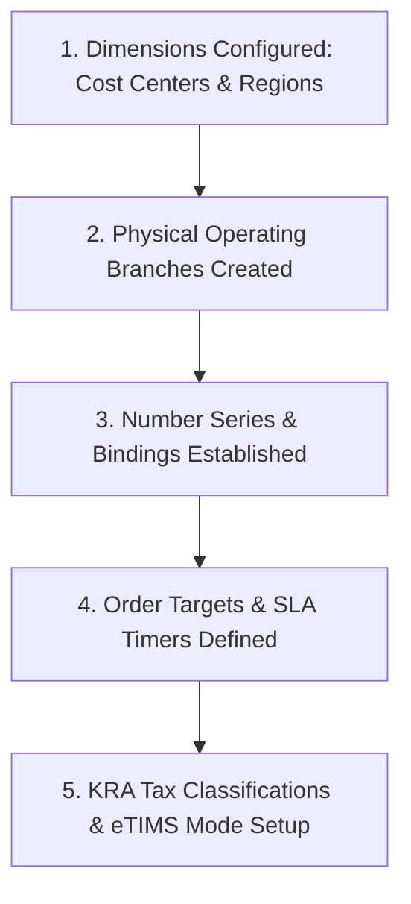
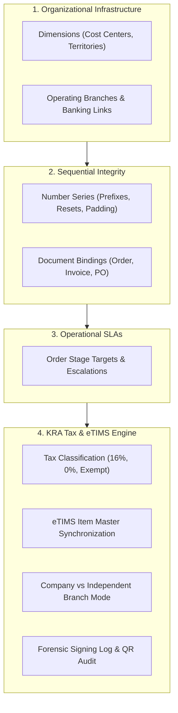

# Guide 13: Settings, Branches, Numbering & KRA eTIMS (`/admin/settings`)

The **Settings & Configuration** module forms the bedrock of the entire enterprise deployment. It governs organizational Dimensions, physical operating Branches, Payment Provider integrations, gapless Number Series engines, Document Number Bindings, Order Stage Target Timers (SLAs), and complete Kenya Revenue Authority (**KRA TIMS & eTIMS**) fiscal compliance.

---

## 1. Executive Overview & Commercial Value Proposition

### Operational Problems Solved
- **The KRA eTIMS Compliance Trap**: Under Kenyan tax law, every B2B and B2C commercial invoice must be validated, digitally signed, and transmitted to the KRA eTIMS system in real time, complete with cryptographic control codes and verification QR codes. Businesses using legacy POS software must buy expensive external hardware "Type C" fiscal boxes (KES 40,000 to KES 80,000 per till) that regularly jam, drop serial connections, and halt store sales. QSell features native **Direct Cloud eTIMS Digital Signing**: no external boxes required; invoices sign in milliseconds via direct API integration.
- **Audit Disasters from Gapped Invoice Numbering**: Tax auditors from the KRA routinely penalize businesses if invoice numbers contain missing gaps (e.g. `INV-0012` followed by `INV-0014` without an explanatory audit trail for `0013`). QSell enforces **Strict Gapless Number Series Engines**: document numbers are reserved transactionally; if a transaction aborts, the gap is tracked or the sequence is preserved cleanly.
- **Multi-Branch Tax Inconsistencies**: A company with branches in Nairobi, Mombasa, and Kisumu may have different physical fiscal devices or branch-specific KRA middleware. QSell supports **Independent Branch Tax Modes**: branches can either inherit the company-wide eTIMS configuration or operate under independent fiscal credentials.
- **Unnoticed Operational Sluggishness**: Orders sit for hours between "Order Placed" and "Picking Started" without anyone noticing. QSell's **Order Target Timers** alert management when any stage exceeds its SLA threshold.

### Target Client Profiles
- **Kenyan Retail & Wholesale Enterprises**: Subject to mandatory KRA eTIMS invoice transmission and VAT compliance.
- **Multi-Branch Retail Chains**: Requiring standardized document numbering (e.g. `INV-NBI-0001` vs `INV-MBA-0001`) and localized branch reporting.
- **SLA-Sensitive Delivery & E-Commerce Merchants**: Guaranteeing customers fast fulfillment and delivery windows.

### Commercial Sales Pitch & Talk Track
> *"With QSell, regulatory tax compliance and enterprise setup are solved out of the box. You do not need to buy expensive, unreliable fiscal gadget boxes for each of your cashiers. Our native KRA eTIMS integration signs and transmits your invoices in the cloud in real time, generating official QR codes on every printed receipt. Furthermore, our gapless number series protect you from tax audit penalties, and our multi-branch architecture lets you scale to 50 stores with complete central visibility."*

### Measurable ROI & Safeguards
- **100% KRA eTIMS Compliance**: Zero risk of non-compliance fines (saving up to KES 1,000,000 per violation).
- **Elimination of Fiscal Box Hardware Costs**: Saves KES 50,000+ per counter till by utilizing software-based cloud signing.
- **Zero Gapless Audit Errors**: Guaranteed sequential numbering satisfies statutory book requirements.

---

## 2. Prerequisites & Configuration Sequence

1. **Dimensions**: Established under `/admin/settings/dimensions` (Optional financial tags).
2. **Branches**: Created under `/admin/settings/branches`.
3. **Number Series**: Formats defined under `/admin/settings/number-series` and bound under `/admin/settings/number-series/bindings`.
4. **Order Targets**: SLA thresholds set under `/admin/settings/order-targets`.
5. **KRA eTIMS Mode**: Configured under `/admin/settings/tax-compliance/kra-tims-etims`.
6. **SMS Provider (optional)**: Connected under `/admin/settings/sms` with the keys the client's own SMS provider gave them (see section 4, item 8).
7. **Required Permissions**: `settings:read/manage`, `branches:read/manage`, `numbering:manage`, `taxes:manage`, `sms:manage` (SMS providers).

---

## 3. Module & Sub-Module Architecture

The Settings module is organized into six administrative domains:

---

## 4. Interface-by-Interface Walkthrough

### 1. Dimensions (`/admin/settings/dimensions`)
- Multi-dimensional reporting axes: Create custom tags (e.g. *Cost Center*, *Department*, *Project*, *Sales Territory*).
- Allows slicing Trial Balance, Sales Reports, and Expense Ledgers by dimension values without cluttering the Chart of Accounts.

### 2. Branches (`/admin/settings/branches`)
- Physical business units:
  - Branch Code (e.g. `BR-NBI-01`), Branch Name (e.g. *"Nairobi Central Depot"*).
  - Physical Street Address, City, County, GPS Coordinates.
  - Linked Default Cash Drawer and linked Bank Account.
  - Public Base URL configuration for localized payment gateway webhooks.

### 3. Payments (`/admin/settings/payments`)
- Payment provider configuration:
  - Connect Safaricom M-Pesa Daraja APIs (Shortcode, Consumer Key, Consumer Secret, Passkey, B2C initiator credentials).
  - Connect Card Processors (Pesapal, Bank PGWs).
  - All secrets encrypted with AES-256 GCM sealed storage.

### 4. Number Series (`/admin/settings/number-series`)
- Document sequential engine:
  - Define formats (e.g. Prefix `INV-`, Starting No `00001`, Ending No `99999`, Increment `1`).
  - Configure Yearly Restarts (e.g. resetting sequence to `0001` on January 1st).
  - Enforce Gap-Less Rules for fiscal documents.

### 5. Document Numbering Bindings (`/admin/settings/number-series/bindings`)
- Connects document types to specific number series per branch:
  - *Branch Nairobi*: Invoices bind to series `INV-NBI-`, Quotes bind to `QT-NBI-`.
  - *Branch Mombasa*: Invoices bind to series `INV-MBA-`, Quotes bind to `QT-MBA-`.

### 6. Order Targets & SLA Timers (`/admin/settings/order-targets`)
- SLA management:
  - Define target duration per order stage (e.g. *Picking: Max 45 mins*, *Packing: Max 30 mins*, *Delivery: Max 180 mins*).
  - Configure notification triggers and escalation email alerts when orders languish in a stage.

### 7a. SMS Providers (`/admin/settings/sms`)
Every client sends text messages through their own SMS provider, so the provider is chosen and its keys are typed in here, per business, with nothing built in. The screen has three parts:
- **Add an SMS provider**: choose the **Provider** (*Africa's Talking*, *Twilio*, or *Write to the server log (for trying it out)*). The form then shows exactly the boxes that provider needs, with a hint under each. Give the connection a **Name** (only for you, to tell connections apart) and press **Add the connection**. The first connection added becomes the default at once.
- **Your connections**: one card for each, showing its name, whether it is the **Default: messages go through this**, **In use** or **Stopped**, the provider, and the result of the last test (*Not tested yet*, *Test message accepted by the provider on …*, or the plain reason it did not go).
- Each card has **Send a test message to** (a mobile number, then **Send the test**), **Change …** (opens the same form; the key box is empty and says *saved*, and leaving it empty keeps the key), **Make this the default**, and **Stop using …** (with a confirm step) or **Use it again**.

The keys are sealed when saved, are never shown again (not in the list, not when the connection is opened to change it) and are used only at the moment a message is sent. Which fields are secret is part of each provider's definition. Nothing is sent by the test except a fixed sentence naming the business (*Test message from …: your SMS provider is connected.*), so the button cannot be used to send anything else; the number typed is not kept, and the same connection can be tested once every half minute. A client whose provider is not in the list needs a new adapter built (a development task, not a setting); the screen and everything that sends messages stay as they are.

### 7. Tax Compliance & KRA eTIMS (`/admin/settings/tax-compliance`)
The comprehensive regulatory suite divided into five sub-screens:
1. **Tax Classification (`.../classification`)**: Maps company tax categories to official KRA eTIMS tax codes:
   - `Code A`: Standard Rate (16% VAT).
   - `Code B`: Zero-Rated (0% VAT - exports, medicines).
   - `Code C`: Exempt (financial services, unmanufactured agricultural produce).
   - `Code D`: Special / Petroleum (8% Fuel VAT).
2. **eTIMS Items Master (`.../items`)**:
   - Synchronizes product catalog items with KRA's central item registry.
   - Shows registration status, KRA Item Code, packaging unit code, and stock sync status.
   - Action: **Register Item with KRA**, **Update Item**, **Transmit Restock Notification**.
3. **Signing Log (`.../signing-log`)**:
   - Forensic audit trail of every invoice signing attempt.
   - Displays Document No, Timestamp, Result (`Signed`, `Skipped`, `Failed`), KRA Invoice Code, Cryptographic Middleware Signature, and QR URL.
   - For skipped or failed documents, displays exact reason trace (e.g. *"Skipped: Proforma quote is not a tax document"* or *"Failed: KRA VSCU endpoint timeout, retrying via outbox"*).
4. **Company Mode (`.../company`)**: Sets the global default mode: `Disabled`, `TIMS (Hardware Control Unit)`, or `eTIMS (Cloud Digital Signing)`.
5. **Branch Modes (`.../branches`)**: Overrides company mode for specific branches operating independently.

---

## 5. Granular Field-by-Field Reference

### Number Series Form Fields (`/admin/settings/number-series/new`)

| Field Label | Purpose | Type & Format | Required? | Validation Rules & Hints |
|---|---|---|---|---|
| **Series Code** | Identifier for this sequence. | Text (Max 20 chars, uppercase) | **Required** | e.g. `SERIES-INV-2026`. |
| **Description** | Human-readable explanation. | Text (Max 120 chars) | **Required** | e.g. *"2026 Sales Invoices Series"*. |
| **Prefix** | Characters leading the number. | Text (Max 10 chars, uppercase) | **Required** | e.g. `INV-` or `PO-`. |
| **Starting Number** | First sequential integer. | Integer | **Required** | Typically `1` or `1001`. |
| **Ending Number** | Ceiling for this series. | Integer | **Required** | Must be $>$ Starting Number. Generates warning at 95% capacity. |
| **Padding Length** | Total digits with leading zeros. | Integer (1-10) | **Required** | e.g. `5` yields `00001`, `6` yields `000001`. |
| **Allow Gaps** | Can sequence skip cancelled numbers? | Toggle (On/Off) | **Required** | Must be `Off` for KRA tax invoices and credit notes. |

### SMS Provider Fields (`/admin/settings/sms`)

| Field Label | Purpose | Type & Format | Required? | Validation Rules & Hints |
|---|---|---|---|---|
| **Provider** | Which SMS provider this connection is. | Choose from the list | **Required** | Fixed once the connection is added (add another connection to change provider). |
| **Name** | Tells connections apart. | Text (2 to 80 characters) | **Required** | Two connections cannot share a name (capital letters do not matter). |
| **Username** (Africa's Talking) | The username of the client's Africa's Talking app. | Letters, numbers, `.`, `-`, `_` (2 to 40) | **Required** | Use `sandbox` with a sandbox key to try it without sending real messages. |
| **API key** (Africa's Talking) | Lets the system send through the client's account. | Secret text | **Required** when adding; empty keeps the saved key | Sealed when saved; never shown again. |
| **Sender name** (Africa's Talking) | The name people see as the sender. | 3 to 11 letters or numbers, no spaces | Optional | Must be approved by Africa's Talking first, otherwise tests are refused; leave empty to use their shared number. |
| **Account SID** (Twilio) | The client's Twilio account. | `AC` and 32 letters or numbers | **Required** | On the Twilio console home page. |
| **Auth token** (Twilio) | Lets the system send through the account. | Secret text | **Required** when adding; empty keeps the saved token | Sealed when saved; never shown again. |
| **Send from** (Twilio) | The number or service messages leave from. | `+` and the country code, or a messaging service starting `MG` | **Required** | e.g. `+254700000000`. |
| **Send a test message to** | Where the test goes. | A mobile number | Required for a test | `0712 345 678`, `+254712345678` and `254712345678` all mean the same Kenyan number; a number from another country needs its `+` and country code. |

### KRA Tax Classification Fields (`/admin/settings/tax-compliance/.../classification`)

| Field Label | Purpose | Type & Format | Required? | Validation Rules & Hints |
|---|---|---|---|---|
| **Tax Label** | Display name in app. | Text (Max 60 chars) | **Required** | e.g. *"General VAT (16%)"*. |
| **Tax Rate %** | Percentage applied to line. | Percentage | **Required** | e.g. `16.0` or `0.0`. |
| **KRA TIMS Code** | Legacy hardware tax code. | Single Character (`A`-`E`) | **Required** | `A`=16%, `B`=0%, `C`=Exempt, `D`=Other, `E`=8%. |
| **KRA eTIMS Code** | Cloud digital signing code. | Text (Max 10 chars) | **Required** | Standard KRA HS item tax code. |
| **Applies to Delivery**| Does delivery charge take this tax? | Toggle (On/Off) | **Required** | Delivery fee is a service taxed at 16% VAT by default. |

---

## 6. Step-by-Step User Actions (Down to the Last Click)

### Action 0: Connecting the Client's SMS Provider
1. Open *Settings and configuration > SMS Providers*. (Needs the SMS permission; without it the entry is not shown.)
2. In **Add an SMS provider**, choose the **Provider**. The boxes for that provider appear.
3. Type a **Name** and the boxes the hints ask for, copying the keys from the client's own provider account. Press **Add the connection**. A box filled in wrongly is named in the message and nothing is saved.
4. In the new card, type the implementor's own mobile number under **Send a test message to** and press **Send the test**. Expected: *The test message was accepted by the provider. Check the phone.* and the text arrives. If it does not go, the message says why in plain words (wrong credentials, no balance, sender name not approved, number refused, provider unreachable); correct the connection with **Change …** and test again.
5. With more than one connection, use **Make this the default** on the one messages should go through. Stopping the default leaves no default, and the screen says so: messages cannot be sent until another is chosen.

### Action 1: Creating a Branch-Specific Invoice Number Series
1. Navigate to `/admin/settings/number-series` and click **New Series**.
2. Enter **Series Code**: `INV-MOMBASA-2026`.
3. Enter **Prefix**: `INV-MSA-`.
4. Set **Starting No**: `1`, **Ending No**: `99999`, **Padding Length**: `5`.
5. Set **Allow Gaps**: `Off` (enforcing strict audit compliance).
6. Click **Save Number Series**.
7. Navigate to `/admin/settings/number-series/bindings`.
8. Locate **Document Kind**: `Tax Invoice`, and find **Branch**: *"Mombasa Retail Store"*.
9. In the dropdown, change the binding from Global Series to `INV-MOMBASA-2026`.
10. Click **Save Bindings**. All future invoices generated in Mombasa will print numbers formatted as `INV-MSA-00001`.

### Action 2: Inspecting and Verifying the KRA Invoice Signing Log
1. Navigate to `/admin/settings/tax-compliance/kra-tims-etims/signing-log`.
2. The log renders in chronological order.
3. Locate Invoice #`INV-2026-00412`.
4. Inspect the columns:
   - Result: `Signed` (Green badge).
   - KRA Middleware Signature: `eTIMS-KRA-01928374-AF892B`.
   - Control Code: `0192-8374-AF89`.
5. Click **View Signing Trace**:
   - Gate 1 (Document): PASSED (Tax Invoice).
   - Gate 2 (Scope): PASSED (Company eTIMS Active).
   - Gate 3 (Customer): PASSED (Customer PIN Validated).
   - Gate 4 (Readiness): PASSED (Keys valid, response received in 240ms).
6. Click the **QR Code Preview** link to test that scanning the QR code opens the official KRA tax invoice verification portal page.

---

## 7. Conditions, Business Rules & Edge Cases

### The 7-Gate KRA Invoice Signing Policy
Every invoice generated by the system passes through the **7-Gate Evaluation Policy** in strict order:
1. **Document Gate**: Proforma quotes and draft orders are never signed.
2. **Scope Gate**: Evaluates whether the branch operates under independent mode or company mode.
3. **Mode Gate**: eTIMS or TIMS must be configured for that scope.
4. **Mode Switch Gate**: Signing must be enabled for that mode.
5. **Module Switch Gate**: Invoicing module switch must be active.
6. **Customer Gate**: Checks if customer explicitly opted out (diplomatic missions).
7. **Readiness Gate**: Digital certificates must be valid and unexpired.

*If any gate halts, the document records a `Skipped` or `Failed` event with an explicit reason string. Crucially, a temporary KRA network outage **never halts customer sales**: the invoice is issued locally, and the signing task is queued in the transactional outbox for automated background retry.*

---

## 8. Implementor Checklist & Go-Live Verification

| Step | Verification Task | Expected Result | Pass/Fail |
|---|---|---|---|
| 1 | Create Mombasa and Nairobi branches with unique codes. | Branches appear in branch selection dropdowns across the system. | [ ] |
| 2 | Create sequential gapless Number Series for Invoices and POs. | Numbers increment sequentially without skips. | [ ] |
| 3 | Configure KRA eTIMS Tax Classifications (16% VAT, 0%, Exempt). | Product catalog reflects mapped tax codes accurately. | [ ] |
| 4 | Post a test cash sale invoice and inspect KRA Signing Log. | Document signs successfully; QR code and KRA signature code generated. | [ ] |
| 5 | Verify Order Stage SLA target timers. | Lapsed orders in Packing stage trigger late warning alerts on dashboard. | [ ] |
| 6 | Connect the client's SMS provider and send a test message to the implementor's phone. | The card shows *Default* and *Test message accepted*; the text arrives; reopening the connection shows the key box empty. | [ ] |
