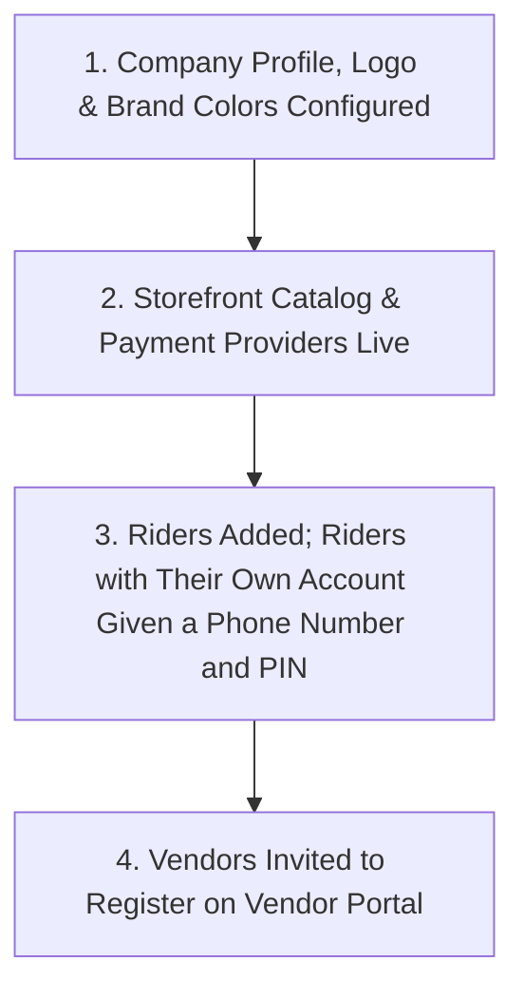
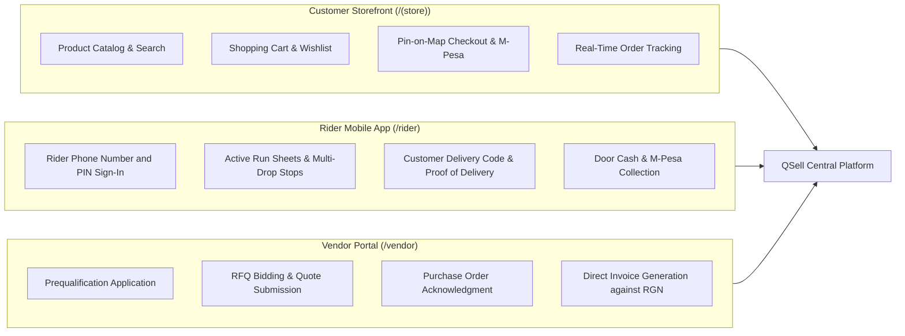

# Guide 14: External & Field Portals (`/(store)`, `/rider`, `/vendor`)

While administrative staff manage operations via `/admin`, QSell delivers three purpose-built external interfaces: the **Customer Web Storefront** (`/(store)`), the **Rider Mobile App** (`/rider`), and the **Vendor Self-Service Portal** (`/vendor`). These portals extend the system's core capabilities directly to shoppers, field delivery crews, and supply chain partners.

---

## 1. Executive Overview & Commercial Value Proposition

### Operational Problems Solved
- **Customer Phone Ordering Friction**: Customers have to call or WhatsApp sales reps to inquire about stock availability, ask for prices, and track their delivery status. The **Customer Storefront** empowers shoppers to browse live stock, calculate exact delivery charges via map pin drops, checkout via M-Pesa, and track their order's timestamped progress in real time.
- **Rider Paper Run Sheets & Misplaced Delivery Notes**: Delivery riders traditionally carry loose paper receipts and invoices on their motorbikes, which get stained by rain, torn, or lost. The **Rider Mobile App** delivers an interactive, mobile-optimized daily run sheet directly to the driver's smartphone, complete with one-tap Google Maps directions, customer phone dialing, and digital proof-of-delivery PIN verification.
- **Supplier Invoice Phone Tag & Lost Invoices**: Suppliers regularly email invoices that get trapped in spam filters or sit forgotten on buyers' desks, resulting in delayed orders and supplier relationship friction. The **Vendor Portal** enables prequalified suppliers to log in, view open RFQs, submit competitive price bids, acknowledge purchase orders, and generate electronic supplier invoices matched directly to Goods Received Notes.

### Target Client Profiles
- **Direct-to-Consumer (D2C) & B2B Web Merchants**: Selling to both retail end-consumers and trade account holders on one unified website.
- **Last-Mile Logistics Fleets**: In-house motorcycle dispatchers, delivery vans, and third-party contract drivers.
- **Multi-Vendor Procurement Networks**: Sourcing materials from tens or hundreds of trade vendors and service contractors.

### Commercial Sales Pitch & Talk Track
> *"With QSell, your business operations connect seamlessly to the outside world. Your customers shop on a fast, modern web store customized with your brand and colors. Your delivery riders carry our dedicated mobile app that guides them stop by stop and verifies deliveries using customer SMS PINs. And your suppliers manage their bids, orders, and invoices in their own private portal—giving you an enterprise ecosystem without paying for external third-party software licenses."*

### Measurable ROI & Safeguards
- **Zero Third-Party Portal Subscription Costs**: Built-in customer storefront, rider dispatch, and vendor portals eliminate separate SaaS subscriptions.
- **100% Secure Tenant Isolation**: External users are cryptographically restricted to their own session records; vendors can never see competing bids or internal staff notes.
- **Paperless Field Operations**: Digital run sheets, doorstep PINs, and electronic delivery notes eliminate paper loss.

---

## 2. Prerequisites & Portal Access Setup

1. **Branding & Gateways**: Storefront appearance, payment providers, and delivery zones must be configured in `/admin`.
2. **Sellable Products**: Catalog items must have `Show on Web Shop = True` and active selling prices.
3. **Rider Logins**: Riders are added under `/admin/delivery/riders`. A rider with an account of their own needs a Kenyan mobile number, and the office gives them a PIN there (see [Guide 06](06-delivery-logistics-and-field-dispatch.md), Action 4). A member of staff who rides signs in with their own email and password.
4. **Vendor Portal Access**: Vendors must receive an invitation link or register at `/vendor/register`.

---

## 3. Architecture of the Three External Surfaces

---

## 4. Interface-by-Interface Walkthrough

### Part A: Customer Web Storefront (`/(store)`)

#### 1. Home & Catalog (`/`)
- Brand header, promotional announcement banners, search bar with live autocomplete, and mega-menu categories.
- Responsive product cards displaying Title, Brand, Star Rating, Price (KES), Unit of Measure, Stock Availability Badge, and **Add to Cart** button.

#### 2. Shopping Cart & Wishlist (`/cart`, `/wishlist`)
- Line item quantity adjusters, subtotal calculation, coupon code entry box, and shipping fee estimator.

#### 3. Checkout (`/checkout`)
- The frictionless, single-page checkout flow:
  1. *Customer Information*: Name, email, mobile phone number.
  2. *Delivery Method & Location*:
     - Choose **Delivery** or **In-Store Pickup / Click & Collect**.
     - Drop a GPS pin on the map or select County $\rightarrow$ Town $\rightarrow$ Estate.
     - System calculates exact delivery fee in real time.
  3. *Payment Selection*: Safaricom M-Pesa STK Push, Credit/Debit Card, or Cash on Delivery.
  4. *Order Submission*: Dispatches M-Pesa prompt directly to customer's phone and transitions to order tracking upon PIN entry.

#### 4. Order Tracking (`/track/[id]`)
- Customer self-service portal: Displays real-time progress bar through the order stage timeline (*Order Confirmed $\rightarrow$ Preparing in Warehouse $\rightarrow$ Out with Rider $\rightarrow$ Delivered*).
- Displays the **delivery code** (6 digits) to give to the rider upon arrival, the promised delivery window until it is delivered, and a link to the courier's own page when a courier handles the parcel.

---

### Part B: Rider Mobile Web App (`/rider`)

#### 1. Rider Sign-In (`/rider/sign-in`, `/rider/pin`)
- Clean, high-contrast mobile interface designed for one-handed operation on low-end smartphones.
- **Sign in** (`/rider/sign-in`) with the rider's **Kenyan mobile number and a 6-digit PIN** (no password to type with gloves on). Opening `/rider` while signed out leads here. A link underneath offers email and password sign-in for staff who ride.
- **Choose your own PIN** (`/rider/pin`): the PIN the office gives is temporary, and the rider must replace it with their own before anything else in the app opens. The same screen (*Change my PIN*) is used later.
- Five wrong tries in a row shut the rider out for a while (15 minutes, growing to 4 hours); the office can let them try again at once. A PIN opens the rider app only, and only for riders with an account of their own.
- **Sign out** is at the top of every screen.

#### 2. Active Run Sheet (`/rider` and a run's own page)
- Displays the assigned multi-drop run for the day:
  - Header: Run Number, Total Stops (e.g. *"Stop 2 of 5"*), Total Cash Float, Total Run Weight.
  - Ordered stop cards: Customer Name, Phone, Delivery Address, Estimated Arrival Time, Payment Method (`Paid Online` vs `Collect KES 3,500 at Door`).
  - Action: **Open Google Maps / Waze Directions**, **Call Customer**.

#### 3. Delivery Confirmation & Door Payment (on a stop of the run)
- Execution of the handover:
  - Input field for the customer's **6-digit delivery code** (when the company's rule at the door asks for it).
  - Door Payment collection confirmation (Cash received or M-Pesa Paybill confirmation code).
  - Digital signature capture or photo upload of delivered parcel.
  - Action: **Confirm Delivery** or **Report Failed Attempt** (with mandatory reason selection).

#### 4. My Pay (`/rider/pay`)
- The rider's own pay: **Owed to me now**, **Earned this month**, the latest 30 pay entries (each *Paid* or *Not paid yet*; pay the office took back shows as *Taken back by the office*) and the latest 10 payouts. A rider sees only their own pay. See [Guide 06](06-delivery-logistics-and-field-dispatch.md).

---

### Part C: Vendor Self-Service Portal (`/vendor`)

#### 1. Registration & Prequalification (`/vendor/register`, `/vendor/prequalification`)
- Supplier onboarding:
  - Complete legal business profile, KRA PIN, physical address, and bank wire details.
  - Select procurement categories applied for (e.g. *Electrical Supplies*, *Solar Inverters*).
  - Upload mandatory compliance documentation (Certificate of Incorporation, KRA Tax Compliance Certificate, CR12).

#### 2. RFQ Bidding Workspace (`/vendor/(portal)/rfqs`)
- View active Requests for Quotation invited to bid on.
- Enter unit prices per line item, lead time in days, payment terms, and validity dates.
- Submit sealed bid before the published round deadline.

#### 3. Purchase Orders & Acknowledgment (`/vendor/(portal)/orders`)
- View official purchase orders issued by the company.
- Download official PDF Purchase Orders.
- Action: **Acknowledge PO** (confirms commitment to deliver by promised date).

#### 4. Supplier Invoicing (`/vendor/(portal)/invoices`)
- Direct electronic invoice submission:
  - Select the matching Goods Received Note (RGN) issued by the warehouse.
  - Type vendor invoice number and attach invoice PDF.
  - Submit directly into the back-office 3-Way Match queue.

#### 5. Withholding Tax Certificates (`/vendor/(portal)/certificates`)
- Self-service tax portal: Suppliers can search by month and download official KRA Withholding VAT and Withholding Tax certificates without calling the accounts department.

---

## 5. Granular Field-by-Field Reference

### Storefront Checkout Fields (`/(store)/checkout`)

| Field Label | Purpose | Type & Format | Required? | Validation Rules & Hints |
|---|---|---|---|---|
| **Full Name** | Recipient identity. | Text (Max 120 chars) | **Required** | Recipient of the package. |
| **Phone Number** | Contact & payment phone. | Phone (Max 25 chars) | **Required** | M-Pesa phone number e.g. `0712345678`. |
| **Delivery Address** | Physical location description. | Text (Max 160 chars) | Required if Delivery | Landmark, estate, apartment/house number. |
| **Map Pin Location** | Exact GPS coordinates. | Map Pin Dropper | Optional | Used for precise distance rate calculation. |
| **Payment Method** | Ingress payment choice. | Radio Selector | **Required** | `M-Pesa STK Push`, `Credit Card`, `Cash on Delivery`. |
| **Customer Order Notes**| Special delivery instructions. | Text (Max 300 chars) | Optional | e.g. *"Call upon arrival at the security gate"*. |

### Rider Proof of Delivery Fields (on a stop of a run)

| Field Label | Purpose | Type & Format | Required? | Validation Rules & Hints |
|---|---|---|---|---|
| **Delivery code** | 6-digit customer security code. | Numeric (6 digits) | Required when the company's rule at the door asks for the code | Matches the code sent to the customer when the delivery left. |
| **Cash Collected** | Monetary sum taken at door. | Currency (KES) | Required if COD | Verified against order balance. Added to rider custody. |
| **M-Pesa Trans ID** | Doorstep M-Pesa receipt code. | Text (10 chars, uppercase) | Required if Door M-Pesa | Valid Safaricom receipt e.g. `QA81273918`. |
| **Recipient Name** | Person accepting parcel. | Text (Max 80 chars) | **Required** | Customer or authorized agent at premises. |

---

## 6. Step-by-Step User Actions (Down to the Last Click)

### Action 1: Shopper Checkout with M-Pesa STK Push
1. A customer browses the storefront, adds a *"Solar Charge Controller"* to the cart, and clicks **Checkout**.
2. Fills in Name and Mobile Phone: `0712 345 678`.
3. Selects **Delivery**: Picks County: *Nairobi*, Estate: *Westlands*. The system quotes delivery fee: `KES 250.00`.
4. Selects **Payment Method**: `M-Pesa STK Push`.
5. Clicks the **Place Order & Pay** button.
6. The screen displays a loading spinner: *"Prompt sent to your phone. Please enter your M-Pesa PIN."*
7. Within 3 seconds, the customer's phone vibrates with the Safaricom STK prompt: *"Do you want to pay KES 4,750.00 to [Company Trading Name]?"*
8. The customer enters their PIN.
9. The checkout screen automatically detects payment confirmation, displays a green success checkmark, and redirects to `/track/[orderId]` displaying the 6-digit delivery code.

### Action 2: Rider Executing a Delivery Stop on Mobile
1. The delivery rider opens `/rider` on their mobile phone and signs in with their phone number and 6-digit PIN (on the first time after the office gives a PIN, they choose their own).
2. The active run sheet displays: *"Stop 1: Jane Wanjiku - Westlands"*.
3. Clicks **Navigate** to open Google Maps turn-by-turn directions.
4. Upon arrival, clicks **I Have Arrived**.
5. Hands the parcel to Jane Wanjiku and asks for her 6-digit delivery code.
6. Types the code (for example `048213`) into the app.
7. Clicks **Complete Delivery**.
8. The app vibrates with a success chime, marks Stop 1 completed, and automatically queues Stop 2.

### Action 3: Vendor Submitting an Electronic Invoice via the Vendor Portal
1. The supplier logs into `/vendor`.
2. Navigates to **Orders & Receipts**.
3. Locates Purchase Order #`PO-2026-0038` and clicks **Create Supplier Invoice**.
4. The system pre-fills the screen with the quantities and prices from Goods Received Note #`RGN-2026-0024`.
5. Types their company's internal invoice number: `INV-SOLAR-8819`.
6. Uploads their signed invoice PDF.
7. Clicks **Submit Invoice to Accounts**.
8. The invoice immediately appears in the back-office queue at `/admin/vendors/invoices` ready for 3-way matching and payment.

---

## 7. Conditions, Business Rules & Security Boundaries

### Strict Vendor Data Isolation
- Vendor Portal users are cryptographically restricted to their own corporate entity:
  - Every database query automatically applies `WHERE vendor_id = session.vendor_id`.
  - Vendors cannot see other vendors, competing bid prices, internal buyer notes, or uninvited RFQs.
  - Passing an arbitrary `vendorId` in the URL or payload is rejected with an instant security exception.

### Rider Cash Custody Block
- If a delivery rider has unremitted cash custody exceeding their maximum allowed cash ceiling (configured per rider under `/admin/delivery/riders`), the system blocks the dispatcher from assigning the rider to new delivery runs until previous cash is reconciled at the cashier desk.

---

## 8. Implementor Checklist & Go-Live Verification

| Step | Verification Task | Expected Result | Pass/Fail |
|---|---|---|---|
| 1 | Complete a storefront checkout using M-Pesa STK Push. | Order created; payment confirmed; customer receives SMS with tracking PIN. | [ ] |
| 2 | Open `/track/[id]` on a mobile browser. | Order stage timeline renders with live milestone indicator and verification PIN. | [ ] |
| 3 | Log into `/rider` on a mobile device using a test rider PIN. | Assigned delivery run sheet renders cleanly with stop sequence. | [ ] |
| 4 | Complete a test delivery stop using verification PIN. | Delivery confirmed; status updates to Delivered across admin and customer tracking. | [ ] |
| 5 | Invite a test supplier to the Vendor Portal. | Supplier registers, accesses open PO, and submits an invoice successfully. | [ ] |
