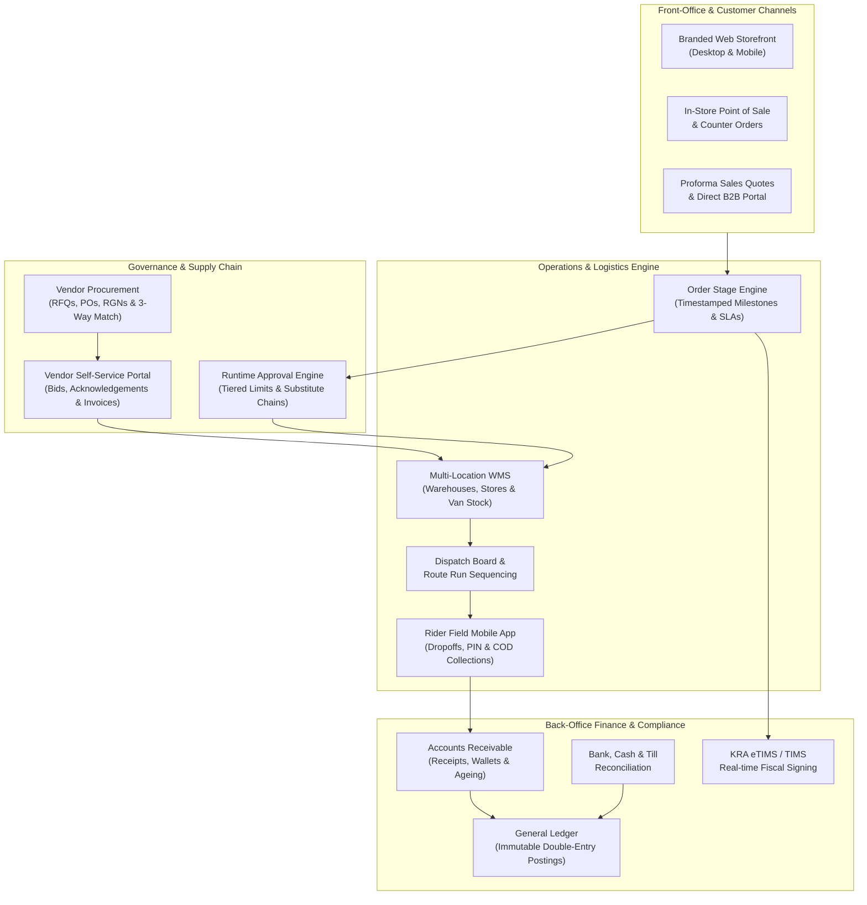
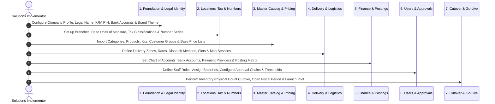

# QSell Enterprise: Master Implementor & Sales Enablement Guide

Welcome to the comprehensive operational manual for **QSell**, an enterprise-grade omnichannel commerce, inventory, route logistics, procurement, core double-entry accounting, and regulatory compliance platform.

This documentation suite is engineered specifically for **System Implementors** deploying and configuring customer organizations, and **Sales Team Members & Solutions Consultants** communicating the platform's value proposition, commercial return on investment (ROI), and competitive advantages to prospective businesses.

---

## 1. System Architecture from a Business Perspective

QSell replaces fragmented point solutions (separate e-commerce plugins, manual POS registers, disconnected spreadsheets, third-party courier dispatch apps, and standalone accounting software) with one unified, real-time operating system.

### The Six Operational Pillars

1. **Omnichannel Demand Capture**: Unifies online storefront transactions, walk-in counter sales, telephone orders, and negotiated B2B proforma quotes into a single consolidated order stream.
2. **Immutable Inventory & Location Ledger**: Tracks stock movements across central warehouses, regional retail stores, and mobile delivery vans in real time using true double-entry stock transactions with zero silent overrides.
3. **End-to-End Route Logistics & Door Collections**: Manages localized delivery zones, dynamic delivery fee calculation (by distance, weight, or flat fee), rider dispatch runs, and reconciled Cash-on-Delivery (COD) or M-Pesa collections at the doorstep.
4. **Controlled Procurement & Accounts Payable**: Streamlines requests for quotation (RFQs), purchase orders, Goods Received Notes (RGN), landed cost apportionments, and automated 3-way invoice matching.
5. **Core Financial Ledger & Receivables**: Posts financial journals, customer payments, credit balances, foreign currency revaluations, and trial balances without batch delays.
6. **Regulatory Compliance by Design**: Native integration with Kenya Revenue Authority (KRA) TIMS and eTIMS protocols, ensuring every invoice and credit note is cryptographically signed and QR-coded before dispatch.

---

## 2. Complete Module Directory

| Manual | Module Name | Primary Administrative Route | Core Business Function |
|---|---|---|---|
| [**Guide 01**](01-business-overview-and-dashboard.md) | Business Overview & Dashboard | `/admin` | Executive KPI monitoring, real-time revenue, order velocities, branch rankings, and profit telemetry. |
| [**Guide 02**](02-company-setup-and-storefront.md) | Company Setup & Brand Identity | `/admin/company` | Legal identity, KRA PIN, document layouts, brand themes, promotional banners, and customer guarantees. |
| [**Guide 03**](03-sales-quotes-and-customer-orders.md) | Sales Quotes & Customer Orders | `/admin/sales` | Proforma quotation generation, order stage tracking, customer master cards, credit limits, and SLA monitoring. |
| [**Guide 04**](04-pricing-engine-promotions-and-margins.md) | Pricing Engine & Promotions | `/admin/pricing` | Customer group pricing, tiered volume breaks, coupons, rebates, loyalty points, margin floors, and price simulators. |
| [**Guide 05**](05-products-catalog-and-inventory-control.md) | Products Catalog & Inventory | `/admin/catalog`, `/admin/inventory` | SKU catalog, units of measure, kits/hampers, multi-warehouse stock, in-transit transfers, and live cycle counts. |
| [**Guide 06**](06-delivery-logistics-and-field-dispatch.md) | Delivery Logistics & Field Dispatch | `/admin/delivery` | Polygon delivery zones, dispatch boards, rider run sequencing, COD reconciliation, late SLA alerts, and 3PL courier APIs. |
| [**Guide 07**](07-users-roles-and-access-governance.md) | Users, Roles & Access Governance | `/admin/users` | Staff directory, branch bindings, role templates, atomic permissions, and contextual ABAC security policies. |
| [**Guide 08**](08-projects-and-job-costing.md) | Projects & Job Costing | `/admin/projects` | Job budgeting, material/labor tracking, milestone invoicing, customer sign-offs, and project profitability. |
| [**Guide 09**](09-vendor-management-procurement-and-payables.md) | Vendor Management & Procurement | `/admin/vendors` | Supplier prequalification, RFQs, purchase orders, 3-way invoice matching, landed costs, and WHT certificates. |
| [**Guide 10**](10-finance-general-ledger-and-accounts-receivable.md) | Finance, General Ledger & AR | `/admin/finance` | Chart of accounts, general journals, posting matrix, trial balance, customer receipts, store credit wallets, and FX revaluation. |
| [**Guide 11**](11-banking-cash-and-payment-gateways.md) | Banking, Cash & Payment Gateways | `/admin/finance/bank-accounts`, `/admin/payments` | Bank accounts, statement CSV reconciliations, cashier till counts, M-Pesa Bill Manager, and gateway audit logs. |
| [**Guide 12**](12-approvals-and-internal-controls.md) | Approvals & Internal Controls | `/admin/approvals`, `/admin/settings/approvals` | Runtime workflow builder, threshold limits, substitute approvers, scenario switches, and stuck request reassignment. |
| [**Guide 13**](13-settings-branches-numbering-and-kra-etims.md) | Settings, Branches & KRA eTIMS | `/admin/settings` | Operating branches, dimensions, gapless number series, stage SLA targets, and KRA eTIMS tax classification setup. |
| [**Guide 14**](14-external-portals-customer-rider-vendor.md) | External & Field Portals | `/(store)`, `/rider`, `/vendor` | Branded web shop checkout, rider mobile run sheet & PIN verification, and supplier quotation/invoice self-service. |

---

## 3. End-to-End Implementation Project Lifecycle

When rolling out QSell for a new client organization, implementors must follow this strict **7-stage deployment sequence**. Configuring modules out of order leads to blocked transactions and missing lookup dependencies.

### Stage 1: Foundation & Legal Identity
- **Actions**: Complete Company Profile ([Guide 02](02-company-setup-and-storefront.md)), upload high-resolution logo, set legal trading name, register corporate KRA PIN, address, telephone, email, and primary bank details.
- **Verification**: Preview invoice and receipt document layouts to ensure legal headers format correctly.

### Stage 2: Locations, Tax & Numbering Series
- **Actions**: Define physical operating branches ([Guide 13](13-settings-branches-numbering-and-kra-etims.md)). Configure Units of Measure ([Guide 05](05-products-catalog-and-inventory-control.md)). Map KRA Tax Classifications (16% General VAT, 0% Zero-rated, 8% Fuel, Exempt). Establish gapless Number Series for Orders, Invoices, Receipts, and POs.
- **Verification**: Test number series generation to ensure sequence formatting matches company conventions (e.g., `INV-2026-00001`).

### Stage 3: Master Catalog, Stock Locations & Pricing
- **Actions**: Create stock locations (warehouses, shops, dispatch vehicles). Establish category trees. Import SKUs with barcodes, weights, and dimensions. Build Kits & Hampers. Establish Customer Groups (Retail, Wholesale, Trade). Build Price Lists with quantity breaks and minimum price floors ([Guide 04](04-pricing-engine-promotions-and-margins.md)).
- **Verification**: Run the Price Check Simulator (`/admin/pricing/check`) on sample products to confirm margin floors and quantity discounts calculate properly.

### Stage 4: Delivery Zones & Logistics Setup
- **Actions**: Configure delivery zones using postal towns or map polygon boundaries ([Guide 06](06-delivery-logistics-and-field-dispatch.md)). Configure rate cards (flat, weight-based, distance-based). Define delivery time slots and daily capacity caps. Connect courier APIs or create in-house rider profiles.
- **Verification**: Enter a test address in checkout or counter order to verify the exact zone, fee, and delivery time slot are assigned.

### Stage 5: Finance, Banking & Gateways
- **Actions**: Set up Chart of Accounts ([Guide 10](10-finance-general-ledger-and-accounts-receivable.md)). Configure General Ledger Posting Setup matrix. Set up commercial bank accounts and cash drawers ([Guide 11](11-banking-cash-and-payment-gateways.md)). Integrate Safaricom M-Pesa Daraja APIs (Paybill/Till) and card payment gateways.
- **Verification**: Execute a test KES 10.00 M-Pesa STK Push payment and confirm automatic transaction ledger recording and settlement allocation.

### Stage 6: Users, Security & Approval Controls
- **Actions**: Configure user accounts for staff members ([Guide 07](07-users-roles-and-access-governance.md)). Assign specific branches and roles (Cashier, Storekeeper, Dispatcher, Sales Rep, Accountant, Branch Manager). Build Approval Workflows ([Guide 12](12-approvals-and-internal-controls.md)) for high-value purchase orders, below-floor price overrides, and customer refunds.
- **Verification**: Submit a purchase order exceeding a test user's signing limit and verify that the document halts in "Pending Approval" state and routes to the designated manager's inbox.

### Stage 7: Cutover, Ledger Initialization & Go-Live
- **Actions**: Lock legacy systems. Execute the Stock Ledger Cutover wizard ([Guide 05](05-products-catalog-and-inventory-control.md)), importing physical on-hand inventory balances location by location. Post opening customer debit balances and vendor accounts payable balances. Open the active fiscal period.
- **Verification**: Print the Trial Balance and Stock Valuation reports and reconcile them to the client's certified opening balance sheet.

---

## 4. Sales Onboarding Curriculum (2-Week Mastery Track)

New commercial sales representatives and solutions consultants must complete this 10-day structured onboarding program to achieve fluency in pitching, demoing, and defending QSell against competing software.

### Week 1: Core Commerce, Inventory & Logistics Operations

- **Day 1: Platform Vision & The Modern African Business Reality**
  - Read: [Guide 01 (Dashboard)](01-business-overview-and-dashboard.md) and [Guide 02 (Company Setup)](02-company-setup-and-storefront.md).
  - Key Topic: Why traditional international ERPs fail in East Africa (lack of native M-Pesa, complex KRA eTIMS integrations, poor road network support, lack of door cash reconciliation).
  - Practice: Configure a mock company profile, logo, and document layout in under 15 minutes.

- **Day 2: The Omnichannel Sales Journey & Order Blueprint**
  - Read: [Guide 03 (Sales & Orders)](03-sales-quotes-and-customer-orders.md).
  - Key Topic: Walk prospects through the journey from Web Storefront / Counter Order $\rightarrow$ Order Confirmed $\rightarrow$ Picking $\rightarrow$ Packing $\rightarrow$ Dispatched $\rightarrow$ Delivered.
  - Practice: Issue a proforma quote, email it to a prospect, convert it into a confirmed order, and explain the timestamped stage audit trail.

- **Day 3: Intelligent Pricing, Margin Protection & Promotions**
  - Read: [Guide 04 (Pricing Engine)](04-pricing-engine-promotions-and-margins.md).
  - Key Topic: How QSell eliminates rogue discounting and protects operating margins using price floors and role-based override limits.
  - Practice: Use the Price Check Simulator to explain a complex pricing waterfall (Customer Group + Quantity Break + Active Promo Code - Margin Floor Lock).

- **Day 4: Inventory Control, Multi-Location WMS & Stock Integrity**
  - Read: [Guide 05 (Products & Inventory)](05-products-catalog-and-inventory-control.md).
  - Key Topic: How QSell stops inventory theft and phantom stockouts across multiple branches and mobile vans.
  - Practice: Execute a stock transfer from Central Warehouse to a Van, demonstrate in-transit tracking, and conduct a cycle count that continues while cashiers sell.

- **Day 5: Delivery Logistics, Dispatch & Cash on Delivery (COD)**
  - Read: [Guide 06 (Delivery)](06-delivery-logistics-and-field-dispatch.md) and [Guide 14 (Rider Portal)](14-external-portals-customer-rider-vendor.md).
  - Key Topic: How QSell solves the last-mile delivery nightmare: pin-on-map zoning, rider run sheets, doorstep PIN verification, and door payment reconciliation.
  - Practice: Plan a 3-stop delivery run on the Dispatch Board, open the Rider Mobile App, complete a dropoff, and reconcile cash collected at the counter.

### Week 2: Procurement, Finance, Compliance & Executive Pitching

- **Day 6: Vendor Management & 3-Way Match Procurement**
  - Read: [Guide 09 (Vendor Management)](09-vendor-management-procurement-and-payables.md).
  - Key Topic: Preventing procurement fraud through public RFQ bidding, Purchase Order approvals, Goods Received Notes (RGN), and automated 3-way matching.
  - Practice: Issue an RFQ, submit a vendor bid through the Vendor Portal, generate a Purchase Order, receive partial goods, and book the supplier invoice.

- **Day 7: Double-Entry Financial Accounting & Receivables**
  - Read: [Guide 10 (Finance & AR)](10-finance-general-ledger-and-accounts-receivable.md) and [Guide 11 (Banking & Payments)](11-banking-cash-and-payment-gateways.md).
  - Key Topic: Why CFOs love QSell: real-time general ledger postings, automated sales/stock sync, customer store credit wallets, and bank CSV reconciliation.
  - Practice: Post a general journal, receive a customer payment, allocate it across three invoices, and inspect the real-time Trial Balance.

- **Day 8: Regulatory Compliance: KRA eTIMS & Tax Architecture**
  - Read: [Guide 13 (Settings & KRA eTIMS)](13-settings-branches-numbering-and-kra-etims.md).
  - Key Topic: Turning KRA compliance into a sales superpower: zero external fiscal boxes required, automated digital invoice signing, and item synchronization.
  - Practice: Explain the difference between TIMS (hardware device) and eTIMS (cloud digital signing) and demonstrate how an invoice receives its cryptographic signature.

- **Day 9: Governance, Approvals & Enterprise Access Control**
  - Read: [Guide 07 (Users & Roles)](07-users-roles-and-access-governance.md) and [Guide 12 (Approvals)](12-approvals-and-internal-controls.md).
  - Key Topic: Corporate governance: separation of duties, tiered financial limits, substitute approvers during leave, and complete audit trail.
  - Practice: Configure an approval rule for orders over KES 100,000, trigger an approval request, reject with a reason, and show the audit trail.

- **Day 10: The Master Executive Pitch & Competitive Objections**
  - Read: [Guide 08 (Projects)](08-projects-and-job-costing.md) and review all Value Proposition sections.
  - Key Topic: Delivering the 30-minute C-suite pitch to a CEO and CFO; handling objections regarding data migration, staff training, and software reliability.
  - Final Exercise: Deliver a full end-to-end platform demo and answer 5 live prospect objections.
